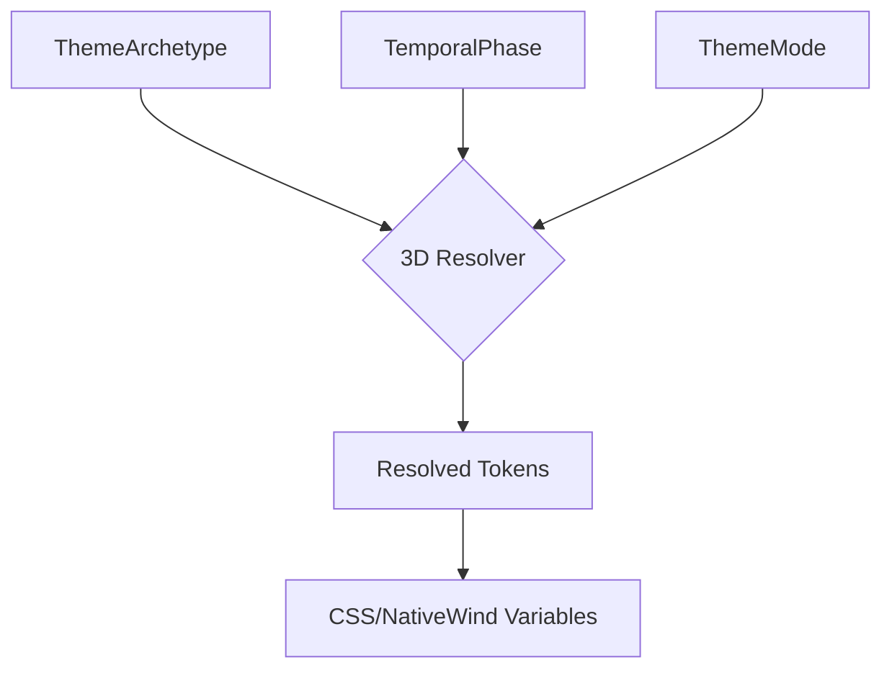

# Gurudevi Multi-Archetype Engine
### The 3D Theme Matrix Architecture
*Decoupling Identity (Archetype), Time (Phase), and Mode (Luminance)*

---

## 0. The Vision
The Gurudevi platform avoids the "SaaS Grey" trap by treating UI design as a living, breathing entity. To support diverse user personas while maintaining a "Zero-Legacy" codebase, we use a **3D Theme Matrix**.

This allows the UI to answer three questions simultaneously:
1.  **Who am I?** (Archetype: Classic, Young, Girl)
2.  **When am I?** (Phase: Predawn, Midday, Dusk, etc.)
3.  **How am I?** (Mode: Light vs Dark)

---

## 1. The 3D Matrix Logic
The theme system resolves tokens through three dimensions:

### Dimension A: Archetype (Identity)
- `sanctuary`: The internal "Classic" vibe. High-fidelity, vellum-based, sacred feel.
- `starlight`: The "Young" vibe. Vibrant, sapphire/amber accents, high energy.
- `lotus`: The "Girl/Soft" vibe. Pastel-biased, lotus-pink and lavender accents.

### Dimension B: Phase (Time)
Six temporal states (`predawn`, `dawn`, `morning`, `afternoon`, `dusk`, `night`) that modulate atmospheric colors (gradients, glass, glows).

### Dimension C: Mode (Luminance)
Standard `light` vs `dark` toggle, handled as the final leaf in the matrix.

---

## 2. Maintenance Protocol
**The "Rule of Two Files"**: To prevent architectural drift, follow these protocols when modifying the design system.

### How to change a color
**Edit exactly ONE file**: `packages/ui/src/theme/Theme.ts`.
- Find the `sanctuaryMatrix`, `starlightMatrix`, or specific override logic.
- Change the hex code.
- **Result**: Every component on Web and Mobile updates instantly. No `.tsx` files are touched.

### How to add a new Archetype (e.g., "Business")
1.  **Update Types**: Add `'business'` to `ThemeArchetype` in `packages/ui/src/context/types.ts`.
2.  **Define Logic**: Add a `businessMatrix` in `Theme.ts` (using the `createVariation` helpers or a full manual matrix).
3.  **Register**: Add it to the `archetypeMatrix` vault in `Theme.ts`.
- **Result**: The "Business" vibe is now selectable in the app settings.

---

## 3. Implementation Details
The system resolves tokens into **Stable Semantic Variables**. Components should NEVER consume raw hex codes; they should consume variables that represent *meaning*.

| Variable Name | Description |
| :--- | :--- |
| `--phase-accent` | The primary brand/action color for the current vibe/time. |
| `--phase-world` | The base "Ground" color of the scene. |
| `--phase-surface` | The primary material layer. |
| `--phase-text-primary` | The WCAG-compliant primary text. |

---

## 4. Why this matters (Zero-Legacy)
By keeping the UI "Style-Blind," we achieve:
- **Instant Global Refactoring**: Change the whole app's look in 5 minutes.
- **Multi-Platform Parity**: Web and Mobile use the exact same bridge logic.
- **Persona Targeting**: Serve a "Young" vibe to students and a "Sanctuary" vibe to teachers using the same components.

---

*Document version 1.0 — April 2026*
*Gurudevi Living Theme System*
