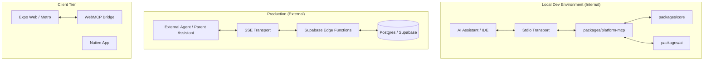

# RFC: Polymath Agentic Layer (PAL) - Model Context Protocol Strategy

**Author**: Senior Platform Architect (Antigravity)  
**Status**: Draft / For Review  
**Date**: April 16, 2026

## 1. Executive Summary
The "Polymath Agentic Layer" (PAL) is an architectural shift from a GUI-first platform to an **Agent-Native ecosystem**. By implementing the Model Context Protocol (MCP), we expose our core business logic as structured "Tools" and "Resources" for AI agents. This transition reduces the entropy of our modular monorepo and positions Gurudevi as a headless capability provider. We leverage **Zenstack v3** to ensure that our agent tools are natively synchronized with our database schema and security policies.

## 2. Theoretical Framework

### 2.1 Maxwell’s Demon (The Developer Productivity Layer)
In the current monorepo state, agents (like coding assistants) spend significant complexity budget navigating 23+ packages. PAL introduces an **Internal MCP Server** to "sort" this entropy, providing the agent with direct, tool-based access to domain logic without full filesystem scans.

### 2.2 Laplace’s Demon (The Platform Interoperability Layer)
We predict a deterministic future where 90% of platform interactions are mediated by agents. PAL introduces **External MCP Servers** (SSE via Supabase) to serve as the "Universal Interface" for third-party agents, replacing traditional REST/GraphQL as the primary integration path.

---

## 3. System Architecture

---

## 4. Internal vs. External MCP

### 4.1 Internal MCP (Phase 1)
*   **Transport**: `stdio`
*   **Security**: Inherits local developer permissions. High-trust environment.
*   **Primary Goal**: Increase developer velocity. Enable the agent to run migrations, audit data, and coordinate logic across modules.
*   **Capabilities**:
    *   `db_audit`: Validate identity facets in the database.
    *   `fix_circular_deps`: Analyze and refactor barrel files.
    *   `run_domain_logic`: Execute functions from `@repo/core` to verify state.

### 4.2 External MCP (Phase 2)
*   **Transport**: `sse` (Server-Sent Events)
*   **Security**: Supabase Auth + JWT + Row Level Security (RLS). Zero-trust environment.
*   **Primary Goal**: External interoperability.
*   **Capabilities**:
    *   `get_student_summary`: Authorized summary of student performance.
    *   `submit_relief_proposal`: Allow agents to suggest scheduling changes.

---

## 5. Technical Constraints & Reality Check

### 5.1 The "Prompt Tax" (Context Limits)
Enterprise MCP servers must be modular. Loading all tools at once exhausts the LLM's context window.
*   **Mitigation**: **Discriminative Tool Loading**. The server should expose a "Registry" that only loads relevant sub-tools based on the active domain (e.g., `classroom`, `finance`, `admin`).

### 5.2 Schema Drift (The Zenstack Advantage)
Latency and versioning between the MCP definitions and the underlying TS logic in `packages/core`.
*   **Constraint**: We MUST use **Zenstack v3** as the definition layer. Zenstack automatically generates Zod schemas from the `schema.zmodel`, ensuring that our agent's understanding of the data perfecty matches the database constraints and RLS policies.

### 5.3 Security (The "Destructive Intent" Problem)
Internal MCP has write access to the filesystem.
*   **Requirement**: "Human-in-the-loop" approval for any tool marked as `destructive: true`.

---

## 6. Requirements & BOM (Bill of Materials)

| Category | Item | Requirement |
| :--- | :--- | :--- |
| **SDK** | `@modelcontextprotocol/sdk` | Core protocol implementation. |
| **Validation** | `zod` | Strong typing for Tool inputs/outputs. |
| **Registry** | `packages/mcp-server` | New monorepo package. |
| **Infrastructure** | Node.js (Local) / Deno (Edge) | Standard execution environments. |
| **Auth** | Supabase Service Role / Anon Keys | Permission management. |

---

## 7. Implementation Roadmap

### Phase 1: Foundations (Week 1)
*   [ ] Initialize `packages/mcp-server` (Internal).
*   [ ] Map `TimetableScheduler` and `ReliefCoordinator` as the first Tools.
*   [ ] Configure Stdio transport for local testing in Claude/Cursor.

### Phase 2: Web Context (Week 2)
*   [ ] Implement a lightweight `WebMCP` bridge in the Expo Web build to share UI state.

### Phase 3: Production Scale (Month 1)
*   [ ] Port internal tools to Supabase Edge Functions with RLS integration.

---

## 8. Open Questions
1.  **Transport Priority**: Do we need to support browser-based agents immediately (requiring SSE/Proxy) or is Stdio sufficient for the current dev workflow?
2.  **Auth Scope**: Should the MCP server act as a "God User" (Service Role) or strictly impersonate the active user session?
3.  **Discovery**: How will we register the tools across different packages (`self`, `classroom`, `people`) to ensure a unified registry?
