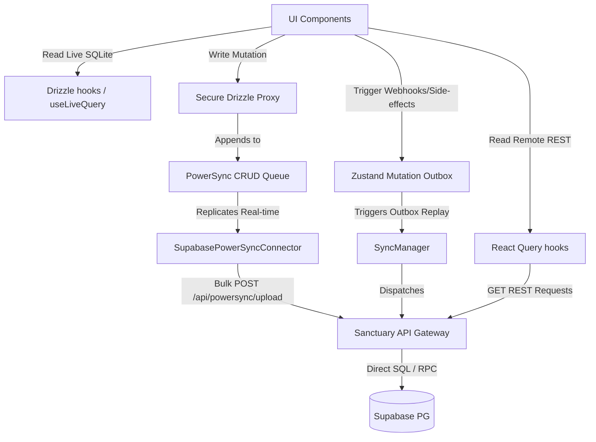

# 🌿 Audit Report: Data Synchronization & Flow Alignment
> **Status**: Active  
> **Timestamp**: 2026-06-13  
> **Scope**: `gurudevi-mobile` & `@repo/core`  
> **Key Technologies**: TanStack Query (React Query), PowerSync (SQLite + SQLCipher), TanStack Pacer, Drizzle ORM

---

## 🏛️ 1. Current Architectural Topology

The codebase uses a **dual-lane synchronization model** to manage state, queries, and replication:



### 1.1 Lane A: Local-First (Offline-Survivable Core)
Used for critical classroom features: **attendance, students, classrooms, mood logs, grading, and workspace layouts**.
* **Read Path**: Fetched from local SQLite using Drizzle compile-time queries piped through `@powersync/react-native`'s reactive subscription engine. Updates automatically whenever local or sync transactions modify the underlying tables.
* **Write Path**: Intercepted by the `SecureDrizzleProxy` for local Cedar role-based permissions validation, written to SQLite locally (optimistic UI render), and placed in the PowerSync queue for real-time background sync to Sanctuary API `/api/powersync/upload`.

### 1.2 Lane B: Online-Only (Sovereign Network REST Queries)
Used for social and community features: **announcements, circles, posts, comments, voting, and report mutations**.
* **Read Path**: Fetched directly from Sanctuary API endpoints using TanStack React Query (`useQuery` / `useInfiniteQuery`).
* **Write Path**: Executed directly over the network via React Query `useMutation` hooks calling the HTTP REST API clients.

### 1.3 Lane C: Coordination & Timing Control (TanStack Pacer)
Acts as the gatekeeper between the SQLite trigger stream and React Query invalidation routines:
* **useThrottledInvalidate**: Throttles invalidation events to prevent Metro bridge congestion during heavy real-time SQLite sync streams.
* **useDebouncedValue**: Debounces state properties (e.g. search terms) to limit query invocations.

---

## ⚠️ 2. Risk Matrix & Alignment Gaps

### 🚨 Risk 1: The "Dual-Rail" Consistency Mismatch (Race Condition)
When a user modifies a local record (e.g. updating a classroom lesson detail) and immediately navigates to a screen that loads that collection's status via a React Query REST endpoint (such as a dashboard query), a race condition occurs:
1. PowerSync connector queues the mutation local-first.
2. The user navigates to the dashboard, triggering React Query to fetch the collection status from Sanctuary API.
3. If the PowerSync sync loop is still processing or offline, the Sanctuary API serves **stale data** from Supabase.
4. **Result**: The UI temporarily reverts to the stale online state (screen flash) until the local PowerSync sync batch finishes, causing visual jarring and confusion of truth.

### 🚨 Risk 2: Thread Congestion during Offline-to-Online Recovery
When a device reconnects after a long offline period:
1. PowerSync streams down bulk updates to SQLite.
2. If React Query has multiple queries active with short `staleTime` defaults, it will trigger concurrent REST API requests.
3. At the same time, `SyncManager` begins replaying the Zustand Mutation Outbox.
4. **Result**: SQLite write locks, excessive JS rendering thread cycles (layout thrashing), and network bandwidth competition on patchy cell signals.

### 🚨 Risk 3: Lack of Offline Resilience in "Online-Only" Community Modules
The community module (`community.hooks.ts`) relies purely on standard network-bound React Query hooks. 
* **Current Behavior**: If the app is offline, opening the community screen fails with raw HTTP exceptions or blank states.
* **Result**: While we accept that community writes require the network, the *read cache* of previously downloaded posts/circles is lost on app restart unless an offline persister is configured.

---

## 🛠️ 3. Concrete Alignment Recommendations

To align these layers and prevent synchronization disasters, we should implement the following mitigations:

### 3.1 Setup React Query Offline Persistence (MMKV Persister)
Introduce `@tanstack/react-query-persist-client` and configure a persister using our MMKV storage layer (already present in the mobile project). This ensures that fully online screens (like Community) can instantly hydrate the UI with cached data while offline, rather than failing immediately.

*Proposed Implementation:*
```typescript
import { persistQueryClient } from '@tanstack/react-query-persist-client';
import { createSyncStoragePersister } from '@tanstack/query-sync-storage-persister';
import { MMKV } from 'react-native-mmkv';

const storage = new MMKV({ id: 'react-query-cache' });

const clientPersister = createSyncStoragePersister({
  storage: {
    getItem: (key) => storage.getString(key) ?? null,
    setItem: (key, value) => storage.set(key, value),
    removeItem: (key) => storage.delete(key),
  },
});

persistQueryClient({
  queryClient,
  persister: clientPersister,
  maxAge: 1000 * 60 * 60 * 24 * 7, // 7 days cache
});
```

### 3.2 Establish Clear Data Ownership Boundaries
* **Read Boundary**: If a table is synced via PowerSync, the UI must **never** read it via React Query REST requests. It should use `useDrizzleQuery` or `useLiveQuery`. This eliminates the read race condition.
* **Write Boundary**: All mutations on PowerSync tables must go through the local-first Drizzle ORM client to leverage `SecureDrizzleProxy` and the PowerSync write queue. REST mutations should be strictly reserved for non-offline data (like casting poll votes or posting reactions).

### 3.3 Link PowerSync Sync Status to React Query Refetches
We should leverage `SovereignBus` event streams to intelligently control React Query refetch states:
* Pause React Query background refetches when PowerSync is in the middle of a heavy sync phase (`powersync:syncing`).
* Trigger invalidations/refetches only after `powersync:sync_complete` emits, ensuring React Query always sees the latest server state.
