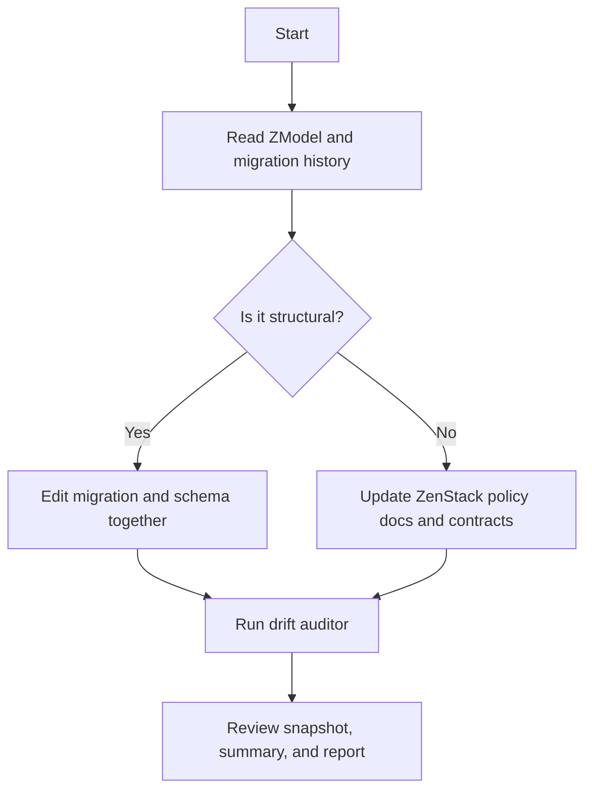

# Agent Database Governance Checklist

## Scouting

Before making any database or policy changes:

1. Read [`packages/schema/schema.zmodel`](/C:/Users/Naween/projects/polymath-platform/packages/schema/schema.zmodel).
2. Inspect [`apps/gurudevi-mobile/supabase/migrations`](/C:/Users/Naween/projects/polymath-platform/apps/gurudevi-mobile/supabase/migrations).
3. Check [`apps/gurudevi-mobile/supabase/migration_status.md`](/C:/Users/Naween/projects/polymath-platform/apps/gurudevi-mobile/supabase/migration_status.md).
4. Review [`apps/gurudevi-mobile/supabase/SSOT_SYNC_PLAN.md`](/C:/Users/Naween/projects/polymath-platform/apps/gurudevi-mobile/supabase/SSOT_SYNC_PLAN.md).
5. Run `node scripts/check-database-drift.mjs`.
6. Inspect the generated files in `apps/gurudevi-mobile/reports/db-drift/`.

## Decision Tree

## Change Rules

- If the change affects tables, columns, indexes, triggers, or functions, update the Supabase migration history.
- If the change affects ownership, tenancy, or access semantics, update ZenStack policies first.
- If both layers are affected, update both in the same work session.
- Never assume `@@allow` or `@@deny` is enough by itself.
- Never assume RLS is enough by itself.
- Never declare success from compilation alone.

## Verification

Before merge:

- `zenstack generate` succeeds.
- migrations are named with valid 14-digit timestamps.
- the drift auditor runs successfully.
- the generated snapshot and summary are reviewed.
- any intentional ignore entry is documented.
- any policy-sensitive change has an updated architecture note.

## Output Expectations

Every serious DB or auth change should leave behind:

- one dated audit doc
- one policy contract update if semantics changed
- one drift snapshot and summary from the auditor
- one remediation plan if drift remains

