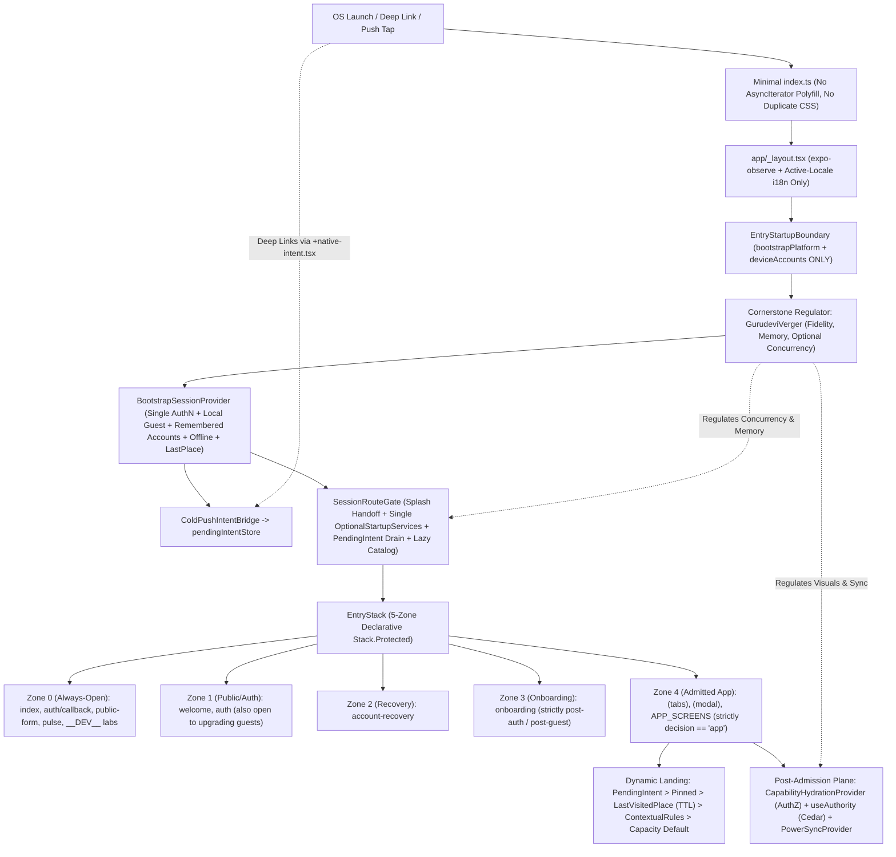

# Gurudevi Mobile Startup, Routing, AuthN & AuthZ Reconstruction

A retrospective and reference guide documenting the four-iteration reconstruction of `apps/gurudevi-mobile`'s startup, routing, authentication (AuthN), authorization (AuthZ), and dynamic landing architecture, together with the underlying 2026 engineering patterns and remaining follow-up horizon.

---

## 1. Iteration-by-Iteration Summary of Changes

### Iteration 1 — Structural Audit & Verger Recalibration
- **What we found:** `SessionRouteGate` acted as a 6-way "God component"; `useBootstrapRouteState` ran in three places (`SessionRouteGate`, `app/welcome.tsx`, `app/onboarding.tsx`), duplicating local guest restoration effects and `useEntitlementQuery` network calls; `OptionalStartupServices` mounted twice; `EntryStack` had only one `Stack.Protected` boolean while leaving `welcome`, `auth`, `onboarding`, and `account-recovery` unguarded.
- **Key architectural correction:** Elevated **Verger (`GurudeviVerger`)** to its proper place as the cornerstone runtime regulator governing `WorldStage` visual fidelity, memory reclamation, optional startup concurrency, and post-admission background work.
- **Empirical baseline (`audit:route-bundles` + `audit:tree-shaking`):** Measured `10.35 MB` minified Android route bundles (`4,746` modules) and missing `sideEffects: false` / broad `effect` imports. Preserved all packages under the Deletion Veto pending dedicated experimentation.

### Iteration 2 — Phase 1, Phase 2 & Cold-Start TTI Quick Wins
- **Single source of truth:** Introduced [BootstrapSessionProvider.tsx](../../src/entry/BootstrapSessionProvider.tsx) above `SessionRouteGate` and migrated [welcome.tsx](../../app/welcome.tsx) and [onboarding.tsx](../../app/onboarding.tsx) to read-only `useBootstrapSession()`.
- **AuthZ decoupled from AuthN admission:** Replaced `useEntitlementQuery` in [bootstrapRouteState.ts](../../src/entry/bootstrapRouteState.ts) with a read-only TanStack Query cache check (`queryClient.getQueryData(entitlementQueryKey(...))`), making `CapabilityHydrationProvider` the sole entitlement fetcher (post-admission).
- **Service deduplication:** Removed the duplicate `<OptionalStartupServices phase="public-ready" />` from [EntryShell.tsx](../../src/entry/EntryShell.tsx); `SessionRouteGate` owns the single phase-aware instance.
- **TTI critical-path reductions (for 2 GB Android):**
  - Made `loadCatalog` optional in [startupCoordinator.ts](../../src/boot/startupCoordinator.ts) and deferred `registerAppCatalog()` (`@repo/self`, `@repo/ai`, `@repo/form-builder`, `@repo/workforce`, `mobileMediaAdapters`) off [EntryStartupBoundary.tsx](../../src/entry/EntryStartupBoundary.tsx) to run once upon app admission (cloud + local guest).
  - Changed [src/i18n/config.ts](../../src/i18n/config.ts) to load only `en.json` + the device's active locale on cold boot, lazy-loading other locales on `languageChanged`.
  - Moved `@azure/core-asynciterator-polyfill` out of [index.ts](../../index.ts) into [PowerSyncProvider.tsx](../../src/providers/PowerSyncProvider.tsx), removed duplicate `@repo/ui/global.css` from `index.ts`, and made web adapters dynamic imports inside [packages/core/src/native/bootstrap.ts](../../../../packages/core/src/native/bootstrap.ts).

### Iteration 3 — Declarative 5-Zone `Stack.Protected` Router Graph
- **Multi-branch route graph:** Expanded [entryAccess.tsx](../../src/entry/entryAccess.tsx) and `EntryStack` in [EntryShell.tsx](../../src/entry/EntryShell.tsx) into **5 explicit zones** (`Always-Open`, `Public/Auth`, `Recovery`, `Onboarding`, `Admitted App`) using Expo Router 58's `<Stack.Protected guard={...} redirectTo={...}>`.
- **Strict booting isolation:** Tightened `admitsAppRoutes(decision)` in [bootstrapRoutes.ts](../../../../packages/core/src/logic/auth/bootstrapRoutes.ts) to strictly `decision === 'app'`, ensuring `(tabs)` and `PowerSyncProvider` never mount during `booting`.
- **Multi-account & guest-upgrade fixes:**
  - Fed `hasRememberedAccounts` (`deviceAccounts.list()`) into the entry policy so signed-out returning devices land on `/auth` (account picker + PIN) while fresh installs land on `/welcome`.
  - Fixed a bug where admitted device-local guests were bounced off `/auth` instead of being allowed to upgrade to a cloud account.
  - Made `onboarding.tsx` passive (removed hardcoded `router.replace('/self')`) and added `useRefreshLocalGuest()` so the router graph handles completion transitions cleanly.

### Iteration 4 — Post-Auth Onboarding, Configurable Dynamic Landing & Cold-Start Push
- **Onboarding is never standalone:** Removed `/onboarding` from `isPublicPath` and `isPublicBootstrapRoute` in [bootstrapRoutes.ts](../../../../packages/core/src/logic/auth/bootstrapRoutes.ts); Zone 3 (`onboardingRoutes`) is now strictly `decision === 'onboarding'` (only reachable after cloud AuthN or explicit local/anonymous guest activation).
- **Offline expired-token continuity:** Added `isOfflineWithVerifiedProfile` in [bootstrapContract.ts](../../../../packages/core/src/logic/auth/bootstrapContract.ts) and [bootstrapRouteState.ts](../../src/entry/bootstrapRouteState.ts) so an offline user with a verified local profile is never logged out just because their JWT expired while offline.
- **Configurable dynamic landing policy:** Created [landingPolicy.ts](../../../../packages/core/src/logic/places/landingPolicy.ts) (`DEFAULT_LANDING_POLICY` with configurable `lastPlaceMaxAgeMs` and pluggable `contextualRules`) and [lastVisitedPlace.ts](../../src/entry/lastVisitedPlace.ts) (`useTrackLastVisitedPlace()` in [app/(tabs)/_layout.tsx](../../app/(tabs)/_layout.tsx)), scoped per `accountId + bondId`.
- **Cold-start push intent bridge:** Added [ColdPushIntentBridge.tsx](../../src/entry/ColdPushIntentBridge.tsx) to capture `Notifications.getLastNotificationResponseAsync()` and live notification taps into `pendingIntentStore` without requesting push permissions on launch.

---

## 2. Final System Architecture Graph

---

## 3. Core Architectural Patterns & 2026 Industry Alignment

The changes we made converge on **7 well-established architectural patterns** backed by current mobile engineering best practices:

### Pattern 1: Functional Core, Imperative Shell
- **Principle:** Keep all routing, admission, and landing rules in pure, framework-free functions (`bootstrapContract.ts`, `bootstrapRoutes.ts`, `landingPolicy.ts`, `entryAccess.tsx`) that take immutable state + injected time (`now`) and return deterministic decisions. Keep side effects (storage I/O, Supabase listeners, Expo Router, SplashScreen, Notifications) in a thin imperative shell (`BootstrapSessionProvider`, `SessionRouteGate`, `ColdPushIntentBridge`).
- **Why it works:** Pure policy functions run in milliseconds in Vitest (G1) with zero native mocks, making multi-account, guest-upgrade, offline, and edge-case matrices exhaustively testable.

### Pattern 2: Declarative Finite-State Router Graph (`Stack.Protected`)
- **Principle:** Treat navigation availability as a **declarative projection of lifecycle phase** rather than imperative `useEffect` redirect chains scattered across screens.
- **Why it works:** Expo Router 58's `<Stack.Protected guard={...} redirectTo={...}>` automatically unmounts disallowed branches and cleans the back stack when state transitions (eliminating Android back-button traps after onboarding or sign-out). Screens remain passive and only trigger domain actions.
- **Gotcha to watch:** Always declare every top-level route inside its explicit zone (including `__DEV__` groups like `(dev)`), because Expo Router's `Stack` mounts undeclared routes outside `Stack.Protected`.

### Pattern 3: Strict AuthN vs. AuthZ Separation (Fail-Closed Post-Admission)
- **Principle:** **Authentication & Onboarding** determine *which router zone* is open. **Authorization** (commercial entitlements + Cedar capabilities) hydrates *after* admission and controls *what features/actions* are offered inside the app (`useAuthority()`), failing closed while loading.
- **Security invariant:** Client-side route guards and authority snapshots are for UX and surface hygiene only; true authorization is always enforced cryptographically on the server (Sanctuary API / RLS / Cedar).

### Pattern 4: Offline-First Optimistic Cold Start
- **Principle:** Never block cold-start rendering on a remote network handshake, and never log out an offline user whose local JWT has expired when their remembered local identity is verified.
- **Why it works:** On intermittent Sri Lankan school/rural networks, trusting verified local identity (`isOfflineWithVerifiedProfile`) lets teachers and students enter local-first SQLite/outbox mode immediately and refresh tokens silently when connectivity returns.

### Pattern 5: Temporal-Decay & Policy-Driven Dynamic Landing
- **Principle:** Follow Apple HIG / Material Design UX guidance on **temporal decay** instead of blind "always restore" or "always reset":
  - Within a configurable staleness window (`DEFAULT_LANDING_POLICY.lastPlaceMaxAgeMs`, default 4 hours), resume the user's **last visited top-level Place floor** (scoped per `accountId + bondId`).
  - Beyond the window, evaluate pluggable `contextualRules` (e.g., future circadian/school-hours or remote-config rules) before falling back to capacity defaults.
- **Anti-patterns avoided:** Never serialize raw React Navigation state trees into AsyncStorage (conflicts with Expo Router URLs, deep links, and Android activity recreation), and never persist modals, settings, or transactional forms as cold-start landing targets.

### Pattern 6: Stage-Gated Lazy Loading Under One Regulator (Verger)
- **Principle:** Separate **critical foreground boot** (storage, crypto, runtime registry, device accounts) from **post-admission work** (domain catalogs, non-active locale JSONs, PowerSync polyfills, Google One Tap, analytics).
- **Why it works:** On 2 GB Android devices, deferring non-public modules until after first paint directly reduces JS evaluation time and peak Hermes heap before TTI—while keeping **Verger** as the single regulator of optional concurrency and memory pressure.

### Pattern 7: Unified Ingress Funnel (`PendingIntentQueue`)
- **Principle:** Every external ingress vector—OS deep links (`+native-intent.tsx`), cold-start push taps (`ColdPushIntentBridge`), and foreground notification taps—validates through `checkInternalHref` and writes into one `pendingIntentStore`, drained once by `SessionRouteGate` after `decision === 'app'`.
- **Why it works:** Eliminates dual-brain races where deep links or push notifications fire before auth hydrates or while the user is still on `/onboarding`.

---

## 4. Verification Baseline (2026-11-25)

- **`@repo/core` Type Check (`tsc --noEmit`)**: `0` errors.
- **`gurudevi-mobile` Type Check (`tsc --noEmit` on `src/entry/` & `app/(tabs)/_layout.tsx`)**: `0` errors.
- **`@repo/core` Vitest (G1)**: `3/3` files, `24/24` tests passing (`admitsAppRoutes`, `bootstrapRoutes`, `landingPolicy`).
- **`gurudevi-mobile` Vitest (G1)**: `7/7` files, `52/52` tests passing (`entryAccess`, `SessionRouteGate`, `entryNavigation`, `bootstrap-contract`, `entry-shell-service-recovery`, `startup-coordinator`, `app-bootstrap-hydration`).
- **Oxlint (`.oxlintrc.react.json`)**: `0` warnings, `0` errors across all modified/new files.

---

## 5. Remaining Follow-Up Horizon

1. **Synchronous Cold-Start Storage Benchmark (`MMKV v4` vs `AsyncStorage`)**: Benchmark `EXPO_PUBLIC_USE_MMKV=true` (`react-native-mmkv 4.3.2` on Nitro) on a 2 GB Android release build now that boot-path contention has been reduced—synchronous JSI reads eliminate the remaining async cold-start waterfall.
2. **Contextual Landing Policies (`contextualRules`)**: Plug in circadian / school-hours or remote-config landing rules into `DEFAULT_LANDING_POLICY.contextualRules` when product policy is finalized.
3. **Verger-Gated OTA & Version Check**: Wire a single post-TTI `expo-updates` (`checkForUpdateAsync`) and `useVersionGatingStore` check inside `OptionalStartupServices` governed by `snapshot.optionalConcurrency > 0`.
4. **PIN / Biometric Resume Lock**: Add an `AppLockOverlay` for PIN-enabled device accounts when returning from background past lock timeout.
5. **Bundle Sourcemap Breakdown**: Inspect the `10.35 MB` Android route bundle sourcemap to quantify per-package byte weights before making icon-adapter, Skia, gradient, map, or web-dependency decisions.
