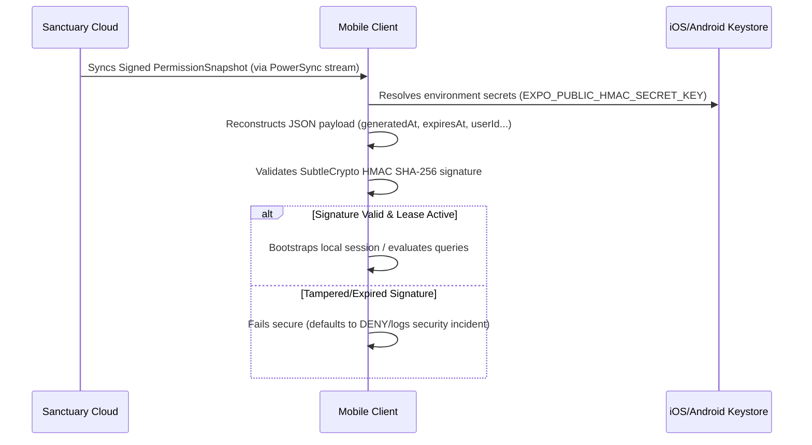

# Offline Security & Resilience Architecture Blueprint

This document specifies the threat models, security architecture patterns, and fail-safe bounds for the Gurudevi offline-first application. It serves as the authoritative guide for verifying system compliance with enterprise-grade cybersecurity standards.

---

## 1. Threat Model & Mitigation Matrix

| Threat Vector | Source / Target | Likelihood / Impact | Mitigation Strategy | Status / Enforcement |
| :--- | :--- | :--- | :--- | :--- |
| **Local Write Injection** | Rooted Android/iOS filesystem modification directly to SQLite. | Medium / High | **Secure Drizzle Proxy Wrapper** intercepting all write mutations (`insert`, `update`, `delete`) combined with **Server-Side Gateway PEP** validation. | Implemented & Active ([database.ts](file:///c:/Users/Naween/projects/polymath-platform/packages/core/src/adapters/powersync/database.ts)) |
| **Identity Swapping / Hijacking** | Copying valid HMAC snapshots from one user context into another client database. | Low / High | **Identity Matching Constraint**: Reconstructed payload forces `userId` comparison against active JWT session context. | Implemented & Active ([localEvaluator.native.ts](file:///c:/Users/Naween/projects/polymath-platform/packages/core/src/logic/permissions/localEvaluator.native.ts)) |
| **Payload Tampering** | Modifying offline policy files or snapshot maps to force permissions. | Medium / High | **SubtleCrypto HMAC SHA-256 Signature Verification** executing on every snapshot database load. | Implemented & Active ([signature.ts](file:///c:/Users/Naween/projects/polymath-platform/packages/core/src/logic/permissions/signature.ts)) |
| **Denial of Service (Memory Exhaustion)** | Overwhelming low-end devices by compiling very large Cedar rules. | Medium / Low | **Max Policy Size Bound**: Strict limits (`MAX_LOCAL_POLICY_SIZE_BYTES = 100KB`) on compiled policy payloads. | Implemented & Active ([localEvaluator.native.ts](file:///c:/Users/Naween/projects/polymath-platform/packages/core/src/logic/permissions/localEvaluator.native.ts)) |
| **Database Theft at Rest** | forensic dumps of SQL data from stolen physical storage. | High / High | **SQLCipher AES-256 Encryption** using dynamic, hardware-backed keys resolved from iOS Keychain or Android Keystore. | Native Standard |

---

## 2. Dynamic Secret Management

HMAC signature validation uses the `TextEncoder` and `crypto.subtle.importKey` interface to verify the integrity of the downloaded permission lease.



### Environment Configuration
The secret signature key is loaded dynamically from standard configurations, avoiding hardcoded values in production bundles:
```typescript
const secretKey =
  process.env.EXPO_PUBLIC_HMAC_SECRET_KEY ||
  process.env.NEXT_PUBLIC_HMAC_SECRET_KEY ||
  'default-fallback-secret-for-development';
```

---

## 3. Dual-PDP/PEP Enforcement Flow

To maintain high responsiveness without compromising security:

1. **Client-Side (Primary Defense)**:
   * Decides permissions immediately inside the view controllers and Drizzle driver proxy wrapper.
   * Prompts fast local user error responses (UI warning + database rollback) when unauthorized writes are caught.
2. **Server-Side (Final Authoritative Defense)**:
   * The client-side database is assumed compromised by default in security audits.
   * During sync replication, the `SupabasePowerSyncConnector` passes mutated rows to the Hono API Gateway. Hono runs the authoritative Cedar engine check using the master secret key.
   * If a validation failure is caught on the server, Hono aborts the transaction, logs a security audit violation, and triggers conflict resolution streams.

---

## 4. Multi-Account and Multi-Device Isolation Architecture

Operating in an environment where multiple users share a single physical device (e.g. tablet shared among multiple teachers) and a single user operates multiple devices (e.g. phone and tablet) introduces complex security boundary conditions.

### A. Multi-Account Co-habitation on a Single Device
When multiple users authenticate on the same physical device, their respective permissions and settings must remain strictly isolated:
1. **Compound Identification**: The `permission_snapshots` table uses a compound primary key (`id = userId + schoolId`). This allows permission sets for multiple accounts to be securely stored concurrently inside the same SQLite file.
2. **Session-Bound Local Evaluation**: During evaluations in `checkLocalPermission()`, the PDP queries the database specifically filtering on the active session's `userId` (resolved dynamically from the secure React Native Zustand auth store). It is programmatically impossible for User A's session to query or execute policies based on User B's local snapshot record.
3. **Database Reset on Switch**: When a user logs out, the app executes `disconnectPowerSync()`. In highly secure institutional environments, switching accounts flushes the in-memory cache and re-keys the SQLCipher database connection, preventing memory-leakage of transient credentials.

### B. Multi-Device Synchronization & Validation
When the same user accounts are active on multiple physical devices simultaneously:
1. **Isolated SQLite Instances**: Each physical device hosts its own distinct, isolated instance of the SQLite database and PowerSync transaction queue.
2. **Stateless Cryptographic Leases**: The permission snapshot generated on the server is stateless. The signature (`HMAC SHA-256`) is bound strictly to the user's context values (`userId`, `schoolId`, `permissions`, etc.) and the expiration lease.
3. **Independent Local Verifications**: Because the verification process uses stateless cryptography, each device can verify the signature independently without needing peer-to-peer handshakes or online validation queries, ensuring seamless offline authorization across all of the user's active devices.
