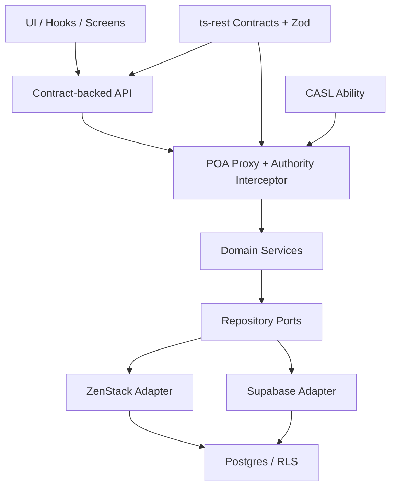

# Protocol-Oriented Authority (POA): Architectural SSOT

**Version**: 2026.3  
**Status**: Authoritative SSOT  
**Strategy**: Contract-Backed POA with Modular Data Adapters

---

## 1. Vision & Definition

Protocol-Oriented Authority (POA) is the platform's runtime authority model.

It exists to ensure that:

- permissions are defined in contracts, not hidden in UI or handler code
- unauthorized requests fail before business logic or database access
- domain orchestration remains modular
- data enforcement remains independent as a second wall

Every authorization decision must be explainable through:

- `ts-rest` contract metadata
- CASL abilities
- repository and adapter boundaries
- database policy enforcement

---

## 2. Target Runtime Shape

Required rule:

`contract -> POA proxy -> service -> repository port -> adapter -> DB`

Forbidden rule:

`UI -> Supabase`

---

## 3. SSOT Responsibilities

### 3.1 `ts-rest`

`ts-rest` is the API ABI.

Every exported API method must:

- map to exactly one contract route, or
- be internalized and removed from the public API surface

Every public contract route must include `metadata.authority`.

### 3.2 Zod

Zod is the data contract SSOT.

It defines:

- request and response shapes
- contract bodies and queries
- identity and actor context inputs
- reusable shapes for CASL and server policy layers

### 3.3 CASL

CASL is the API-surface authority engine.

It is used to:

- fail fast at the POA proxy
- drive client-side gating and UX
- express role and rule composition through the composer

CASL and POA should be capability-oriented, not single-role oriented.

That matters because many real actors carry mixed authority.

Examples:

- a principal may also be a teacher
- a section head may need both classroom and oversight abilities
- a grade head may keep teacher capabilities while gaining narrower academic coordination powers

So authority should be composed from capabilities and scoped policies rather than a single dominant role string.

### 3.4 ZenStack v3

ZenStack is the data-policy authority engine.

It is used to:

- enforce server-side data policy
- sit behind repository ports as an adapter
- remain independent from UI and application package concerns

ZenStack is not a replacement for the BFF or POA proxy.

POA protects the API surface.
ZenStack protects the data surface.

### 3.5 Supabase

Supabase is infrastructure, not the application API.

Supabase may be used as:

- a storage backend
- a realtime channel
- an adapter implementation behind repository ports

It must not be the dependency that public API modules are built around.

---

## 4. Runtime Enforcement Flow

1. UI calls a contract-backed API method.
2. `createPOAProxy` resolves the matching contract route.
3. `AuthorityInterceptor` reads `metadata.authority`.
4. CASL ability is enforced before the handler executes.
5. Domain service performs orchestration.
6. Repository port delegates to a concrete adapter.
7. Adapter executes against Supabase or ZenStack-backed data access.
8. Database policy and RLS remain the final guard.

---

## 5. Implementation Standard

### 5.1 Public API Modules

Public API modules must:

- export contract-backed methods only
- be wrapped by `createPOAProxy`
- register coverage through `contractCoverage`
- avoid direct database logic when possible

### 5.2 Domain Services

Domain services must:

- own orchestration and non-trivial workflow logic
- depend on ports, not concrete infrastructure
- be safe to reuse from different runtimes

### 5.3 Repository Ports

Repository ports define the stable data-facing interface for a domain.

Adapters may implement the same port with:

- Supabase
- ZenStack
- test or memory fakes

### 5.4 Contract Coverage

`contractCoverage` is the drift detector between exported APIs and contracts.

It exists to catch:

- implementation without contract
- contract without implementation
- proxy method without contract mapping

### 5.5 Migration Rule

Do not add new direct Supabase access into exported API modules.

New work must follow the production path:

`contract -> POA proxy -> service -> repository port -> adapter`

---

## 6. Current Reference Implementations

Production-shaped reference slices currently include:

- educational domain foundation
- self POA fail-fast enforcement
- library POA proxying

These are implementation references, not proof that the entire platform is fully production-ready.

---

## 7. Required Gates Before Calling A Domain Production-Ready

A domain is production-ready only when all of the following are true:

- every exported API method is contract-backed
- every contract route has POA metadata
- POA proxy coverage is strict
- domain logic goes through services and ports
- direct DB calls are behind adapters
- focused integration tests prove authorization behavior
- the server-side data path is ready for ZenStack enforcement or equivalent policy-backed execution

---

## 8. Supporting Implementation Docs

Implementation detail and migration guidance live here:

- [POA Implementation Guide](C:/Users/Naween/projects/polymath-platform/docs/architecture/POA_IMPLEMENTATION_GUIDE.md)
- [POA Foundation Progress - 2026-03-27](C:/Users/Naween/projects/polymath-platform/reports/poa-foundation-progress-2026-03-27.md)
- [POA Hardening Audit - 2026-03-27](C:/Users/Naween/projects/polymath-platform/reports/poa-hardening-audit-2026-03-27.md)

---

## 9. Non-Negotiables

- No ad-hoc role checks in exported API code.
- No public API method without a contract route.
- No new direct Supabase coupling inside exported API modules.
- No claim that a domain is production-ready without both API-surface and data-surface enforcement.
