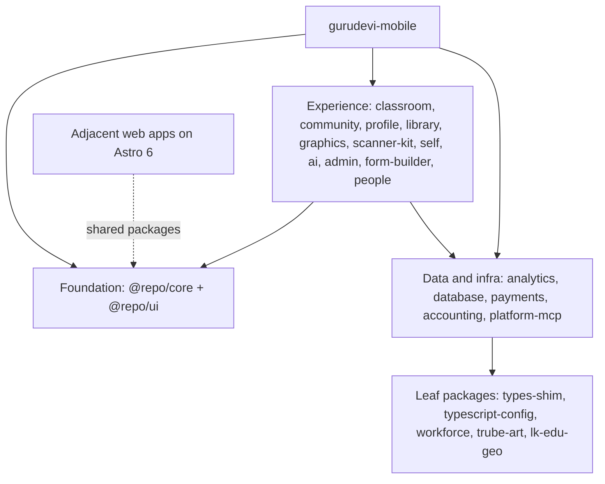

# Gurudevi Mobile Stack And Compatibility Atlas

> Historical snapshot retained for chronology. Use the linked Gluestack/NativeWind audit and generated RN Terrain stack map for current dependency and styling-engine state.

_Scope: the mobile app at `apps/gurudevi-mobile` plus its transitive workspace closure, with an adjacent note on the Astro web apps because they share `@repo/ui` and `@repo/core`._

_Data snapshot: 2026-04-17; file counts exclude `node_modules`, `dist`, `.turbo`, `.expo`, and `.astro`._

## High-level shape

## 1) Current stack snapshot

| surface | current | note |
| --- | --- | --- |
| Monorepo root | pnpm@10.33.0 | Node engine pinned to 24.x |
| Mobile app | expo ~55.0.8 | React 19.2.0, React Native 0.83.2 |
| Mobile runtime helpers | @expo/metro-runtime ~55.0.6 | Router, gesture, storage, media, and native modules live here |
| Web sibling stack | Astro ^6.1.7 | Shared with React ^19.0.0 / 19.1.0 on sibling web apps |

### Node version note

- `24.x` in the root `package.json` is a family pin, not a single patch pin. It means the repo is intended to stay on Node 24 rather than on one exact `24.2.x` or `24.11.x` value.
- The current local machine snapshot is `v24.11.0`, which is safely inside that family pin.
- The `20.19.4` reference comes from Expo EAS build infrastructure for SDK 55, not from this repo's root engine field. That is why you will see both numbers in the atlas: one is the repo target, the other is the hosted build baseline.

### Current foundation pins that matter most

| package | version |
| --- | --- |
| @shopify/react-native-skia | 2.4.18 |
| @ts-rest/core | 3.53.0-rc.1 |
| expo | ~55.0.8 |
| react | 19.2.0 |
| react-native | 0.83.4 |
| react-native-gesture-handler | 2.30.0 |
| semver | ^7.6.3 |

### Astro sibling snapshot

| surface | package | astro | react | reactDom | svelte |
| --- | --- | --- | --- | --- | --- |
| apps/gurudevi-marketingWeb | apps-gurudevi-marketing-web | ^6.1.7 | ^19.0.0 | ^19.0.0 | ^5.49.1 |
| apps/neevsk-web | apps-neevsk-web | ^6.1.7 | 19.1.0 | 19.1.0 | ^5.49.1 |

## 2) External dependency inventory

### 2.1 Mobile runtime dependencies

| package | version | note |
| --- | --- | --- |
| @expo/metro-runtime | ~55.0.6 |  |
| @react-native-async-storage/async-storage | 2.2.0 |  |
| @react-native-community/netinfo | ^11.4.1 |  |
| @react-native-ml-kit/barcode-scanning | ^2.0.0 |  |
| @react-native-ml-kit/text-recognition | ^2.0.0 |  |
| @react-navigation/bottom-tabs | ^7.4.0 |  |
| @react-navigation/native | ^7.1.8 |  |
| @react-navigation/native-stack | ^7.3.16 |  |
| @sentry/react-native | ~7.11.0 |  |
| @shopify/flash-list | 2.0.2 |  |
| @shopify/react-native-skia | 2.4.18 |  |
| @supabase/postgrest-js | 2.102.1 |  |
| @supabase/supabase-js | 2.102.1 |  |
| @tanstack/react-query | ^5.90.20 |  |
| @types/qrcode | ^1.5.6 |  |
| buffer | ^6.0.3 |  |
| date-fns | ^4.1.0 |  |
| expo | ~55.0.8 |  |
| expo-application | ~55.0.8 |  |
| expo-asset | ~55.0.8 |  |
| expo-audio | ^55.0.8 |  |
| expo-auth-session | ~55.0.6 |  |
| expo-blur | ^55.0.8 |  |
| expo-camera | ^55.0.9 |  |
| expo-clipboard | ^55.0.8 |  |
| expo-constants | ~55.0.7 |  |
| expo-dev-client | ~55.0.10 |  |
| expo-device | ~55.0.9 |  |
| expo-document-picker | ~55.0.8 |  |
| expo-file-system | ~55.0.10 |  |
| expo-font | ~55.0.4 |  |
| expo-haptics | ~55.0.8 |  |
| expo-image | ~55.0.5 |  |
| expo-image-manipulator | ^55.0.9 |  |
| expo-image-picker | ~55.0.10 |  |
| expo-linear-gradient | ^55.0.8 |  |
| expo-linking | ~55.0.7 |  |
| expo-localization | ~55.0.8 |  |
| expo-location | ~55.1.2 |  |
| expo-router | not used in the app runtime | keep only if a future migration explicitly needs it |
| expo-secure-store | ^55.0.8 |  |
| expo-sharing | ~55.0.11 |  |
| expo-sqlite | ^55.0.10 |  |
| expo-status-bar | ~55.0.4 |  |
| expo-updates | ~55.0.12 |  |
| expo-video | ~55.0.8 |  |
| expo-web-browser | ~55.0.9 |  |
| gluestack-ui | 3.0.0 |  |
| i18next | ^25.8.0 |  |
| inline-style-prefixer | 5.1.2 |  |
| jpeg-js | ^0.4.4 |  |
| jsqr | ^1.4.0 |  |
| lucide-react-native | ^0.563.0 |  |
| nativewind | 4.1.23 |  |
| posthog-react-native | ^4.35.1 |  |
| qrcode | ^1.5.4 |  |
| react | 19.2.0 |  |
| react-dom | 19.2.0 |  |
| react-i18next | ^16.5.4 |  |
| react-native | 0.83.2 |  |
| react-native-css-interop | 0.1.22 |  |
| react-native-gesture-handler | 2.30.0 |  |
| react-native-get-random-values | ^1.11.0 |  |
| react-native-mmkv | ^4.1.2 |  |
| react-native-nitro-modules | 0.33.9 |  |
| react-native-reanimated | 3.16.7 |  |
| react-native-safe-area-context | 4.15.0 |  |
| react-native-screens | 4.23.0 |  |
| react-native-svg | 15.15.3 |  |
| react-native-url-polyfill | ^3.0.0 |  |
| react-native-worklets | 0.7.2 |  |
| tailwindcss | 3.4.17 |  |
| uuid | ^13.0.0 |  |
| zustand | ^5.0.10 |  |

### 2.2 Mobile devDependencies

| package | version | note |
| --- | --- | --- |
| @repo/eslint-config | workspace:^ | Shared lint rule presets |
| @sentry/cli | ^3.2.2 |  |
| @testing-library/jest-dom | ^6.9.1 |  |
| @testing-library/react | ^16.3.2 |  |
| @testing-library/react-native | 14.0.0-beta.0 |  |
| @types/jest | ^29.5.14 |  |
| @types/react | 19.2.14 |  |
| @types/react-native | 0.83.2 |  |
| @types/react-test-renderer | 19.2.0 |  |
| cross-env | ^10.1.0 |  |
| eslint | ^9.38.0 |  |
| eslint-plugin-react-compiler | 19.1.0-rc.2 |  |
| eslint-plugin-react-native-a11y | ^3.5.1 |  |
| jest-cucumber | ^4.5.0 |  |
| jest-expo | ~55.0.11 |  |
| react-native-web | ^0.21.2 |  |
| react-test-renderer | 19.1.0 |  |
| supabase | ^2.76.15 |  |
| tailwindcss | ~3.4.17 |  |
| typescript | ~5.9.2 |  |

### 2.3 Workspace packages in the mobile closure

Direct workspace dependencies from `apps/gurudevi-mobile` to shared packages:

| package | role |
| --- | --- |
| @repo/admin | Admin and oversight surfaces |
| @repo/ai | AI-assisted flows and helper surfaces |
| @repo/classroom | High-level classroom orchestration and feature composition |
| @repo/community | Community/social feature bundle |
| @repo/core | Domain rules, auth, data contracts, shared hooks, API clients, and policy glue |
| @repo/form-builder | Form creation and rendering |
| @repo/library | Library/content browsing and content-rich flows |
| @repo/people | People directory and identity-adjacent views |
| @repo/profile | Profile, identity, and media workflows |
| @repo/scanner-kit | QR / barcode / OCR scanning toolkit |
| @repo/self | Learner self-service and personal dashboard surfaces |
| @repo/ui | Shared design system and cross-platform UI primitives |

Transitive workspace closure reached through those direct dependencies:

| package | role |
| --- | --- |
| @intuitui-labs/lk-edu-geo | Geographic dataset and geo helper package |
| @repo/admin | Admin and oversight surfaces |
| @repo/ai | AI-assisted flows and helper surfaces |
| @repo/analytics | Telemetry and product analytics wrapper |
| @repo/classroom | High-level classroom orchestration and feature composition |
| @repo/community | Community/social feature bundle |
| @repo/core | Domain rules, auth, data contracts, shared hooks, API clients, and policy glue |
| @repo/database | Database schema/runtime package for server-side data work |
| @repo/form-builder | Form creation and rendering |
| @repo/graphics | Maps, charts, and advanced visualization utilities |
| @repo/library | Library/content browsing and content-rich flows |
| @repo/people | People directory and identity-adjacent views |
| @repo/profile | Profile, identity, and media workflows |
| @repo/scanner-kit | QR / barcode / OCR scanning toolkit |
| @repo/self | Learner self-service and personal dashboard surfaces |
| @repo/ui | Shared design system and cross-platform UI primitives |

### 2.4 Dependency layers from foundation to peripheral

- Foundation/runtime: `expo`, `react`, `react-native`, `@expo/metro-runtime`, `@react-navigation/*`, `react-native-gesture-handler`, `react-native-reanimated`, `@shopify/react-native-skia`
- Shared domain/data: `@repo/core`, `@tanstack/react-query`, `@ts-rest/core`, `@supabase/*`, `@zenstackhq/*`, `zod`, `i18next`, `react-i18next`
- Shared UI/media: `@repo/ui`, `lucide-react-native`, `@expo/vector-icons`, `expo-blur`, `expo-linear-gradient`, `react-native-svg`, `react-native-gesture-handler`, `react-native-gifted-charts`
- Feature packages: `@repo/classroom`, `@repo/community`, `@repo/profile`, `@repo/library`, `@repo/graphics`, `@repo/scanner-kit`, `@repo/ai`, `@repo/admin`, `@repo/self`, `@repo/people`, `@repo/form-builder`
- Peripheral/leaf packages: `@repo/payments`, `@repo/accounting`, `@repo/workforce`, `@repo/platform-mcp`, `@repo/types-shim`, `@repo/typescript-config`, `@repo/eslint-config`

## 3) Compatibility matrix for the next stack decisions

Notes: compatibility is a mix of hard peer ranges, current npm dist-tags, and architecture-level inference. Where the upstream version is canary or alpha, treat the row as experimental, not production-ready.

| target | current_state | latest_signal | verdict |
| --- | --- | --- | --- |
| Node 26 | Repo engine: 24.x; Expo SDK 55 build infra still shows Node 20.19.4 | Node 26 schedule is published, but it is just entering the release line | Yellow: likely fine for tooling eventually, but not yet a clean Expo/EAS target |
| Expo 56 | Current app is on ~55.0.8 | expo@canary currently exposes 56.0.0-canary-* | Red for production: only canary exists today |
| Astro 6 | Sibling web apps already use astro ^6.1.7 | astro@latest is 6.1.7 and requires Node >=22.12.0 | Green for web; not a mobile runtime concern |
| React Native 0.85 | Current app is on react-native 0.83.2 | react-native@latest is 0.85.1 and peers React ^19.2.3 | Yellow: stable upstream, but a major step from Expo SDK 55 |
| React 19.3 | Current app is on react 19.2.0 | react@canary is 19.3.0-canary-*; latest stable is 19.2.5 | Red: canary only, do not plan this as the default baseline |
| gluestack v5 | Current app is on gluestack-ui 3.0.0 | gluestack-ui latest stable is 3.0.11 and alpha is 5.0.3-alpha.0 | Red: v5 is still alpha, so treat it as a future migration, not an upgrade |
| ZenStack canary | Repo uses @zenstackhq/orm n/a via shared packages | @zenstackhq/orm canary is below current stable 3.5.6 | Red: your current stable line is already ahead of canary |
| Reanimated 4.3 | Current app is on react-native-reanimated 3.16.7 | latest stable is 4.3.0 and peers RN 0.81 - 0.85 | Green: this is a low-risk patch/minor uplift |
| Skia latest | Root baseline pins @shopify/react-native-skia 2.4.18 | latest stable is 2.6.2 and peers React >=19, RN >=0.78, Reanimated >=3.19.1 | Green: good candidate for an upgrade window |

### Cross-platform compatibility callout

- `apps/gurudevi-marketingWeb` uses `react@19.0.0`, while `@repo/ui` peers `react@19.2.0`. That is a hidden compatibility debt if the web app actually imports `@repo/ui`.
- `apps/neevsk-web` uses `react@19.1.0`, which is closer, but still not the same minor as the shared UI package expects.
- Safest shared-package move: widen `@repo/ui` and `@repo/core` peer ranges to tolerate a React 19 minor window, then align the web apps to React 19.2.x before attempting any 19.3 or canary work.

## 4) Internal package weight and blast radius

### 4.1 Heaviest packages by file count

| package | files | deps | downstream | role |
| --- | --- | --- | --- | --- |
| @intuitui-labs/lk-edu-geo | 360 | 9 | 1 | Geographic dataset and geo helper package |
| @repo/core | 335 | 41 | 19 | Domain rules, auth, data contracts, shared hooks, API clients, and policy glue |
| @repo/ui | 215 | 42 | 14 | Shared design system and cross-platform UI primitives |
| @repo/admin | 141 | 22 | 2 | Admin and oversight surfaces |
| @repo/classroom | 131 | 27 | 1 | High-level classroom orchestration and feature composition |
| @repo/self | 128 | 22 | 2 | Learner self-service and personal dashboard surfaces |
| @repo/trube-art | 102 | 17 | 0 | Native graphics sandbox and experimental visual module |
| @repo/library | 69 | 42 | 4 | Library/content browsing and content-rich flows |
| @repo/profile | 66 | 29 | 2 | Profile, identity, and media workflows |
| @repo/community | 56 | 27 | 3 | Community/social feature bundle |

### 4.2 Heaviest packages by dependency surface

| package | files | deps | dev | peer | downstream | role |
| --- | --- | --- | --- | --- | --- | --- |
| @repo/ui | 215 | 19 | 9 | 14 | 14 | Shared design system and cross-platform UI primitives |
| @repo/library | 69 | 18 | 9 | 15 | 4 | Library/content browsing and content-rich flows |
| @repo/core | 335 | 16 | 13 | 12 | 19 | Domain rules, auth, data contracts, shared hooks, API clients, and policy glue |
| @repo/graphics | 48 | 15 | 9 | 6 | 3 | Maps, charts, and advanced visualization utilities |
| @repo/profile | 66 | 15 | 7 | 7 | 2 | Profile, identity, and media workflows |
| @repo/classroom | 131 | 15 | 7 | 5 | 1 | High-level classroom orchestration and feature composition |
| @repo/community | 56 | 14 | 6 | 7 | 3 | Community/social feature bundle |
| @repo/scanner-kit | 24 | 3 | 7 | 14 | 6 | QR / barcode / OCR scanning toolkit |
| @repo/admin | 141 | 15 | 5 | 2 | 2 | Admin and oversight surfaces |
| @repo/self | 128 | 9 | 6 | 7 | 2 | Learner self-service and personal dashboard surfaces |

### 4.3 Highest blast radius if they change

| package | score | files | deps | downstream | role |
| --- | --- | --- | --- | --- | --- |
| @repo/core | 130 | 335 | 41 | 19 | Domain rules, auth, data contracts, shared hooks, API clients, and policy glue |
| @repo/ui | 107 | 215 | 42 | 14 | Shared design system and cross-platform UI primitives |
| @repo/eslint-config | 78 | 5 | 14 | 16 | Shared lint rule presets |
| @repo/library | 61 | 69 | 42 | 4 | Library/content browsing and content-rich flows |
| @repo/scanner-kit | 49 | 24 | 24 | 6 | QR / barcode / OCR scanning toolkit |
| @repo/graphics | 44 | 48 | 30 | 3 | Maps, charts, and advanced visualization utilities |
| @repo/community | 41 | 56 | 27 | 3 | Community/social feature bundle |
| @repo/profile | 40 | 66 | 29 | 2 | Profile, identity, and media workflows |
| @repo/admin | 36 | 141 | 22 | 2 | Admin and oversight surfaces |
| @repo/classroom | 36 | 131 | 27 | 1 | High-level classroom orchestration and feature composition |

### 4.4 Full workspace inventory

| package | files | deps | dev | peer | downstream | role |
| --- | --- | --- | --- | --- | --- | --- |
| @intuitui-labs/lk-edu-geo | 360 | 0 | 9 | 0 | 1 | Geographic dataset and geo helper package |
| @repo/accounting | 11 | 2 | 3 | 0 | 0 | Accounting domain helpers |
| @repo/admin | 141 | 15 | 5 | 2 | 2 | Admin and oversight surfaces |
| @repo/ai | 9 | 6 | 5 | 6 | 3 | AI-assisted flows and helper surfaces |
| @repo/analytics | 30 | 8 | 5 | 5 | 2 | Telemetry and product analytics wrapper |
| @repo/classroom | 131 | 15 | 7 | 5 | 1 | High-level classroom orchestration and feature composition |
| @repo/community | 56 | 14 | 6 | 7 | 3 | Community/social feature bundle |
| @repo/core | 335 | 16 | 13 | 12 | 19 | Domain rules, auth, data contracts, shared hooks, API clients, and policy glue |
| @repo/database | 9 | 5 | 6 | 0 | 1 | Database schema/runtime package for server-side data work |
| @repo/eslint-config | 5 | 2 | 12 | 0 | 16 | Shared lint rule presets |
| @repo/form-builder | 19 | 5 | 0 | 3 | 2 | Form creation and rendering |
| @repo/graphics | 48 | 15 | 9 | 6 | 3 | Maps, charts, and advanced visualization utilities |
| @repo/library | 69 | 18 | 9 | 15 | 4 | Library/content browsing and content-rich flows |
| @repo/payments | 12 | 2 | 3 | 0 | 0 | Payments integration helpers |
| @repo/people | 15 | 4 | 4 | 2 | 3 | People directory and identity-adjacent views |
| @repo/platform-mcp | 5 | 3 | 2 | 0 | 0 | MCP service wrapper for platform tooling |
| @repo/profile | 66 | 15 | 7 | 7 | 2 | Profile, identity, and media workflows |
| @repo/scanner-kit | 24 | 3 | 7 | 14 | 6 | QR / barcode / OCR scanning toolkit |
| @repo/self | 128 | 9 | 6 | 7 | 2 | Learner self-service and personal dashboard surfaces |
| @repo/trube-art | 102 | 0 | 11 | 6 | 0 | Native graphics sandbox and experimental visual module |
| @repo/types-shim | 2 | 0 | 0 | 0 | 1 | Shared ambient type declarations |
| @repo/typescript-config | 4 | 0 | 0 | 0 | 9 | Shared TypeScript config presets |
| @repo/ui | 215 | 19 | 9 | 14 | 14 | Shared design system and cross-platform UI primitives |
| @repo/workforce | 7 | 1 | 3 | 0 | 0 | Minimal workforce domain shell |

## 5) What is safest to decouple

- High-confidence leaf candidates: `@repo/workforce`, `@repo/accounting`, `@repo/payments`, `@repo/platform-mcp`, `@repo/types-shim`, and `@repo/typescript-config`. These have small surfaces and no or very few workspace dependents.
- Large but isolated candidate: `@repo/trube-art` has a high file count but no workspace dependents, so its blast radius is mostly local to its own package.
- Single-consumer candidate: `@intuitui-labs/lk-edu-geo` is large by file count, but only `@repo/graphics` consumes it, which keeps the coupling contained.
- Top structural seams to preserve: `@repo/core` should keep domain rules and adapters separate; `@repo/ui` should keep theme tokens separate from platform widgets; feature packages should depend inward on those two, not sideways on each other.

## 5.1 Related guidance docs

- Dependency update policy: `apps/gurudevi-mobile/docs/architecture/dependency-update-guidance.md`
- Beta vs production monorepo strategy: `apps/gurudevi-mobile/docs/architecture/beta-vs-production-monorepo-guidance.md`

## 6) Recommended stack posture

- Keep the current stable base for mobile: Expo SDK 55, React Native 0.83.x, React 19.2.x, Reanimated 4.x, Skia 2.6.x, gluestack-ui 3.x, ZenStack stable 3.5.6.
- Upgrade only the low-risk pieces first: React 19.2.5, Reanimated 4.3.0, Skia 2.6.2, and any Expo SDK 55 patch updates that stay inside the same SDK line.
- Treat Expo SDK 56, React Native 0.85, React 19.3, gluestack v5, and ZenStack canary as watch-list items until they become stable and the mobile build infra officially supports them.
- For Node, keep one eye on the split reality: the repo wants Node 24.x, Expo EAS SDK 55 still shows Node 20.19.4, and Node 26 is the next future line to validate rather than adopt immediately.

## 7) Sources checked for compatibility

- Expo new architecture guide: https://docs.expo.dev/guides/new-architecture/
- Expo build infrastructure: https://docs.expo.dev/build-reference/infrastructure/
- React Native versions: https://reactnative.dev/versions.html
- React Native 0.85 release: https://reactnative.dev/blog/2026/04/07/react-native-0.85
- Node.js release schedule: https://nodejs.org/blog/announcements/evolving-the-nodejs-release-schedule
- gluestack-ui homepage and releases: https://gluestack.io/ui and https://github.com/gluestack/gluestack-ui
- ZenStack homepage: https://zenstack.dev/

## 8) Appendix: direct dependency inventory for `apps/gurudevi-mobile`

### Runtime dependencies

| package | version | note |
| --- | --- | --- |
| @expo/metro-runtime | ~55.0.6 |  |
| @react-native-async-storage/async-storage | 2.2.0 |  |
| @react-native-community/netinfo | ^11.4.1 |  |
| @react-native-ml-kit/barcode-scanning | ^2.0.0 |  |
| @react-native-ml-kit/text-recognition | ^2.0.0 |  |
| @react-navigation/bottom-tabs | ^7.4.0 |  |
| @react-navigation/native | ^7.1.8 |  |
| @react-navigation/native-stack | ^7.3.16 |  |
| @sentry/react-native | ~7.11.0 |  |
| @shopify/flash-list | 2.0.2 |  |
| @shopify/react-native-skia | 2.4.18 |  |
| @supabase/postgrest-js | 2.102.1 |  |
| @supabase/supabase-js | 2.102.1 |  |
| @tanstack/react-query | ^5.90.20 |  |
| @types/qrcode | ^1.5.6 |  |
| buffer | ^6.0.3 |  |
| date-fns | ^4.1.0 |  |
| expo | ~55.0.8 |  |
| expo-application | ~55.0.8 |  |
| expo-asset | ~55.0.8 |  |
| expo-audio | ^55.0.8 |  |
| expo-auth-session | ~55.0.6 |  |
| expo-blur | ^55.0.8 |  |
| expo-camera | ^55.0.9 |  |
| expo-clipboard | ^55.0.8 |  |
| expo-constants | ~55.0.7 |  |
| expo-dev-client | ~55.0.10 |  |
| expo-device | ~55.0.9 |  |
| expo-document-picker | ~55.0.8 |  |
| expo-file-system | ~55.0.10 |  |
| expo-font | ~55.0.4 |  |
| expo-haptics | ~55.0.8 |  |
| expo-image | ~55.0.5 |  |
| expo-image-manipulator | ^55.0.9 |  |
| expo-image-picker | ~55.0.10 |  |
| expo-linear-gradient | ^55.0.8 |  |
| expo-linking | ~55.0.7 |  |
| expo-localization | ~55.0.8 |  |
| expo-location | ~55.1.2 |  |
| expo-router | not used in the app runtime | keep only if a future migration explicitly needs it |
| expo-secure-store | ^55.0.8 |  |
| expo-sharing | ~55.0.11 |  |
| expo-sqlite | ^55.0.10 |  |
| expo-status-bar | ~55.0.4 |  |
| expo-updates | ~55.0.12 |  |
| expo-video | ~55.0.8 |  |
| expo-web-browser | ~55.0.9 |  |
| gluestack-ui | 3.0.0 |  |
| i18next | ^25.8.0 |  |
| inline-style-prefixer | 5.1.2 |  |
| jpeg-js | ^0.4.4 |  |
| jsqr | ^1.4.0 |  |
| lucide-react-native | ^0.563.0 |  |
| nativewind | 4.1.23 |  |
| posthog-react-native | ^4.35.1 |  |
| qrcode | ^1.5.4 |  |
| react | 19.2.0 |  |
| react-dom | 19.2.0 |  |
| react-i18next | ^16.5.4 |  |
| react-native | 0.83.2 |  |
| react-native-css-interop | 0.1.22 |  |
| react-native-gesture-handler | 2.30.0 |  |
| react-native-get-random-values | ^1.11.0 |  |
| react-native-mmkv | ^4.1.2 |  |
| react-native-nitro-modules | 0.33.9 |  |
| react-native-reanimated | 3.16.7 |  |
| react-native-safe-area-context | 4.15.0 |  |
| react-native-screens | 4.23.0 |  |
| react-native-svg | 15.15.3 |  |
| react-native-url-polyfill | ^3.0.0 |  |
| react-native-worklets | 0.7.2 |  |
| tailwindcss | 3.4.17 |  |
| uuid | ^13.0.0 |  |
| zustand | ^5.0.10 |  |

### Dev dependencies

| package | version | note |
| --- | --- | --- |
| @repo/eslint-config | workspace:^ | Shared lint rule presets |
| @sentry/cli | ^3.2.2 |  |
| @testing-library/jest-dom | ^6.9.1 |  |
| @testing-library/react | ^16.3.2 |  |
| @testing-library/react-native | 14.0.0-beta.0 |  |
| @types/jest | ^29.5.14 |  |
| @types/react | 19.2.14 |  |
| @types/react-native | 0.83.2 |  |
| @types/react-test-renderer | 19.2.0 |  |
| cross-env | ^10.1.0 |  |
| eslint | ^9.38.0 |  |
| eslint-plugin-react-compiler | 19.1.0-rc.2 |  |
| eslint-plugin-react-native-a11y | ^3.5.1 |  |
| jest-cucumber | ^4.5.0 |  |
| jest-expo | ~55.0.11 |  |
| react-native-web | ^0.21.2 |  |
| react-test-renderer | 19.1.0 |  |
| supabase | ^2.76.15 |  |
| tailwindcss | ~3.4.17 |  |
| typescript | ~5.9.2 |  |

## 9) Short version

- The mobile app is centered on `@repo/core` and `@repo/ui`; those are the biggest leverage points and the biggest migration risks.
- The current stack is already solidly on the New Architecture era, but Expo 56 / React 19.3 / gluestack v5 are still too early for a default production move.
- The most useful next work is to widen peers, reduce tight version coupling, and keep the leaf packages leaf-like so future Node/Expo/React changes do not fan out everywhere.
