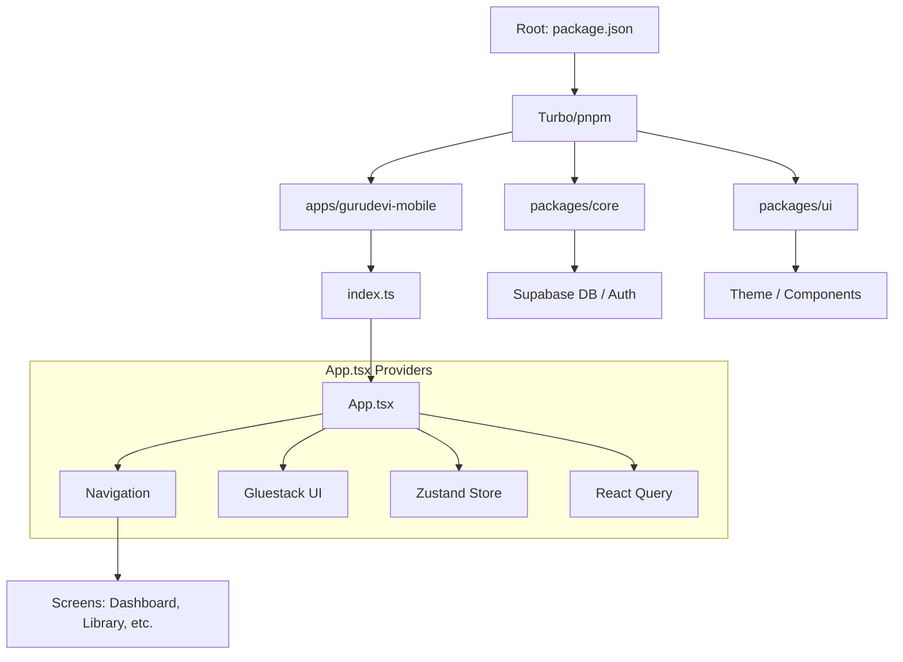

# Gurudevi Mobile: The Clockwork Behind the Magic

This document provides a comprehensive breakdown of how the `gurudevi-mobile` app and its surrounding ecosystem are structured, how they communicate, and how they transform from "scattered files" into a living application.

## 1. The Monorepo Infrastructure (The Factory)

The project is structured as a **Monorepo** using `pnpm` workspaces and `Turborepo`. 

### Key Configs:
- [pnpm-workspace.yaml](file:///c:/Users/Naween/projects/polymath-platform/pnpm-workspace.yaml): Defines that `apps/*` and `packages/*` are part of the family.
- [turbo.json](file:///c:/Users/Naween/projects/polymath-platform/turbo.json): Orchestrates tasks. When you run `turbo run start`, it figures out the dependency graph and runs the necessary scripts in order.

### Why this structure?
Instead of one massive mess, we have specialized "neighborhoods":
- **`apps/gurudevi-mobile`**: The "face" of the project—the actual mobile app.
- **`packages/ui`**: The "fashion designer"—contains all buttons, cards, and theme configurations.
- **`packages/core`**: The "engine room"—handles database (Supabase) connections, global state (Zustand), and authentication.
- **Domain Packages** (`@repo/classroom`, `@repo/library`, etc.): Specialized logic for specific features.

---

## 2. The Build System (The Magic Wand)

When you run `npm run start` or `expo start`, two magical things happen: **Metro** and **Expo**.

### Metro Bundler
Think of Metro as a "vacuum cleaner" for code. It starts at `index.ts` and follows every `import` link.
- **Clockwork**: Metro looks at [metro.config.js](file:///c:/Users/Naween/projects/polymath-platform/apps/gurudevi-mobile/metro.config.js). It is configured to "watch" the entire monorepo.
- **Transpilation**: It turns modern TypeScript/JSX into plain JavaScript that the mobile engine (Hermes) can understand.
- **Symlinking**: It makes code in `packages/core` feel like it's inside `apps/gurudevi-mobile` even though it's physically elsewhere.

### Expo
Expo is the framework that wraps React Native. It provides:
- **EAS (Expo Application Services)**: Handles the complex process of building `.ipa` (iOS) and `.aab` (Android) files in the cloud.
- **Expo Go / Development Builds**: Allows you to run the app on your phone instantly without opening Android Studio/Xcode every time.

---

## 3. The App Bootstrap Flow (The Awakening)

When the app starts, it follows this precise sequence (The Clockwork):

1.  **`index.ts`**: The very first file. It registers the root component.
2.  **`App.tsx`**: The "God Component". It wraps the entire app in **Providers**:
    - `SafeAreaProvider`: Handles notches and home bars.
    - `GluestackUIProvider`: Injects the design system.
    - `NavigationContainer`: Enables the "brain" of movement between screens.
    - `QueryClientProvider`: Manages the "memory" of data fetched from the internet.
3.  **Authentication Handshake**: Inside `App.tsx`, it calls `supabase.auth.getSession()`.
    - If a session exists $\rightarrow$ Load User Profile $\rightarrow$ Show **Main Dashboard**.
    - If no session $\rightarrow$ Show **Welcome Screen**.
4.  **Navigation Entry**: The `RootStack.Navigator` decides which "World" to show based on the Auth state.

---

## 4. Logical Layers (The Brain)

### State Management (Zustand)
Located in [`packages/core/src/store/useStore.ts`](file:///c:/Users/Naween/projects/polymath-platform/packages/core/src/store/useStore.ts).
- This is the "short-term memory". It knows who is logged in, what their role is, and whether they've finished onboarding.

### Data Fetching (TanStack Query)
- Handles the "requesting and caching" of data. When you visit the Library, Query checks if it already "remembers" the data; if not, it talks to Supabase.

### Backend (Supabase)
The "Source of Truth".
- **Database**: Postgres.
- **Auth**: Handles logins/signups.
- **Storage**: Where images and PDFs live.

---

## 5. Visual Summary

### Reference Files for Deep Dives:
- **Main Entry**: [App.tsx](file:///c:/Users/Naween/projects/polymath-platform/apps/gurudevi-mobile/App.tsx)
- **Navigation Logic**: [TabNavigator.tsx](file:///c:/Users/Naween/projects/polymath-platform/apps/gurudevi-mobile/src/navigation/TabNavigator.tsx)
- **Core Engine**: [packages/core/index.ts](file:///c:/Users/Naween/projects/polymath-platform/packages/core/src/index.ts)
- **Bundler Logic**: [metro.config.js](file:///c:/Users/Naween/projects/polymath-platform/apps/gurudevi-mobile/metro.config.js)
