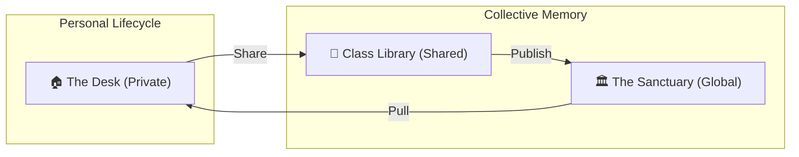

# Library Ecosystem: The Knowledge Sanctuary

This document outlines the design of the **Library** feature within the Gurudevi platform. It serves as the "Long-Term Memory" of the educational ecology, where fleeting interactions crystallize into permanent knowledge.

## 🏗️ Core Architecture: The Dual Workspace

The Library is split into two distinct but interconnected spaces: **The Desk** for personal work and **The Sanctuary** for global knowledge.

---

## 🏠 The Personal Desk (My Space)
**Model: "The Creative Workbench" (Offline-First)**

Every user (Teacher, Student, Principal) has a **Personal Desk**. This is where resources are born, edited, and organized. To ensure usability in low-connectivity areas, the Desk is **Offline-First**.

*   **Teacher's Desk:** Draft lesson plans, private notes, worksheets in progress. All items are saved locally and synced when online.
*   **Student's Desk:** Downloaded study materials, personal notes, and offline assignments.
*   **Offline Capabilities:**
    *   **Auto-Sync**: Local changes are pushed to the cloud automatically when a connection is restored.
    *   **Resource Caching**: When a user "Pulls to Desk" from the Sanctuary, the system offers to download the resource for offline access.
    *   **Local Editing**: Notes and metadata edits happen instantly on-device.
*   **UX Strategy:** Inviting, private, and **resilient**. Visual indicators (e.g., "Ready for Offline", "Syncing...") provide confidence.

---

## 🏛️ The Global Sanctuary (Our Space)
**Model: "Netflix for Learning" (Streaming Service Style)"**

The **Sanctuary** is the public knowledge hub. It is engaging, visual, and curated.

### 1. 🖼️ The "Collection Card"
*   **Visual:** Cover-art style layout.
*   **Context:** Shows "Verified" badges and "Endorsements".
*   **Action:** "Pull to Desk" — adding a copy/link to the personal workbench.

### 2. 🛋️ "Smart Shelves"
Horizontal scrolls categorized by:
*   **"Pulled to Desk":** Quickly access things you've added to your workspace.
*   **"Trending in [Subject]":** Popular global resources.
*   **"Verified by [School/System]":** High-quality official content.

---

## 🤖 AI-Assisted Discovery (Socratic Assistant)
**Mechanism: The "Curation Concierge"**

The AI Assistant acts as a bridge between the Desk and the Sanctuary:
*   **Publishing Suggestion:** *"I see you've shared this Physics worksheet with 3 classes. It's getting great feedback. Would you like to publish it to the Global Sanctuary for other teachers?"*
*   **Discovery:** *"You're planning a lesson on Gravity. I've found 3 top-rated simulations in the Sanctuary. Shall I pull them to your Desk?"*

---

## 🚀 Innovative Refineries: Beyond the List

To make Gurudevi's Library the best in its class, we are introducing several "High-Agency" innovations:

### 1. 🧬 Resource Remixing (The "Fork")
*   **Concept:** Teachers shouldn't just "use" a resource; they should be able to **remix** it.
*   **Mechanism:** When a teacher pulls a Collection to their Desk, they can "Remix" it—changing the sequence, adding their own notes, or swapping out specific worksheets.
*   **Pedigree:** The Sanctuary tracks the lineage (e.g., *"Remixed from Mr. Silva's Grade 10 Math"*), creating an evolutionary map of educational content.

### 2. ⚡ "Flash-Play" Mode
*   **Concept:** Reduce the friction from "Finding" to "Learning".
*   **Mechanism:** A mini-player transition. When you tap a resource in the "Telegram List", it doesn't open a new screen immediately. It expands into a **PIP (Picture-in-Picture)** or a bottom-sheet preview so you can "scan" the content without losing your search context.

### 3. 👥 Collaborative "Shadow Shelves"
*   **Concept:** Private study groups need shared spaces.
*   **Mechanism:** Students can create a "Shared Shelf" on their Desk and invite peers. It's a mini-library for a specific goal (e.g., *"Group Study: Osmosis"*).
*   **UX:** Feels like a "Group Chat" but for resources.

### 4. 🧠 AI "Smart Summaries" & "Knowledge Bridges"
*   **Mechanism:** The Socratic Assistant automatically generates 3-bullet summaries for long PDFs and identifies **Knowledge Bridges**—connections between the current resource and others on your Desk.
*   **Example:** *"This video on Kinetic Energy matches the worksheet you pulled yesterday. Shall I group them?"*

---

## 🔄 User Flows: The Knowledge Flow

### 1. 📤 Publishing Flow (Private -> Public)
1.  **Creation:** Teacher creates a Resource on their **Desk** (Visibility: `private`).
2.  **Trial:** Teacher shares it with a **Class** (Visibility: `class`).
3.  **Validation:** The resource gains "Endorsements" from students/peers.
4.  **Publication:** Teacher promotes it to the **Sanctuary** (Visibility: `public`).

### 2. 📥 Pulling & Remixing Flow (Public -> Private)
1.  **Discovery:** User finds a great resource in the **Sanctuary**.
2.  **Interaction:** **Pull to Desk** (creates a personal reference).
3.  **Refinement:** **Remix** (creates a private fork for specific class needs).

---

## 🛠️ Technical Strategy: Media Neutrality

To ensure the platform scale without provider lock-in, all media (images, videos, PDFs) is handled via a **Decoupled Media Layer**:

*   **Abstraction:** UI components interact with a generic `MediaAsset` interface (defined in `@repo/core`).
*   **Provider Independent:** The system supports `cloudinary`, `s3`, `supabase`, etc., via the `provider` field.
*   **API-First resolution:** Instead of hardcoding URL patterns, components use provider-agnostic metadata (bytes, duration, format).
*   **State:** The `LibraryResource` type now contains a `media` object instead of raw Cloudinary fields.

---

## 📱 User Visibility Map (Role-Based)

| Role | Desk Access | Sanctuary Access | Permissions |
| :--- | :--- | :--- | :--- |
| **Admin** | Full | Full | System-wide verification |
| **Principal** | Personal | School-Wide | Verify & Promote to Sanctuary |
| **Teacher** | Full Control | Full View | Create, Share, **Remix**, Publish |
| **Student** | Personal | Grade-Wide | Bookmark, **Collaborate**, Suggest |
| **Guest** | None | Public Only | View-only |

---

## 🔍 Search Context: Intelligent Filtering
*   **Desk Search:** Deep search within personal files, notes, and shared class items.
*   **Sanctuary Search:** Global search across verified curriculum content.
*   **Actionable Slicing:**
    *   `Origin`: (Original, Remixed, Pulled)
    *   `Study Mode`: (Read-only, Interactive, High-Focus)
    *   `Grade & Syllabus`: (Aligned to 2026 Reforms)
