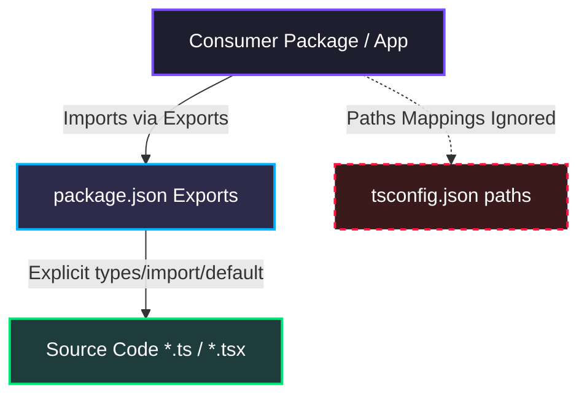

> [!IMPORTANT]
> **This document has been superseded** by the [TypeScript 7.0 RC Migration Guide](./2026-06-25-typescript-7-migration-guide.md). Please refer to the new guide for active monorepo standards.


# TypeScript 6.0.3 Modernization & Module Resolution Guide

This document outlines the standard architecture, patterns, and compiler rules established during our modernization to **TypeScript 6.0.3** and **Node 24.15.0**. All developers contributing to the `polymath-platform` monorepo must adhere to these standards to maintain build-graph stability and type-checking performance.

---

## 1. Core Architectural Pillars

We have standardized the monorepo to eliminate legacy path mappings and achieve modern ESM-native and bundler compliance:



1. **`moduleResolution: "bundler"`**: Standardized in `packages/typescript-config/base.json`. Binds TypeScript's module discovery directly to the standard ESM `exports` fields of dependency packages.
2. **`strict: true`**: Tightens implicit type inference, array initialization bounds, and nullability assertions.
3. **Native Workspace Exports**: Decoupled from custom `tsconfig.json` `paths` configurations. Dependent workspaces resolve modules strictly through the `exports` configuration of the package they consume.

---

## 2. Mandatory Coding Patterns & Gotchas

### 2.1 The "Empty Array" `never[]` Inference Trap (`TS2345`)
Under TypeScript 6.0.3, declaring an empty array literal without explicit annotations now infers the type `never[]` under strict checks. Appending items or passing it to typed functions will trigger compilation failures.

#### ❌ Incorrect Pattern (Legacy)
```typescript
// TS infers 'calendar' as never[], triggering downstream errors on assignment
const calendar = []; 
const poyaDays = [];

calendar.push({ date, isPoya: true }); // Error: Argument of type '...' is not assignable to 'never'
```

####   Correct Pattern (Modern)
Always supply explicit types or generic constructors during empty array initializations.
```typescript
interface CalendarDay {
  date: string;
  isPoya: boolean;
}

const calendar: CalendarDay[] = [];
const poyaDays: string[] = [];
```

---

### 2.2 Subpath Exports & Barrel Files (`TS2307` / `TS2882`)
When importing subpaths/barrel directories (e.g. `@repo/profile/api` which resolves to a directory `src/api/index.ts`), relying on wildcard matches like `"./*": "./src/*.ts"` in the provider's `package.json` **will fail** under `bundler` resolution mode because TypeScript expects a file literally named `api.ts`.

#### ❌ Incorrect `package.json` Exports (Legacy)
```json
"exports": {
  ".": "./src/index.ts",
  "./*": "./src/*.ts"
}
```

####   Correct `package.json` Exports (Modern)
Always declare explicit condition blocks for directory entrypoints (barrel files) and folders:
```json
"exports": {
  ".": {
    "types": "./src/index.ts",
    "import": "./src/index.ts",
    "default": "./src/index.ts"
  },
  "./api": {
    "types": "./src/api/index.ts",
    "import": "./src/api/index.ts",
    "default": "./src/api/index.ts"
  },
  "./*": {
    "types": "./src/*.ts",
    "import": "./src/*.js",
    "default": "./src/*.js"
  }
}
```

> [!NOTE]
> **Why do we duplicate same path under `types`/`import`/`default`?**
> The `types` field tells TypeScript's compiler exactly where to find the source types (enabling real-time typechecking inside consumer packages). The `import` and `default` fields map the runtime ESM execution boundaries. Specifying all three guarantees that both the TypeScript compiler and bundlers (Vite, Metro, Next.js) resolve the exact same source file smoothly.

---

### 2.3 Platform-Specific Extensions (`.web` / `.native`)
If your mobile/web workspace imports platform-specific files directly (e.g. `import AdminDashboard from '@repo/admin/screens/AdminDashboard.web'`), but the underlying package only has a universal `AdminDashboard.tsx` file, TypeScript will fail module resolution because the file does not literally exist on disk.

To support clean platform decoupling:
1. Define an explicit mapping in the source package's `package.json` exports to direct the platform-specific extension import to the universal file:
```json
"./screens/AdminDashboard.web": {
  "types": "./src/screens/AdminDashboard.tsx",
  "import": "./src/screens/AdminDashboard.tsx",
  "default": "./src/screens/AdminDashboard.tsx"
}
```
2. This resolves type checking synchronously, while allowing bundlers (like Metro) to resolve and apply custom bundle splits correctly during packaging.

---

## 3. Standardizing Build & Type-Check Scopes

### 3.1 Type-Checking Test Files vs. Production Bundle Builds
A common question is: *Should test files be included in the TypeScript compiler (`tsc`) checks or excluded?*

Our monorepo adopts a **Hybrid Standard Strategy**:

| Environment / Step | Configuration | Target | Rationale |
| :--- | :--- | :--- | :--- |
| **Local Dev & CI Verification** | `tsconfig.json` | Includes test files (`src/**/*`) | Ensures test code, mocks, and contract assertions remain type-safe and never drift from production APIs. |
| **Production Build Bundles** | `tsconfig.build.json` | Excludes test files (`**/__tests__/*`) | Minimizes package overhead, speeds up compiler outputs, and prevents test libraries from leaking into production. |

*   **Continuous Integration Check Command**:
    ```bash
    pnpm turbo run check-types
    ```
    This uses Turborepo caching to quickly validate the type-checking boundary across the whole monorepo, only re-running packages that underwent changes.

---

## 4. Verification Checklists for New Workspaces

When creating or refactoring workspace packages under TypeScript 6:
*   [ ] Verify `typescript` dependency is locked to `^6.0.3` in `devDependencies`.
*   [ ] Verify the package extends `../../packages/typescript-config/base.json`.
*   [ ] Avoid using `paths` inside consumer `tsconfig.json` for resolving workspace dependencies; always use explicit `exports` inside the provider's `package.json`.
*   [ ] Ensure all directory exports/subpaths are explicitly registered in the provider's `"exports"` block rather than relying on wildcard catch-alls.
*   [ ] Run `pnpm turbo run check-types` locally before submitting a PR to verify cross-package alignment.
