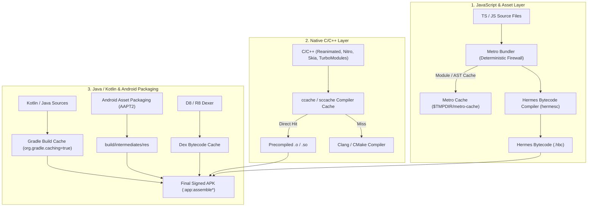

# Android Native Build Caching, Diagnostics, and Acceleration SOP

> **Source of truth for optimizing, caching, diagnosing, and accelerating Android native builds (Debug & Release) across Expo 57, WSL 2, Hermes, and Gradle.**

---

## 1. Build & Caching Architecture Topology



---

## 2. Exhaustive Cache Layers & Configuration

### A. Native C/C++ (`ccache` / `sccache`)
- **What it caches:** C++ compilation objects from CMake, NDK Clang, TurboModules, Nitro modules, Reanimated, Skia, MapLibre, SQLite.
- **Speedup:** Reduces native compilation from **~10–15 minutes** to **~10–20 seconds** on subsequent passes.
- **WSL 2 Configuration:**
  ```bash
  export NDK_CCACHE="$(which ccache)"
  export CCACHE_DIR="$HOME/.ccache"
  export CCACHE_MAXSIZE="10G"
  export CCACHE_SLOPPINESS="include_file_ctime,include_file_mtime,time_macros"
  ```

### B. Gradle Build Cache (`org.gradle.caching=true`)
- **What it caches:** Kotlin/Java task outputs, class generation, manifest merging, annotation processing.
- **Configured in:** `apps/gurudevi-mobile/plugins/withGradleProperties.js` via config plugin.
- **Settings:**
  ```properties
  org.gradle.caching=true
  org.gradle.parallel=false
  org.gradle.jvmargs=-Xmx4096m -XX:MaxMetaspaceSize=512m -XX:+UseSerialGC
  kotlin.compiler.execution.strategy=in-process
  ```

### C. Metro & JavaScript Asset Cache
- **What it caches:** Babel transforms, CSS interop runtime transforms, JSX ASTs.
- **Location:** System temp directory (`$TMPDIR/metro-cache` or `node_modules/.cache`).

### D. Android Intermediates & Dex Cache
- **What it caches:** AAPT2 compiled XML/resources, merged AIDL, D8 dex outputs.
- **Location:** `apps/gurudevi-mobile/android/app/build/intermediates/`.

---

## 3. Diagnostic & Tooling Ecosystem in This Repo

Here are the diagnostic tools and utilities available for build validation, performance profiling, and bundle analysis:

### A. Build & Expo Diagnostics
- **`expo-doctor`**:
  ```powershell
  pnpm --filter gurudevi-mobile exec expo-doctor
  ```
  *Validates dependency graph compatibility against Expo 57, checks duplicate packages, and ensures native plugins are well-formed.*

- **Resolved Expo Prebuild Config**:
  ```powershell
  npx --prefix apps/gurudevi-mobile expo config --type prebuild
  ```
  *Dumps the exact resolved AndroidManifest and Gradle parameters generated by config plugins before compilation.*

### B. TypeScript & Typecheck Gate
- **Strict Monorepo Typecheck with UTF-8 Stream Capture**:
  ```powershell
  [Console]::OutputEncoding = [System.Text.Encoding]::UTF8
  pnpm --filter gurudevi-mobile exec tsc --noEmit
  ```
  *Guarantees zero type regressions across native and shared workspace packages before building.*

### C. JavaScript Bundle & Hermes Diagnostics
- **Hermes Bytecode Validator / Disassembler**:
  ```bash
  # Inside WSL / Android SDK
  hermesc -emit-binary -out test.hbc test.bundle.js
  ```
  *Tests whether any dynamic syntax or non-standard ES patterns cause Hermes compilation failures before triggering a full Gradle build.*

- **`react-native-bundle-visualizer`** *(installed in repo)*:
  ```powershell
  pnpm --filter gurudevi-mobile run bundle-analyzer
  ```
  *Generates an interactive treemap of every package contributing to the bundle size.*

- **Metro Firewall & Shims**:
  Any third-party browser library attempting dynamic imports (e.g. `import(/*webpackIgnore: true*/ ...)`) must be shimmed in `apps/gurudevi-mobile/metro.config.js` under `UNIVERSAL_SHIMS`.

### D. Native Android & Gradle Diagnostics
- **Gradle Build Scan / Profiling**:
  ```bash
  ./gradlew :app:assembleRelease --profile --scan --console=plain
  ```
  *Produces a detailed HTML performance report (`build/reports/profile`) showing exact execution time for every task, cache hit/miss rates, and CPU bottlenecks.*

- **`ccache` Statistics**:
  ```bash
  ccache -s
  ```
  *Displays exact cache hit percentage, memory usage, and direct cache hits across C++ modules.*

---

## 4. Modern Build Acceleration & CI Patterns (Industry Standards)

Beyond standard local caching, large-scale React Native and mobile engineering teams use several advanced acceleration mechanisms:

### 1. Remote Build Cache (Gradle Develocity / Gradle Enterprise)
- **Concept:** Instead of caching build task outputs only on the local machine, task outputs are stored in a centralized, secure HTTP/S3 remote cache.
- **Impact:** When CI builds a commit or PR, every developer pulling that branch gets **100% cache hits** for unchanged Kotlin/Java/Dex tasks without rebuilding them locally.

### 2. Distributed C/C++ Cloud Caching (`sccache`)
- **Concept:** Mozilla's `sccache` works like `ccache` but supports cloud storage backends (AWS S3, GCP Cloud Storage, Azure Blob, Redis).
- **Impact:** Native C++ compilation (TurboModules, Skia, Reanimated) is compiled **once in CI**, and all team machines download the precompiled object files instantly.

### 3. Prebuilt Native Binaries & Expo Prebuild Snapshots (EAS Build Cache)
- **Concept:** Separating the slow-moving native shell (C++, Java, native SDKs) from fast-moving JS application logic.
- **Pattern:** The native APK shell is compiled once (as a custom Development Client or Base Release harness) and distributed via local adb / internal bucket, allowing day-to-day work to execute strictly through Metro OTA / JS bundling.

### 4. Build Doctoring & Profiling Plugins
- **Gradle Profiler (`gradle-profiler`)**: Automated tool to benchmark Gradle build speed with warm, cold, and incremental builds, generating flame graphs for bottleneck discovery.
- **AAPT2 Daemon Optimizations**: Retaining worker daemons in memory to prevent cold asset compilation overhead.

---

## 5. Sacred Versions Audit (Verified 2026-09-08)

All pinned sacred packages in this repository are verified against the active npm registry:

| Package | Sacred Pin | Registry `@latest` | Audit Verdict |
| :--- | :--- | :--- | :--- |
| `react-native-gesture-handler` | **3.2.1** | `3.2.1` | ✅ **Exact Match (Latest Stable)** |
| `react-native-reanimated` | **4.6.0** | `4.6.0` | ✅ **Exact Match (Latest Stable)** |
| `react-native-worklets` | **0.12.1** | `0.12.1` | ✅ **Exact Match (Latest Stable)** |
| `react-native-mmkv` | **4.3.2** | `4.3.2` | ✅ **Exact Match (Latest Stable)** |
| `react-native-nitro-modules` | **0.37.1** | `0.37.1` | ✅ **Exact Match (Latest Stable)** |
| `@shopify/react-native-skia` | **2.11.2** | `2.11.2` | ✅ **Exact Match (Latest Stable)** |
| `typescript` | **7.0.2** | `7.0.2` | ✅ **Exact Match (Latest Stable)** |

> [!NOTE]
> All sacred dependencies are at the exact latest stable versions. No version bumps or changes are required.
