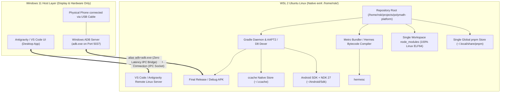

# Pure Linux WSL 2 / WSL 3 Architecture Migration: Plan, Tradeoffs & SOP

> **Architectural blueprint and step-by-step SOP for migrating the Polymath Platform / Gurudevi Mobile workspace from the Windows 9P cross-mount (`/mnt/c/x`) into native WSL 2 / WSL 3 Linux `ext4` filesystem (`/home/nsk/projects/...`).**  
> *For deep architectural capabilities, daemonless container patterns (`wslc`), and NPU/GPU hardware acceleration, see [WSL 3.0 Modern Architecture & Patterns](file:///c:/x/docs/infra/2026-10-09-wsl3-modern-architecture-capabilities-and-patterns.md).*


---

## 1. Executive Summary & Why This Migration Exists

### The Root Problem (Current Split-Environment Setup)
Currently, code lives on the Windows NTFS drive (`C:\x`), and `pnpm install` runs on Windows (installing `win32-x64` native binaries). When native Android compilation (Gradle / NDK / Metro) runs inside WSL 2, Linux Node attempts to execute Windows-compiled `.node` addons (Tailwind Oxide, LightningCSS, Sentry CLI), causing recurrent build failures and severe 9P filesystem bridge I/O bottlenecks.

### The Target Architecture (Pure Linux Container)
The entire repository, pnpm store, node_modules, Android SDK/NDK, Gradle caches, and Metro bundler live **exclusively inside the native Linux ext4 filesystem** (`/home/nsk/projects/polymath-platform`). Windows acts strictly as the **UI display layer** (IDE window and USB hardware driver).

---

## 2. Complete Architecture Topology



---

## 3. Exhaustive Tradeoffs, Caveats & Nuances Matrix

| Domain | How It Works in Pure Linux | Caveat / Nuance | How We Handle It |
| :--- | :--- | :--- | :--- |
| **Native Tooling & Rust Binaries** | 100% native Linux ELF64 bindings downloaded automatically by pnpm. | None. This permanently solves the Tailwind Oxide, LightningCSS, and Sentry binary crashes. | Works out-of-the-box with standard `pnpm install`. |
| **Filesystem Performance** | Direct in-memory Linux kernel ext4 caching. 5x–10x faster bundle & compile speed. | None. | No 9P translation layer latency. |
| **Disk Storage & Sparse VHD** | Single repo clone and pnpm store in Linux virtual disk (`ext4.vhdx`). | Virtual disks historically grew without shrinking. Upstream Hyper-V flags existing distros needing `--allow-unsafe` to force sparse mode. | Set `sparseVhd=true` in `~/.wslconfig`. If converting an existing distro, run `wsl --manage <distro> --set-sparse true --allow-unsafe` or compact via `wsl --compact`. |
| **RAM & vmmem Management** | Hyper-V balloon driver reclaims idle Linux page cache automatically. | Uncapped WSL can allocate 50% of host RAM and hold idle cache indefinitely. | Configure `memory=12GB` and `autoMemoryReclaim=gradual` in `C:\Users\<User>\.wslconfig` to release memory on idle. |
| **Networking & Dev Ports** | Mirrored networking mode maps Linux localhost to Windows localhost seamlessly. | Legacy NAT networking broke VPN connections and ADB port proxies. | Use `networkingMode=mirrored` and `dnsTunneling=true` in `.wslconfig`. |
| **Physical USB & ADB Debugging** | Phone stays plugged into Windows USB port. WSL executes Windows `adb.exe` via alias. | WSL's native `adb` package must NOT run its own server to prevent ADB server port 5037 conflicts. | Add `alias adb='/mnt/c/Users/<User>/AppData/Local/Android/Sdk/platform-tools/adb.exe'` in `~/.bashrc`. |
| **IDE & Code Editing** | VS Code / Antigravity connects via the "WSL Remote" extension. | Opening files via `\\wsl$\Ubuntu\...` in a non-remote Windows editor can cause file lock issues. | Always open projects using `code .` from inside the WSL terminal or "Open Folder in WSL". |
| **Git Line Endings (CRLF vs LF)** | Pure Linux `LF` line endings across all files. | Windows Git might try to convert to `CRLF` if accessed from Windows Git GUI. | Set `git config --global core.autocrlf input` inside WSL 2. |
| **Environment Variables & Secrets** | Stored in WSL `~/.bashrc` or Doppler CLI inside Linux. | Windows `.env` files don't automatically transfer unless copied or synced with Doppler. | Install Doppler CLI in Ubuntu and run `doppler setup` inside WSL. |


---

## 4. Step-by-Step Execution Plan

### Phase 1: Preparation in WSL (Non-Destructive)
0. Configure host resource bounds in `C:\Users\<User>\.wslconfig`:
   ```ini
   [wsl2]
   networkingMode=mirrored
   dnsTunneling=true
   memory=12GB
   swap=2GB
   processors=6

   [experimental]
   autoMemoryReclaim=gradual
   sparseVhd=true
   autoProxy=true
   ```
1. Ensure Ubuntu WSL has Node.js 22 (matching `.nvmrc`) and pnpm 12:
   ```bash
   # Inside WSL:
   curl -fsSL https://get.pnpm.io/install.sh | sh -
   ```

2. Clone the repository directly into the native Linux filesystem:
   ```bash
   mkdir -p ~/projects
   cd ~/projects
   git clone https://github.com/NeevSK/Gurudevi.git polymath-platform
   cd polymath-platform
   ```
3. Set line-ending policy:
   ```bash
   git config core.autocrlf input
   ```

### Phase 2: Dependency Installation & Toolchain Verification
1. Run clean native install inside Linux:
   ```bash
   pnpm install
   ```
2. Verify all native Linux binaries are natively installed:
   ```bash
   node -e "console.log('Tailwind PostCSS:', typeof require('@tailwindcss/postcss'))"
   ```
3. Verify Android SDK, NDK, and `local.properties`:
   ```bash
   echo "sdk.dir=$HOME/Android/Sdk" > apps/gurudevi-mobile/android/local.properties
   ```

### Phase 3: IDE & ADB Setup
1. Configure ADB alias in WSL `~/.bashrc`:
   ```bash
   echo "alias adb='/mnt/c/Users/Naween/AppData/Local/Android/Sdk/platform-tools/adb.exe'" >> ~/.bashrc
   source ~/.bashrc
   ```
2. Test device connectivity:
   ```bash
   adb devices
   ```
3. Open the workspace in your IDE:
   ```bash
   cd ~/projects/polymath-platform
   code .
   ```

### Phase 4: Verification & Windows Host Cleanup
1. Run full 6-tier first-principles native audit:
   ```bash
   pnpm --filter gurudevi-mobile run audit:native-pipeline
   ```
2. Run full test suite:
   ```bash
   pnpm --filter gurudevi-mobile run verify:style-stack
   ```
3. Once 100% operational, safely delete the redundant Windows `C:\x` folder to reclaim 20+ GB of disk space.

---

## 5. Verification Checklist

- [ ] Repository cloned in `/home/nsk/projects/polymath-platform`
- [ ] `pnpm install` completed with zero cross-filesystem warnings
- [ ] `@tailwindcss/postcss` and native engines load in Linux Node without shims
- [ ] `adb devices` sees connected physical phone from WSL terminal
- [ ] IDE language servers and TypeScript intellisense active via WSL Remote
- [ ] Windows host `C:\x` cleaned up after migration sign-off
