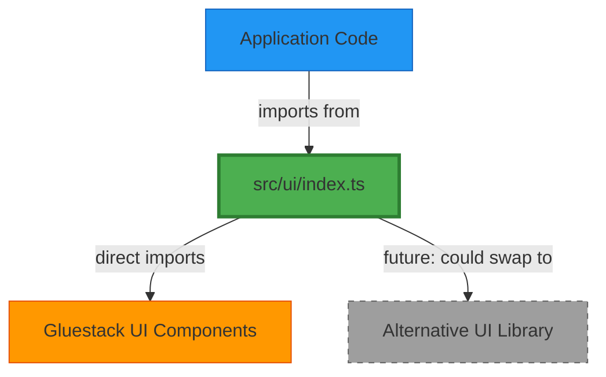

> **Superseded** � kept for historical reference.
> See active docs at docs/INDEX.md.
# UI Abstraction Layer Architecture

**Status**: APPROVED | **Date**: 2026-02-11 | **Author**: Senior Architecture Team

---

## Executive Summary

We are implementing a **UI Abstraction Layer** to solve critical TypeScript compiler stack overflows and optimize bundle size for low-end Android devices (2GB RAM) in Sri Lankan schools.

**Problem**: Gluestack UI's aggregate index causes TypeScript stack overflow and potentially ships 200KB+ of unused components.

**Solution**: Create `src/ui/index.ts` as our single source of truth for UI components, using direct imports.

**Impact**: 
- ✅ Fixes TypeScript compiler errors
- ✅ Improves bundle size through better tree-shaking
- ✅ Future-proofs architecture for easy refactoring
- ✅ Documents actual UI component inventory

---

## Problem Statement

### TypeScript Stack Overflow (Compile-time)
```
RangeError: Maximum call stack size exceeded
    at resolveNameHelper (typescript/lib/_tsc.js:19477:29)
```

**Root Cause**: Gluestack UI exports 30+ components with deeply nested generic types. When the TypeScript compiler resolves the aggregate index, it hits recursion limits.

### Bundle Size Risk (Runtime)
- **Target Devices**: 2GB RAM, spotty 3G/4G, limited storage
- **Current Risk**: Gluestack UI's full bundle is ~200KB+ (minified)
- **Future Risk**: By Beta (100+ components), could hit 500KB+ of UI library alone

### Architectural Debt
- Direct imports scattered across codebase make future refactoring hard
- No single source of truth for which components we actually use
- Difficult to swap UI libraries later

---

## Architecture Overview

### The UI Abstraction Layer Pattern



### Directory Structure

```
src/
├── ui/
│   ├── index.ts              # Main export barrel (SINGLE SOURCE OF TRUTH)
│   ├── primitives/           # Future: custom primitive components
│   ├── patterns/             # Future: common UI patterns
│   └── README.md             # Usage guide
├── components/
│   ├── shared/              # Import from src/ui, NOT @gluestack-ui
│   └── screens/             # Import from src/ui, NOT @gluestack-ui
└── ...
```

---

## Implementation Plan

### Phase 1: Foundation (NOW - This Session)

#### Step 1.1: Create UI Abstraction Layer
Create `src/ui/index.ts`:

```typescript
/**
 * UI Abstraction Layer
 * 
 * RULE: This is the ONLY file that imports from @gluestack-ui
 * All application code MUST import UI components from this file.
 * 
 * WHY: 
 * 1. Fixes TypeScript stack overflow (direct imports)
 * 2. Improves tree-shaking (only bundle what we use)
 * 3. Enables easy refactoring (change one file to swap libraries)
 * 4. Documents our actual UI component inventory
 */

// Layout Components
export { Box } from '@gluestack-ui/themed/build/components/Box';
export { Center } from '@gluestack-ui/themed/build/components/Center';
export { HStack } from '@gluestack-ui/themed/build/components/HStack';
export { VStack } from '@gluestack-ui/themed/build/components/VStack';

// Loading States
export { Spinner } from '@gluestack-ui/themed/build/components/Spinner';

// Typography
export { Text } from '@gluestack-ui/themed/build/components/Text';
export { Heading } from '@gluestack-ui/themed/build/components/Heading';

// Form Components
export { 
  Input, 
  InputField, 
  InputSlot, 
  InputIcon 
} from '@gluestack-ui/themed/build/components/Input';

export { 
  Button, 
  ButtonText, 
  ButtonSpinner, 
  ButtonIcon 
} from '@gluestack-ui/themed/build/components/Button';

export {
  Select,
  SelectTrigger,
  SelectInput,
  SelectIcon,
  SelectPortal,
  SelectBackdrop,
  SelectContent,
  SelectDragIndicatorWrapper,
  SelectDragIndicator,
  SelectItem
} from '@gluestack-ui/themed/build/components/Select';

// Provider (special case - keep from main export)
export { GluestackUIProvider } from '@gluestack-ui/themed';

// ADD COMPONENTS AS NEEDED - DO NOT PREEMPTIVELY IMPORT UNUSED COMPONENTS
```

#### Step 1.2: Create Usage Guide
Create `src/ui/README.md`:

```markdown
# UI Component Library

## Usage Rules

### ✅ DO
```typescript
// Import from the abstraction layer
import { Button, ButtonText, Spinner } from '@/ui';
```

### ❌ DON'T
```typescript
// NEVER import directly from Gluestack UI
import { Button } from '@gluestack-ui/themed';
```

## Adding New Components

1. Check if component exists in `src/ui/index.ts`
2. If not, add it using the direct import pattern:
   ```typescript
   export { ComponentName } from '@gluestack-ui/themed/build/components/ComponentName';
   ```
3. Update this README with usage examples

## Why This Pattern?

- **TypeScript Performance**: Avoids stack overflow from aggregate index resolution
- **Bundle Optimization**: Only ships components we actually use
- **Future-Proofing**: Easy to swap UI libraries later
- **Documentation**: This file is our component inventory
```

#### Step 1.3: Update tsconfig.json
Add path alias for clean imports:

```json
{
  "extends": "expo/tsconfig.base.json",
  "compilerOptions": {
    "strict": false,
    "paths": {
      "@/*": ["./src/*"]
    }
  }
}
```

### Phase 2: Migration (Next 2-3 Sessions)

#### Priority Order:
1. **Critical**: `App.tsx`, `AuthScreen.tsx`, `OnboardingScreen.tsx`
2. **High**: Main navigation screens (Home, Library, Community, Profile)
3. **Medium**: Shared components
4. **Low**: Admin/rarely-used screens

#### Migration Script Pattern:
```typescript
// BEFORE
import { Button, ButtonText, Spinner } from '@gluestack-ui/themed';

// AFTER
import { Button, ButtonText, Spinner } from '@/ui';
```

#### Automated Migration (Optional):
```bash
# Find all files importing from @gluestack-ui
grep -r "from '@gluestack-ui/themed'" src/ --files-with-matches

# Use sed or manual search-replace
# VS Code: Search "@gluestack-ui/themed" → Replace with "@/ui"
```

### Phase 3: Bundle Analysis (After Migration)

#### Run Production Build:
```bash
npx expo export --platform android
npx source-map-explorer dist/bundles/*.js > bundle_analysis.txt
```

#### Success Metrics:
- Gluestack UI bundle < 150KB
- TypeScript compilation < 30s
- No stack overflow errors

#### If Bundle > 150KB:
- Implement lazy loading for heavy screens
- Consider custom primitives for commonly-used components
- Evaluate alternative UI libraries

---

## Migration Checklist

### Pre-Migration
- [ ] Create `src/ui/index.ts` with current components
- [ ] Create `src/ui/README.md` with usage guide
- [ ] Update `tsconfig.json` with path alias
- [ ] Test that imports work from new location

### Migration
- [ ] Migrate `App.tsx`
- [ ] Migrate `AuthScreen.tsx`
- [ ] Migrate `OnboardingScreen.tsx`
- [ ] Migrate navigation screens
- [ ] Migrate shared components
- [ ] Run full TypeScript check (no stack overflow)

### Post-Migration
- [ ] Run bundle analysis
- [ ] Document bundle size in KB
- [ ] Update collaboration guide with new pattern
- [ ] Add lint rule to prevent direct @gluestack-ui imports

---

## Future Evolution

### Option A: Stay with Gluestack UI
If bundle analysis shows < 150KB and no performance issues:
- Continue using abstraction layer
- Periodically audit for unused components
- Monitor bundle size as we add features

### Option B: Hybrid Approach
If some components are too heavy:
- Replace heavy components with custom primitives
- Keep lightweight Gluestack components
- Example: Custom Button, but use Gluestack Select

### Option C: Full Migration
If bundle > 300KB or persistent issues:
- Evaluate alternatives (NativeWind, custom primitives)
- Abstraction layer makes this swap trivial
- Change only `src/ui/index.ts`

---

## Architectural Decision Records (ADR)

### ADR-001: Why UI Abstraction Layer?

**Context**: TypeScript stack overflow when importing from Gluestack UI aggregate index.

**Decision**: Create single source of truth at `src/ui/index.ts` using direct imports.

**Consequences**:
- ✅ Fixes TypeScript compiler errors
- ✅ Improves bundle size
- ✅ Future-proofs architecture
- ⚠️ Requires discipline (no direct imports)
- ⚠️ One-time migration effort

**Alternatives Considered**:
1. ❌ Ignore and use workarounds: Technical debt compounds
2. ❌ Switch to Tamagui: Version incompatibilities with React 19 / RN 0.81
3. ✅ **UI Abstraction Layer**: Best balance of safety and pragmatism

### ADR-002: Why Direct Imports Instead of Aggregate?

**Context**: Gluestack UI's main index re-exports 30+ components with complex generic types.

**Decision**: Import directly from `build/components/ComponentName` instead of main index.

**Consequences**:
- ✅ TypeScript resolves each component's types independently (no recursion)
- ✅ Better tree-shaking (esbuild/Metro can eliminate unused code)
- ✅ Faster compilation (smaller type resolution graph)
- ⚠️ Slightly more verbose import paths

**Alternatives Considered**:
1. ❌ Increase Node stack size: Treats symptom, not cause
2. ❌ Use `skipLibCheck`: Hides errors, doesn't reduce bundle
3. ✅ **Direct Imports**: Solves both compile-time and runtime issues

---

## Developer Guidelines

### For Human Developers

1. **Always import from `@/ui`**, never from `@gluestack-ui/themed`
2. Before adding a new component, check if it exists in `src/ui/index.ts`
3. When adding a component, use the direct import pattern
4. Run `npx tsc --noEmit` before committing to catch errors early

### For AI Assistants

1. **Pattern Recognition**: If you see `import ... from '@gluestack-ui/themed'`, flag it as anti-pattern
2. **Automatic Correction**: Suggest replacing with `import ... from '@/ui'`
3. **Component Discovery**: Check `src/ui/index.ts` before adding new components
4. **Documentation**: When adding components, update `src/ui/README.md`

---

## Success Metrics

### Short-term (Alpha Release)
- [ ] Zero TypeScript stack overflow errors
- [ ] Gluestack UI bundle < 150KB
- [ ] TypeScript compilation < 30s
- [ ] All imports use `@/ui` pattern

### Long-term (Beta Release)
- [ ] Bundle size growth < 10% per month
- [ ] New developers follow pattern without prompting
- [ ] Easy to swap UI libraries (if needed)
- [ ] Clear component inventory documented

---

## Emergency Rollback Plan

If abstraction layer causes issues:

1. **Quick Fix**: Revert `src/ui/index.ts` to re-export from main index
   ```typescript
   export * from '@gluestack-ui/themed';
   ```

2. **Full Rollback**: Use git to revert to direct Gluestack imports
   ```bash
   git revert <commit-hash>
   ```

3. **Root Cause**: File issue with Gluestack UI team about aggregate index performance

---

## References

- [Gluestack UI Documentation](https://ui.gluestack.io/)
- [TypeScript Performance Best Practices](https://github.com/microsoft/TypeScript/wiki/Performance)
- [React Native Bundle Optimization](https://reactnative.dev/docs/performance)
- [Tree Shaking in Metro Bundler](https://metrobundler.dev/docs/bundling)

---

**Last Updated**: 2026-02-11  
**Next Review**: After Alpha release (bundle analysis results)  
**Owner**: Architecture Team
