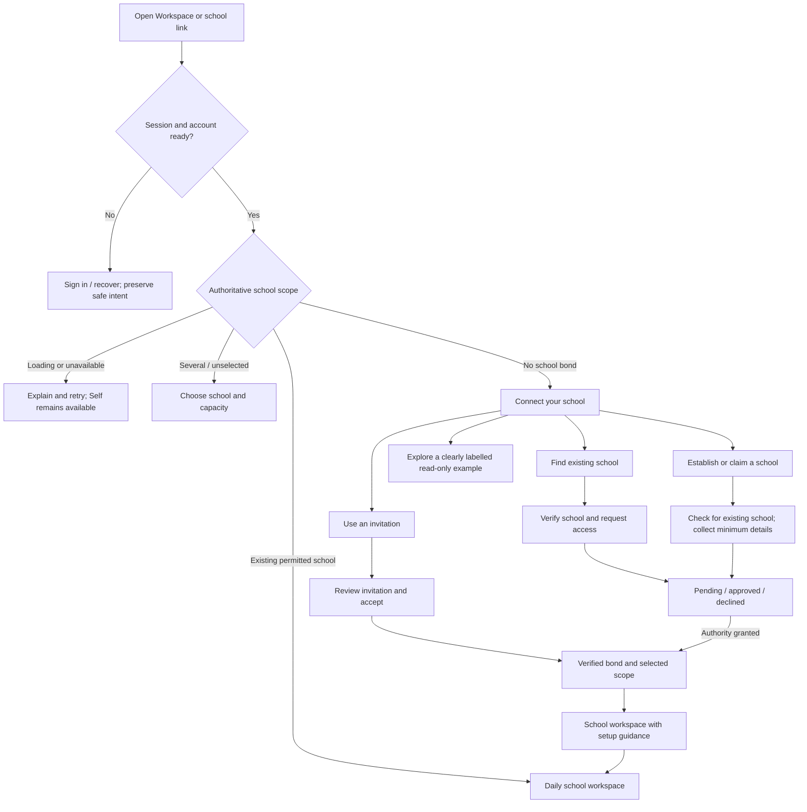

# Principal first-school journey and experience model

> **Domain correction:** Principal is an institutional or commercial capacity, never a personal principal workspace. Self and any teacher personal workspace are separate capabilities. This draft's connection flow is a proposal, not an implementation instruction: first trace the existing school and tuition-institute lifecycles, bonds, Cedar authority and onboarding before deciding how an unconnected person reaches principal work. The earlier personal-scope screen experiment was reverted.

This is a proposed product and interaction model, not a statement that its screens or backend operations already exist. It builds on the [principal parity audit](2026-10-29-principal-admin-parity-audit.md). The first user's job is to connect to the right school, not to complete every administrative setup task before using the app.

The initial machine-readable pilot is `flow:principal:connect_school` in `packages/core/src/flows/admin/principalConnectSchool.flow.ts`. Query its declared minimal and expanded views and gaps with `pnpm exec tsx --tsconfig packages/core/tsconfig.json scripts/query-journey.ts flow:principal:connect_school`. The checker validates declared IDs, references, connectivity and scenario coverage; it does not validate route behavior, implementation bindings or evidence authenticity. A valid report with gaps does not establish a working journey. This is a small pilot, not complete parity or a general-purpose catalog.

## Minimal and expanded views of one journey

The two views describe the same journey and use the same stable journey, step, action and scenario identifiers. They are proposed views over a shared contract, not two independent specifications. The existing `FeatureJTBDGraph` and `FLOW_REGISTRY` provide a starting point but do not yet implement all fields or queries below. The identifier `principal.connect_school` in this document is a proposed example, not a registered flow ID.

| View | Intended readers | Contents |
| --- | --- | --- |
| Minimal | Product, design, engineering, support | User and context, intent, trigger, prerequisite, steps and choices, visible feedback, success and other outcomes, and important failure/recovery scenarios. |
| Expanded | Engineering, security, QA and operators | The minimal view plus data and schema relationships, API and events, authentication and authorization, state and persistence, platform bindings, failure and concurrency semantics, privacy, architecture boundaries, observability and evidence. |

The expanded view must link to actual source contracts and evidence, and label each binding **unknown**, **proposed**, **implemented**, or **verified**. An implementation binding records the source revision or date; evidence records the environment, tier, substitutions, result and limitations. An inferred link or route file is not proof that a behavior works. Do not store credentials, personal records or raw sensitive identifiers in the catalog.

### Minimal example: principal connects to a school

| Element | Contract |
| --- | --- |
| Intent | A principal wants to work with the correct school while retaining access to her personal Self. |
| Entry | Workspace, school invitation, QR or a saved school link. |
| Starting situation | Account is ready; school authority may be absent, unselected, pending or unavailable. |
| Steps | Resolve authority → choose an existing permitted school, find a school, review an invitation, or start an available claim/establishment path → review and submit → follow the resulting status. |
| Interaction | Show relevant choices, allow back and return to Self, preserve a safe draft, and confirm the school and requested capacity before submission. |
| Feedback | Explain loading, invalid input, submitting, pending, confirmed and failure states in text; provide retry or another appropriate recovery action. |
| Outcomes | A verified bond and selected school lead to the workspace; a pending request remains pending; cancellation returns to the prior safe context. An error never creates a successful outcome. |

### Expanded example: trace behind the experience

| Concern | Current evidence and outstanding contract |
| --- | --- |
| Identity and scope | `lib/sanctuary/authorizedEntry.ts` obtains server-derived identity and active scope. Verify whether it exposes all eligible bonds and pending states before deciding that no school exists. |
| Domain data | `School`, `Bond`, `SchoolRegistryClaim` and membership records appear in `packages/schema/schema.zmodel`. Verify deployed migrations and the applicable transaction for each establishment or claim branch. |
| APIs and events | The onboarding handler includes `createFounderSchoolBond` for a school created by the current user. Search, invitation, request and claim contracts need individual tracing; no endpoint is implied merely by this model. |
| Authentication and authorization | Session verification identifies the account. Server-derived active bond, Cedar evaluation and database enforcement determine permitted school operations. Selecting a role or finding a record is not an authority grant. Verify resource ownership and cross-school denial for every mutation. |
| Platform and flow | Web currently has a personal-scope state in `workspace/page.tsx`; the connection screens and state transitions in this model are proposed. Register a real FlowDAG and bind platform routes and actions when those implementations exist. |
| State and durability | Define which drafts are local versus server-persisted, their account/school scope, expiration and recovery behavior; reconcile unknown submission outcomes before retrying. Do not promise offline submission without an implemented outbox. |
| Failure and concurrency | Specify inaccessible or stale bonds, service errors, duplicate claims, concurrent submissions and account/school switches, including what the user can do and which records can change. |
| Privacy and operations | Minimize stored verification data, define retention and access, and record safe operational events without leaking invitation secrets or sensitive content. Specify ownership and support/recovery paths. |
| Evidence | Link each scenario to its concrete tests or browser/device/database evidence, including revision, environment, tier and substitutions; absence of evidence remains visible. |

### Interaction and feedback contract per action

Every important action should describe **what the user can do**, availability and reason when unavailable, input and validation, focus/keyboard behavior, the visible state while running, and the result. Map each outcome to the next state and a truthful message: validation error, pending review, confirmed success, denied, retryable error, unknown outcome or cancellation. Accessibility announcements and reduced-motion behavior are part of the contract. Optional Tutii, motion, sound or haptics enhance these signals and must never be their only representation.

For example, **Submit school access request** is enabled only when the form is valid and a supported, authorized request path exists. On submit, keep the choice visible and show progress. On a server-confirmed pending response, show “Request sent; awaiting review.” On a rejected response, explain the returned reason where safe. On an uncertain network outcome, check request status before offering a duplicate submission. These are proposed behaviors until linked to real contracts and tests.

### Query and comparison requirements

The catalog should answer, for a given stable journey or scenario ID: what is intended; which screen and action implement each step by platform; what API, data and authorization contracts support it; and what evidence exists for success and failure. Queries must distinguish missing bindings from failed evidence and stale evidence from current evidence. Automated checks can validate identifiers, schema, references, route existence and evidence freshness; behavioral parity, security and real user outcomes need appropriate tests and review. The checker must report uninspected or unverifiable assertions rather than infer success from a filename.

## What the principal experiences

Her personal Self is available after account onboarding. On opening Workspace with no verified school scope, she sees a welcoming school connection screen with useful choices and a clear path back to Self. No fabricated school data, irrelevant attendance cards, or operational dashboard is shown. A personal scope does not by itself prove that no school bond exists: the system must distinguish no bond from an unselected, pending, expired, or unavailable bond.

Transitions are proposed semantics, not existing route declarations. Use the existing shared flow and authority machinery when implementing. Account selection, onboarding capacity, a search result, a school record, and a draft do not grant principal authority: Cedar and server-side verified bond/resource checks remain authoritative.

## Questions to ask, in order

The application should ask only what it needs for the current step, provide a reason, and let her stop or return to Self. Prefill only verified existing facts.

1. **Which school do you want to work with?** Search by name and locality or use an invitation; show enough verified context to distinguish similar names. If it cannot be found, offer a separate establish/claim path. Never assume a blank search result means the school does not exist when the search failed.
2. **How are you connected to this school?** Present the actual available routes: invitation, request access, or claim/establish, with their proof and review requirements taken from the implemented contract. Principal is a requested capacity until verified. Do not invent a verification method or promise an approval time.
3. **Is this the right school?** Confirm the school name and location before accepting or submitting. Warn if a matching school or existing request is found; allow correcting the choice.
4. **What is needed to get started?** Once authorized, ask about missing essentials in context: school identity, sections and grades, academic year and terms, staff invitations, and timetable. Ask for each only when its workflow starts, and explain whether it is required for a specific action. Establishing a school does not require populating every feature.
5. **What would you like to do now?** Show daily work and incomplete setup together once the school is available. Let her defer optional tasks and come back later.

Open product/contract decisions: who can approve or verify a principal's claim; what evidence is necessary; which registry is authoritative; whether creation creates a principal bond atomically; how multiple campuses and acting principals are represented; which scheduling model is authoritative; and which setup dependencies are genuinely mandatory. Until verified, display neutral request/review language and do not create a new authority path from a client selection.

## Screens, interactions and feedback

| Screen / state | User goal and content | Actions and feedback |
| --- | --- | --- |
| Workspace resolving | Understand that the school connection is being checked. | Accessible loading status; keep Self navigation. Timeout or failure offers retry and does not imply no school exists. |
| Connect your school | “Your personal space is ready. Connect a school to begin your school workspace.” | Find school, use invitation, establish/claim if supported, explore example, return to Self. Explain each choice in one sentence. |
| Choose school | Select among verified eligible bonds, or see why an entry is pending/inactive. | Show school name, locality and capacity; choosing a scope uses authoritative selection and refreshes permissions. Failure preserves selection and permits retry. |
| Find a school | Identify an existing institution without creating a duplicate. | Search name/locality; results have disambiguating details. Distinguish no results, offline/service error and loading. Review result before requesting access. |
| Invitation | Understand the school, requested capacity, sender if safely available, and expiry before accepting. | Paste code or open validated link; accept or cancel. Clearly explain invalid, expired, already-used or different-account invitations; no silent privilege grant. |
| Claim / establish | Confirm whether this is an existing school and collect the minimum facts and evidence actually required by the verified server contract. | Save/resume a draft where safe; review before submit. Successful submission shows whether a request is pending or a verified school bond exists. Prevent duplicate submission with an appropriate server contract. |
| Request status | Know whether access is pending, approved, declined, expired or requires further information. | Show only known status and next action, with retry/contact path when available; return to Self. Do not claim approval before the authoritative bond exists. |
| First school workspace | Begin meaningful work with the actual school, even when some setup is incomplete. | Show school identity, a small next-step setup lane and accessible daily tools allowed by verified authority. Each task explains the benefit, prerequisite and whether it can wait. No invented metrics. |
| Setup room | Complete one school task in context: identity, structure, terms, staff, timetable. | Show progress based on persisted facts, save/continue later, validation near fields, confirmation only after server receipt, actionable failure and retry. Offer a way back without losing a draft. |
| Daily workspace | See what needs attention today and choose a task. | Provide real data with timestamps where relevant; distinguish none, not configured, no permission and unavailable. Keep incomplete setup discoverable without obstructing work. |
| Read-only example | Understand the experience before connecting. | Persistent example label, clearly synthetic school and zero real writes; leave example or connect school. A demo action must never imply a real submission. |

## State and feedback model

Treat these as independent dimensions, not one linear onboarding percentage:

- **Account:** signed out, onboarding required, active, inactive, unavailable.
- **School authority:** resolving, no eligible bond, scope selection required, pending request, selected and permitted, denied/expired, service unavailable. Distinguish school eligibility from active personal scope.
- **Per setup capability:** unknown, not started, draft/in progress, ready, blocked by prerequisite, not authorized, or unavailable. Persisted facts determine readiness; a local dismissal is not proof of completion.
- **Per operation:** idle, submitting, confirmed by server, rejected with explanation, retryable failure, or unknown outcome. For unknown outcome, reconcile the server state before allowing a duplicate submission.
- **Per daily data source:** loading, populated, genuinely empty, not configured, denied, stale, or failed. Preserve last known data only if it is labeled and remains authorized for the selected school.

Feedback should name the action and outcome: “Request sent; awaiting review” for a pending request, “Invitation accepted” only after confirmation, and “We couldn't save the term. Your draft is still here” when that is true. Validation is inline; operation status is announced accessibly. Do not use success colors, completed steps, or a celebratory chime for a request that is only pending. Respect reduced motion and avoid intrusive sound; sensory effects are optional enhancements to a textual receipt.

## Journey and authority obligations

- **Ingress:** workspace navigation, saved deep link, invitation link/QR, notification, cold start and OAuth return. Preserve validated intent across sign-in; prevent open redirects and resume only after identity and scope resolve.
- **Admission:** personal Self remains accessible independently. Server-derived active scope and Cedar decisions govern school reads and writes. Unavailable authorization fails closed without presenting a fake empty state. School switching invalidates prior school data and drafts are scoped to account and school.
- **Branches:** first-time no school, existing school, multiple schools, invited user, pending claim, incomplete setup, already-operating school, demo and offline/service failure. A principal can return to Self at every branch.
- **Convergence:** after a confirmed bond and scope selection, enter the school workspace; retain the original intent only if it is still authorized and prerequisites are satisfied. Setup prompts disappear or change when their real underlying conditions change; avoid a permanent welcome banner.
- **FlowDAG:** declare feature graphs and register real web routes before implementing screens. The existing academic-cycle flow needs correction with its actual implementations; a valid route string alone does not validate the described user action.

## Current substrate and gaps

- `app/(sanctuary)/workspace/page.tsx` already handles `PERSONAL_CLASSROOM` with a message and links to Self and Guest House, but it has no principal-specific find/join/establish choices.
- `packages/admin/src/components/principal/PrincipalOnboardingView.tsx` offers demo, create and join callbacks in the native/legacy experience; those callbacks alone do not establish verified web functionality.
- `app/(sanctuary)/workspace/school/page.tsx` falls back to a sample school ID when the selected scope is not a school. The actual displayed result and access behavior require browser verification; a real user's identity must not be inferred from that sample.
- `apps/sanctuary-api/src/core/handlers/onboarding.ts` has a founder-school bond operation that checks school creator. This is one existing operation, not proof that all school creation, claim and review branches are wired or safe.
- `packages/admin/src/principal/workspace.ts` supplies shared principal capability IDs and distinguishes planned from live in that model. Web behavior and acceptance evidence remain separately tracked in the parity audit.

## Acceptance scenarios before declaring implementation complete

1. A newly onboarded principal in a personal scope opens Workspace, finds a useful connection screen, and returns to Self without creating a school.
2. A principal with an existing but unselected school bond can select it; no duplicate school is created. A failed authority lookup shows retry, not “no school”.
3. An invite or claim opened while signed out resumes safely after authentication. A pending or rejected request never grants school access.
4. A principal who joins a partly configured school sees real daily work and specific missing setup; a failed read is distinguishable from an empty result.
5. An authorized user can save and resume a setup draft; failure, duplicate submission, stale scope, other-school access and permission denial are covered. Confirmed completion reflects authoritative data.
6. Demo mode is clearly labeled and performs zero real writes. Keyboard and screen reader users can complete the same flows at narrow and desktop widths.

Evidence must name its tier and substitutions: static contract checks, boundary mocks, scenario tests and real browser/API/database acceptance each prove different things. This model itself has no runtime evidence.
