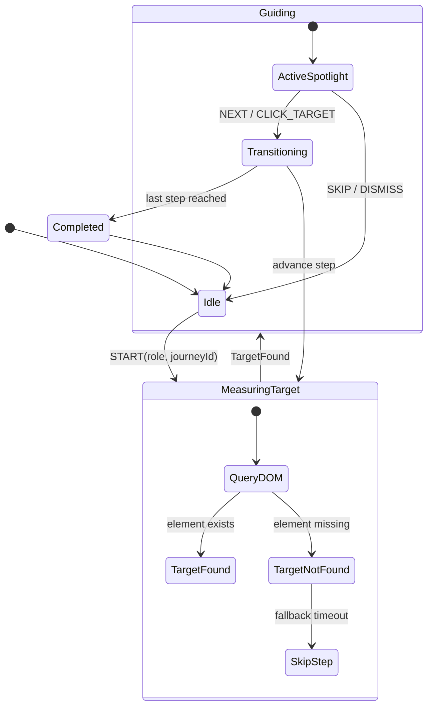

# Technical Dossier: Modern Spotlight Onboarding & Journey Architecture

**Date:** 2026-10-31  
**Author:** Antigravity  
**Methodology:** Temporal Grounded Search (GitHub Velocity, Driver.js v1+, XState v6, Floating UI / Pure DOM FLIP)  
**Subject:** Reverse-Engineering State-of-the-Art In-App Product Tours, Dynamic Spotlights, and Character-Led UX

---

## 1. Industry State of the Art: How High-End Teams Build Guided Paths

Top SaaS products (Linear, Notion, Stripe, Figma) and leading open-source libraries (Driver.js, React Joyride, CommandBar) have abandoned full-screen blocking modals. Modern user expectations demand **in-situ progressive disclosure**: the real layout stays alive, while a luminous spotlight cut-out focuses user attention on real UI controls.

### Architectural Breakdown of Top Solutions

```
┌────────────────────────────────────────────────────────────────────────┐
│                        1. ORCHESTRATION LAYER (XState v6)              │
│   • Finite State Machine & Actor pattern                               │
│   • Prevents boolean explosion (`isTourOpen`, `step1Done`, etc.)       │
│   • Manages async lifecycle: DOM measurement, scrolling, transitions   │
└───────────────────────────────────┬────────────────────────────────────┘
                                    ▼
┌────────────────────────────────────────────────────────────────────────┐
│                        2. POSITIONING & COLLISION (Geometry Engine)     │
│   • `getBoundingClientRect()` + Scroll & Resize Listeners              │
│   • Collision detection & smart flipping (Top/Bottom/Left/Right)       │
│   • Viewport boundary clamping                                         │
└───────────────────────────────────┬────────────────────────────────────┘
                                    ▼
┌────────────────────────────────────────────────────────────────────────┐
│                        3. STAGE & SPOTLIGHT LAYER (SVG Mask / Cutout)  │
│   • Full-viewport SVG with `<mask id="spotlight">` or CSS box-shadow  │
│   • Hardware-accelerated morphing coordinates (FLIP transition)        │
│   • Interactive pass-through: targeted element remains clickable       │
└───────────────────────────────────┬────────────────────────────────────┘
                                    ▼
┌────────────────────────────────────────────────────────────────────────┐
│                        4. CHARACTER POPUP (Tutti Presentation)         │
│   • Speech bubble with dynamic indicator pointing to spotlight rect    │
│   • Short, everyday functional copy (1-2 sentences)                    │
│   • Immediate, prominent "Skip" / "Got it" action                      │
└────────────────────────────────────────────────────────────────────────┘
```

---

## 2. Deep Dive: The 4 Core Technical Seams

### Seam A: The Stage & SVG Cutout Mask (How Driver.js & Top Tools Do It)

Instead of drawing four separate dark `<div>` overlays around an element (which stutters during scrolling and breaks on border-radii), the industry standard uses an **Inverted SVG Mask**:

```html
<svg class="fixed inset-0 w-full h-full pointer-events-none z-50">
  <defs>
    <mask id="tutti-spotlight-mask">
      <!-- 1. White fills the whole screen (making backdrop visible) -->
      <rect width="100%" height="100%" fill="white" />
      
      <!-- 2. Black cuts a transparent hole over target DOMRect -->
      <rect
        x="target.left - padding"
        y="target.top - padding"
        width="target.width + (padding * 2)"
        height="target.height + (padding * 2)"
        rx="radius"
        fill="black"
        style="transition: all 0.35s cubic-bezier(0.16, 1, 0.3, 1);"
      />
    </mask>
  </defs>
  
  <!-- 3. The dark dimming backdrop applied with the mask -->
  <rect
    width="100%"
    height="100%"
    fill="rgba(15, 23, 42, 0.72)"
    mask="url(#tutti-spotlight-mask)"
  />
</svg>
```

#### Why this is superior:
1. **Single GPU Layer:** Only one composite SVG layer is animated.
2. **Smooth Morphing:** When advancing from a small button to a wide table, the `<rect>` morphs smoothly using CSS transitions.
3. **Rounded Corners:** Native support for `rx` / `ry` matching the target button's exact `border-radius`.

---

### Seam B: Smart Popover Positioning & Collision Avoidance

To place Tutti without third-party bloat, we implement the **Viewport Collision Pipeline**:

1. **Target Measurement:** Measure target rect: `{ top, left, right, bottom, width, height }`.
2. **Preferred Placement:** Default to `bottom` (or `top` if target is in bottom third of viewport).
3. **Collision Checks:**
   - If `preferred === 'bottom'` and `target.bottom + popoverHeight + margin > window.innerHeight`, flip to `top`.
   - If `preferred === 'top'` and `target.top - popoverHeight - margin < 0`, flip to `bottom`.
   - Clamp `left` position between `margin` and `window.innerWidth - popoverWidth - margin`.
4. **Scroll Alignment:** Automatically trigger `element.scrollIntoView({ behavior: 'smooth', block: 'center' })` before calculating coordinates.

---

### Seam C: XState v6 Machine Architecture

Managing product tours with `useState` leads to race conditions (e.g. user clicks next before target is in DOM, route changes mid-animation, or window resizes). With `xstate@6.0.0-alpha.70`, the flow is deterministic:



#### Key Invariants Handled by XState:
- **Resilience to Missing Nodes:** If a tab takes 200ms to render, XState can retry DOM querying for up to 1 second before gracefully skipping the step rather than crashing.
- **Route Sync:** If a step requires navigating from `/workspace` to `/workspace/attendance`, XState fires the route push, waits for navigation to settle, and then triggers target measurement.
- **Durable Dismissal:** On `SKIP`, the machine calls `StorageManager.set('tutti.dismissed.' + journeyId, true)` so it is never shown again.

---

### Seam D: The Tutti Persona & UI/UX Polish

#### The Popover Card Structure:
- **Tutti Avatar:** Positioned on the corner of the speech bubble with a soft glow and subtle floating bob (`translateY` animation).
- **Pointer/Beak:** An SVG triangle pointing directly at the center of the spotlight cut-out.
- **Copy:** Exactly 1-2 functional sentences.
  - *Example (Teacher on Attendance):*  
    *"Click any student to toggle Present or Absent. It saves automatically to your device even if you're offline."*
- **Controls:**
  - `[Got it / Skip]` (grey ghost button, dismisses tour).
  - `[Next →]` (brand accent button, advances spotlight).
  - Step indicator dots (e.g. `● ○ ○`).

---

## 3. Comparison of Alternatives

| Approach | Bundle Overhead | Smooth Morphing | React Lifecycle Integration | Reliability & Offline |
| :--- | :--- | :--- | :--- | :--- |
| **Monolithic Third-Party (Intro.js)** | High (~30kB) + restrictive AGPL license | Clunky CSS `div` wrappers | Fragile wrapper needed | Poor offline/local state control |
| **Driver.js (Pure JS)** | Very Low (~7.5kB) | Excellent SVG mask | External imperative API, doesn't know Next.js routing natively | Good, but requires manual React bindings |
| **Our Engine (XState v6 + Native SVG Mask + React DOM)** | **Zero extra dependencies** (XState already installed) | **Flawless hardware-accelerated SVG mask** | **100% native Next.js router & React 19 integration** | **Complete local storage persistence & role-filtering** |

---

## 4. Execution Plan in the Codebase

1. **`apps/gurudevi-web/lib/tutti/types.ts`**: Types for journey steps, target selectors, and role filters.
2. **`apps/gurudevi-web/lib/tutti/tuttiMachine.ts`**: XState v6 actor machine managing step transitions and DOM measurements.
3. **`apps/gurudevi-web/lib/tutti/TuttiSpotlight.tsx`**: High-performance SVG mask overlay, collision-aware tooltip card, and Tutti avatar.
4. **`apps/gurudevi-web/lib/tutti/journeys/`**: Role-based scripts for Teacher, Principal, Student.
5. **Streamlined `/support`**: Clean, direct help page with a button to launch the Tutti tour on demand.
