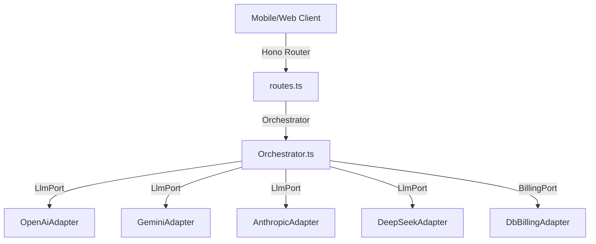

# AI Assistant Hono Migration & Sovereign Architecture (June 2026)

This document records the architectural details and security considerations for migrating the AI Assistant's orchestrator from Supabase Edge Functions to the Hono API framework within the `sanctuary-api` service.

---

## 1. Context & Motivation

To preserve **infrastructure sovereignty** and provide maximum flexibility in user monetization, the AI orchestration layer was decoupled from Supabase-specific functions and rewritten in the Hono API framework using the **Hexagonal (Ports & Adapters) architecture**.

Key design drivers:
* **Dynamic Billing Modes**: Dynamic resolution between *Platform Baseline* (gpt-4o-mini funded by the platform), *Personal BYOK* (user provides their own API key), and *Premium Tiers* (high-tier paid/institutional access).
* **Zero-Knowledge Key Storage**: Developer/user keys are stored at-rest on the device keychain/hardware enclave via the native `cryptoManager` and transmitted securely to Hono, keeping them hidden from standard logs.
* **Resiliency**: Provider fallbacks ensure that if one service provider fails, the platform automatically switches to configured fallbacks.
* **Auditing**: Accurate token auditing mapped to the stream end-state without impacting request latencies.

---

## 2. Ports & Adapters Architecture

The system resides under `apps/sanctuary-api/src/ai/` and separates business logic from APIs and databases.

### A. Ports (`/ports`)
* **`LlmPort.ts`**: Defines standard contracts for LLM streaming queries.
* **`BillingPort.ts`**: Defines contracts to resolve the active pricing tier, check available keys, decrypt personal credentials, and log token usage details.

### B. Adapters (`/adapters`)
* **`OpenAiAdapter`, `GeminiAdapter`, `AnthropicAdapter`, `DeepSeekAdapter`**: Individual wrappers implementing `LlmPort` using TanStack AI modules.
* **`DbBillingAdapter`**: Connects to the database/ZenStack to resolve pricing tiers (`FREE`, `PRO`, `INSTITUTIONAL`) and decrypts keys. It also inserts logs into `SentinelAuditLog`.

---

## 3. Client Encryption & Envelope Decryption

To safeguard developer keys while enabling personal key integration:

1. **Hardware Enclave Storage**: User-provided API keys are captured on the client, secured inside the device's hardware enclave via `cryptoManager` (`expo-secure-store`), and persist securely on-device.
2. **Transmission**: Plaintext keys are encrypted on the client or during storage (formatted as `iv:ciphertext:authTag`).
3. **Server Envelope Decryption**: The server decrypts these inputs on-the-fly using `aes-256-gcm` inside `crypto.ts` with a 32-byte secret derived from environment variables (`BYOK_ENCRYPTION_SECRET`).

---

## 4. Fallback Chains & Failovers

Inside `Orchestrator.ts`, client requests run through a fallback system:
* If a primary platform model (e.g. OpenAI) returns a rate-limit error, quota limit, or connectivity exception, the orchestrator intercepts the failure and proceeds to evaluate alternative fallback providers (OpenAI -> Anthropic -> Gemini) in order.
* Ensures maximum uptime for active sessions.

---

## 5. Middleware, Rate-Limiting & Auditing

* **Rate-Limiting**: The Hono router applies a token-bucket rate limiter (`rateLimit.ts`) limiting clients to 10 queries per minute to guard against bot exhaustion.
* **Streaming & Auditing**:
  * Streams use TanStack AI's `toServerSentEventsResponse`.
  * The routes use standard web-spec `TransformStream` to intercept tokens as they fly through the socket.
  * Once the stream closes (`flush`), a background task computes duration metrics and logs details to the `SentinelAuditLog` table asynchronously, preventing performance blockages during stream initialization.
