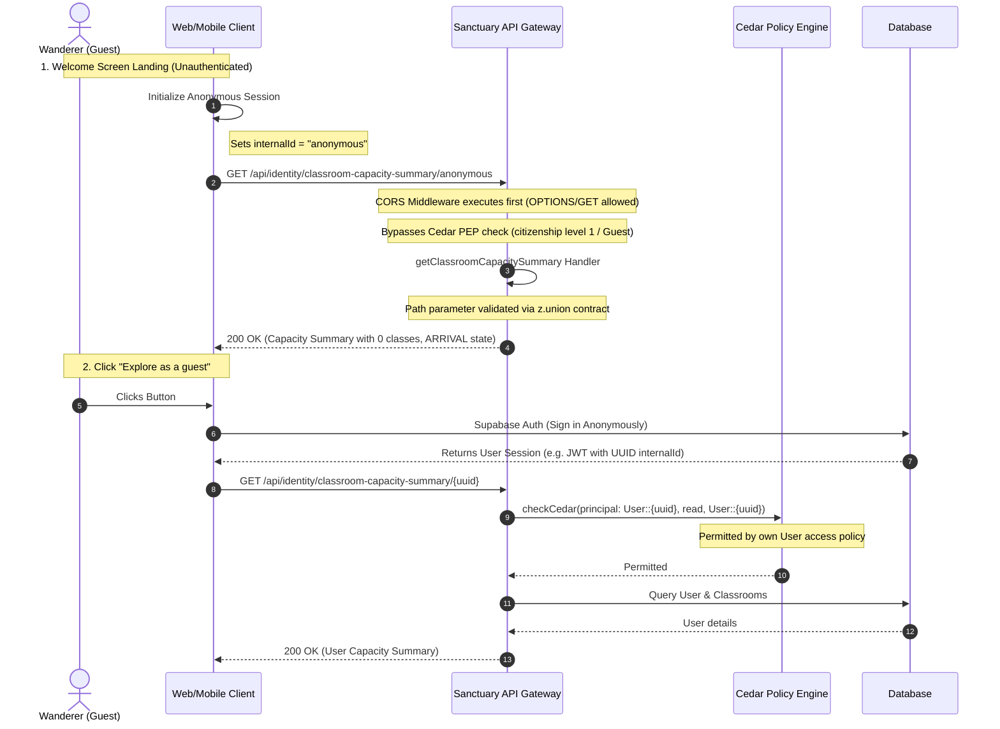

# Guest Session Lifecycle & Proof of Authority (POA) Specification

This document details the architectural lifecycle of guest sessions (Wanderers) on the Gurudevi platform and explains how the Proof of Authority (POA) security model coordinates access control across Hono and Cedar.

---

## 1. What is POA (Proof of Authority)?

**Proof of Authority (POA)** is Gurudevi's distinctive security model that separates **permission intent** from **transport execution**.

*   **Sovereign Contracts**: Every route is defined in a framework-agnostic way using pure Zod schemas (`SovereignRoute`).
*   **POA Metadata**: Routes carry CASL-style intent metadata specifying the action (e.g., `read`, `create`) and the resource/subject (e.g., `User`, `Classroom`) they require.
*   **Zero Implicit Access**: If a route is registered without explicit POA metadata, it is denied by default at the gateway boundary.

### PEP vs. PDP Architecture & Co-existence of CASL and Cedar

To avoid redundancy and clarify how CASL-style metadata and Cedar co-exist, the system divides authorization responsibilities clearly:

```text
HTTP Request (e.g., GET /api/identity/profile/123)
     │
     ▼
┌──────────────┐
│  Hono PEP    │  ◄─── 1. Map HTTP Route to Intent
└──────┬───────┘       (Using CASL-style metadata: action='read', subject='User')
       │
       │ principal, action, resource
       ▼
┌──────────────┐
│  Cedar PDP   │  ◄─── 2. Evaluate Relationship Logic
└──────┬───────┘       (Using policy files: is user.id == resource.id?)
       │
       ▼ Permitted? (Yes / No)
┌──────────────┐
│  Hono PEP    │  ◄─── 3. Enforce the Decision
└──────────────┘       (Bypass or block with 403)
```

1.  **PEP (Policy Enforcement Point)**: The `poa(route)` middleware inside the Hono gateway (`apps/sanctuary-api/src/core/app.ts`). It intercepts requests, extracts client/header context (such as `x-capacity`, `x-school-id`), builds the unified authority payload, and enforces the final allow/deny decision by throwing a `403 Forbidden` on failure.
2.  **PDP (Policy Decision Point)**: The Cedar-based authorization engine (`@repo/policies`). The PEP delegates the evaluation to this engine, passing it the principal, action, resource, and context. Cedar evaluates the pre-compiled policy set and returns a binary `permitted: true | false` response.

### Why We Need Both CASL Metadata and Cedar

It might seem redundant to have both, but they perform entirely different roles:

*   **CASL Route Metadata (The "What" — Nouns & Verbs)**: Hono only understands HTTP paths and methods. It does not know what a route semantically represents. The contract metadata translates the HTTP request into an abstract intent (e.g., `action: "read"`, `subject: "User"`). Without this metadata, Hono would not know *what* request parameters or actions to pass to Cedar.
*   **Cedar Engine (The "How" — Rules & Relationships)**: While CASL metadata defines *what* is being requested, the Cedar engine contains the actual *relationship rules* to decide if the user is allowed to do it (e.g. checking school IDs, classroom IDs, parent-child relationships). Placing these rules inside the route definition or Hono middleware would result in bloated gateway code. Cedar acts as a decoupled, fast engine that handles authorization logic as pure, compiled policies.

---

## 2. The Guest (Wanderer) Session Lifecycle

The platform supports a frictionless entry point for guests to view public materials and try out features before signing up or joining a school.

### Citizenship vs. Role/Capacity
*   **Citizenship Level**: This defines how deep the user is in the system (Wanderer/Guest -> Personal Workspace -> Institutional Workspace).
*   **Capacity/Role**: The specific structural role the user has (e.g., Teacher, Student, Principal) once they have joined a school.

**Key Architectural Invariant**: Citizenship level checks are resolved at the Hono Gateway *before* Cedar is ever invoked. Cedar assumes a valid authenticated session. Wanderers (third-class citizens with Level 1 citizenship) do not hold a valid session or structural capacities and are bypassed early in the gateway.

### Technical Flow Diagram

Below is the sequence of events as a guest lands on the welcome screen, initializes their session, and eventually signs in to establish a concrete identity.



---

## 3. Key Invariants and Rules

1.  **CORS Priority**: The CORS middleware must remain at the very top of the gateway pipeline, preceding rate-limiting, CSRF, and timing/logger middlewares. This ensures all requests (preflights, successful calls, and error states) correctly present CORS headers.
2.  **No Citizenship inside Cedar**: Cedar policies must not contain logic asserting `principal.capacity == "wanderer"` or verifying citizenship integers. Citizenship is evaluated as a Hono Gateway prerequisite.
3.  **Onboarding State Restrictions**: Any subsequent state mutation during onboarding (e.g., calling `createInitialBond` or `completeOnboarding` to choose a role/name) requires a valid user session. These handlers then elevate the user's citizenship level and initialize the appropriate database structures.
