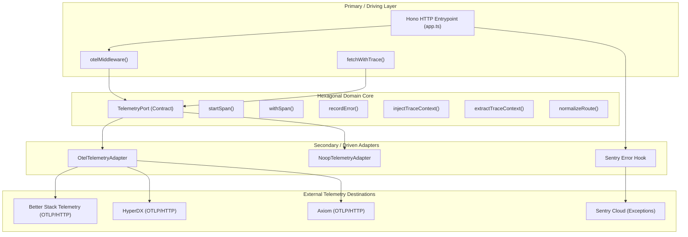

# Hexagonal Telemetry and OpenTelemetry Observability Architecture

## Executive Summary

Observability in `apps/sanctuary-api` is structured around **Hexagonal Architecture (Ports and Adapters)**. This guarantees that domain logic, HTTP routing, and error boundaries remain 100% vendor-agnostic. Whether telemetry is shipped to **Better Stack**, **HyperDX**, **Axiom**, or **Sentry**, the core application only speaks to the sovereign `TelemetryPort`.

---

## 1. Architectural Topology



---

## 2. Port Contract Specification

Located at [`apps/sanctuary-api/src/telemetry/ports/TelemetryPort.ts`](file:///c:/x/apps/sanctuary-api/src/telemetry/ports/TelemetryPort.ts):

```typescript
export interface TelemetryPort {
  readonly status: TelemetryRuntimeStatus;

  startSpan(name: string, options?: SpanOptions, parentContext?: unknown): SpanHandle;
  withSpan<T>(name: string, fn: (span: SpanHandle) => Promise<T>, options?: SpanOptions): Promise<T>;
  getCurrentTraceId(): string | undefined;
  recordError(error: unknown, attributes?: Record<string, unknown>): void;
  injectTraceContext(carrier: Record<string, string>, activeContext?: unknown): void;
  extractTraceContext(carrier: Record<string, string>): unknown;
  normalizeRoute(path: string): string;
}
```

### Key Invariants
1. **Low Metric Cardinality**: The port mandates `normalizeRoute(path)` which strips UUIDs, integers, and sensitive query tokens:
   - `/api/users/123e4567-e89b-8101-8000-426614174000` $\rightarrow$ `/api/users/:id`
   - `/api/search?q=secret` $\rightarrow$ `/api/search`
2. **W3C Distributed Tracing**: Follows the official W3C Trace Context recommendation (`traceparent` header format: `00-<trace_id>-<span_id>-01`).
3. **Safe Response Headers**: Injects `x-trace-id` into all outbound HTTP responses so clients can reference trace IDs during support requests.

---

## 3. Driven Adapters

### A. `OtelTelemetryAdapter`
Located at [`apps/sanctuary-api/src/telemetry/adapters/OtelAdapter.ts`](file:///c:/x/apps/sanctuary-api/src/telemetry/adapters/OtelAdapter.ts):
- Binds `@opentelemetry/api` with `@opentelemetry/sdk-trace-base`.
- Utilizes `BatchSpanProcessor` with `scheduledDelayMillis: 1000` and `timeoutMillis: 3000` to prevent blocking the event loop.
- Uses `AsyncLocalStorageContextManager` in Node.js runtimes to maintain trace context across asynchronous microtasks.

### B. `NoopTelemetryAdapter`
Located at [`apps/sanctuary-api/src/telemetry/adapters/NoopAdapter.ts`](file:///c:/x/apps/sanctuary-api/src/telemetry/adapters/NoopAdapter.ts):
- Zero allocations, zero network overhead.
- Used automatically when `OTEL_SDK_DISABLED=true`, when running in isolated unit tests, or when no endpoint is configured.

---

## 4. Vendor Alignment & Free Tier Ingestion Matrix

| Destination | Protocol | Free Quota | Best Used For | Configuration |
| :--- | :--- | :--- | :--- | :--- |
| **Better Stack** | OTLP / HTTP | 1 GB / month | Unified Status + Telemetry | `OTEL_EXPORTER_OTLP_ENDPOINT="https://in-otel.betterstack.com"`<br>`OTEL_EXPORTER_OTLP_HEADERS="authorization=Bearer <TOKEN>"` |
| **HyperDX** | OTLP / HTTP | 7 GB / month (~3.5M spans) | Microservice flamegraphs, span search | `OTEL_EXPORTER_OTLP_ENDPOINT="https://in-otel.hyperdx.io"`<br>`OTEL_EXPORTER_OTLP_HEADERS="authorization=<KEY>"` |
| **Axiom** | OTLP / HTTP | 500 GB / month (30d retention) | High-volume trace archiving | `OTEL_EXPORTER_OTLP_ENDPOINT="https://api.axiom.co/v1/traces"`<br>`OTEL_EXPORTER_OTLP_HEADERS="x-axiom-dataset=traces,authorization=Bearer <KEY>"` |
| **Sentry** | Native Sentry SDK | 5k errors + 10k spans/mo | Stack-trace diagnostics & crash reports | `SENTRY_DSN="https://<KEY>@sentry.io/<PROJECT>"` |

---

## 5. Verification & Test Evidence

- **Unit Test Suite**: [`apps/sanctuary-api/src/__tests__/telemetry.test.ts`](file:///c:/x/apps/sanctuary-api/src/__tests__/telemetry.test.ts)
  - Verified route normalization
  - Verified W3C trace injection on outbound fetch
  - Verified inbound parent context preservation and span attributes
  - **Result**: `✓ 3 passed (88ms)`
- **TypeScript Integrity**: `pnpm --filter @repo/sanctuary-api exec tsc --noEmit` exits with code 0.
