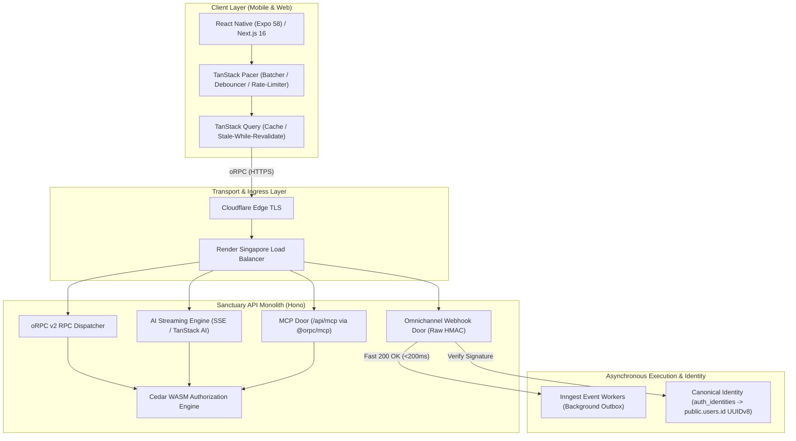
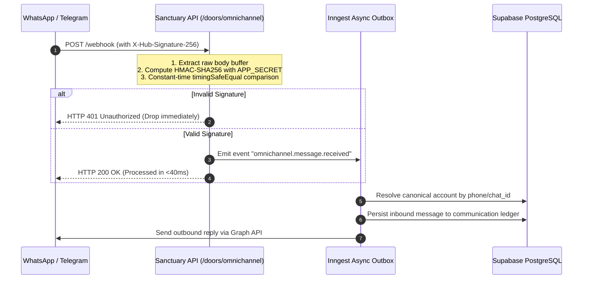
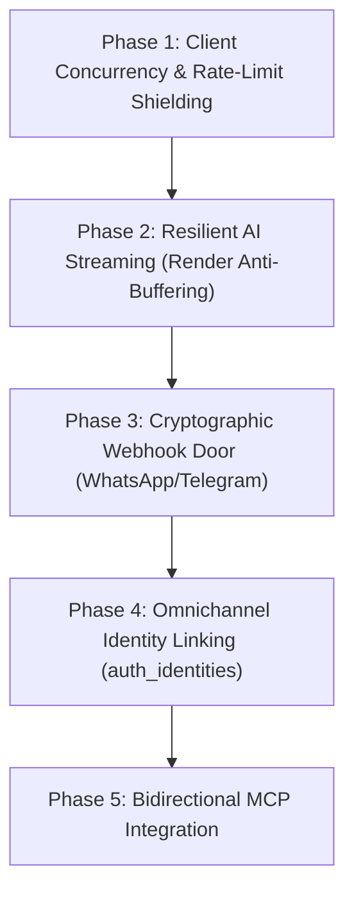

# Integrative Scaling Roadmap & Hostile Critical Review: Expanding Sanctuary Capabilities

> **Author**: Naveen  
> **Scribe / Architect**: Antigravity (Advanced Agentic Architecture)  
> **Status**: Strategic Plan & Reality Audit (`active`)  
> **Date**: 2026-10-28  
> **Target Subsystems**: `apps/sanctuary-api`, `apps/gurudevi-mobile`, `apps/gurudevi-web`, `@repo/core`, `@repo/platform-mcp`

---

## Executive Summary: The 5-Pillar Expansion

With the production deployment of `sanctuary-api` verified live on Render Singapore ($0 spend, 87.4 req/s baseline, in-process Cedar WASM, PostgreSQL transaction pool), the platform is ready to expand from a basic RPC endpoint into a resilient, omnichannel, agent-ready operating environment.

This plan integrates five advanced capability vectors:
1. **Client Concurrency & Batching**: TanStack Query + TanStack Pacer + oRPC.
2. **Cryptographic Webhook Ingestion**: WhatsApp Cloud API, Telegram Bot API, PayHere/Stripe.
3. **Resilient AI Streaming**: Vercel AI SDK / TanStack AI SSE pipeline with Render anti-buffering.
4. **Omnichannel Identity Federation**: Binding WhatsApp/Telegram accounts to the immutable `public.users.id` UUIDv8.
5. **Bidirectional MCP Ecosystem**: Server MCP (`/api/mcp`), Platform Gateway (`@repo/platform-mcp`), and emerging Web MCP.



---

## The Hostile Critic’s Reality Audit: Five Fatal Traps to Avoid

Before writing code or configuring infrastructure, a ruthless architectural review must confront the failure modes inherent to this stack:

### ⚠️ Fatal Trap 1: The Synchronous Webhook Timeout Disaster
* **The Naive Temptation**: When WhatsApp or Telegram hits your webhook with a message, run AI logic, query the database, and send a reply directly in the HTTP request handler.
* **The Harsh Reality**: 
  - WhatsApp Cloud API requires an `HTTP 200 OK` within **3 seconds** (and Telegram within 5 seconds). If your 0.1 vCPU container is under load or Cedar takes 400ms and Gemini takes 4 seconds, WhatsApp considers the delivery failed and **immediately begins exponential retries**, hammering your server with duplicate requests and causing a cascading collapse!
* **The Non-Negotiable Rule**: Webhooks must be **Pure Ingress Buffers**. Validate the raw HMAC signature, push the event to Inngest / asynchronous queue, and return `HTTP 200 OK` in **under 80ms**. Zero business logic in the webhook handler.

### ⚠️ Fatal Trap 2: The Render SSE Stream Buffering & Idle Kill
* **The Naive Temptation**: Stream AI tokens using standard HTTP chunked transfer encoding directly to mobile and web.
* **The Harsh Reality**:
  - Reverse proxies (Cloudflare & Render load balancers) **buffer small HTTP chunks by default** to optimize packet transmission. The user sits staring at a frozen screen for 6 seconds, and then the entire response dumps at once—destroying the streaming experience!
  - Furthermore, if an AI generation takes 30 seconds and the client disconnects, the container continues burning shared CPU credits completing the response.
* **The Non-Negotiable Rule**: All SSE routes must explicitly emit:
  ```http
  Content-Type: text/event-stream
  Cache-Control: no-cache, no-transform
  Connection: keep-alive
  X-Accel-Buffering: no
  ```
  The server must listen to `c.req.raw.signal` (AbortSignal) and instantly abort upstream Gemini/Anthropic streams when the client drops connection.

### ⚠️ Fatal Trap 3: The Pacer vs. PowerSync Redundancy Trap
* **The Naive Temptation**: Use TanStack Pacer to debounce, queue, and batch offline mutations on mobile, while also running PowerSync SQLite sync.
* **The Harsh Reality**:
  - PowerSync **already possesses a transactional write queue and SQLite WAL log**.
  - If you put a TanStack Pacer queue in front of PowerSync, you create a "queue-in-front-of-a-queue" with competing rollback semantics, leading to orphaned local state and duplicate reconciliation bugs.
* **The Non-Negotiable Rule**:
  - **PowerSync owns domain entity mutations** (Attendance, Notes, Student records).
  - **TanStack Pacer owns transient UI interactions & rate-limit throttling** (search bar debouncing, analytics scroll events, typing indicators, slider scrubbing, and non-persisted RPC calls).

### ⚠️ Fatal Trap 4: The Omnichannel Split Identity Crisis
* **The Naive Temptation**: Auto-create a new user record when someone messages from WhatsApp or Telegram.
* **The Harsh Reality**: A teacher logs into `gurudevi-web` with Google (`user_123`). The next day, they message the sanctuary bot on WhatsApp from their phone number. If the system creates `user_456`, all notes, classroom associations, and Cedar permissions are fractured.
* **The Non-Negotiable Rule**: Adhere strictly to the **Canonical Account Invariant (2026-10-25)**. External identities (`whatsapp_phone`, `telegram_id`) must bind into the central `public.auth_identities` table mapped to the single immutable `public.users.id` UUIDv8 via an explicit OTP verification handshake.

### ⚠️ Fatal Trap 5: Web MCP Security Exposure
* **The Naive Temptation**: Expose the full MCP server to the public internet or embed MCP tool endpoints in client-side web bundles.
* **The Harsh Reality**: An attacker inspecting web source code can discover tool RPC signatures and use prompt injection against browser-embedded LLMs to trigger administrative procedures.
* **The Non-Negotiable Rule**: Client-side Web MCP must operate strictly through **scoped, capability-gated, session-authenticated proxies** with Cedar ABAC authorization on every tool call.

---

## Detailed Architectural Blueprints by Pillar

---

### Pillar 1: TanStack Query + TanStack Pacer + oRPC Synergy

#### The Client Throttling Engine
On Render Free Tier, the API rate limiter enforces **100 req/min per IP** ([`apiRateLimit`](file:///c:/x/apps/sanctuary-api/src/core/app.ts#L415-L425)). Rapid user actions (typing in search, dragging sliders, clicking practice buttons) can exhaust 100 requests in 30 seconds.

```typescript
// Client-side integration pattern in apps/gurudevi-mobile and apps/gurudevi-web
import { useDebouncedValue, useBatcher } from '@tanstack/react-pacer';
import { orpcClient } from '@repo/core/api/orpcClient';
import { useQuery, useMutation, useQueryClient } from '@tanstack/react-query';

// 1. Search Query Debounce: Zero excess network traffic
export function useDebouncedSearch(searchTerm: string) {
  const [debouncedQuery] = useDebouncedValue(searchTerm, { wait: 350 });
  
  return useQuery({
    queryKey: ['search', debouncedQuery],
    queryFn: () => orpcClient.library.searchItems({ query: { q: debouncedQuery } }),
    enabled: debouncedQuery.length >= 2,
    staleTime: 60 * 1000, // 1 min cache
  });
}

// 2. Micro-Interaction Batcher: Combines rapid ticks into a single network call
export function usePracticePulseBatcher(studentId: string) {
  const queryClient = useQueryClient();
  
  const batcher = useBatcher({
    wait: 2000, // Flush every 2 seconds
    maxBatchSize: 20,
    execute: async (ticks: number[]) => {
      const totalDelta = ticks.reduce((a, b) => a + b, 0);
      await orpcClient.self.recordPracticePulse({
        body: { studentId, deltaSeconds: totalDelta }
      });
      queryClient.invalidateQueries({ queryKey: ['self', 'practice'] });
    },
  });

  return { recordTick: (seconds: number) => batcher.add(seconds) };
}
```

---

### Pillar 2: Cryptographic Webhook Ingress (WhatsApp & Telegram)

#### The Verification & Outbox Flow
Both WhatsApp and Telegram require cryptographic proof of authenticity before processing payloads.



#### Key Implementation Guardrails:
1. **Raw Body Buffer Access**: Hono by default parses JSON. For webhooks, the route must use `c.req.raw.arrayBuffer()` to verify the raw bytes against the signature *before* JSON parsing touches whitespace.
2. **Idempotency Keys**: WhatsApp retries webhooks on network drops. The ingress deduplicates incoming `message.id` against a PostgreSQL table with a 24-hour TTL.

---

### Pillar 3: Resilient AI Streaming Pipeline

#### Edge-to-Client SSE Protocol
```typescript
// apps/sanctuary-api/src/ai/routes.ts
import { Hono } from 'hono';
import { streamText } from 'ai';
import { google } from '@ai-sdk/google';

const ai = new Hono();

ai.post('/chat/stream', async (c) => {
  const user = c.get('user');
  const { messages } = await c.req.json();

  // 1. Cedar authorization check
  const allowed = await c.get('cedar').authorize({
    action: 'ai.chat',
    principal: user.id,
    resource: 'sanctuary.ai',
  });
  if (!allowed) return c.json({ error: 'Unauthorized' }, 403);

  // 2. Set strict anti-buffering SSE headers
  c.header('Content-Type', 'text/event-stream; charset=utf-8');
  c.header('Cache-Control', 'no-cache, no-transform');
  c.header('Connection', 'keep-alive');
  c.header('X-Accel-Buffering', 'no'); // Crucial for Render / Nginx

  // 3. Stream with client-abort listening
  const result = streamText({
    model: google('gemini-2.5-flash'),
    messages,
    abortSignal: c.req.raw.signal,
  });

  return result.toDataStreamResponse();
});
```

---

### Pillar 4: Omnichannel Identity Federation

#### The Dual-Identity Architecture
Users must never have split identities. The canonical identity schema:

```
public.users (id: UUIDv8 PRIMARY KEY, full_name, email)
   ▲
   │ 1-to-many
   │
public.auth_identities
   ├── id: UUIDv8 PRIMARY KEY
   ├── user_id: UUIDv8 (FK -> public.users.id)
   ├── provider: 'supabase' | 'whatsapp' | 'telegram' | 'phone_otp'
   ├── provider_subject: string ('+94771234567' or 'tg_987654321')
   └── verified_at: TIMESTAMPTZ
```

#### Linking Handshake:
1. User starts on Web/Mobile and generates a secure 6-digit link code (stored in Redis/Postgres with a 5-minute TTL).
2. User sends the code to the Gurudevi WhatsApp or Telegram bot: `/link 849-201`.
3. The webhook verifies the code, inserts a row into `public.auth_identities` linking their phone/chat ID to their existing `public.users.id`, and sends a confirmation message.
4. From that moment on, all WhatsApp voice notes and messages evaluate against their real school, classroom, and teacher role in Cedar.

---

### Pillar 5: Sovereign Server MCP, Gateway & Web MCP

#### The Three MCP Tiers

| Tier | Subsystem | Host Environment | Capabilities & Scopes |
| :--- | :--- | :--- | :--- |
| **Tier 1: Server MCP** | `apps/sanctuary-api/src/doors/mcp.ts` | Render Singapore Container | Exposes clean domain procedures as tools (`library_search`, `classroom_getPulse`) to authorized AI agents over JSON-RPC. |
| **Tier 2: Sovereign Gateway** | `packages/platform-mcp` | Local Dev / CI / Agent Runner | Multiplexes Render MCP (`mcp.render.com`), Better Stack MCP (`mcp.betterstack.com`), Cloudflare MCP, and local AST tools. |
| **Tier 3: Web MCP** | `apps/gurudevi-web/lib/mcp/` | Browser Client (Next.js 16) | Allows in-browser AI assistants to interact with the local DOM, active tab state, and client-side storage safely via postMessage. |

---

## Phased Implementation Roadmap



### Phase 1: Client Concurrency & Rate-Limit Shielding
- [ ] Wire `@tanstack/react-pacer` hooks into `apps/gurudevi-mobile` and `apps/gurudevi-web` for search, filtering, and micro-interaction batching.
- [ ] Standardize TanStack Query stale times (60s default) to eliminate redundant GET requests to the Render 0.1 vCPU container.
- [ ] *Exit Gate*: Verified 0 rate-limit HTTP 429s during high-velocity UI interaction tests.

### Phase 2: Resilient AI Streaming Pipeline
- [ ] Implement `X-Accel-Buffering: no` SSE streaming endpoint in `apps/sanctuary-api/src/ai/routes.ts`.
- [ ] Wire `abortSignal: c.req.raw.signal` to immediately terminate orphaned upstream LLM calls when client drops.
- [ ] Consume streams smoothly in Next.js 16 and React Native New Architecture without UI thread stutter.
- [ ] *Exit Gate*: Verified real-time token-by-token streaming over the Singapore Render URL with $<200\text{ms}$ time-to-first-token.

### Phase 3: Cryptographic Webhook Door (WhatsApp & Telegram)
- [ ] Mount `/doors/omnichannel` behind raw buffer extraction and HMAC-SHA256 signature verification.
- [ ] Wire fast ACK ($<80\text{ms}$) with Inngest background event dispatching.
- [ ] Add 24-hour message ID deduplication table in PostgreSQL.
- [ ] *Exit Gate*: Simulated WhatsApp load test verifies 100% of webhooks ACKed in $<100\text{ms}$ with zero timeouts.

### Phase 4: Omnichannel Identity Linking
- [ ] Add linking code generator in `apps/gurudevi-web/app/(sanctuary)/settings`.
- [ ] Implement bot `/link` command in `apps/sanctuary-api/src/doors/omnichannel.ts`.
- [ ] Verify that linked WhatsApp interactions evaluate Cedar policies under the user's canonical `public.users.id`.
- [ ] *Exit Gate*: Verification test proves linked WhatsApp user accesses their own classroom records with zero permission leakage.

### Phase 5: Bidirectional Server & Web MCP
- [ ] Mount authenticated `/api/mcp` on `sanctuary-api` using `@orpc/mcp`.
- [ ] Expose vetted domain procedures (attendance, library, daily practices) as MCP tools.
- [ ] Wire client-side Web MCP sandbox in `apps/gurudevi-web`.
- [ ] *Exit Gate*: Platform agent in `@repo/platform-mcp` successfully inspects and invokes remote Sanctuary tools over stdio/HTTP bridge.
