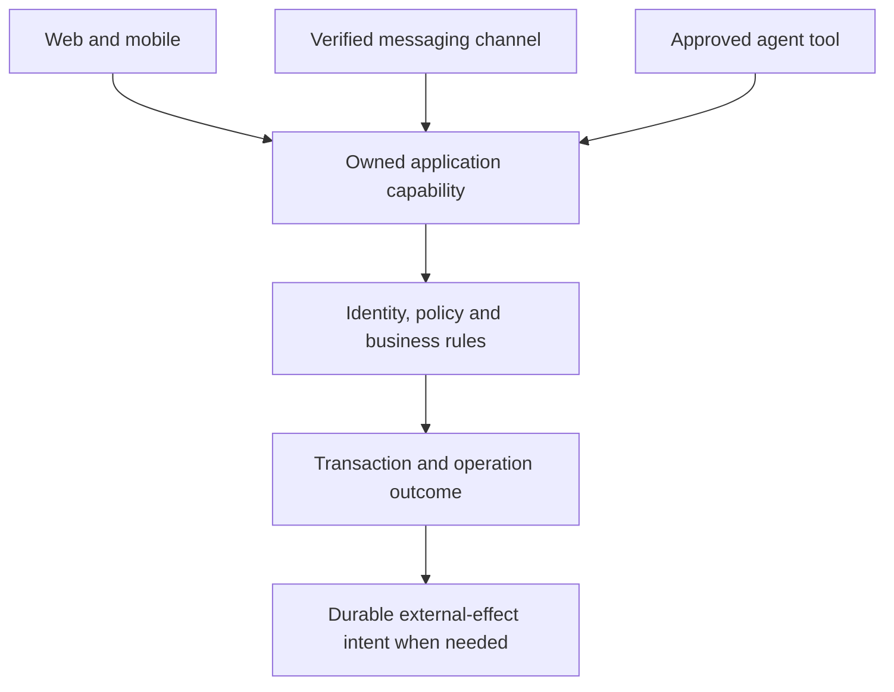

# API Landscape: What the Pieces Mean

For shared identity, reliable retries and protocol compatibility, use the
[interoperability module](api-foundations/interoperability-and-operation-semantics.md).

This is the **what** entry point: a learning reference, not a dependency shopping
list. Read the [engineering playbook](api-engineering-playbook.md) for application
to Gurudevi and the [canonical model](api-domain-and-channel-model.md) for governing
decisions. External facts were checked on **2026-10-30**; live documentation and
package releases can change. Recommendations are identified as such.

API means **Application Programming Interface**. New to the abbreviations?
Use the [short glossary](api-foundations/vocabulary-and-history.md#terms-we-should-use-precisely)
as you read; there is no need to memorize every name before understanding one action.

## Read one module at a time

| Order | Module | Question it answers |
| --- | --- | --- |
| 1 | [Vocabulary and history](api-foundations/vocabulary-and-history.md) | What is an API, contract, protocol, schema, event or feed? |
| 2 | [Channels and agent protocols](api-foundations/channels-and-agents.md) | Where do bots, MCP, AG-UI, LangChain and agent runtimes fit? |
| 3 | [Dependencies and evidence](api-foundations/dependencies-and-evidence.md) | What do established products expose, what do statistics establish, and how should we choose libraries? |
| 4 | [Domain rules and decisions](api-foundations/domain-rules-and-decisions.md) | Which decisions belong to the product owner, policies, contracts and implementation? |
| Then | [Engineering playbook](api-engineering-playbook.md) | In what order do we design, implement and verify the system? |

Each module owns a separate subject. Cite its stable section or PJC binding when
working on that subject; do not copy all modules into every feature document.
An agent should load the entry point, the relevant module, the owning PJC journey
and the actual source contracts. A small context package must still include the
invariants and unresolved decisions that affect its task.

## Start with one concrete action

A teacher recording attendance expresses an intention. A valid operation must
identify the account, establish the teaching relationship, validate the entries,
commit the correct records, and let the teacher understand the outcome. Web,
mobile and an approved assistant may present different interactions while using
the same authoritative capability.

The following is a conceptual map, not a claim that these channels currently work:

An API is an intentional interface to that work. It is not necessarily an HTTP
endpoint, database table or microservice. A network API adds serialization,
authentication and the uncertainty of a connection that may disappear.

## Keep the layers separate

| Layer | Examples | Owns |
| --- | --- | --- |
| Human experience | Workspace, Self, chat, forms | Orientation, interaction and understandable feedback |
| Business capability | Record attendance, publish an approved resource | Meaning, authority, lifecycle and correction |
| Contract | Native oRPC procedures and Zod DTOs | Public input/output/error agreement |
| Transport/channel | HTTP RPC, webhook, SSE, WebSocket, MCP | How requests or events cross a boundary |
| Agent orchestration | Tool loop, LangGraph, provider SDK | How bounded agent work is coordinated |
| Persistence and operations | Database, receipts, outbox, limits, telemetry | Durable state and operational mechanisms |

One diagram containing all these layers does not require one library for every
box. A modest implementation can satisfy several responsibilities; a library's
advertised feature is not proof that our integration satisfies them.

## The recent Anthropic announcement

The strongest match to the owner's recollection is Anthropic's **October 22,
2026 donation of Agent Skills to the Agentic AI Foundation**. The announcement
concerns the governance of the portable skills standard. It does not announce a
replacement for our API, Cedar or database. The exact announcement the owner saw
remains unconfirmed. [Official announcement](https://www.anthropic.com/news/donating-agent-skills-to-the-agentic-ai-foundation)

A skill packages task instructions and supporting material. MCP supplies a
tool/data interface; an agent SDK supplies execution machinery. These are
different responsibilities. See the channel module before selecting a runtime.

## Facts, choices and implementation

Use these labels in discussion and records:

- **Source observation:** what a particular repository revision or upstream page says.
- **User rule:** a product decision supplied by the owner.
- **Proposal:** a recommended design that has not been adopted or implemented.
- **Verified behavior:** a named scenario exercised in a specified environment.

Our existing PJC (Product and Journey Catalog) supports these provenance distinctions. A document, filename,
linked test, model output or passing static guard cannot promote a proposal into
verified behavior. Read [the PJC guide](../../../../docs/architecture/product-journey-catalog.md)
for queries, bindings and evidence levels.

## Current repository boundary

The reset source contains an empty native v1 contract, a small Hono host, shared
client construction and fixture tests. It does **not** establish application
features, authentication/Cedar admission, database operations, bot execution,
user-facing MCP, browser WebMCP or AI workflows. Old app consumers still need
deliberate rebuilding; they do not acquire compatibility through this guide.

Implementation is paused for grounding. The [playbook](api-engineering-playbook.md)
describes required future work, not an announcement that the API is ready.
