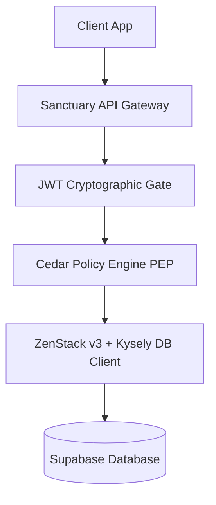

# Sanctuary API Developer Onboarding Guide

Welcome to the Sanctuary API developer guide! This document provides an introduction to the API gateway, the tech stack, codebase navigation, and local development tools.

---

## 1. Gateway Overview & Architecture

The Sanctuary API (`apps/sanctuary-api`) acts as the secure, platform-agnostic gateway for the Polymath Platform. It handles routing, JWT identity validation, relationship-based authorization, and request-scoped database access.



---

## 2. Technical Stack

* **Server Engine**: [Hono](https://hono.dev) (v4) with `@hono/zod-openapi` for OpenAPI-compliant typed route contracts.
* **Validation**: [Zod](https://zod.dev) (v4) for incoming request validation and schema definition.
* **Database Layer**: [ZenStack](https://zenstack.dev) (v3) built on Prisma, generating optimized query rules executed via [Kysely](https://kysely.dev).
* **Authorization**: [Cedar Policy Engine](https://www.cedarpolicy.com) (compiled to WebAssembly via `@cedar-policy/cedar-wasm` v4) for fine-grained, policy-based access control.
* **Environments**: Runs seamlessly on **Bun** (standard fast dev server) and **Node.js** (via `@hono/node-server`).

---

## 3. Codebase Navigation

The codebase is organized as follows:

```text
apps/sanctuary-api/
├── src/
│   ├── core/
│   │   └── app.ts           # Central application routing, middlewares, and OpenAPI registration
│   ├── ai/                  # AI routers and TanStack AI orchestrators
│   ├── jwt.ts               # Cryptographic JWT validation helper using web crypto APIs
│   ├── entry-node.ts        # Node.js server wrapper (using @hono/node-server)
│   ├── index.ts             # Bun & WinterCG-compatible entry point
│   └── __tests__/           # Integration and unit tests
│       ├── setup.ts         # Test environment initialization and database mocking proxy
│       └── downstream.test.ts # Gateway PEP and database integration tests
├── docs/                    # Technical specs, ADRs, SOPs, and developer documentation
└── package.json             # Service dependencies and runner scripts
```

---

## 4. Local Development Workflow

### Starting the Server
Before starting the gateway, ensure you have setup your environment variables by copying `.env.example` to `.env`.

* **Bun Run (Default)**:
  ```bash
  pnpm run dev:bun
  ```
* **Node.js Run**:
  ```bash
  pnpm run dev
  ```

### Interactive API Playgrounds (Postman-style DX)
The gateway exposes two live playgrounds populated from your code contracts:
* **Scalar API Reference** (`http://localhost:3000/reference`): Recommended for testing. Offers a modern, beautiful developer interface, full query histories, auth header support, and built-in fetch client.
* **Swagger UI** (`http://localhost:3000/ui`): Traditional OpenAPI schema client.
* **Raw Spec**: Available as JSON at `http://localhost:3000/doc`.

---

## 5. Testing & Verification

* We use **Vitest** for testing because of its native ESM support and fast in-memory execution.
* Run the tests with:
  ```bash
  pnpm run test       # Node.js runner
  pnpm run test:bun   # Bun runner
  ```

* **Standard Rule**: Do not bind tests to real TCP/IP sockets. Use Hono's `app.request()` in-memory mock routing for ultra-fast, mockable request pipelines.
* **Contract Verification**: Use Hono's `testClient` to automatically validate API paths, query parameters, headers, and request bodies at compile-time.

---

## 6. Type-Safe Client RPC Integration

To eliminate client-server type drift, client-side queries (such as in `apps/gurudevi-mobile`) use Hono's RPC client (`hc`) along with `InferResponseType` to automatically infer API response types at compile-time.

### Recommended Pattern

Always import the helper types from the core contract:

```typescript
import type { InferResponseType } from '@repo/core/api/contract';
import { client } from '../lib/api'; // Sovereign RPC client instance

// 1. Infer response types at compile time
type GradesResponse = InferResponseType<typeof client.api.grades.$get>;

// 2. Use it directly in TanStack Query hooks
export function useGrades() {
  return useQuery<GradesResponse>({
    queryKey: ['grades'],
    queryFn: async () => {
      const res = await client.api.grades.$get();
      return res.json();
    },
  });
}
```

This requires **zero manual type declarations** and updates automatically when route contracts or payload schemas change.
