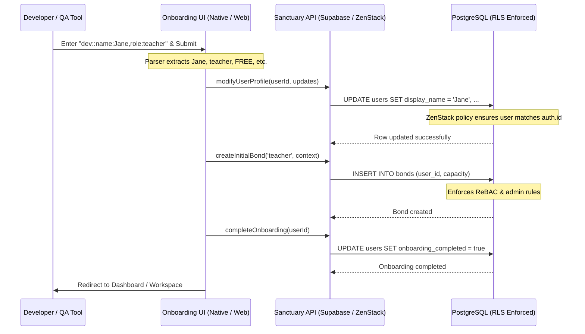

# Developer Sandbox Console & Onboarding Parser

This document details the architecture, capabilities, and security boundaries of the Developer Sandbox Console and inline parameter parser implemented in the Gurudevi onboarding flow.

---

## 1. Overview & Objectives

The Developer Sandbox Console provides developers and QA tools with a fast, safe, and policy-compliant shortcut to spin up customized test profiles (spanning custom roles, pricing tiers, citizenship levels, and school boundaries).

### Key Features
1. **Interactive Console UI:** A dedicated, Gluestack-designed developer console modal containing input selectors.
2. **Inline Config Parser:** An automation-friendly parser that handles structured input strings (e.g. `dev::name:...,role:...`) to configure and fast-track profile creation in a single step.
3. **Compile-time Security Gating:** Automatic pruning of dev sandbox code in production builds via bundler tree-shaking.

---

## 2. Trigger Mechanism

The onboarding name input page (Step 0) intercepts values starting with `dev::` when the continue action is triggered:

```text
Name Input
  ├── Starts with "dev::" AND (is __DEV__ OR EXPO_PUBLIC_ENABLE_DEV_SANDBOX === 'true')
  │     ├── Input is "dev::sandbox" or "dev::menu" ──> Launch Interactive Console UI
  │     └── Input contains params (e.g., "dev::role:teacher") ──> Parse & Fast-Track
  └── Otherwise ──> Proceed to standard Step-by-Step Onboarding
```

### Inline Parameter Format
```text
dev::name:<String>,role:<Capacity>,pricing:<Tier>,citizenship:<Tier>,school:<UUID>
```
* **Example:** `dev::name:Naween,role:principal,pricing:pro,citizenship:first_class`

---

## 3. Architecture & API Flow

The Sandbox Console and inline parser do **not** bypass existing security layers, IAM boundaries, or database policies. Instead, they automate standard API flows under the logged-in user's authentication context:



---

## 4. Compile-Time Security Hardening

To prevent leaking test code, endpoints, or layout specs into production bundles, both the Native and Web UI modules wrap the console in compile-time static flags:

```tsx
const DevSandboxConsoleInner = memo(({ t, onClose, onSave }) => {
  // Full layout, components, and selectors here
});

export const DevSandboxConsole =
  (typeof __DEV__ !== 'undefined' && __DEV__) || process.env.EXPO_PUBLIC_ENABLE_DEV_SANDBOX === 'true'
    ? DevSandboxConsoleInner
    : () => null;
```

### How Security is Enforced:
* **Production Build:** The compiler evaluates the static environment variables to `false`.
* **Tree-Shaking:** Bundler optimizers (like Metro, Webpack, or Vite) replace the ternary statement with `() => null`.
* **Zero Leakage:** The contents of `DevSandboxConsoleInner` (including form tags, input elements, buttons, and helper code) are completely pruned and excluded from final production JavaScript files.
