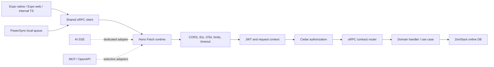

# Sanctuary API oRPC Architecture

## Purpose

oRPC is the canonical request/response contract for first-party Sanctuary clients. It gives Expo native, Expo web, server-side TypeScript callers, and internal agents one typed procedure surface without making Hono responsible for business contracts.

Current implementation status is a paused migration checkpoint, not a production-cutover declaration. See the [checkpoint](../current_progress/2026-07-30-orpc-migration-checkpoint.md) and [contributor guide](./orpc-contributor-guide.md) before extending the system.

This is a transport and contract decision, not a replacement for the rest of the platform:

- Hono remains the runtime and middleware host.
- Cedar remains the authorization policy engine.
- ZenStack remains the online database enforcement boundary.
- PowerSync remains the local-first database, queue, and replication engine.
- AI chat remains a dedicated Hono streaming route.
- MCP and selective OpenAPI remain adapters for explicitly approved external surfaces.

## Why oRPC was introduced

The previous API surface had overlapping contract and client systems. Some procedures were described by Hono/ts-rest-style objects while newer procedures were described by oRPC. That created several failure modes:

- a contract could diverge from the handler;
- clients could manually construct paths and payloads;
- request authentication and database context could be created twice;
- database model objects could leak through response boundaries;
- PowerSync could accidentally become a row-by-row network client;
- tests could pass against a legacy route while the intended native oRPC route remained broken.

oRPC is used as the single source of truth for migrated request/response procedures because its native fetch protocol works across web and React Native, and its input/output/error types can be shared from `packages/core`.

## Runtime shape

The request context is created once by Hono middleware and reused by the oRPC handler. It carries the authenticated principal, request ID, active bond/school scope, request-scoped database, and security attributes.

## Contract rules

Every migrated procedure must define:

- strict input schema;
- explicit output DTO schema;
- declared oRPC error map;
- authorization policy metadata;
- idempotency requirements where applicable;
- audit requirements for sensitive mutations;
- online-only or sync semantics;
- cacheability where relevant.

Database records are not API DTOs. Dates are serialized deliberately, nullable values are declared deliberately, and internal authorization/database metadata is excluded deliberately.

## PowerSync boundary

PowerSync owns offline state and replication. It does not use React Query or oRPC for local reads. Local writes continue through the secure Drizzle/PowerSync path.

The online upload boundary is one typed `sync.uploadBatch` procedure. A batch contains ordered operations and is applied synchronously inside one transaction. The client completes the PowerSync batch only after the procedure resolves successfully. A duplicate idempotency key returns the previous success result without replaying the writes.

This preserves the important boundary:

- Zone A: PowerSync SQLite/live queries and queued local writes.
- Zones B/C: online oRPC procedures and server-side business operations.

## Why Hono remains

Hono is still valuable for concerns that are transport/runtime oriented:

- Bun and Node request hosting;
- CORS and secure headers;
- request IDs and OpenTelemetry setup;
- rate limiting, body limits, and timeouts;
- AI SSE and other streaming responses;
- MCP and selected interoperability adapters.

Business authorization and procedure behavior should not be hidden in route-specific Hono middleware. The oRPC procedure boundary is the authoritative request/response boundary.

## Tradeoffs

### Benefits

- One typed client contract across native, web, and server TypeScript callers.
- Contract-level output validation prevents accidental database-model leakage.
- Shared error codes make retry and offline behavior classifiable.
- A batch upload prevents one network request per PowerSync row.
- Native oRPC remains independent of OpenAPI generation choices.

### Costs and constraints

- The cutover is a breaking wire-format change for migrated procedures.
- Existing Hono clients cannot be silently considered migrated; every caller must move to the shared oRPC client.
- OpenAPI generation must remain selective so it does not become a second source of truth.
- AI streaming cannot be forced into ordinary oRPC request/response semantics.
- Full confidence requires real database, Bun/Node, native/web, authorization, and sync integration suites in addition to fast mocked tests.

## Current implementation status

Implemented:

- native oRPC transport for identity, onboarding, self, profile, and sync;
- native daily content, library, authorization snapshot, education, grading, and attendance routers;
- native community group/post/reaction/comment/poll/report procedures and shared callers;
- native community group-message procedures and shared circle callers;
- native direct-conversation and direct-message procedures with participant-scoped ZenStack models;
- native user-owned notification and social-block procedures with server-derived ownership;
- migrated community wrapper methods for reactions, polls, comments, reports, and group policy to the native client;
- native school-scoped announcement reads and writes with server-derived authorship;
- native group-member listing, role-change, and bulk-approval procedures;
- native post update/delete and reaction-status procedures with server-derived ownership;
- native community-resonance aggregation through the community contract;
- native classroom enrollment and shadow-student procedures with deployed-table-aligned ZenStack models;
- native classroom lifecycle create/update/delete procedures with Cedar-scoped writes;
- native classroom-note CRUD procedures with server-derived authorship and Cedar policy metadata;
- native classroom-note snapshot/timeline procedures backed by the deployed `classroom_note_events` table;
- native material and assignment CRUD procedures with classroom-scoped policy metadata;
- native upcoming-assignment and submission procedures with idempotency-key support;
- selective read-only OpenAPI adapter backed by the same native router;
- native admin/staff procedures and shared callers;
- native grading settings/draft and classroom-resource callers;
- shared request context reuse;
- typed `sync.uploadBatch` contract and handler;
- shared first-party client factory;
- PowerSync connector and guest/outbox upload migration;
- contract/service/in-memory HTTP tests for the migrated slice.

Not yet complete:

- other non-HTTP domain-manager methods;
- removal of remaining legacy contract/handler source files after coverage/audit tooling is migrated;
- procedure-level telemetry/audit completion across every domain;
- curated MCP tools;
- Bun/Node plus Expo native/web acceptance matrix.

The migration must not be called complete until those remaining domains and acceptance gates are verified.

## Source locations

- Contracts: `packages/core/src/api/*.contract.ts`
- Shared contract aggregate: `packages/core/src/api/orpc.contract.ts`
- Shared client: `packages/core/src/api/orpcClient.ts`
- API context/router: `apps/sanctuary-api/src/core/orpc.ts`, `router.ts`
- Native handlers: `apps/sanctuary-api/src/core/handlers/`
- PowerSync connector: `packages/core/src/adapters/powersync/SupabasePowerSyncConnector.ts`
