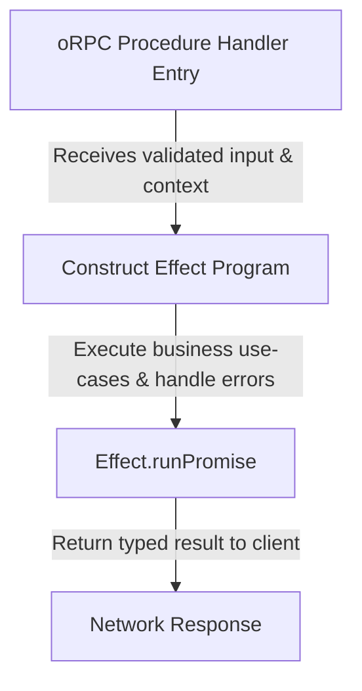

# oRPC and Effect-TS Migration Standards

This document establishes the official patterns for migrating legacy REST endpoints to **oRPC v1** and integrating **Effect-TS** as the business logic engine within the Sanctuary API gateway (`apps/sanctuary-api`).

---

## 1. Directory Structure & Key Files

When migrating a vertical slice:
- **Contracts:** Defined in `packages/core/src/api/contracts/` or `packages/core/src/api/self.contract.ts` using `oc.router({ ... })`.
- **Handlers:** Located in `apps/sanctuary-api/src/core/handlers/[sliceName].ts`.
- **Mocking:** Registered in `apps/sanctuary-api/src/__tests__/setup.ts` using `vi.mock('@repo/database/client', ...)` to intercept database queries.

---

## 2. oRPC v1 Implementation Standards

Every contract router implementation must follow the standalone `implement` configuration:

```typescript
import { implement } from '@orpc/server';
import { selfContract } from '@repo/core/api/server';
import { type ORPCContext } from '../orpc';
import { doubleGateMiddleware } from '../router';

// 1. Create the context-bound router implementer
const impl = implement(selfContract).$context<ORPCContext>();

// 2. Define handlers directly using ProcedureImplementer's methods
export const selfRouter = impl.router({
  logMood: impl.logMood.use(doubleGateMiddleware).handler(async ({ input, context }) => {
    if (!context.db) throw new Error('Database context not initialized');
    return await context.db.moodLog.create({
      data: input,
    });
  }),
});
```

### Key Practices:
- **Do not** use the generic builder `o` to map contract handlers, as it bypasses the contract schemas and forces manual type casting.
- **Strict Payload Mapping:** In ZenStack/Prisma updates, destructure out non-updatable keys (like `user_id`) from the payload and cast the rest `as any` if you encounter strict JSON validation type mismatches against Prisma models:
  ```typescript
  const { user_id, ...updateData } = input;
  return await context.db.userPreferences.update({
    where: { user_id: context.user.id },
    data: updateData as any,
  });
  ```

---

## 3. Coexistence Sequence: oRPC & Effect-TS

We use **oRPC** to guard the network boundary (routing, serialization, input validation) and **Effect-TS** to execute the underlying domain logic.



### Implementation Sequence
1. **oRPC Boundary First:** Mount the type-safe contract routers first while keeping the DB controllers as standard async procedures. This validates the API contract and client/server synchronization.
2. **Abstract Business Logic into Effects:** Wrap domain use cases in functional `Effect` blocks, declaring required services (like database access or telemetry) as dependencies:
   ```typescript
   export const LogMoodUseCase = (input: MoodLogInput) =>
     Effect.gen(function* () {
       const db = yield* DatabaseService;
       return yield* db.moodLog.create(input);
     });
   ```
3. **Run inside the Handler:** Dispatch and execute the Effect inside the oRPC handler using the Hono context dependencies:
   ```typescript
   logMood: impl.logMood.use(doubleGateMiddleware).handler(async ({ input, context }) => {
     return await Effect.runPromise(
       LogMoodUseCase(input).provide(context.effectDbLayer)
     );
   }),
   ```
