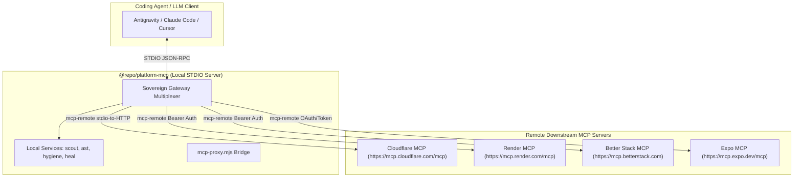

# Platform MCP Gateway & Sovereign Agentic Toolchain

## Executive Summary

`@repo/platform-mcp` serves as the monorepo's sovereign control plane. It acts as an MCP multiplexer that aggregates local platform services (scout, AST search, code graph, refactoring) and connects downstream remote MCP servers using `mcp-remote`.

Both the **Render MCP Server** and **Better Stack MCP Server** are now first-class downstream servers wired into the platform gateway.

---

## 1. Downstream Multiplexing Architecture



---

## 2. Downstream Server Configurations

Located in [`packages/platform-mcp/src/index.ts`](file:///c:/x/packages/platform-mcp/src/index.ts#L268-L290):

### A. Render MCP Server
- **Endpoint**: `https://mcp.render.com/mcp`
- **Authentication**: `Authorization: Bearer <RENDER_API_KEY>`
- **Capabilities**:
  - List services, deploys, and builds
  - Inspect build and runtime logs
  - Trigger zero-downtime manual deployments
  - Query environment variables and health status

### B. Better Stack MCP Server
- **Endpoint**: `https://mcp.betterstack.com`
- **Authentication**: `Authorization: Bearer <BETTERSTACK_API_TOKEN>`
- **Capabilities**:
  - Monitor uptime and heartbeats in real-time
  - Investigate live incidents and escalation policies
  - Search and query ingested application logs and trace waterfalls
  - Query infrastructure metrics

---

## 3. Secret Management via Doppler

Secrets are injected dynamically at gateway startup and never committed to version control:

| Key | Doppler Path | Purpose |
| :--- | :--- | :--- |
| `RENDER_API_KEY` | `gurudevi-mobile:dev` | Authenticates with `mcp.render.com/mcp` |
| `BETTERSTACK_API_TOKEN` | `gurudevi-mobile:dev` | Authenticates with `mcp.betterstack.com` |
| `CLOUDFLARE_API_TOKEN` | `gurudevi-mobile:dev` | Authenticates with `mcp.cloudflare.com/mcp` |
| `EXPO_TOKEN` | `gurudevi-mobile:dev` | Authenticates with `mcp.expo.dev/mcp` |

---

## 4. Empirical Stress-Testing Harness

A persistent zero-dependency benchmark runner is available at `scratch/benchmark.mjs` for rapid capacity evaluation:

```powershell
# Syntax: node scratch/benchmark.mjs <URL> <concurrency> <total_requests>

# Benchmark liveness probe (10 concurrency, 100 requests)
node scratch/benchmark.mjs https://sanctuary-api-tpj7.onrender.com/health/live 10 100

# Benchmark database readiness probe (5 concurrency, 50 requests)
node scratch/benchmark.mjs https://sanctuary-api-tpj7.onrender.com/health/ready 5 50
```

### Measured Output Metrics
- Requests/second throughput
- Status code distribution (200, 429, 500)
- Percentile latency metrics (P50, P90, P95, P99)
- Connection error count
