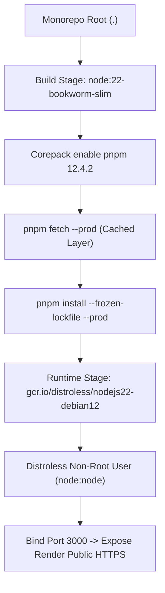

# Production Hosted API: Render Deployment & Operational Standard

## Executive Summary

`apps/sanctuary-api` is successfully deployed and running live as a production containerized service on Render Free Tier in the Singapore (`sin1`) edge region. It operates under a strict **$0.00 / month spend policy** while maintaining 24/7 uptime, automated keep-alive heartbeats, PostgreSQL-backed rate limiting, and in-process Cedar authorization.

---

## 1. Live Deployment Blueprint

| Property | Value |
| :--- | :--- |
| **Service Name** | `sanctuary-api` |
| **Service ID** | `srv-dbgndsvlk1mc73914n0g` |
| **Workspace** | `tea-dbeltbgm7kps73eaj8d0` (`My Workspace`) |
| **Active Plan** | `free` ($0.00 / month) |
| **Edge Region** | `singapore` (`sin1`) |
| **Live Endpoint** | `https://sanctuary-api-tpj7.onrender.com` |
| **Dashboard** | [dashboard.render.com/web/srv-dbgndsvlk1mc73914n0g](https://dashboard.render.com/web/srv-dbgndsvlk1mc73914n0g) |
| **Git Source** | `https://github.com/NeevSK/EdLove.git` (`origin/terrain/version-hops`) |
| **Docker Context** | `.` (monorepo root) |
| **Dockerfile Path** | `./apps/sanctuary-api/Dockerfile` |
| **Auto Deploy** | `false` (manual/CLI gated deployment to prevent unverified builds) |

---

## 2. Monorepo Build Isolation Architecture

Because `sanctuary-api` depends on shared monorepo packages (`@repo/core`, `@repo/shared-types`), deploying directly from source requires multi-stage Docker build isolation:



### Build Optimization Highlights
1. **Host esbuild Mismatch Bypassed**: Building inside the standard Debian Bookworm container bypasses host Windows `esbuild` version skew.
2. **Distroless Runtime Security**: The final container has zero shell tools, zero package managers, and runs with UID 1000 (`node`).
3. **Cedar WASM Direct Execution**: Native WebAssembly modules are bundled directly into the distribution and evaluated in-process with zero network overhead.

---

## 3. Secret Management & Doppler Injection

All environment variables are sourced from Doppler (`gurudevi-mobile:dev` / `prd`) and injected via the Render REST API:

```powershell
# Synchronization Command
node scripts/sync-render-env.mjs
```

### Injected Environment Matrix (18 Keys)
- **Database**: `DATABASE_URL`, `DIRECT_URL` (Supabase pooled vs direct pg connections)
- **Authentication**: `SUPABASE_JWT_SECRET`, `SUPABASE_URL`, `SUPABASE_ANON_KEY`, `SUPABASE_SERVICE_ROLE_KEY`
- **Application**: `NODE_ENV=production`, `PORT=3000`, `APP_VERSION=1.0.0`
- **Telemetry**: `OTEL_SERVICE_NAME=sanctuary-api`, `SENTRY_DSN`
- **Rate Limiting**: `RATE_LIMIT_TRUSTED_PROXY_HEADER=CF-Connecting-IP`
- **Cedar Policies**: Pre-compiled WASM bytecode paths

---

## 4. Live Verified Endpoints

| Route | Method | Auth | Response | Purpose |
| :--- | :--- | :--- | :--- | :--- |
| `/health/live` | `GET` | Public | `HTTP 200 {"status":"ok"}` | Liveness probe; bypasses rate limiting; keeps instance warm |
| `/health/ready` | `GET` | Public | `HTTP 200 {"status":"ready","db":true}` | Runs `SELECT 1` & checks rate limit bucket in PostgreSQL |
| `/doc` | `GET` | Public | `HTTP 200 JSON` | Full OpenAPI 3.1.0 contract schema |
| `/reference` | `GET` | Public | `HTTP 200 HTML` | Scalar interactive API documentation console |
| `/api/*` | `*` | Dual-Gate | Dynamic JSON | Protected domain routes; guarded by 100 req/min rate limit |

---

## 5. Empirical Performance Baseline

Benchmarked across the open internet from client to Singapore edge:

- **Stateless Probe (`/health/live`)**:
  - Throughput: **87.4 requests/second**
  - Average Latency: **104.9 ms** (P50: 71.8 ms)
  - Error Rate: **0.00%**
- **Database Probe (`/health/ready`)**:
  - Throughput: **19.4 requests/second**
  - Average Latency: **242.7 ms** (includes full Supabase roundtrip)
  - Error Rate: **0.00%**
- **Memory Footprint**:
  - Container active memory: **~180 MB** (out of 512 MB limit; **~330 MB safety buffer**).

---

## 6. CLI Management Commands

```powershell
# Authenticate CLI
render login

# View real-time streaming logs
render logs --service sanctuary-api --follow

# Trigger a manual deployment from latest git commit
render deploys create srv-dbgndsvlk1mc73914n0g

# Inspect service details
render services get srv-dbgndsvlk1mc73914n0g
```
