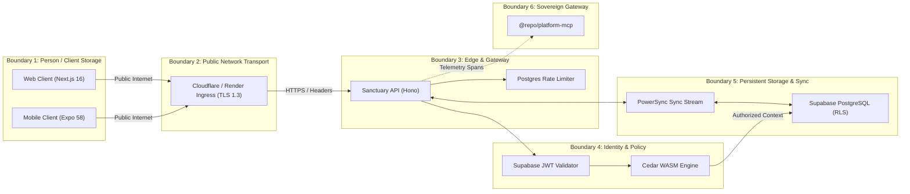

# Full-Stack Threat Model & Cybersecurity Architecture: Mobile, Web, Edge & Sanctuary API

## Executive Summary

This document defines the formal repository-grounded Application Security (AppSec) threat model for the integrated Polymath Platform:
- **Mobile Client**: Expo SDK 58, React Native 0.88 (New Architecture / Fabric / JSI / Nitro), local SQLite via PowerSync.
- **Web Client**: Next.js 16 (React 19, Server Components, Server Actions).
- **Edge & Transport**: Cloudflare Edge + Render TLS Ingress (Singapore `sin1`).
- **Core API**: Hono v4 / Node.js containerized monolith (`sanctuary-api`) with in-process Cedar Policy WASM.
- **Data & Identity**: Supabase PostgreSQL 16 (with Row Level Security and Transaction-mode Supavisor pooling) + PowerSync replication stream.

---

## 1. System Inventory & Evidence Substrate

| Subsystem | Physical Substrate / Evidence | Security Function & Threat Relevance |
| :--- | :--- | :--- |
| **Mobile Client** | `apps/gurudevi-mobile/`, `packages/ui` | Device storage, biometric gates, offline PowerSync sync queues, local guest lease expiration. |
| **Web Client** | `apps/gurudevi-web/`, `packages/core/src/web-auth` | Next.js Server Components, SSR cookie extraction, CSRF mitigation, client session hydration. |
| **Client Transport** | `packages/core/src/api/clientRuntime.ts`, `base.ts` | HTTPS assertion (`assertSecureApiUrl`), active bond injection, `orpcClient` retries. |
| **Edge Ingress** | Render Singapore Load Balancer (`https://sanctuary-api-tpj7.onrender.com`) | TLS termination, DDoS absorption, Cloudflare header forwarding (`true-client-ip`). |
| **Transport Security** | `apps/sanctuary-api/src/core/transportSecurity.ts` | Strict HTTPS enforcement, CORS origin regex validation (`*.gurudevi.app`). |
| **Rate Limiter** | `apps/sanctuary-api/src/core/rateLimit.ts` | Postgres bucket store (`api_rate_limit_buckets`), 100 req/min/IP limit on `/api/*`. |
| **Identity Substrate** | `docs/current_progress/2026-10-25-canonical-uuidv8-account-cutover.md` | Immutable `public.users.id` UUIDv8, `auth_identities`, signed `canonical_account_id` claim. |
| **Authorization** | `apps/sanctuary-api/src/core/orpcMiddleware.ts`, Cedar WASM | In-process linear memory RBAC/ABAC policy engine, fail-closed access decisions. |
| **Offline Sync** | `apps/sanctuary-api/src/core/handlers/powersync.ts` | Batched client mutation upload, transactional Kysely execution, tenant boundary check. |
| **Telemetry & Redaction**| `apps/sanctuary-api/src/telemetry/otel.ts`, `safeErrorTelemetry.ts` | Cardinality route normalization, PII error stripping, W3C trace injection. |
| **Agent Control Plane** | `packages/platform-mcp/src/index.ts`, `scripts/mcp-proxy.mjs` | Subprocess isolation, Doppler token injection, MCP tool boundary containment. |

---

## 2. The Six Architectural Trust Boundaries

1. **Boundary 1 (Device / Local Storage $\rightarrow$ Client App)**: Shared or compromised mobile hardware, rooted Android / jailbroken iOS, browser local storage inspection, XSS.
2. **Boundary 2 (Client App $\rightarrow$ Edge Network)**: Man-in-the-Middle (MitM) attacks, proxy header forgery (`CF-Connecting-IP`, `X-Forwarded-For`), TLS stripping.
3. **Boundary 3 (Edge $\rightarrow$ Sanctuary Gateway)**: Resource exhaustion DoS, unauthenticated rate-limit evasion, oversized payloads, malformed JSON RPC envelopes.
4. **Boundary 4 (Gateway $\rightarrow$ Identity & Policy Engine)**: Stolen or forged JWTs, account substitution attacks, Cedar authorization bypasses, replay of expired guest leases.
5. **Boundary 5 (Gateway $\rightarrow$ PostgreSQL & PowerSync)**: Cross-tenant data leaks, SQL injection, connection pool starvation, unauthorized batch sync upload.
6. **Boundary 6 (Platform Gateway $\rightarrow$ Autonomous Agents & MCP)**: Prompt injection triggering unauthorized deploys, API key leakage in stack traces, rogue subprocess spawning.

---

## 3. High-Priority Threat Vectors & Abuse Paths

### Threat 1: Refresh Token & Local State Extraction on Shared Devices
- **Target Asset**: Long-lived user refresh tokens, offline cached educational records.
- **Abuse Path**: An attacker gains physical access to a shared student/teacher mobile tablet or exploits a malicious third-party SDK with file-system read access.
- **Risk Severity**: **HIGH** (Likelihood: Medium, Impact: High).
- **Existing Mitigations**:
  - `packages/core/src/native/localGuestActivation.ts`: Ephemeral guest leases expire automatically.
  - Short-lived Supabase Access Tokens (1 hour).
- **Required Controls**:
  - Long-lived refresh tokens **MUST NEVER be stored in plain MMKV**. Store solely in `expo-secure-store` (Hardware Keychain / Keystore).
  - Cache database encryption for local SQLite via PowerSync cipher keys stored in SecureStore.

---

### Threat 2: Reverse Proxy Header Spoofing for Rate Limit Evasion
- **Target Asset**: Compute availability (0.1 vCPU Render Free Tier), PostgreSQL connection pool.
- **Abuse Path**: An attacker sends automated bursts directly to `https://sanctuary-api-tpj7.onrender.com/api/*`, rotating arbitrary `CF-Connecting-IP: <random_ip>` headers on each request. If trusted blindly, the server spins up infinite rate-limit buckets and exhausts the 0.1 vCPU and Supabase pool.
- **Risk Severity**: **CRITICAL** (Likelihood: High, Impact: High).
- **Existing Mitigations**:
  - `apps/sanctuary-api/src/core/app.ts`: Rate limiter prunes stale buckets every 60s.
  - Render edge is fronted by Cloudflare, which overwrites incoming `CF-Connecting-IP` with the real TCP IP.
- **Required Controls**:
  - In `apps/sanctuary-api/src/core/app.ts`, ensure that if `CF-Connecting-IP` is missing or unparseable, requests default to a strict shared `'anonymous'` rate-limit bucket rather than bypassing controls.

---

### Threat 3: Canonical Account Substitution & Auth Subject Disconnect
- **Target Asset**: Cross-tenant isolation, user identity integrity.
- **Abuse Path**: A malicious user authenticates with their own valid Supabase account $A$, but injects header `x-expected-auth-subject: <target_user_B_uuid>` or manipulates the payload account ID.
- **Risk Severity**: **CRITICAL** (Likelihood: Low, Impact: Critical).
- **Existing Mitigations**:
  - **The Canonical Account Invariant (2026-10-25)**: Domain identity is strictly resolved from `public.get_my_id()` using the cryptographically verified JWT claim `canonical_account_id`.
  - `apps/sanctuary-api/src/core/router.ts`: Rejects requests where the active account does not match the database credential binding.

---

### Threat 4: Cedar Policy Linear Memory Exhaustion or Bypass
- **Target Asset**: Zero-trust authorization integrity.
- **Abuse Path**: An attacker crafts complex, deeply nested entity hierarchies or recursive context trees to cause WebAssembly out-of-memory panics or force fail-open evaluation.
- **Risk Severity**: **HIGH** (Likelihood: Low, Impact: Critical).
- **Existing Mitigations**:
  - Cedar evaluates strictly in-process with synchronous, non-allocating WASM instances.
  - Policy evaluation is **Fail-Closed**: Any panic, parse error, or unmapped action evaluates to `Deny`.
- **Required Controls**:
  - Enforce payload depth and size limits on incoming oRPC JSON bodies (5MB limit active in `bodyLimit`).

---

### Threat 5: Distributed Denial of Service (DDoS) on Render Free Tier
- **Target Asset**: Service availability (750-hour monthly compute quota).
- **Abuse Path**: An attacker floods `/health/ready` (which executes PostgreSQL queries) with 500 req/s, exhausting Supabase pool connections and burning CPU credits, causing Render to throttle or suspend the container.
- **Risk Severity**: **HIGH** (Likelihood: Medium, Impact: High).
- **Existing Mitigations**:
  - `/health/live` is stateless (in-memory) and handles 87.4 req/s with 0 DB queries.
  - In `keep-alive-sanctuary.yml`, the heartbeat only hits `/health/live`, never `/health/ready`.
- **Required Controls**:
  - Move public health probes behind Cloudflare Rate Limiting Rules (e.g. 100 req/min across the domain).

---

### Threat 6: Agentic Tool Misuse & Credential Exfiltration
- **Target Asset**: `RENDER_API_KEY`, `BETTERSTACK_API_TOKEN`, production deploys.
- **Abuse Path**: A malicious prompt injection in user input or educational content causes an autonomous agent running `@repo/platform-mcp` to invoke `render_deploys_create` or exfiltrate environment secrets.
- **Risk Severity**: **HIGH** (Likelihood: Low, Impact: High).
- **Existing Mitigations**:
  - `scripts/mcp-proxy.mjs`: `buildCleanEnv` sanitizes the environment before spawning subprocesses.
  - Render service `autoDeploy: false` prevents uninspected git commits from triggering builds.
  - `.gitleaks.toml` scans commits for hardcoded tokens.

---

## 4. Operational Cybersec Verification Matrix

| Security Layer | Verification Command | Gate Pass Standard |
| :--- | :--- | :--- |
| **Secrets Scan** | `pnpm run check:gitleaks` | Zero unencrypted secrets in git history |
| **CNG & Native Firewall** | `pnpm run check:cng` | Ephemeral `android/` and `ios/` unmodified |
| **Live Deprecations** | `reports/live-deprecations.json` | 0 unannotated deprecated symbols in code |
| **Transport Security** | `pnpm --filter @repo/core test src/api/transportSecurity.test.ts` | All remote endpoints reject non-HTTPS URLs |
| **Telemetry Privacy** | `pnpm --filter sanctuary-api test src/__tests__/http-error-telemetry-privacy.test.ts` | Zero secrets or PII emitted in traces or Sentry |
| **Database Pool Integrity** | Live `/health/ready` check | HTTP 200 with active pool connection verified |
