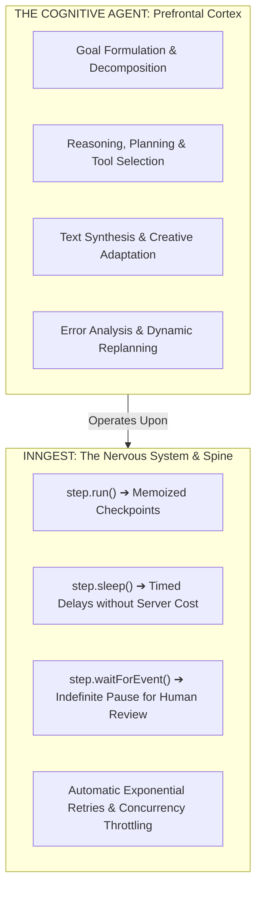
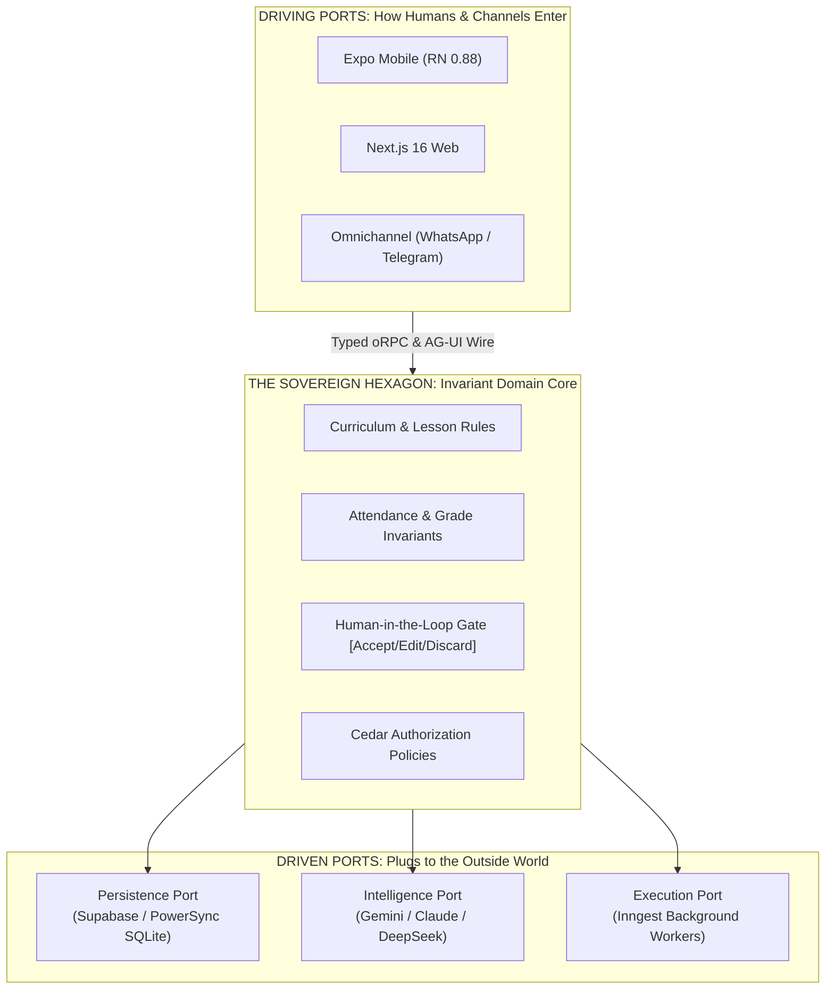

# The Four Computational Generations & The Agentic Frontier: Taxonomy, Economics, and the Convivial ROI Curve

> **CANONICAL INVARIANT SPECIFICATION**  
> This document establishes the permanent, domain-agnostic taxonomy governing asynchronous workflows, conversational models, multimodal interfaces, and autonomous enduring agents across the Polymath Platform. It codifies the distinction between execution runtimes (Inngest) and cognitive planners (Agents), models the compounding economic cost curves of autonomy, and establishes the **Inverted U-Curve of Convivial Return on Investment (ROI)**.

---

## 1. The Four Computational Generations

Modern computing paradigms are frequently confused because they share common terminology ("tools", "functions", "prompts"). To maintain architectural integrity, the platform strictly stratifies systems into four distinct generations:

```
┌─────────────────────────────────────────────────────────────────────────────────────────────────┐
│                               THE FOUR COMPUTATIONAL GENERATIONS                                │
├─────────────────────┬───────────────────────┬─────────────────────────┬─────────────────────────┤
│ Gen 1: Asynchronous │ Gen 2: Synchronous    │ Gen 3: Multimodal       │ Gen 4: Enduring         │
│ Event Workflows     │ Conversational Stream │ Turn-by-Turn Canvas     │ Autonomous Agents       │
├─────────────────────┼───────────────────────┼─────────────────────────┼─────────────────────────┤
│ • Inngest, n8n,     │ • Single/multi-turn   │ • Voice, Vision,        │ • Claude Duet, OpenDuet,│
│   Temporal, cron    │   text completion     │   Generative UI, Canvas │   Gurudevi Companion    │
│ • Decoupled event   │ • User & model locked │ • Richer human senses,  │ • User delegates goal   │
│   pipelines (queue) │   in ping-pong chat   │   but still turn-based  │   and walks away        │
│ • Executes at 2am   │ • "Spitting words" in │ • Synchronous reactive  │ • Operates for hours/   │
│   in background     │   real-time response  │   co-presence           │   days independently    │
│ • Deterministic     │ • Ephemeral session;  │ • Interactive tool      │ • Autonomous planning,  │
│   DAG execution     │   dies on disconnect  │   manipulation          │   tool loops, endurance │
└─────────────────────┴───────────────────────┴─────────────────────────┴─────────────────────────┘
```

### Generation 1: Decoupled Asynchronous Workflows (The Rails)
* **Archetypes:** Inngest, n8n, Temporal, Celery, BullMQ.
* **Operational Mode:** Decoupled from human attendance. Triggered by system events (e.g., student attendance marked, daily ledger rollover, webhook ingress).
* **Execution Dynamics:** Fully deterministic DAGs (Directed Acyclic Graphs). Functions execute step-by-step with memoized checkpoints, automatic retry backoffs, and durable state preservation across server reboots.
* **LLM Role:** The LLM is merely a passive, leaf-node transformation utility (e.g., summarizing an already gathered JSON payload). The workflow does not hold a conversational dialogue with a human.

### Generation 2: Synchronous Conversational Streams (The Ping-Pong Chat)
* **Archetypes:** ChatGPT, Claude Web, raw `/api/ai/chat` completions.
* **Operational Mode:** Human and machine locked in a tightly coupled, turn-by-turn conversational game ($User \rightarrow Model \rightarrow User \rightarrow Model$).
* **Execution Dynamics:** Ephemeral HTTP/SSE streaming connection. The model reactive "spits words" token-by-token. If the user closes the laptop, switches mobile apps, or drops Wi-Fi, the connection is severed and the run is terminated.
* **Limitation:** The AI has no autonomous stamina. It cannot continue working once it finishes spitting its immediate completion; it must sit idle, awaiting the next human prompt.

### Generation 3: Real-Time Multimodal Canvas & Turn-by-Turn Interfaces
* **Archetypes:** ChatGPT Voice Mode, Claude Artifacts, Gemini Live, Copilot Canvas.
* **Operational Mode:** Multi-sensory co-presence (audio streaming, camera/screen observation, interactive SVG/React widgets).
* **Execution Dynamics:** Bidirectional, low-latency client-server streaming. The user directly manipulates code or diagrams on a shared visual surface while speaking or typing.
* **Limitation:** While the sensory bandwidth is high, the architectural paradigm remains fundamentally synchronous and turn-based. The AI is still an interactive collaborator sitting in the room with the human, rather than an independent worker dispatched into the field.

### Generation 4: Enduring Autonomous Agents (The Independent Conductor)
* **Archetypes:** Claude Duet (Anthropic), OpenDuet / OpenBot, Cursor Agent SDK, The Default Gurudevi Agent.
* **Operational Mode:** Goal delegation without synchronous human attendance. The user provides intent (*"Audit the grade 5 flood adaptation curriculum, check attendance patterns across the past 3 weeks, identify struggling students, draft individual encouragement notes, and notify me for review"*), and departs.
* **Execution Dynamics:**
  1. **Autonomy & Reasoning Loops:** The agent constructs a dynamic plan, invokes tools, inspects databases, evaluates intermediate findings, recovers from tool errors, and adjusts its strategy without asking for permission at every trivial step.
  2. **Endurance & Persistence:** The agent operates across minutes, hours, or days.
  3. **Durable Pause & Human-in-the-Loop:** When a consequential boundary is reached (e.g., committing a grade, publishing a notice), the agent durably pauses, persists its execution state, and awaits human verification.

---

## 2. Inngest vs. Agent: The Nervous System vs. The Prefrontal Cortex

A critical error in early AI engineering is conflating the **Workflow Engine** with the **Agent**:



* **Inngest is NOT an Agent:** Inngest provides **Durable Execution**. It has no intelligence, understands no language, and makes no autonomous decisions. It guarantees that if a process fails on step 7 of 10, it resumes from step 7 without restarting or corrupting state.
* **The Agent is NOT an Execution Engine:** An LLM agent has cognitive capability but zero native stamina. If an agent runs in a naked Node.js process and experiences a 30-second model timeout or container restart, its memory vanishes and the task aborts.
* **The Synthesis:** **Inngest serves as the durable execution spine that grants the Agent its endurance.** An enduring agent wraps its cognitive reasoning loops within Inngest's `step.run()` and `step.waitForEvent()` primitives, enabling it to survive network outages, rate limits, and multi-day human approval delays.

---

## 3. The Economics of Autonomy: Compounding Cost Trajectories

Moving from Generation 1 to Generation 4 transforms the cost structure from predictable flat fees to compounding token consumption:

$$\text{Cost}_{\text{Gen 1}} = O(1) \quad \ll \quad \text{Cost}_{\text{Gen 2}} = O(\text{Tokens}) \quad \ll \quad \text{Cost}_{\text{Gen 4}} = O\left(\sum_{k=1}^{N_{\text{steps}}} \text{Context}_k \times \text{Tools}_k \times \text{Reflection}_k\right)$$

```
COMPUTATIONAL COST & INVOCATION VOLUME TRAJECTORY

Cost / Run
    ▲
    │                                                     Gen 4: Autonomous Agent
    │                                                     (Compounding Loops)
    │                                                          /
    │                                                         /  [$0.50 - $4.00 / task]
    │                                                        /
    │                                                       /
    │                                                      /
    │                                   Gen 3: Multimodal /
    │                                   (Audio / Canvas) /
    │                                        ───────────┘ [$0.05 - $0.20 / session]
    │                 Gen 2: Chat Stream
    │                 (Single Turn)
    │                      ─────────── [$0.002 - $0.01 / turn]
    │   Gen 1: Workflow
    │   (Deterministic)
    └───────────────────────────────────────────────────────────► Level of Autonomy
       [Fixed Compute]
```

1. **Generation 1 (Fixed):** A Postgres query and deterministic formatting cost fraction-of-a-cent server compute.
2. **Generation 2 (Linear):** A chat query sends a prompt and receives 500 tokens. Cost is strictly bounded by human reading speed.
3. **Generation 4 (Compounding):** An autonomous agent delegating a complex task runs in a loop:
   - Step 1: System prompt + Task definition (4,000 tokens).
   - Step 2: Tool call to search curriculum (4,000 in + 2,000 out).
   - Step 3: Reflection on search results (6,000 in + 1,000 out).
   - Step 4: Tool call to fetch student records (7,000 in + 3,000 out).
   - Step 5: Draft generation & self-critique (10,000 in + 1,500 out).
   - **Total:** One autonomous task consumes **$50\times \text{ to } 200\times$ the tokens of a simple chat turn.**

---

## 4. The Inverted U-Curve of Convivial ROI

Does maximum autonomy yield maximum value? **No.**

In educational platforms (and human institutions generally), unconstrained agentic autonomy violates Ivan Illich's **Convivial Limit** and leads to catastrophic collapse in net Return on Investment (ROI):

```
THE INVERTED U-CURVE OF CONVIVIAL UTILITY & ROI

Net ROI /
Convivial Value
    ▲
    │                               ★ THE OPTIMAL CONVIVIAL ZONE:
    │                         . · ' ' · .   "Discerning Contextual Copilot"
    │                     . ·             · .   (Human-in-the-Loop Drafts & Review)
    │                 . ·                     · .
    │             . ·                             · .
    │         . ·                                     · .   ZONE OF AGENTIC DRIFT:
    │     . ·                                             · (Runaway Token Costs,
    │   ·                                                   Hallucinations, Alienation,
    │  /                                                     Liability, Security Risks)
    │ /
    │/  Gen 1: Workflows     Gen 2: Chat     Gen 3: Canvas     Gen 4: Full Autonomy
    └─────────────────────────────────────────────────────────────────────────────►
      [Zero Autonomy]                       [Bounded Co-Pilot]        [Full Swarm]
```

### Deconstructing the Curve:

#### Zone 1: Sub-Optimal Autonomy (Gen 1 & Raw Gen 2)
* **Characteristics:** Rigid forms, manual database data entry, or disconnected chat text boxes.
* **Failure Mode:** Administrative drudgery. Teachers spend hours manually copying grades, compiling attendance, and drafting repetitive notices.

#### Zone 2: The Convivial Optimum (The Discerning Co-Pilot)
* **Characteristics:** Bounded autonomy. The agent reads authorized minimum context, plans steps, compiles evidence, and **produces an editable proposal**.
* **The Sovereign Rule:** The agent never commits domain truth on its own. It presents clear **[Accept] / [Edit] / [Discard]** review cards to an authorized human.
* **Economic & Human Balance:** High administrative time savings, strictly bounded token budgets, zero risk of runaway automated actions, and preserved human relational agency.

#### Zone 3: The Collapse of ROI (Hyper-Agentic Drift)
* **Characteristics:** Unconstrained multi-agent swarms with direct database write access, autonomous external messaging, or unmonitored background tasks.
* **Why the Curve Collapses:**
  1. **Economic Ruin:** Background loops looping infinitely on ambiguous web data, exhausting school budgets overnight.
  2. **Epistemic Injustice:** The model confuses empirical token statistics with biological/social reality, making unverified assessments of children.
  3. **Loss of Conviviality:** Software encloses human community. Parents receive cold, robotic automated warnings; teachers feel deskilled and sidelined by a machine claiming false omniscience.
  4. **Security Vulnerabilities:** Indirect prompt injections in unvetted curriculum files hijacking agent tools to exfiltrate student records.

---

## 5. Architectural Mandate for the Polymath Platform

To maintain operations strictly at the **Convivial Optimum**, all agentic implementations across Gurudevi Mobile, Gurudevi Web, and Sanctuary API must obey the following architectural laws:

1. **The Separation of Powers:**
   - **Inngest** owns the execution lifecycle, retries, step checkpointing, and sleep/resume states.
   - **The Model** owns language comprehension, synthesis, and structured proposal formulation.
   - **The Sanctuary API (oRPC + ZenStack)** owns domain truth, authorization, and permanent audit receipts.
2. **Natural Language is Never a Commit:**
   - An agent asserting `"I have updated 32 attendance records"` is a proposal.
   - A commit exists *only* when an authorized teacher reviews the draft and the server returns a signed transactional receipt.
3. **Atomic Quota Pre-Reservation:**
   - Every autonomous task dispatched into the background must reserve a bounded token/budget cap *before* execution begins.
   - If an agent loop exceeds its budget ceiling, it must gracefully pause, checkpoint its findings via Inngest, and request human guidance.
4. **Contextual Conviviality:**
   - The Default Gurudevi Agent exists to relieve administrative burden—never to replace teacher-student connection, contemplative reflection, or human community.

---

## 6. The Tiered Deployment Policy: Economic Access Control & Operational Topology

To protect the platform's financial sustainability while maximizing user value, the Four Generations are mapped directly to platform access tiers and operational roles:

```
┌────────────────────────────────────────────────────────────────────────────────────────┐
│                          GURUDEVI PRODUCT TIER & ENGINE MATRIX                         │
├───────────────────────┬────────────────────────────┬───────────────────────────────────┤
│ Tier / Capability     │ Operational Generation     │ Economic Model & Access Policy    │
├───────────────────────┼────────────────────────────┼───────────────────────────────────┤
│ 1. Asynchronous Spine │ Generation 1               │ Platform Foundation               │
│    (Background Jobs)  │ • Pure Inngest Workers     │ • Zero marginal token cost        │
│                       │ • No n8n/LangChain yet     │ • Predictable server compute      │
├───────────────────────┼────────────────────────────┼───────────────────────────────────┤
│ 2. Default Companion  │ Generation 2 / 3 Hybrid    │ All Active Members                │
│    (Conversational &  │ • Routed streaming chat    │ • Strictly bounded token costs    │
│    Contextual Canvas) │ • Fast, responsive UI      │ • Baseline included allowance     │
│                       │ • Multimodal turn-by-turn  │ • Optional personal BYOK          │
├───────────────────────┼────────────────────────────┼───────────────────────────────────┤
│ 3. Autonomous Agent   │ Generation 4               │ Pro / Institutional / Preview     │
│    (Enduring Tasks &  │ • Inngest + Dynamic Loops  │ • Gated behind Pro entitlement    │
│    Autonomous Work)   │ • Multi-step background    │ • Hard pre-reserved token budgets │
│                       │   research & drafting      │ • Strict human approval gates     │
└───────────────────────┴────────────────────────────┴───────────────────────────────────┘
```

### Operational Decisions Codified:

1. **Generation 1 as Asynchronous Foundation (Holding on n8n / LangChain):**
   - Inngest is the sole authorized asynchronous execution engine for background jobs (events, webhooks, retries, rollups).
   - Integration with external workflow orchestrators (e.g. n8n) or heavyweight chains (e.g. LangChain/LangGraph) is intentionally deferred. Inngest satisfies all current step-execution and recovery needs without introducing secondary operational dependencies.

2. **Generation 2/3 Hybrid as the Platform-Wide Default:**
   - The primary user-facing companion uses the multi-provider router (`apps/sanctuary-api/src/ai/routes.ts`) with dual-SDK support (`@tanstack/ai` and Vercel `ai`).
   - It operates synchronously turn-by-turn, ensuring immediate responsiveness, warm pedagogical assistance, and strictly bounded per-turn token costs ($O(\text{Tokens})$).
   - Funded via baseline included usage for members, with optional client-side Bring-Your-Own-Key (BYOK) for unconstrained personal use.

3. **Generation 4 Gated as a Pro / Limited Preview Feature:**
   - Because autonomous agents execute compounding background loops with tool invocations ($O(N_{\text{steps}} \times \text{Context} \times \text{Tools})$), Gen 4 is strictly restricted to **Gurudevi Pro**, **Institutional licenses**, or **bounded research previews**.
   - Pro entitlement checks (e.g. `usePremiumStatus()` in mobile and server-side Cedar verification) must guard all Gen 4 entry points.
   - Any background task run by a Gen 4 agent must atomically reserve its token budget before launch, enforcing a hard financial ceiling against runaway autonomous loops.

---

## 7. The Hexagonal Simplification Law: Collapsing the 6 Layers into Ports & Adapters

To prevent "layer anxiety" and the proliferation of unnecessary framework abstractions, the platform enforces **The Hexagonal Simplification Law** (Alistair Cockburn's Ports & Adapters).

### The Epistemic Truth: Only Three Physical Boundaries Exist

In all computing systems, there are fundamentally only three real boundaries:
1. **The Human / Sensory Surface:** The glass, pixels, audio, and taps on the user's phone or laptop.
2. **The Core Domain:** The invariant business rules, curriculum models, and pedagogical covenants (e.g., *"Attendance requires an authenticated teacher"*, *"AI suggestions must be reviewed before committing"*).
3. **The Outside World (External Substrates):** The physical network cables, PostgreSQL disks, GPU inference endpoints (OpenAI, Gemini, Anthropic), and background queues (Inngest).

### Collapsing the 6 Layers into 4 Standard Ports

Instead of constructing six fragile, tightly-coupled vertical tiers for every new feature, the entire AI and application architecture is organized as **One Sovereign Domain Hexagon** surrounded by **Four Standard Swappable Ports**:

```
                       ┌─────────────────────────────────────────┐
                       │          ACTORS / DRIVERS (Inputs)      │
                       │  Expo Mobile · Next.js Web · WhatsApp   │
                       └────────────────────┬────────────────────┘
                                            │
                                  ┌─────────▼────────┐
                                  │ 1. Driving Port  │
                                  │ (oRPC Contracts) │
                                  └─────────┬────────┘
                                            │
               ┌────────────────────────────▼────────────────────────────┐
               │                                                         │
               │                   THE CORE HEXAGON                      │
               │                   (Domain Logic)                        │
               │                                                         │
               │   • "Grade is between 0 and 100"                        │
               │   • "Attendance requires verified teacher"              │
               │   • "AI drafts require human approval"                  │
               │   • "Atomic budget must precede agent run"              │
               │                                                         │
               └──────────────┬───────────────────────────┬──────────────┘
                              │                           │
                   ┌──────────▼──────────┐     ┌──────────▼──────────┐
                   │ 2. Persistence Port │     │ 3. Intelligence Port│
                   │ (AiPersistencePort) │     │ (ModelPort / Router)│
                   └──────────┬──────────┘     └──────────┬──────────┘
                              │                           │
          ┌───────────────────▼───────────┐   ┌───────────▼──────────────────┐
          │      Driven Adapters          │   │        Driven Adapters       │
          │ • Supabase Postgres Adapter   │   │ • Gemini Adapter (Gen 2/3)   │
          │ • PowerSync SQLite Adapter    │   │ • Claude Adapter (Gen 4)     │
          │ • InMemory Mock Adapter (CI)  │   │ • DeepSeek / OpenRouter      │
          └───────────────────────────────┘   └──────────────────────────────┘
                                            │
                                  ┌─────────▼────────┐
                                  │ 4. Execution Port│
                                  │ (Worker / Queue) │
                                  └─────────┬────────┘
                                            │
                              ┌─────────────▼─────────────┐
                              │      Driven Adapter       │
                              │ • Inngest Adapter (Gen 1) │
                              │ • Immediate Sync Adapter  │
                              └───────────────────────────┘
```



### The Four Standard Monorepo Ports:

| Port | Purpose & Contract | Active Monorepo Adapters |
| :--- | :--- | :--- |
| **1. Driving (Input) Port** | Defines how requests enter the domain. | • **Web Adapter:** Next.js 16 App Router (`apps/gurudevi-web`)<br>• **Mobile Adapter:** Expo 58 (`apps/gurudevi-mobile`)<br>• **AG-UI Wire Adapter:** Streams agent events to clients |
| **2. Persistence (Storage) Port** | Defines how permanent records are saved without coupling to SQL syntax. | • **PostgreSQL Adapter:** Cloud relational store (`apps/sanctuary-api`)<br>• **PowerSync SQLite Adapter:** Local-first offline device store (`packages/core`)<br>• **Memory Mock Adapter:** Instant, zero-network unit tests |
| **3. Intelligence (Model) Port** | Defines how cognitive tasks (drafting, reasoning) are requested. | • **Gemini Adapter:** Low-cost, fast Gen 2/3 chat completions<br>• **Claude Adapter:** Deep Gen 4 lesson planning and multi-step reasoning<br>• **Deterministic Rule Adapter:** Zero-cost offline pedagogical rules |
| **4. Execution (Worker) Port** | Defines how long-running jobs are scheduled and checkpointed. | • **Inngest Adapter:** Durable step execution, retries, and sleep states<br>• **Immediate Sync Adapter:** Synchronous execution for dev testing |

### The Constitutional Invariant of Hexagonal Simplicity:

1. **The Core Never Imports External SDKs:**
   The domain logic in `packages/core` or `apps/sanctuary-api/src/core` must **never** import `@google/genai`, `@anthropic-ai/sdk`, `inngest`, or native device packages. It interacts *only* through pure TypeScript port interfaces.
2. **Vendors Are Merely Swappable Plugs:**
   If a model provider doubles its prices, or a background worker engine deprecates an API, **zero domain logic is touched**. The developer modifies only the isolated Adapter in `apps/sanctuary-api/src/ai/adapters/`.
3. **Liberation from Layer Anxiety:**
   Engineers do not build six distinct architectural layers for each feature. They write one clean domain use-case, expose it through the driving port (oRPC), and connect the required driven ports (Persistence, Model, Inngest).


