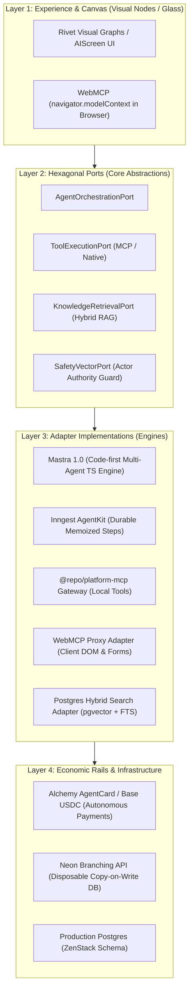
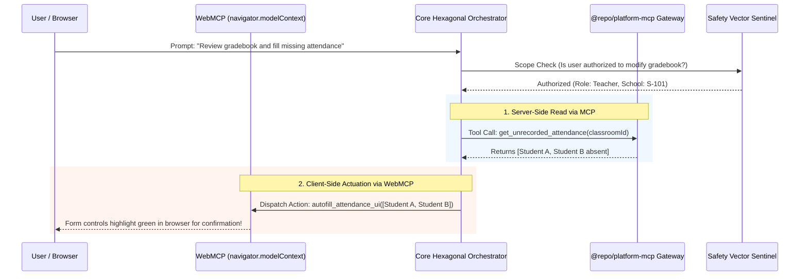

# Canonical Hexagonal Agent Architecture & Safety Vectors

> **Author**: Staff Solutions Architect & Pragmatic System Integrator  
> **Date**: October 29, 2026  
> **Status**: Approved Architectural Standard  
> **Applies to**: `apps/sanctuary-api`, `apps/gurudevi-mobile`, `packages/ai`, `packages/core`

---

## 1. Deconstructing Frameworks Across Hexagonal Layers

The industry suffers from severe layer-confusion: **Mastra**, **Rivet**, **Inngest**, and **Alchemy** are often thrown into the same sentence, but they occupy radically different concentric rings in a Hexagonal (Ports & Adapters) system:



| Technology | Hexagonal Layer | Role in Polymath Platform |
| :--- | :--- | :--- |
| **Rivet** | **Layer 1: Visual Design** | Offline graph designer for curriculum designers to test multi-turn prompt chains visually before exporting as JSON graph specs into `@repo/core`. |
| **Mastra 1.0** | **Layer 3: Agent Adapter** | In-process TypeScript engine for rapid, code-first multi-agent coordination (Handoffs, Supervisors, Councils). |
| **Inngest AgentKit** | **Layer 3: Durable Engine** | Background durable nervous system for long-horizon jobs (hours/days) with crash-proof step memoization. |
| **Alchemy Rails** | **Layer 4: Economic Adapter** | Gated commerce adapter allowing institutional agents to execute real-world micro-transactions (paying external API credits or purchasing certified course materials) with cryptographic spend limits. |

---

## 2. MCP & WebMCP: Delegated Execution on Behalf of the User

### The Real Substrate: oRPC v2 MCP Door (`apps/sanctuary-api/src/doors/mcp.ts`)
Rather than relying on `@repo/platform-mcp` (which is our developer/engineering MCP server), **production end-user agents connect directly to our oRPC v2 MCP Door (`/api/mcp`)**:
* Powered natively by `@orpc/mcp` and `@modelcontextprotocol/server`.
* Automatically exposes all 5 bounded contexts in `canonicalDomainRouter` (`workspace`, `community`, `library`, `identity`, `self`).
* Standard endpoints:
  - `GET /api/mcp/info`: Advertises `sanctuary-api-mcp` capabilities.
  - `GET /api/mcp/tools`: Auto-generates real MCP JSON schemas from our Zod procedure contracts.
  - `POST /api/mcp/call`: Executes tool calls with strict per-actor context isolation (`ORPCContext`).

### Can Chat LLMs & Autonomous Agents Call oRPC MCP Tools?
| Modality | Can It Call oRPC MCP? | How It Works & Limitations |
| :--- | :--- | :--- |
| **Fast Chat LLM (Gen 2/3)** | ✅ **Read-Only Tools** | When a user asks a question requiring factual context, the LLM calls read procedures (`library.search`, `workspace.getAttendance`). Writes are blocked to maintain sub-second streaming. |
| **Autonomous Agent (Gen 4)** | ✅ **Full Catalog (Gated Writes)** | Dispatches multi-step workflows. Can call mutating procedures (`workspace.updateGrade`), but all mutations are intercepted by the **Convivial Review Gate** as proposals before commit. |

### Client-Side WebMCP (`navigator.modelContext`)
* Runs **inside the user's browser / webview session**.
* Directly exposes interactive client forms, active tabs, and canvas states as callable tools (`search_ui`, `fill_admission_form`, `export_pdf`).
* Automatically inherits the user's active session cookies, local storage, and client DOM state without sending credentials to a third-party server.



---

## 3. Database-Native Hybrid RAG (pgvector + FTS + RRF)

Rather than paying for an external vector database (Pinecone, Qdrant) that drifts out of sync with user records, knowledge embeddings live **directly in PostgreSQL** using the `pgvector` extension coupled with PostgreSQL's built-in Full-Text Search (`tsvector`).

### Reciprocal Rank Fusion (RRF) Retrieval
To ensure 95%+ precision, the search executes semantic similarity and exact keyword match in parallel within a single transactional SQL procedure:

$$\text{RRF\_Score}(d) = \frac{w_{\text{dense}}}{k + \text{rank}_{\text{vector}}(d)} + \frac{w_{\text{sparse}}}{k + \text{rank}_{\text{fts}}(d)}$$

Both the **Fast Chat LLM** and the **Autonomous Agent** read from the same `KnowledgeRetrievalPort`, filtered by the user's active bond:
* Teachers can retrieve school curriculum guides and lesson archives.
* Students can only retrieve public or classroom-enrolled materials.
* **Neither can ever retrieve private personal reflections (`packages/self`).**

---

## 4. The 4 Safety Vectors (Defense-in-Depth)

To prevent catastrophic hallucinations, data leaks, or unconstrained financial bleeding, every agent execution passes through 4 non-negotiable vectors:

```
[ Vector 1: Identity & Scope Boundary ]
                   ↓ (Pass)
[ Vector 2: Convivial Review Gate (Human Sign-off) ]
                   ↓ (Pass)
[ Vector 3: Sandbox / Ephemeral Scratch Isolation ]
                   ↓ (Pass)
[ Vector 4: Economic Circuit Breakers & Spend Velocity ]
```

1. **Vector 1: Identity & Scope Boundary (Actor-Authority Invariant)**
   * Every MCP or WebMCP tool receives the caller's immutable `ActorAuthority` context (`userId`, `schoolId`, `bonds`).
   * The tool physically asserts `bond.capacity == 'teacher'` before evaluating gradebook procedures.
2. **Vector 2: Convivial Review Gate (The Deletion & Mutation Veto)**
   * Read operations (`get_`, `list_`, `search_`) execute autonomously.
   * Write mutations (`create_`, `update_`, `delete_`) are **quarantined as proposals**.
   * Output is rendered as an interactive `ProposalCard` in `AIScreen`. Production DB mutation requires an explicit human tap.
3. **Vector 3: Sandbox Scratchpad Isolation (Neon / Memory WAL)**
   * Multi-step exploratory analysis (e.g. optimizing 500 student timetables) executes in a temporary Copy-on-Write database branch or in-memory SQLite WAL.
   * If the run fails, times out, or produces invalid schemas, the branch is destroyed.
4. **Vector 4: Economic Circuit Breaker & Spend Velocity**
   * For paid models or Alchemy-backed transactions:
     - Maximum $0.50 per autonomous mission.
     - Maximum 20 API turns per continuous loop.
     - Exponential backoff on 429/503 errors via canonical retry schedules.
