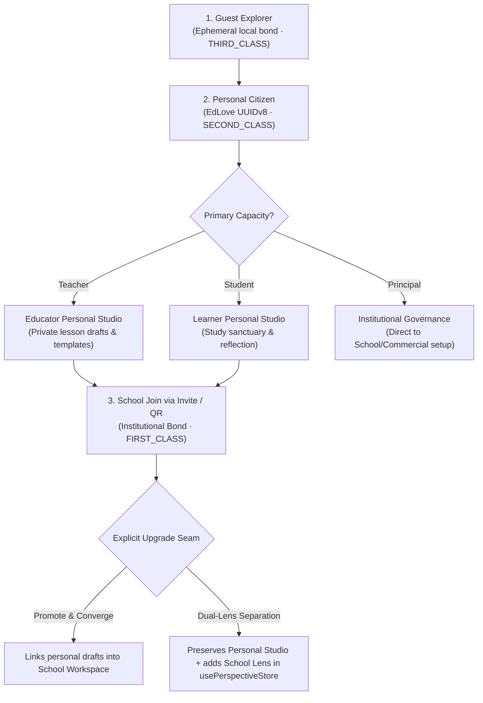

# Onboarding Core Documentation

## Overview

The onboarding system creates a user's initial identity bond and completes the onboarding flow. It's split into:

1. **Contract** — route definitions + POA metadata (in `packages/core/src/api/`)
2. **Handlers** — ZenStack-based server logic (in `packages/core/src/api/handlers/`)
3. **Client** — frontend API wrapper (in `packages/core/src/api/`)

## Contract Paths

| Route | Method | Path | POA Action | POA Subject |
|---|---|---|---|---|
| `createInitialBond` | POST | `/identity/initial-bond` | `update` | `User` |
| `completeOnboarding` | POST | `/identity/complete-onboarding` | `update` | `User` |

Both use `action: 'update'` because Cedar policy only permits non-admin users `read`/`update` on their own `User` record. `'create'` would be blocked at the Cedar gate.

## Handler Logic

### `createInitialBond`

1. **Auth guard** — Returns 401 if no user or user is `'anonymous'`
2. **Body validation** — Zod schema: `{ orientation: string, context: { displayName, fullName?, firstName?, lastName?, username?, schoolId?, metadata? } }`
3. **Profile lookup** — `db.user.findUnique` (returns 404 if missing)
4. **Citizenship computation** — `is_anonymous` → `THIRD_CLASS`, authenticated → `SECOND_CLASS`, authenticated + school → `FIRST_CLASS`
5. **Personal classroom creation** — Idempotent: checks `findFirst` before `create` (only for `SECOND_CLASS` without schoolId)
6. **User update** — Sets display_name, full_name, capacity, citizenship, identity_state, etc.
7. **Bond upsert** — `findFirst` then `update` or `create` based on entity_id, entity_type, capacity
8. **Error handling** — `ZodError` → 400, anything else → 500 with console.error

### `completeOnboarding`

1. **Auth guard** — Same as above, returns 401
2. **Body validation** — Zod schema: `{ userId: string }`
3. **Profile lookup** — `db.user.findUnique` (returns 404 if missing)
4. **Bond check** — `db.bond.findMany`; if empty and no capacity, returns 400
5. **Default sanctuary creation** — If bonds empty but capacity exists, creates a `PERSONAL_CLASSROOM` + bond
6. **Onboarding completion** — Sets `onboarding_completed: true`, `onboarding_completed_at`, `identity_state: 'onboarded'`
7. **Error handling** — Same as `createInitialBond`

## Client (Frontend)

`packages/core/src/api/onboarding.ts` exports `onboardingAPI`:

- `createInitialBond(orientation, context)` — calls API via `hc` client, throws `APIError` on failure
- `completeOnboarding(userId)` — calls API via `hc` client, throws `APIError` on failure
- `getActivePerspective()` — uses dynamic `import()` of factory to avoid circular dependency
- Other methods (`requestSchoolJoin`, `requestClassroomJoin`, etc.) still call factory directly

---

## Canonical Onboarding & Workspace Transition Seam (2026-11-01)

The platform enforces a three-stage progressive covenant:

### The Explicit Upgrade Choice:
When an existing personal account joins an accredited school:
1. **Option A (Promote & Converge)**: Links their existing personal draft materials to the newly bonded school context so they hit the ground running with zero data reentry.
2. **Option B (Dual-Lens Separation)**: Retains their independent Personal Studio and registers an `InstitutionalBondPerspective` inside `usePerspectiveStore.availablePerspectives`. Switching between personal craft and official school duties occurs with 0ms latency.

## How to Add a New Onboarding Step

1. **Add route to contract** — Add entry to `onboardingContract` in `packages/core/src/api/onboarding.contract.ts` with method, path, Zod request body, response, and POA metadata
2. **Write handler** — Add to `onboardingHandlers` in `packages/core/src/api/handlers/onboarding.ts` — use ZenStack `db`, auth guard, try/catch with ZodError handling
3. **Register route** — Add `registerRoute(onboardingApp, onboardingContract.newRoute, onboardingHandlers.newHandler)` in `apps/sanctuary-api/src/core/app.ts`
4. **Add client method** — Add to `onboardingAPI` in `packages/core/src/api/onboarding.ts`
5. **Write tests** — POA contract tests in `onboarding-poa.test.ts` + integration tests in `onboarding.test.ts`

## Relevant Files

| File | Purpose |
|---|---|
| `packages/core/src/api/onboarding.contract.ts` | Route definitions + POA metadata |
| `packages/core/src/api/handlers/onboarding.ts` | ZenStack-based handler logic |
| `packages/core/src/api/onboarding.ts` | Frontend API client |
| `apps/sanctuary-api/src/core/app.ts` | Route registration (lines 710-713) + CORS (lines 258-270) |
| `apps/sanctuary-api/src/__tests__/onboarding.test.ts` | 7 integration tests |
| `packages/core/src/api/__tests__/onboarding-poa.test.ts` | 5 POA contract tests |
| `apps/sanctuary-api/src/__tests__/setup.ts` | Mock DB via `setMockUserData`/`setMockActiveBond` |
