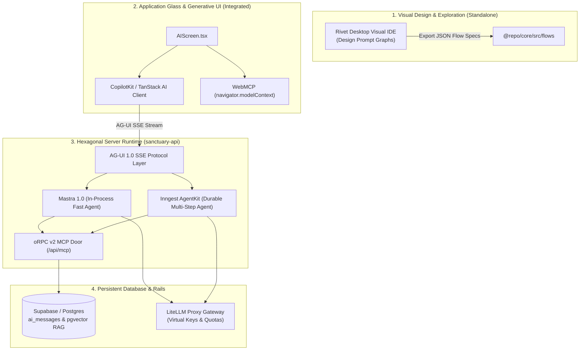

# Standalone vs. Integrated Matrix: Deciding Where AI Frameworks Belong

> **Author**: Staff Solutions Architect & Systems Integrator  
> **Date**: October 29, 2026  
> **Status**: Approved Architectural Standard  
> **Applies to**: `apps/sanctuary-api`, `apps/gurudevi-mobile`, `packages/ai`, `packages/core`

---

## 1. The Core Architectural Dilemma: "Can We Go Standalone or Must We Integrate?"

When evaluating **Rivet**, **Inngest AgentKit**, **Mastra 1.0**, **AG-UI**, **CopilotKit**, **Botpress/Dify/Coze**, and **Cursor Agent SDK**, teams often get trapped in false binaries:
* *"Do we throw away our codebase and build on Botpress/Dify?"* ❌ **No**. Platforms like Botpress/Dify are closed SaaS/low-code silos designed for customer-support chatbots. They cannot run inside our offline SQLite/PowerSync mobile app or read our ZenStack database schemas.
* *"Do we hand-code everything from scratch with no frameworks?"* ❌ **No**. That causes massive reinvention of event streaming, multi-agent loops, and state machines.
* **The Senior Architectural Answer**: **Integrated Hexagonal Modularism**. We run specific frameworks as decoupled adapters within their designated layer, while keeping the platform core completely standalone and vendor-independent.

---

## 2. The Comprehensive 8-Tier Comparison Matrix

| Technology | Architectural Layer | Primary Function | Can It Run Standalone? | Polymath Platform Role: Integrated or Standalone? |
| :--- | :--- | :--- | :--- | :--- |
| **Rivet** (Ironclad) | **Layer 1: Visual Design / IDE** | Visual node-based canvas for prompt chaining and branch logic. | ✅ **Yes** (Runs as standalone desktop app). | **Standalone / Offline Design Tool**: Curriculum designers design complex prompt graphs visually in Rivet, then export the graph as a JSON spec into `@repo/core`. Zero production runtime coupling. |
| **CopilotKit** | **Layer 1: Glass / Generative UI** | React hooks (`useCopilotAction`, `useCopilotReadable`) and canvas sync. | ❌ No (Requires app host). | **Integrated Frontend Adapter**: Consumes the AG-UI event stream in `AIScreen.tsx` to render Generative UI cards (`ProposalCard`) and sync form state. |
| **AG-UI Protocol** | **Layer 2: Wire Standard** | Open event protocol (`RUN_STARTED`, `TOOL_CALL`, `APPROVAL_REQUIRED`). | N/A (It is an open protocol standard). | **The Platform Wire Spine**: The universal SSE event dialect connecting our backend engines to mobile & web clients. |
| **Mastra 1.0** | **Layer 3: In-Process Agent Engine** | Code-first TypeScript multi-agent topologies (Councils, Supervisors, Handoffs). | ✅ **Yes** (Can run as a microservice). | **Integrated Engine Adapter**: Embedded inside `apps/sanctuary-api` for fast, in-process multi-agent collaboration with low latency. |
| **Inngest AgentKit** | **Layer 3: Durable Workflow Engine** | Long-horizon durable execution (hours/days) with step memoization and recovery. | ✅ **Yes** (Cloud or Dev Server). | **Integrated Execution Spine**: Dispatches heavy preparation tasks (timetable generation, attendance audits) with automatic pause-and-resume for human review. |
| **oRPC v2 MCP Door** | **Layer 3: Model Context Protocol** | Serves Zod procedures as official MCP tools over Streamable HTTP. | ✅ **Yes** (Stateless HTTP door). | **Integrated Core Door (`/api/mcp`)**: Exposes our 5 canonical domain routers (`workspace`, `community`, `library`, `identity`, `self`) to LLMs. |
| **Botpress / Dify / Coze** | **External SaaS / Low-Code Platform** | Out-of-the-box chatbot platforms with pre-built UI widgets. | ✅ **Yes** (Standalone hosted). | **Standalone / External Integration**: Used *only* if deploying external marketing landing page chatbots or WhatsApp broadcast bots. **Never** embedded in the core mobile app. |
| **Cursor Agent SDK / Local Bridge** | **External Developer Harness** | Headless CLI / local agent execution via terminal. | ✅ **Yes** (Developer local machine). | **Standalone BYOS Companion**: Power users run local bridges on their laptops (`localhost:8080`); `AIScreen` routes to their local IP when on LAN. |

---

## 3. The 3-Tier Execution Topology: How They Fit Together

---

## 4. Why This Architecture Wins (The Hostile Verdict)

1. **Zero Framework Lock-in**:
   - Because our domain business logic lives inside **oRPC v2 Zod procedures**, the agent engine is completely interchangeable. If we swap Mastra for Inngest or LangGraph tomorrow, our domain logic and database models **never change**.
2. **Generative UI Without Fragility**:
   - Instead of the agent sending unstructured raw HTML or Markdown, it communicates via the **AG-UI standard** and emits typed **ProposalCards** that CopilotKit/React renders natively with animations, haptics, and touch targets.
3. **No Expensive SaaS Dependency**:
   - We do not pay monthly seat licenses for Botpress or Dify for internal users. The core runs entirely on our self-hosted Hono/Node cluster and PostgreSQL.
