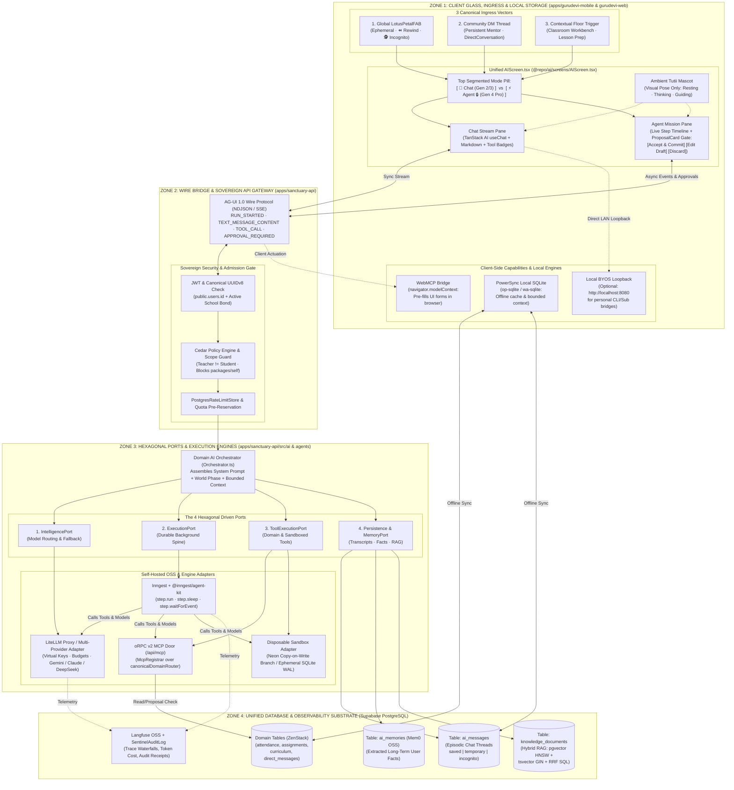
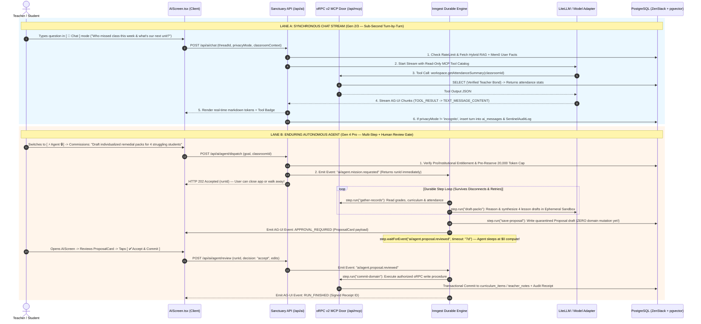

# The Unified Fine-Grained Visual Atlas: Polymath AI & Agent Architecture

> **CANONICAL SYNTHESIS & SINGLE SOURCE OF TRUTH**  
> **Date:** October 29, 2026  
> **Purpose:** Reconciles all prior architectural explorations (The 4 Computational Generations, The 8-Sphere Cartography, The Hexagonal Ports & Adapters Law, oRPC v2 MCP, Disposable Sandboxes, Self-Hosted OSS Primitives, BYOS/BYOK Billing, and `AIScreen` Ingress Vectors) into **seven fine-grained, zero-contradiction architectural blueprints**.

---

## Why Previous Docs Felt Fragmented (The Reconciliation Table)

Across earlier turns, different lenses were used to explain different problems, which created apparent contradictions. Here is the **single reconciled decision** for every seam:

| Architectural Seam | Previous Apparent Contradiction | The Final Reconciled Architecture (Single Truth) |
| :--- | :--- | :--- |
| **8 Spheres vs. 6 Layers vs. 4 Hexagonal Ports** | Are there 8 spheres, 6 vertical layers, or 4 hexagonal ports? | **They are 3 views of the exact same system:**<br>• **8 Spheres** = Ecosystem map (where external tools live in the world).<br>• **6 Layers** = Network packet journey (UI $\to$ Wire $\to$ Gateway $\to$ Engine $\to$ DB).<br>• **4 Hexagonal Ports** = Codebase folder structure (`Driving`, `Persistence`, `Intelligence`, `Execution`). |
| **Inngest AgentKit vs. Mastra 1.0 vs. Rivet** | One doc said "Inngest only"; another added Mastra and Rivet. | • **Inngest (`@inngest/agent-kit`)** = **Primary Durable Engine** (background multi-step loops, `step.run`, `step.waitForEvent`).<br>• **Mastra 1.0** = Optional **In-Process Sub-Adapter** *inside* an Inngest step or fast route if multi-agent supervisor/memory primitives are needed.<br>• **Rivet** = **Offline Desktop Design Tool** only (exports JSON flow specs; zero server runtime footprint). |
| **`@repo/platform-mcp` vs. `@orpc/mcp` vs. `WebMCP`** | Which MCP server does the AI call? | • **`@repo/platform-mcp`** = **Dev/Coding Agent CLI only** (Antigravity/Cursor repo tooling; *never* called by end-user AI).<br>• **`@orpc/mcp` (`/api/mcp`)** = **Server Domain MCP Door** (exposes `workspace`, `library`, `community` Zod procedures to LLMs).<br>• **`WebMCP` (`navigator.modelContext`)** = **Client Browser MCP** (lets AI highlight/pre-fill UI forms directly in the user's active tab). |
| **Chat History vs. Long-Term Memory vs. RAG** | Where does `ai_messages` stop and Mem0 / `pgvector` begin? | **All 3 live inside our single PostgreSQL database:**<br>1. **Episodic Transcript (`ai_messages`)**: Exact turn-by-turn chat history (`thread_id`) synced via PowerSync.<br>2. **Semantic User Facts (`Mem0` OSS / `ai_memories`)**: Distilled traits (*"Teacher prefers 45-min inquiry rubrics"*).<br>3. **Knowledge Commons (`knowledge_documents`)**: Hybrid RAG (`pgvector` + `tsvector` + RRF) for curriculum & library search. |

---

## Picture 1: The Grand Unified System Topology (All 4 Zones & Every File Seam)

This diagram shows **every single component, where it lives in the monorepo, and how the 4 zones connect**:



---

## Picture 2: Synchronous Chat (`[ 💬 Chat ]`) vs. Enduring Agent (`[ ⚡ Agent 🔒 ]`) Sequence

This sequence diagram shows the **exact packet-by-packet difference** between what happens when a user is on the `[ Chat ]` pill versus the `[ ⚡ Agent 🔒 ]` pill:



---

## Picture 3: The Dual-MCP & Tool Execution Architecture (What Can Call What)

This diagram clarifies **the three completely separate MCP mechanisms** (`@repo/platform-mcp` vs. `@orpc/mcp` vs. `WebMCP`) and how the **Read/Write Quarantine** works:

```mermaid
flowchart LR
    subgraph DevWorld ["1. DEVELOPER TIME ONLY (Never in Production App)"]
        DEV_AGENT["Coding Agents<br/>(Antigravity / Cursor)"]
        PLAT_MCP["@repo/platform-mcp<br/>(sovereign_discovery, codegraph, rg, sd)"]
        DEV_AGENT -->|Stdio| PLAT_MCP
    end

    subgraph ProdServer ["2. PRODUCTION SERVER MCP (apps/sanctuary-api/src/doors/mcp.ts)"]
        CHAT_LLM["Chat LLM<br/>(Gen 2/3 Stream)"]
        AGENT_LLM["Autonomous Agent<br/>(Gen 4 Inngest)"]
        
        subgraph ORPCDoor ["oRPC v2 MCP Door (/api/mcp via @orpc/mcp)"]
            CTX["Per-Request ORPCContext<br/>(Verified user.id + school bonds)"]
            
            subgraph Routers ["canonicalDomainRouter (5 Bounded Contexts)"]
                R_WORK["workspaceDomainRouter<br/>(Attendance, Gradebook, Timetable)"]
                R_LIB["libraryDomainRouter<br/>(Curriculum, Epistemic Atlas)"]
                R_COMM["communityDomainRouter<br/>(Groups, Announcements)"]
                R_ID["identityDomainRouter<br/>(Profile, School Info)"]
                R_SELF["selfDomainRouter<br/>(Private Reflections & Mood)"]
            end
        end

        GATE{"Read vs. Write<br/>Quarantine Filter"}
        PROP_STORE[("Draft Proposal Store<br/>(Awaits Human Tap)")]
        PROD_DB[("Production Postgres<br/>(Authoritative Commit)")]

        CHAT_LLM -->|Allowed: Read Tools Only| CTX
        AGENT_LLM -->|Allowed: Read + Quarantined Writes| CTX
        CTX --> R_WORK & R_LIB & R_COMM & R_ID
        CTX -.-x|HARD BLOCKED:<br/>Inviolable Privacy| R_SELF

        R_WORK & R_LIB & R_COMM & R_ID --> GATE
        GATE -->|Read Procedure (GET/List)| PROD_DB
        GATE -->|Mutating Procedure (Create/Update)| PROP_STORE
        PROP_STORE ==>|ONLY after Human clicks<br/>Accept & Commit| PROD_DB
    end

    subgraph ProdClient ["3. PRODUCTION CLIENT WEBMCP (Browser / WebView)"]
        BROWSER_DOM["Active Screen / Form State<br/>(navigator.modelContext)"]
        CHAT_LLM & AGENT_LLM -.->|AG-UI STATE_DELTA /<br/>Client Tool Call| BROWSER_DOM
        BROWSER_DOM -.->|Highlights & Pre-fills Inputs<br/>User clicks Submit| UserAction["Human Visual Confirmation"]
    end
```

---

## Picture 4: The 4-Tier Storage, Memory & Disposable Sandbox Topology

How **Episodic Chat**, **Long-Term Memory (Mem0)**, **Hybrid RAG (`pgvector` + FTS)**, and **Disposable Sandboxes (Neon / Ephemeral SQLite)** coexist without stepping on each other:

```mermaid
flowchart TD
    subgraph ClientMemory ["Tier 0: Device & Session Memory (Client)"]
        INC["Incognito Buffer (RAM Only)<br/>privacy_mode = 'incognito'<br/>Wiped on sheet close · Zero DB writes"]
        PS_LOCAL["PowerSync Local SQLite<br/>Offline-first cache of synced threads<br/>& active classroom notes"]
    end

    subgraph PostgresUnified ["Tiers 1–3: Unified Supabase / PostgreSQL Cluster"]
        direction TB
        subgraph Tier1 ["Tier 1: Episodic Transcript Store"]
            AI_MSG["Table: ai_messages (FAB Threads)<br/>• privacy_mode = 'saved' (Permanent)<br/>• privacy_mode = 'temporary' (24h TTL)"]
            DM_MSG["Table: direct_messages (Community DM)<br/>• Persistent multi-month mentor thread"]
        end

        subgraph Tier2 ["Tier 2: Observational Long-Term Memory (Mem0 OSS Pattern)"]
            MEM0["Table: ai_memories (pgvector)<br/>• Extracts & deduplicates durable user traits<br/>• Scoped by (user_id, school_id)<br/>• Never extracts from Incognito or packages/self"]
        end

        subgraph Tier3 ["Tier 3: Institutional Knowledge Commons (Hybrid RAG)"]
            RAG["Table: knowledge_documents<br/>• Dense: vector(1536) HNSW index<br/>• Sparse: tsvector GIN full-text index<br/>• Fused via Reciprocal Rank Fusion (RRF) SQL"]
        end
    end

    subgraph Tier4 ["Tier 4: Disposable Agent Scratchpad (Gen 4 Sandbox)"]
        NEON["Neon Copy-on-Write Ephemeral Branch<br/>OR In-Memory SQLite WAL Sandbox"]
        NOTE["Used when an Agent tests 50 timetable permutations<br/>or dry-runs complex curriculum restructures.<br/>Destroyed immediately after emitting ProposalCard!"]
        NEON --- NOTE
    end

    PS_LOCAL <-->|PowerSync Sync| AI_MSG & DM_MSG
    AI_MSG -->|Async Fact Extraction<br/>(When saved)| MEM0
    Tier4 -->|Promotes ONLY verified<br/>Proposal JSON| AI_MSG
```

---

## Picture 5: Multi-Tier Economics, Quotas & BYOK / BYOS Routing Matrix

How we support **Free Members**, **Institutional/Pro Members**, **Developer API Keys (BYOK)**, and **Personal Subscriptions (BYOS)** safely without getting our cloud IPs banned:

```mermaid
flowchart TD
    REQ["User Sends Message or Dispatches Agent in AIScreen"] --> MODE{"Which Billing / Connection<br/>Mode is Selected?"}

    %% Path 1: Baseline
    MODE -->|1. Baseline (Default Free)| BASE_CHECK["Check PostgresRateLimitStore<br/>(e.g., 20 turns/day cap)"]
    BASE_CHECK -->|Within Cap| LITE_BASE["LiteLLM / Fast Router<br/>(Gemini 2.5 Flash / GPT-4o-mini)<br/>Chat Only · Agent Locked 🔒"]
    BASE_CHECK -->|Quota Exceeded| UPGRADE_PROMPT["Render Friendly Quota Banner:<br/>Switch to BYOK or Upgrade to Pro"]

    %% Path 2: Pro / Institutional
    MODE -->|2. Purchased (Pro / School Grant)| PRO_CHECK["Verify user.pricing_tier == 'PRO'<br/>or Active School userEntitlementGrant"]
    PRO_CHECK -->|Verified| LITE_PRO["LiteLLM Virtual Key Budget<br/>(Claude 4.5 Sonnet / Gemini 2.5 Pro / DeepSeek R1)<br/>Unlocks [ ⚡ Agent ] with Pre-Reserved Token Cap"]

    %% Path 3: Cloud BYOK
    MODE -->|3. Personal API Key (BYOK)| BYOK_DEC["Client Encrypts Key (AES-256-GCM)<br/>via cryptoManager in SecureStore"]
    BYOK_DEC --> BYOK_ROUTE["Sanctuary API Decrypts in RAM Only<br/>Routes to Provider (AIzaSy* / sk-ant-* / sk-or-*)<br/>Zero Platform Token Cost · Unlocks [ ⚡ Agent ]"]

    %% Path 4: Local BYOS Companion
    MODE -->|4. Local Subscription Bridge (BYOS)| BYOS_LOCAL["Client Connects Directly to User's LAN/Localhost<br/>(e.g., http://localhost:8080 via BYOKEY / Claude CLI Proxy)"]
    BYOS_LOCAL --> BYOS_NOTE["Bypasses Sanctuary Cloud LLM Router Entirely!<br/>100% ToS-Safe for Platform · Uses User's Flat-Rate Sub"]

    LITE_BASE & LITE_PRO & BYOK_ROUTE --> AUDIT["Log Token Count & Latency to<br/>SentinelAuditLog + Langfuse (Skipped if Incognito)"]
```

---

## Picture 6: The 3 Ingress Vectors & Unified `AIScreen` Anatomy

How the user physically enters and interacts with the system across Mobile and Web:

```
┌─────────────────────────────────────────────────────────────────────────────────────────────────┐
│                                  THE 3 USER INGRESS VECTORS                                     │
├───────────────────────────────┬─────────────────────────────────┬───────────────────────────────┤
│ 1. Global LotusPetalFAB       │ 2. Community Direct Message     │ 3. Contextual Floor Trigger   │
│ • Tap from any tab            │ • Inside Community -> DMs list  │ • Inside Classroom / Library  │
│ • Quick overlay / modal       │ • Pinned "AI Assistant" row     │ • "Draft Lesson" / "Audit"    │
│ • Default: Ephemeral/Saved    │ • Default: Persistent Thread    │ • Auto-injects bounded        │
│ • Has ⏪ Rewind & 🕵️ Incognito│ • Synced via PowerSync          │   classroomContext pill       │
└───────────────┬───────────────┴────────────────┬────────────────┴───────────────┬───────────────┘
                │                                │                                │
                └────────────────────────────────▼────────────────────────────────┘
┌─────────────────────────────────────────────────────────────────────────────────────────────────┐
│                             UNIFIED AIScreen.tsx (@repo/ai/screens)                             │
├─────────────────────────────────────────────────────────────────────────────────────────────────┤
│  [← Back]             ┌──────────────────────────────────┐            [⏪ Rewind] [🕵️ Incognito]│
│                       │  [ 💬 Chat ]   │  [ ⚡ Agent 🔒 ] │                      [18/20 Free 🟢]│
│                       └──────────────────────────────────┘                                      │
├─────────────────────────────────────────────────────────────────────────────────────────────────┤
│  Bound Context Banner (if present): 📚 Grade 8 Science · Term 2 (Private reflections excluded)  │
├────────────────────────────────────────────────┬────────────────────────────────────────────────┤
│         IF ACTIVE TAB == [ 💬 Chat ]           │         IF ACTIVE TAB == [ ⚡ Agent 🔒 ]        │
│                                                │                                                │
│  • Ambient Tutii Avatar (Visual Pose Only)     │  • Mission Control Header (Pro / BYOK Active)  │
│  • Real-Time Streaming Bubbles                 │  • Live Step Progress Timeline:                │
│  • Inline Read-Tool Badges:                    │    ✓ Step 1: Checked 28 attendance logs        │
│    [🔍 Searched Grade 8 Curriculum · 3 hits]   │    ✓ Step 2: Drafted 3 biome lesson units      │
│  • Quick Suggestion Chips                      │    ⏸ Step 3: Halted at Convivial Review Gate   │
│                                                │                                                │
│                                                │  ┌──────────────────────────────────────────┐  │
│                                                │  │ 📋 PROPOSAL READY FOR HUMAN SIGN-OFF     │  │
│                                                │  │ Target: classroom.curriculum             │  │
│                                                │  │ ┌──────────────────────────────────────┐ │  │
│                                                │  │ │ Unit 1: Energy Transfer in Food Webs │ │  │
│                                                │  │ │ Unit 2: Ecosystem Resilience         │ │  │
│                                                │  │ └──────────────────────────────────────┘ │  │
│                                                │  │ [🗑 Discard] [✏️ Edit] [✅ Accept & Commit]│  │
│                                                │  └──────────────────────────────────────────┘  │
├────────────────────────────────────────────────┴────────────────────────────────────────────────┤
│  [ 💬 Ask anything or assign a mission...                                          [🎙️]  [➤] ]  │
└─────────────────────────────────────────────────────────────────────────────────────────────────┘
```

---

## Picture 7: Concrete Monorepo Implementation Status

| Layer / Seam | Monorepo File Path | Status |
| :--- | :--- | :--- |
| **1. Journey & PJC Contract** | `packages/core/src/flows/ai/aiAssistant.flow.ts`<br>`packages/core/src/flows/pjc/ai.assistant.json` | ✅ **Done & Tested** |
| **2. Database Schema** | `packages/schema/schema.zmodel` (`model AiMessage`, `DirectMessage`, `SentinelAuditLog`) | ✅ **Done** |
| **3. Server Chat Stream, Threads & Quota** | `apps/sanctuary-api/src/ai/routes.ts`<br>`DbAiPersistenceAdapter.ts`<br>`DbBillingAdapter.ts` | ✅ **Wired (`POST /chat`, `GET /threads`, `GET /threads/:threadId`, `DELETE /threads/:threadId`, `GET /quota`)** |
| **4. Server oRPC v2 MCP Door** | `apps/sanctuary-api/src/doors/mcp.ts` | ✅ **Done & Tested** |
| **5. Durable Agent Spine** | `apps/sanctuary-api/src/core/routes/durableAgents.ts`<br>`apps/sanctuary-api/src/agents/inngest.ts` | ✅ **Wired (`/api/durable-agents/*`)** |
| **6. Client Hook & State** | `packages/ai/src/hooks/useAIAgent.ts` | ✅ **Wired (`threads`, `quota`, `customBaseUrl`, `agentRuns`, `promoteAgentRun`)** |
| **7. Unified Screen & Ingress** | `packages/ai/src/screens/AIScreen.tsx`<br>`DirectMessagesListScreen.tsx`<br>`LotusPetalFAB.tsx` | ✅ **Wired End-to-End** |
