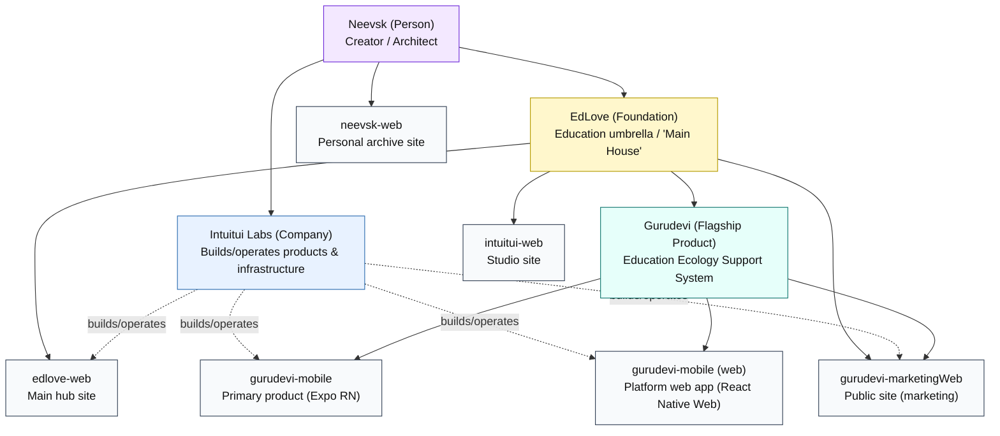

# Internal Project Map (Polymath / EdLove / Gurudevi)

This document is for **internal/dev navigation**: what the ecosystem is, what each app/package is for, and how it maps to domains/subdomains and pillar packages.

## Ecosystem diagram

## Apps (what / where / status)

Owner for all apps is currently **Neevsk** (single-person build); "built/operated by" is noted where relevant.

| App | Folder | Purpose | Status | Current domain | Target domain |
|---|---|---|---|---|---|
| EdLove Web | `apps/edlove-web` | Main "House" / central hub site | Phase 1 active construction | `edlove.org` (TBD) | `edlove.org` |
| Gurudevi Mobile | `apps/gurudevi-mobile` | Primary product (teachers/principals/students) | Active dev; "production-ready after critical fixes" | App stores / EAS builds (TBD) | Play Store / App Store (TBD) |
| Gurudevi Platform (Web App) | `apps/gurudevi-mobile` | The "real app" on web (React Native Web via Expo/Metro) | Active dev | `platform.gurudevi.edlove.org` (GitHub Pages) | `platform.gurudevi.edlove.org` (TBD) |
| Gurudevi Public Site | `apps/gurudevi-marketingWeb` | Public landing/marketing/information site | Phase 2/3 build | `gurudevi.edlove.org` | `gurudevi.lk` |
| Intuitui Web | `apps/intuitui-web` | Studio site (services/portfolio/gateway) | Phase 2/3 build | `intuitui.edlove.org` | `intuituilabs.lk` |
| Neevsk Web | `apps/neevsk-web` | Personal archive / portfolio | Phase 2/3 build | `neevsk.edlove.org` | `neevsk.edlove.org` (TBD) |

## Gurudevi pillars (domain packages)

Gurudevi's product surface is organized around **five pillars**, and the monorepo mirrors this with packages.

| Pillar | Package | Primary surfaces |
|---|---|---|
| SELF | `packages/self` | Mobile + web platform (`*.web.tsx` where needed) |
| CLASSROOM | `packages/classroom` | Mobile tab + classroom workflows |
| LIBRARY | `packages/library` | Mobile + web platform (web-native screens in `*.web.tsx`) |
| COMMUNITY | `packages/community` | Mobile tab + community features |
| PROFILE | `packages/profile` | Mobile tab + identity/profile features |

Cross-cutting shared packages:

- `packages/core`: shared engine/state/storage/api foundations (used by pillar packages).
- `packages/ui`: shared UI components/theme primitives across apps/packages.
- `packages/graphics`: visual/graphics utilities (used by library and UI).
- `packages/scanner-kit`: scanning utilities (used by classroom/community).
- `packages/eslint-config`, `packages/typescript-config`, `packages/types-shim`: tooling/types infra for the monorepo.

## Navigation

- Ecosystem index: [apps/00_ECOSYSTEM_INDEX.md](../apps/00_ECOSYSTEM_INDEX.md)
- App-specific context docs: `apps/*/CONTEXT.md` (and [apps/gurudevi-mobile/README.md](../apps/gurudevi-mobile/README.md)).
- Gurudevi web environments (marketing vs platform web app): [apps/gurudevi-mobile/docs/web/WEB_GUIDE.md](../apps/gurudevi-mobile/docs/web/WEB_GUIDE.md)

