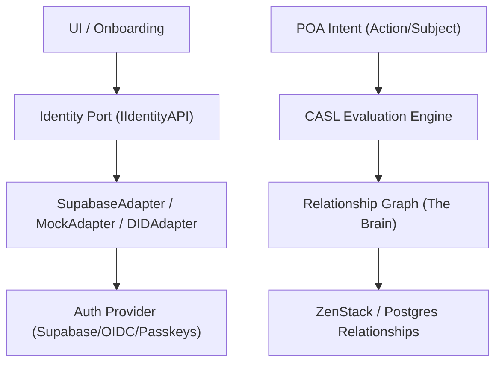

# Sovereign Identity Fabric: Architectural SSOT (May 2026)

**Status**: AUTHORITATIVE  
**Paradigm**: Relationship-Based Access Control (ReBAC) + Hexagonal Identity Ports  
**Timestamp**: 2026-05-04  

---

## 1. The Sovereign Vision
In May 2026, the Polymath platform treats Identity as a **Sovereign Fabric**, not a database table. We decouple *who* you are (AuthN) from *what you can do* (AuthZ) and *how you prove it* (Sovereignty).

### The Three Pillars:
1.  **Identity Portability**: Zero hard-coupling to Supabase Auth.
2.  **Relationship-First (ReBAC)**: Permissions are derived from **Bonds** (e.g., Teacher-of-Class), never static Role strings.
3.  **Contextual Perspective**: A user doesn't "have a role"; they act through a **Perspective** (e.g., acting as a Teacher in Classroom A while also being a Parent in School B).
4.  **Cross-Tenant Isolation**: Bonds are scoped to specific Tenants (Platform, School, Community).

---

## 2. Target Architecture (The Hexagonal IAM)



---

## 3. Bonds vs. Perspectives (The ReBAC Core)

The platform handles the multi-tenant/multi-role reality by splitting Identity into **Bonds** (the reality) and **Perspectives** (the lens).

### 3.1 Bonds (The Relationship Reality)
A **Bond** is a triple: `(User, Entity, Capacity)`.
- **Platform Bond**: `(User:123, Platform:Global, Capacity:Admin)`
- **School Bond**: `(User:123, School:A, Capacity:Staff)`
- **Classroom Bond**: `(User:123, Classroom:B, Capacity:Teacher)`
- **Community Bond**: `(User:123, Community:C, Capacity:Moderator)`

### 3.2 Perspectives (The Active Authority)
At any moment, the UI operates through a **Perspective**. This is what you call "the role they come into reality."
- When in the Classroom screen, the user might adopt the **Teacher Perspective**.
- When in the Community screen, they might adopt the **Member Perspective**.
- The `Identity Port` must allow the UI to query: `"What are my available Perspectives for this Entity?"`

### 3.3 No Neutral Users
Onboarding is the process of creating the **First Bond**. 
- Selecting "Student" creates a `(User, School, Student)` Bond.
- Selecting "Founder" creates a `(User, Platform, Founder)` Bond.

---

## 4. Approved Patterns (Do This)

### 4.1 Use the Identity Port
Never call `supabase.auth` directly outside of an Adapter.
*   **Pattern**: `const userId = await identity.getMyInternalId();`
*   **Benefit**: Allows swapping Supabase for Passkeys, DID, or local-first fakes in tests.

### 4.2 Relationship-Based CASL
Define abilities based on the **Relationship Context**, not a role string.
*   **Pattern**: `can('update', 'Classroom', { teacher_id: user.id })`
*   **Anti-Pattern**: `if (user.role === 'teacher') can('update', 'Classroom')`

### 4.3 Intent-Based POA
Annotate API contracts with the specific **Action/Subject** pair.
*   **Pattern**: `metadata: { authority: { action: 'grade', subject: 'Assignment' } }`

---

## 5. Anti-Patterns (The "Kill" List)

Any agent or developer attempting the following must be blocked:
1.  **Ghost RBAC**: Storing `role`, `authority`, or `platform_roles` as static strings on the `User` record.
2.  **The Admin Backdoor**: `@@allow('all', auth().authority == 'admin')`. Replace with relationship-based platform ownership.
3.  **Role Branching**: Using `switch(role)` in the `composer.ts`. Switch on **Active Bonds/Memberships** instead.
4.  **String Matching**: Checking `profile.role === 'student'` in domain logic. Use `user.hasRelationship('ENROLLED_IN', 'CLASSROOM')`.

---

## 6. Future Foundations (L2/L3)

### 6.1 Decentralized Identity (DID)
The Identity Port must support resolving an internal UUID from a DID string. This allows "Bring Your Own Identity."

### 6.2 Zero-Knowledge Proofs (ZKP)
Identity resolution should support "Proved Capacity" without "Revealed Identity."
*   *Example:* Prove "I am a teacher in School X" without revealing PII.

### 6.3 Permission Message Bus
When a relationship changes, an event fires to invalidate the **Identity Cache** across the fabric.

---

## 7. E2E Implementation Flow: From Login to Logic

1.  **Auth (AuthN)**: User logs in via Supabase/Passkeys.
2.  **Identity Port**: `identity.getMyInternalId()` resolves the platform UUID.
3.  **Bond Resolution**: `identity.getBonds(userId)` performs a relational scan (Classrooms, Schools, Communities).
4.  **Perspective Selection**:
    *   *Default*: System picks the primary Bond (e.g., School Staff).
    *   *Explicit*: User clicks "Switch to Classroom B" -> `switchPerspective`.
5.  **Capability Seeding**: `usePermissions` calls `composeUserAbilities(activePerspective)`.
6.  **UI Gating**: `can('create', 'Lesson')` returns true if the Active Perspective has that relationship.
7.  **Data Policy (ZenStack)**: The final wall. Even if the UI is tricked, the database policy checks the `memberships` table via RLS.

---

## 8. Developer Experience (DX) E2E Workflow

How to implement a new authorized feature in 5 steps:

1.  **Step 1: The Relationship (Schema)**
    Define the relationship in `schema.zmodel`. 
    *Example:* Add `moderators GroupMember[]` to `Community`.
2.  **Step 2: The Intent (Contract)**
    Mark the API route with POA metadata.
    ```typescript
    // community.contract.ts
    deletePost: {
      method: 'DELETE',
      path: '/community/post/:id',
      metadata: { authority: { action: 'delete', subject: 'Post' } }
    }
    ```
3.  **Step 3: The Bond (Adapter)**
    Update `SupabaseIdentityAdapter.getBonds()` to fetch this new relationship and map it to a `Bond`.
4.  **Step 4: The Capability (Composer)**
    Add the logic to `composer.ts` or a domain-specific ability file.
    ```typescript
    // community.abilities.ts
    if (capacity === 'moderator') can('delete', 'Post');
    ```
5.  **Step 5: The UI (Hook)**
    Use the `usePermissions` hook to hide/show the button.
    ```tsx
    const { can } = usePermissions();
    if (can('delete', 'Post')) return <DeleteButton />;
    ```

---

## 9. Tooling & Intelligence (2026 Stack)

*   **CASL (The Engine)**: Lightweight, memory-based authorization evaluation. (Free/OSS).
*   **ZenStack (The Guard)**: Transpiles ZModel policies to Prisma/RLS for database-level ReBAC. (Free/OSS).
*   **OpenFGA (The Zanzibar Option)**: If the Relationship Graph grows to millions of tuples, we can swap the `IdentityAdapter` to use [OpenFGA](https://openfga.dev/). (Open Source / Self-Hostable).
*   **Sovereign SDK**: Our internal `IdentityManager` acts as the "BFF for Identity," hiding these tools from the UI.

---

## 9. Implementation Checklist for Agents
- [ ] Is the logic coupled to `supabase.auth`? **(FAIL: Move to Adapter)**
- [ ] Does it check a static `role` string? **(FAIL: Use ReBAC/CASL)**
- [ ] Is there an `admin` backdoor in the schema? **(FAIL: Replace with Membership)**
- [ ] Is the POA intent missing from the contract? **(FAIL: Annotate Metadata)**
