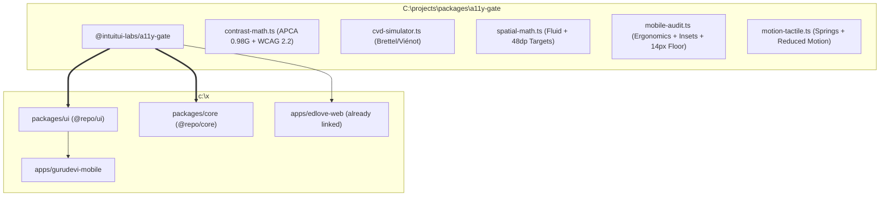

# A11y Gate Canonical Consolidation: `@intuitui-labs/a11y-gate` vs Workspace Architecture

## 1. Executive Summary & Canonical Status

This document establishes **`C:\projects\packages\a11y-gate` (`@intuitui-labs/a11y-gate`)** as the **canonical, authoritative engine** for all accessibility mathematics, perceptual contrast (APCA / WCAG 3), color vision deficiency (CVD) simulation, spatial harmony, and mobile ergonomics across the entire platform ecosystem.

Currently, the Polymath monorepo (`c:\x`) contains fragmented, partial implementations of accessibility logic (e.g. `packages/ui/src/utils/a11yUtils.ts` relying on heavy external dependencies like `culori` and `apca-w3`, and ad-hoc tests in `apps/gurudevi-mobile`). 

By standardizing on `@intuitui-labs/a11y-gate` via `pnpm link`, we eliminate duplicate math, align web and mobile under identical mathematical rigor, and empower the design system with both the **WCAG 2.2/2.3 legal baseline** and the **WCAG 3 / APCA perceptual future**.



---

## 2. Deep Comparison: Canonical Package vs. Local Workspace

| Feature Domain | Canonical: `C:\projects\packages\a11y-gate` | Workspace: `packages/ui` & `core` | Consolidation Verdict |
|---|---|---|---|
| **APCA / WCAG 3 Math** | **Pure TypeScript (Zero External Runtime Deps)**.<br>Direct implementation of W3C APCA 0.98G constants (`sRco`, `sGco`, `normBG`, `scaleBoW`). Full font lookup matrix (`getApcaFontMatrix`, `w100`–`w900` weight mapping). | Relies on `apca-w3` and `culori`. Basic `getAPCAContrast` wrapper; lacks weight-specific font matrix. | **Migrate to Canonical.** Eliminate `culori` and `apca-w3` dependencies from `@repo/ui`. |
| **WCAG 2.1 / 2.2 Contrast** | ISO 9241-306 / W3C relative luminance (`getWcagContrastRatio`, `evaluateWcag`). Categorizes `passesAaNormal`, `passesAaLarge`, `passesAaaNormal`, `passesUiComponent`. | Duplicated across `colorUtils.ts` and `core/hooks/useAccessibility.ts` (`getContrastRatio`, `meetsWCAG`). | **Consolidate on Canonical.** Single source of truth for contrast ratios. |
| **Color Vision Deficiency (CVD)** | **Full Brettel/Viénot Simulation Matrices** for Protanopia, Deuteranopia, Tritanopia, and Achromatopsia (`simulateCvd`, `auditPaletteCvd`). | **Zero CVD tooling.** No automated verification that alert colors don't collapse for colorblind users. | **Adopt Canonical.** Add CVD palette audit to design token CI. |
| **Delta E (Perceptual Distance)** | CIE76 Delta E color distance formula (`getDeltaE`) to detect indistinguishable UI accents. | None. | **Adopt Canonical.** |
| **Spatial Harmony & Grids** | Utopia fluid responsive clamp generator (`generateFluidClamp`), 4px/8px quantum verification (`isValidSpatialQuantum`), reading measure bounds (45–75ch). | Ad-hoc static styles. | **Adopt Canonical.** |
| **Mobile Ergonomics & Touch** | `mobile-audit.ts`: Touch Target Geometry ($\ge 48\text{dp}$), 320px reflow, safe-area defensiveness (`viewport-fit=cover`), strict 14px typography floor, mobile drawer semantics. | Ad-hoc Vitest files (`contrastAudit.test.ts`, `fontScalingAudit.test.tsx`). | **Unify.** Wire canonical mobile audit runner into mobile CI. |
| **Motion & Tactile Architecture** | Tiered spring presets (`subtle`, `tactile`, `expressive`), continuous interpolation, ambient glow CSS, `prefersReducedMotion`. | React Native `AccessibilityInfo.isReduceMotionEnabled` hook in `@repo/ui` and `@repo/core`. | **Bridge.** Map canonical motion tokens to React Native Reanimated spring configs. |

---

## 3. Dual-Standard Governance: WCAG 3 (APCA) + WCAG 2.2 / 2.3

A modern design system cannot rely solely on WCAG 2.x relative luminance, nor can it ignore legal compliance:

### Why WCAG 3 / APCA is the Perceptual Foundation
WCAG 2.x math has well-known perceptual flaws:
1. **Dark Mode Inversion**: Fails to account for human optical halation (white text on dark backgrounds appears brighter to human cones than dark text on light backgrounds).
2. **Spatial Frequency & Weight**: Treats a 100-weight hair-thin font identically to a 900-weight ultra-bold font of the same size.
3. **Color Hue Sensitivity**: Treats pure blues and saturated ambers inconsistently.

**APCA 0.98G** calculates lightness contrast ($L_c$) on a scale of 0 to 106+:
- $L_c \ge 90$: Preferred for fine/body text down to 14px weight 400.
- $L_c \ge 75$: Strict minimum for body text.
- $L_c \ge 60$: Minimum for headlines and large interactive controls.
- $L_c \ge 45$: Minimum for non-text graphics, disabled indicators, and icons.

### Why WCAG 2.2 / 2.3 Remains the Compliance Baseline
- WCAG 2.2 Success Criterion 2.5.8 (Target Size - Minimum 24×24dp).
- WCAG 2.2 AA (4.5:1 for body, 3.0:1 for large text).
- Legal and institutional audit bodies require WCAG 2.2 certification.

### The Unified Verdict Rule
Every UI token and screen in Gurudevi must satisfy:
$$\text{Pass} \iff \text{WCAG 2.2 AA} \ge 4.5:1 \quad \text{AND} \quad \text{APCA } |L_c| \ge 75 \text{ (Body)}$$
$$\text{Pass (Large)} \iff \text{WCAG 2.2 AA} \ge 3.0:1 \quad \text{AND} \quad \text{APCA } |L_c| \ge 60 \text{ (Headings / Buttons)}$$

---

## 4. Mobile Ergonomics Subsection Specification

To make `@intuitui-labs/a11y-gate` an unbeatable mobile powerhouse, we define the **Mobile Sub-Section Expansion**:

### 1. Touch Target Geometry
- **Strict Android / Sanctuary Standard**: $48 \times 48\text{dp}$ touch bounding box.
- **Compact Apple Fallback**: $44 \times 44\text{pt}$.
- **HitSlop Defense**: When visual elements are compact (e.g. 24dp icon or badge), require explicit `hitSlop` expansion:
  ```typescript
  hitSlop={{ top: 12, bottom: 12, left: 12, right: 12 }}
  ```

### 2. 320px Reflow & Dynamic Type Scaling
- Layouts must never enforce fixed pixel widths $> 320\text{px}$.
- Text components must pass font scaling up to $2.0\times$ without text truncation or layout breakage.
- Strict $14\text{px}$ floor on critical mobile instructions (no unreadable $10\text{px}$ captions for essential data).

### 3. Screen Reader State & Drawer Semantics
- Every interactive element must declare `accessibilityRole`, `accessibilityLabel`, and `accessibilityHint`.
- Multi-step modal or drawer views must announce their transition via `AccessibilityInfo.announceForAccessibility`.

---

## 5. Phased Consolidation Roadmap

### Phase 1: Link & Bridge (Immediate)
1. Add `"@intuitui-labs/a11y-gate": "link:C:/projects/packages/a11y-gate"` to `packages/ui/package.json` and `packages/core/package.json`.
2. Refactor `packages/ui/src/utils/a11yUtils.ts` to be a clean re-export and React Native bridge for `@intuitui-labs/a11y-gate`.
3. Deprecate and remove redundant `culori` and `apca-w3` direct monorepo dependencies.

### Phase 2: Native Test Gate Integration
1. Extend `apps/gurudevi-mobile/src/__tests__/contrastAudit.test.ts` to consume `evaluateApca` and `evaluateWcag` directly from `@intuitui-labs/a11y-gate`.
2. Wire `auditPaletteCvd` into the theme test runner to guarantee zero colorblindness regressions on Sanctuary tokens.

### Phase 3: Screen-Level Application (Sanctuary Welcome Screen)
1. Apply the consolidated mobile gate to the new, cohesive **`SanctuaryWelcomeScreen.tsx`**:
   - Primary buttons: $L_c \ge 75$, touch target $\ge 48\text{dp}$.
   - Language switchers: touch target $\ge 48\text{dp}$, clear `accessibilityRole="button"`.
   - Dynamic font scaling tolerance up to $2.0\times$.
