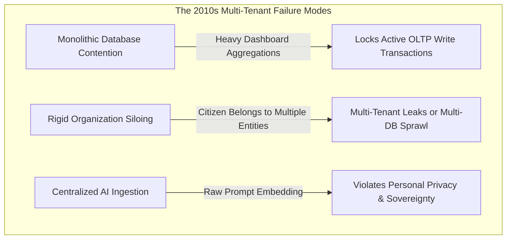
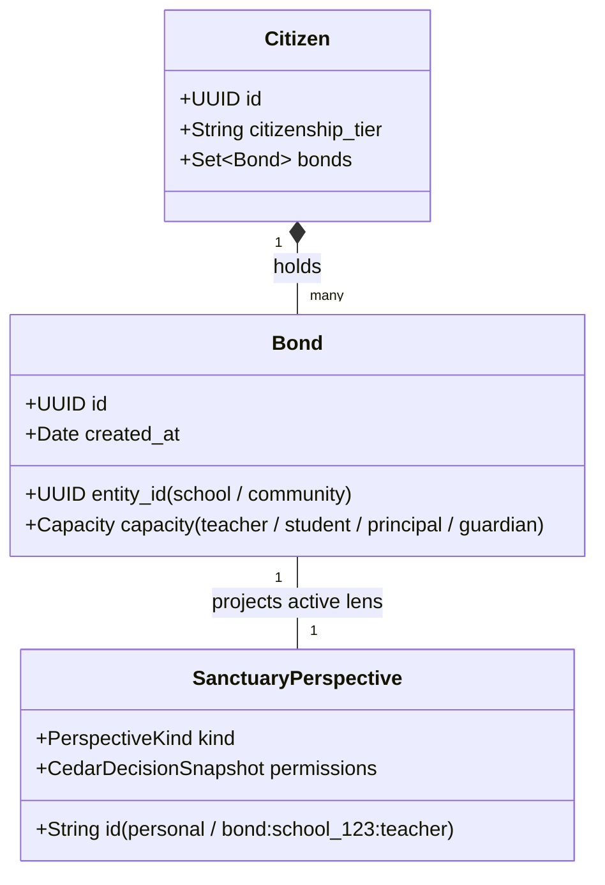

# Sovereign Architecture: The First-Principles Data Paradigm for High-Scale Citizen & Institutional Intelligence

> **A definitive, modern treatise on local-first OLTP, edge/cloud hybrid OLAP, mathematical ReBAC authorization, and AI-governed agentic workflows in the Polymath Platform.**

---

## 1. Executive First-Principles: The Crisis of the 2010s SaaS Multi-Tenant Model

Traditional multi-tenant SaaS architecture was designed around a 2010s premise: **a centralized relational database serving passive browser sessions over persistent broadband internet.**

In high-scale community, healthcare, and educational ecosystems, this model completely breaks down under three modern realities:



### The Three Fundamental First-Principles Axioms:

1. **Axiom I — Data Sovereignty Belongs to the Human Citizen, Not the Tenant:**
   A citizen is not a row locked inside "Tenant A". A citizen (e.g. a teacher who is also a parent, a learner, and a community member) possesses autonomous personal sanctuary data that must never be co-opted, locked, or deleted by any single institution.
2. **Axiom II — Compute Must Reside Where the Action Happens (Edge-First OLTP):**
   Transaction latency must be $<1\text{ms}$ regardless of cell connectivity or cloud outage. Daily operations (taking attendance, logging thoughts, submitting assessments) happen on edge SQLite instances and sync asynchronously.
3. **Axiom III — Bifurcated OLTP / OLAP Synchronization:**
   High-frequency point-lookups (OLTP) and heavy longitudinal analytics/aggregations (OLAP) cannot share the same execution locks. Operational state syncs via lightweight row-level replication, while analytical state is computed via vectorized columnar engines (DuckDB/Parquet) and asynchronous rollup projections.

---

## 2. The 4-Layer Sovereign Stack (2026 & Beyond Architecture)

```mermaid
flowchart TD
    subgraph 1. Sovereign Client Edge Layer
        User[Citizen Device: Mobile / Web]
        SQLite[(Encrypted SQLite / SQLCipher: Local OLTP)]
        DuckDB_Edge[(DuckDB-WASM: Local Vectorized Analytics)]
        CedarWASM[Cedar WASM Policy Decision Point]
        Outbox[Perspective-Tagged Mutation Outbox]
        
        User <--> SQLite
        User <--> DuckDB_Edge
        User --> Outbox
        User --> CedarWASM
    end

    subgraph 2. Scoped Sync & Replication Fabric
        PowerSync[PowerSync Dynamic Stream Router]
        StreamBuckets[Parameter-Scoped Buckets: school_id / user_id]
        
        Outbox -->|Transactional RPC Batches| PostgresOLTP
        PowerSync --> StreamBuckets
        StreamBuckets -->|Filtered Replication| SQLite
    end

    subgraph 3. Central Transactional Core (Cloud OLTP)
        PostgresOLTP[(PostgreSQL 16+ OLTP Core)]
        RangePartitions[(Monthly Range Partitions: Events & Audit)]
        NightlyRollups[pg_cron: Rollup Projections & Drift Repair]
        
        PostgresOLTP --> RangePartitions
        PostgresOLTP --> NightlyRollups
    end

    subgraph 4. AI Synthesis & Analytical Intelligence Plane (OLAP)
        ReadReplica[(PostgreSQL Analytical Read Replica)]
        DuckDB_Cloud[(DuckDB / Parquet Cold Lake)]
        AIAgents[Autonomous Pedagogical & Governance AI Agents]
        CedarGovernor[Formally Verified Cedar AI Boundary Guard]
        
        PostgresOLTP -->|Async WAL Stream| ReadReplica
        ReadReplica --> DuckDB_Cloud
        DuckDB_Cloud --> CedarGovernor
        CedarGovernor --> AIAgents
        AIAgents -->|Synthesized Insights & Milestones| User
    end
```

---

## 3. Deep Architectural Subsystems

### A. The Sovereign Relational Bond Model (Beyond Multi-Tenancy)

Instead of forcing artificial subdomains or rigid foreign keys, we model relationships through **Bonds** and **Sanctuary Perspectives**:



- **Personal Sandbox (`kind: 'personal'`):** Scoped strictly to `user_id`. Tables: `thought_records`, `mood_logs`, `user_preferences`. Totally invisible to institutional queries.
- **Institutional Bond (`kind: 'institutional'`):** Scoped by `school_id`, `classroom_id`, and `capacity`. Tables: `classrooms`, `classroom_students`, `attendance`, `learning_reflections`.
- **Zero-Bleed Storage Guarantee:** MMKV and SQLite namespaces use atomic keys `perspective:<userId>:<perspectiveId>:<key>`, guaranteeing that personal reflections never leak into institutional exports.

---

### B. High-Scale OLTP vs. OLAP Topology

When 1,000 schools take attendance simultaneously at 08:00 AM:
1. **At the Edge (OLTP):**
   - Teachers mark attendance in $<1\text{ms}$ into their local SQLite.
   - Mutations enter the `QueuedMutation` outbox tagged with `perspectiveId`, `tenantId`, and monotonic logical clocks.
2. **At the Central Hub (Replication):**
   - Outbox uploads mutations in transactional RPC batches.
   - Postgres updates raw tables and fires lightweight asynchronous rollup triggers into `school_daily_attendance_summary`.
3. **For Institutional Reporting & Dashboards (OLAP):**
   - School Principals, District Officers, and Ministry Dashboards **never query raw transactional `attendance` rows**.
   - Queries hit pre-calculated daily summary rollups and DuckDB columnar projections in $O(1)$ time, eliminating database locks on active classrooms.

---

### C. Formally Verified Cedar ReBAC & AI Agent Governance

In 2026, security is not just checking `user.role === 'admin'`. We use **Cedar (mathematically proven ReBAC)** to govern both human users and AI subagents:

1. **Client-Side Snapshot PDP:**
   - Server signs an Ed25519 permission snapshot for the citizen's active bond.
   - Mobile evaluates permissions locally in $0\text{ms}$ with zero network roundtrips.
2. **Agentic Boundary & Privacy Filter:**
   - When AI background agents synthesize student progress or school performance:
   - Cedar policies enforce a **Strict Deny-by-Default Boundary**:
     - $\checkmark$ AI can read: `learning_reflections`, `attendance`, `grade_assessments` (where `classroom_id` matches the authorized bond).
     - $\times$ AI is mathematically blocked from: `thought_records`, `mood_logs`, `private_journals`.
   - Embeddings and summaries are generated strictly over authorized read-model projections.

---

## 4. Architectural Comparison: Legacy vs. Sovereign Polymath

| Dimension | Legacy 2010s Multi-Tenant SaaS | 2026 Polymath Sovereign Architecture |
|---|---|---|
| **Identity Core** | User trapped inside single Org account | Sovereign Citizen holding dynamic Bonds & Perspectives |
| **Edge Capability** | Dumb client; spins on network loss | Full-fidelity Local-First SQLite via PowerSync & Drizzle |
| **Write Contention** | Morning rushes swamp central DB with 504s | Local-first edge writes + batched outbox background sync |
| **Reporting Latency** | Multi-table JOINs scanning millions of rows | $O(1)$ Daily Summary Rollups + Vectorized Columnar OLAP |
| **Authorization** | Hardcoded `if (role === 'admin')` checks | Formally verified Cedar ReBAC with signed edge snapshots |
| **AI Governance** | Indiscriminate RAG scraping private tables | Cryptographic Cedar PDP boundaries for AI tool access |
| **Storage Hygiene** | Monolithic tables slowing down over years | Monthly range-partitioning + automated `pg_cron` archival |

---

## 5. Technical Implementation Directives

To execute this architecture across `@repo/core` and `gurudevi-mobile`:

1. **Step 1 — Composite Index Optimization:** Multi-column B-trees on `(school_id, academic_year)` and `(classroom_id, date, status)` in Postgres and SQLite.
2. **Step 2 — Institutional Daily Rollup Projections:** Introduce `school_daily_attendance_summary` and automated increment triggers.
3. **Step 3 — Parameterized PowerSync Sync Buckets:** Restrict device replication streams strictly to the user's active bonds.
4. **Step 4 — Edge Cedar PDP & AI Synthesis Enforcement:** Maintain strict segregation between private citizen journaling and institutional analytical pipelines.
