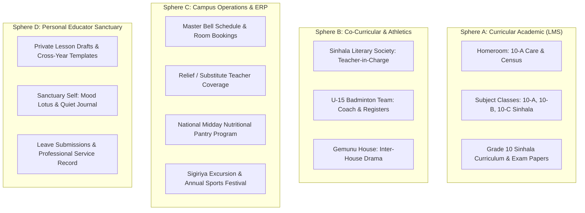

# Workspace and Classroom Domain Architecture

This document supersedes the former Workspace UI operationalization note at `docs/files/specialized/21-workspace-tab-ui-operationalization.md`. It is read alongside the foundational cybernetic treatise at [`docs/architecture/2026-10-31-requisite-variety-and-the-poly-sphere-educational-reality.md`](2026-10-31-requisite-variety-and-the-poly-sphere-educational-reality.md). Together, they form the sovereign authority for Workspace/Classroom inventory, boundaries, platform migration, and the domain Overview floor.

## Product boundary

Workspace is where school work happens. Self owns personal regulation and reflection; Workspace owns learning, classroom participation, academic progress, school operations, and family-school connection. A private feature may still belong to Workspace when its job is academic.

```text
perspective → capability set → school/classroom/person scope → temporal context
           → Overview floor → active task working set → focused task
```

Overview is always the domain floor and never an artificial task. It may arrange orientation, pinned surfaces, catalog furniture, and task recovery. Deep work opens as a task only when it has resumable state or meaningful resource scope.

## Perspective inventory

| Perspective | User job | Core inventory | Scope | Write authority |
|---|---|---|---|---|
| Teacher | Teach and care for learners | classrooms, attendance, assignments, lessons, materials, gradebook, observations, notes, insights | personal vault → subject/grade → classroom → student | own classroom & curriculum records; grades/publication by policy |
| Student | Study, submit, understand progress | classrooms, lessons, materials, assignment queue/submission, grades, goals, growth, rewards, timetable, attendance history, reflection bridge | enrolled school/classroom → own work | own submissions/goals/notes; academic records read-only |
| Guardian | Support learner and connect home/school | learner overview, attendance, published progress, events, notices, communication bridge | relationship → child → school/classroom | family communication only |
| Principal/leadership | Govern institution and sustain continuity | brief, faculty, pulse, approvals, calendar, observations, hierarchy, invites, notes/log, cycles, profile, resources, commons | institution → school/classroom aggregates | governance actions and institutional records |
| Founder/developer | Steward platform/ecosystem | platform pulse, topology, institution roster/bridge, creation runway, cross-ecosystem signals | platform → institution | platform administration; developer-gated |

Same-named capabilities are not the same task across perspectives: teacher Attendance is writable classroom/date work; student Attendance is personal read history; guardian Attendance is relationship-scoped published data; principal Attendance is an aggregate pulse.

## 2.1 The 4-Layer Pedagogical & Operational Scoping Continuum

A common architectural failure mode is treating all teacher data as flatly tied to a single classroom (`classroom_id`). In a real school, teachers operate across 4 distinct, nested scopes:

```text
Layer 0: Personal Educator Vault (teacher_id)
    └── Layer 1: Grade-Level & Subject Domain (school_id + grade_level + subject_id)
            └── Layer 2: Classroom Delivery Venue (classroom_id)
                    └── Layer 3: Institutional ERP & Operations (school_id)
```

1. **Layer 0: Personal Educator Vault (`teacher_id`)**:
   - Private pedagogical notes, lesson drafts, multi-year teaching templates, and reflective journals.
   - Belongs to the teacher personally across classes and terms. Unshared until published.
2. **Layer 1: Grade-Level & Subject Domain Scope (`school_id` + `grade_level` + `subject_id`)**:
   - Common curriculum units, reading passages, poetry guides, grammar rules, and departmental rubrics.
   - Shared across all parallel sections of a grade (e.g. Grade 10-A, 10-B, 10-C).
   - *The Sinhala Teacher Invariant*: A Sinhala teacher prepares literature notes and poem explanations for **Grade 10 Sinhala**. This content is authored once at the Subject/Grade level or in her library. It is never duplicated three times for 10-A, 10-B, and 10-C.
3. **Layer 2: Classroom Delivery Venue Scope (`classroom_id`)**:
   - The active delivery space and cohort roster.
   - Bounded strictly by `classroom_id`: enrolled student rosters, roll call marks, assignment submissions, class-specific ability groups, and localized observations.
   - The classroom is the *execution venue* for Layer 1 curriculum content.
4. **Layer 3: Institutional ERP & Operations Scope (`school_id`)**:
   - School-wide administrative operations: master bell schedule, timetable period allocations, relief/substitute teacher coverage, morning situational brief/census, staff leave management, and tuition fees.

### Flight Deck vs. Bounded Workspace
- **Overview Hub (`/workspace`)**: The educator's aggregated institutional flight deck. Surfaces master timetable countdown ("Now/Next"), assigned classroom cards with status badges, morning campus brief, and intent dispatchers ("Take Period 2 Roll Call").
- **Classroom Workspace (`/workspace/classroom/[id]`)**: The deep pedagogical work surface where all actions are relational and scoped to the active class entity.

## 2.2 Requisite Variety & The Poly-Sphere Reality (Ashby's Law in School Life)

Ashby’s Law of Requisite Variety dictates that *only variety can absorb variety*. In a live educational institution, a human teacher is never a 1-dimensional worker tied to a single classroom silo. An educator simultaneously holds roles across **four intersecting spheres of responsibility**:



### The Scenario of Reality: A Day in the Life of Mrs. Jayasinghe
To prevent naive software abstractions from fracturing school life, consider the actual daily operational rhythm of a senior educator (Mrs. Jayasinghe):
1. **07:30 AM — Personal Reflection & Preparation (Sphere D)**:
   - Arrives at school. Opens `/self` to review private lesson drafts, personal reminders, and somatic grounding before the day's rush.
2. **07:50 AM — Homeroom Pastoral Care & Morning Census (Sphere A + C)**:
   - Enters **Grade 10-A (Homeroom)**. Takes morning census roll call.
   - Marks are captured in local SQLite WAL; aggregated presence feeds the schoolwide **Morning Situational Brief** (`/workspace`).
3. **08:30 AM — Period 1: Grade 10-A Sinhala Literature (Sphere A — Delivery Venue)**:
   - Teaches the *Guttila Kavya* poetry module.
   - **Crucial Architectural Invariant**: The poetry notes, reading passages, and essay rubric were authored once at the **Grade 10 Subject Scope** in `/library`, not inside 10-A alone.
   - She distributes the essay assignment simultaneously across parallel sections (`10-A, 10-B, 10-C`).
4. **10:15 AM — Interval & Operational ERP Duty (Sphere C)**:
   - Assigned to Canteen & Nutrition Duty. Performs quick inventory dispatch check for the Midday Feeding Program (`/workspace/events`).
5. **11:00 AM — Period 4: Grade 10-C Sinhala Literature (Sphere A — Delivery Venue)**:
   - Teaches the exact same *Guttila Kavya* module to Section 10-C.
   - Takes subject period attendance to identify **Hallway Drift** (learners marked present in homeroom census who slipped away before Sinhala).
6. **01:15 PM — Lunchtime: Sinhala Literary Society Meeting (Sphere B — Co-Curricular)**:
   - Meets with the student executive of the **Sinhala Literary Society** in the Library.
   - Plans the upcoming Inter-School Drama Competition.
   - This society has its own multi-grade membership roster (Grades 9–12), attendance register, costume inventory, and budget allocation—completely outside any classroom boundary.
7. **03:30 PM — After-School: Under-15 Badminton Practice (Sphere B — Athletics)**:
   - Conducts badminton practice on the indoor courts.
   - Takes practice session attendance, checks equipment stock (rackets and shuttlecocks), and verifies parental consent slips for next week's zonal tournament.

### The "Both Inside and Outside Classroom" Law
Operations and records must not be artificially pigeonholed into "strictly classroom" or "strictly schoolwide". The platform supports **Polymorphically Bounded Scopes**:

$$\text{ScopeIdentity} = \{ \text{kind}: \text{classroom} \mid \text{grade} \mid \text{subject} \mid \text{society} \mid \text{sport} \mid \text{house} \mid \text{school} \mid \text{personal}, \; \text{id}: \text{string} \}$$

* **Attendance**:
  - Homeroom attendance is classroom-scoped (`kind: 'classroom'`).
  - Badminton practice attendance is sport-scoped (`kind: 'sport'`).
  - Hallway drift sentinels detect anomalies when a student is present in one scope but unaccounted for in another.
* **Events**:
  - Class Parents Meeting is classroom-scoped (`kind: 'classroom'`).
  - Drama Competition Audition is society-scoped (`kind: 'society'`).
  - Sigiriya Archaeological Study is grade-scoped (`kind: 'grade'`).
  - Annual Sports Meet is schoolwide (`kind: 'school'`).
* **Inventory & Assets**:
  - Whiteboard markers are classroom-located.
  - Microscopes & reagents are lab-located with the Science Head as custodian.
  - Shuttlecocks & nets are sports-store-located with the Badminton Coach as custodian.

### What the Overview Flight Deck (`/workspace`) Does in this Matrix
The Overview Hub does not force everything onto one flat screen. It acts as the **Educator's Multi-Sphere Compass**:
1. **Temporal Rhythm ("Now / Next")**: Directs the teacher based on where they are needed right now (Classroom, Staff Room, Canteen, or Sports Court).
2. **Circles of Responsibility**: High-level visual cards for:
   - **Academic Classrooms** (Homeroom & Subject Sections)
   - **Societies & Clubs** (Literary Society, Debate Guild)
   - **Athletics** (Badminton Squad)
   - **Operational Committees** (Exam Board, Nutrition Program)
3. **Contextual Intent Dispatch**: Every quick-action from the flight deck immediately launches into deep work with its target scope pre-bound (`{ kind: 'classroom', id: '10-a' }` or `{ kind: 'society', id: 'sinhala-literary' }`), preventing un-scoped data floating freely.

### 2.3 Cross-Classroom Artifacts, Common Syllabus Notes, and Cohort Moderation Architecture

Historical audits (`docs/files/specialized/10-classroom-academic-domain-audit.md`, `docs/decisions/2026-08-12-grade-school-grade-marks-domain.md`, and `docs/decisions/2026-10-20-institutional-structure-canonical-model.md`) established the fundamental architectural distinction between **Administrative Registration Cohorts** (`grade_classes` such as 10-A, 10-B, 10-C) and **Instructional Delivery Groups** (`classrooms` of kind `homeroom`, `subject`, or `cohort`). 

In real academic operational life (e.g. Mrs. Jayasinghe teaching Grade 10 Sinhala across sections A, B, and C), curriculum artifacts do NOT originate inside isolated classroom silos:

1. **Master Artifact Authoring (Curriculum & Subject Circle)**:
   - **Notes & Study Packs**: Core lecture notes, literary commentary (e.g., *Guttila Kavya* analysis), and reading anthologies are authored at the **Subject Offering / Grade Level** (or curated in `/library`).
   - **Formative Diagnostic Quizzes**: Quick conceptual checks authored once to test vocabulary, grammar, or fundamental concepts across all parallel learners.
   - **Summative Term Examination Papers**: Standardized exam papers set for the entire Grade 10 cohort under formal exam committee supervision, with uniform timing, questions, and mark allocations.
   - **School-Based Assessment (SBA - Circular 23/2017)**: Five certified continuous assessment stages for O/L candidates, requiring documented rubric scoring across all parallel sections.

2. **Multicast Projection & Lifecycle**:
   - Rather than duplicating documents three times, the educator authors the artifact as a master resource and triggers a **Multicast Projection** to target sections (`['10-A', '10-B', '10-C']`).
   - The platform creates projection bindings in each target classroom's stream.
   - Students in each section submit their coursework into their own classroom context, preserving classroom privacy and student identity boundaries.

3. **Cross-Classroom Moderation & Gradebook Analysis**:
   - In `/workspace/gradebook`, the educator can inspect:
     - **Section View**: Drill into an isolated class (e.g. `10-A`) to review specific student needs and individual feedback.
     - **Cross-Classroom Moderation View (`ALL`)**: Inspect the entire Grade 10 cohort side-by-side with section tags (`[10-A]`, `[10-B]`, `[10-C]`).
     - **Parallel Section Balance Strip**: Real-time section comparative averages (e.g. `10-A: 82%`, `10-B: 78%`, `10-C: 58%`), alerting the subject head to pedagogical divergence, grading stringency disparities, or relief-teacher disruption across parallel classes.

4. **Event-Sourced Publication & Parent Sealing**:
   - Per `10-classroom-academic-domain-audit.md`, draft marks and teacher internal commentary remain strictly sealed from student and guardian views.
   - Once cross-classroom moderation is completed, the educator triggers official publication. Publication is recorded immutably in `audit_logs` (`GradeMark.publication_state = 'published'`).
   - Guardian read access is resolved via `StudentGuardianRelationship` join policies, guaranteeing parents see finalized marks and developmental feedback for their children only, eliminating both the Parent Paradox (empty screen) and the draft-leak hazard.

## Capability status

Every catalog entry declares `live` (complete real flow), `wired` (destination exists but delivery/contract incomplete), `planned`, `restricted`, or `demo` (local sandbox only, visibly labelled). The mobile navigation registry is route inventory, not source of truth. Package registries describe capability metadata; domain surface registries describe floor furniture; the shared workbench contract describes lifecycle. No platform invents a competing catalog.

## Scope and task identity

Task keys include every dimension that changes work:

```text
domain + perspective + capability + school? + classroom? + student? + resource? + temporal context?
```

Opening an existing key focuses it. Closing a background task preserves focus; closing focused work selects the most recent safe task, otherwise Overview. Unsaved or privacy-sensitive state is never silently evicted. Behavior is declared `single`, `per-resource`, `transient`, `modal`, or `disabled`.

## Time

The Overview owns the temporal horizon beneath domain identity and the task strip. Features opt into `follow-domain`, `fixed`, or `none`; academic-cycle and classroom-date contexts belong in task identity when changing them changes the work.

## Plumbing before broad migration

Authn/authz and relationship-aware capability resolution; feature flags/lifecycle; shared workbench state with browser and mobile persistence adapters; offline queue/conflict/retry policy; boundary schemas and partial-failure handling; privacy/redaction/retention/publication rules; loading/empty/unavailable/error/recovery states; keyboard, screen-reader, touch, focus, and back accessibility; responsive bounds and platform chrome; layout persistence keyed by user, perspective, school/classroom, domain, and platform.

These foundations integrate as each feature migrates. A placeholder may be catalog furniture, never simulated successful writes or live data.

## Existing implementation to preserve

- Teacher: `packages/classroom/src/workspace/useTeacherDashboardSurfaces.tsx`, `useTeacherClassroomWorkspaceData.ts`.
- Student: `packages/classroom/src/student/workspace.ts`, `useStudentDashboardSurfaces.tsx`, `useStudentClassroomWorkspaceData.ts`.
- Classroom gating: `useClassroomWorkspaceSurfaces.tsx`, `CLASSROOM_REGISTRY`.
- Principal/guardian/founder: `packages/admin/src/{principal,guardian,founder}/workspace.ts` and surface hooks.
- Persistence: `useClassroomWorkspaceLayout` and `workspaceLayoutServices`; no second layout store.
- Canvas primitives: `packages/ui/src/components/workspace/*`; domain semantics remain package-owned.
- Mobile route inventory: `apps/gurudevi-mobile/src/navigation/registries/workspaceRegistry.ts`; migrate it to consume canonical metadata.

Risks: classroom IDs have historically been passed then discarded by capacity routing; student cards contain demo data; aggregate loaders can blank usable surfaces on one failure; broad catches/unsafe casts lack typed boundaries; cards leak layout metadata and density; student/guardian/grade/longitudinal policies need coordinated privacy audit.

## Platform migration rule

Migration preserves capability while rebuilding its platform adapter. RN and `.web.tsx` files are behavior evidence, not Next.js components. Browser delivery uses browser auth, server contracts, browser persistence, web routing/CSS, accessible focus, and web recovery. Platform incompatibility is a migration task to solve, never a reason to complain, defer, or silently narrow the product.

## Explore and demo

Explore uses the same floors, contracts, accessibility, and task semantics. Only the data/persistence adapter changes: local/seeded data, visible demo label, no accidental cloud writes, explicit conversion. Restricted capabilities may be inspectable but never masquerade as functional.

## Sequence

1. Shared plumbing and canonical capability/task inventory.
2. Truthful Overview floors for every perspective.
3. Scope-aware routing and persistence.
4. Teacher: registry, attendance, assignments/lessons, gradebook, observations/notes.
5. Student: classrooms, submissions, grades, goals/progress, rewards; Self remains a reflection bridge.
6. Guardian learner/events/notifications/bridge.
7. Principal governance and founder-only surfaces.
8. Native, browser, Explore, accessibility, offline, privacy, and recovery verification per capability.

Overview-first exposes inventory and gives each perspective a coherent floor; it does not replace vertical completion of every declared live feature.

## Legacy documentation disposition

The following are migration evidence, not competing authority: `docs/files/specialized/21-workspace-tab-ui-operationalization.md`, `apps/gurudevi-mobile/docs/architecture/STUDENT_WORKSPACE_FEATURE_INVENTORY.md`, `ROLE_WORKSPACE_STRATEGY.md`, `ROLE_WORKSPACE_IMPLEMENTATION_GUIDE.md`, `CAPABILITY_CANVAS_STRATEGY.md`, `CANVAS_SHARED_SURFACE_MODEL.md`, and `docs/architecture/2026-08-25-gurudevi-workspace-canvas-audit.md`. Before archival or deletion, run repository reference search, record any surviving unique findings in this document, update inbound links, and obtain review. No similarly named registry, canvas, or preview file may be removed solely by filename similarity.

## Exhaustive feature ledger

The ledger is deliberately feature-by-feature. `wired` means discovered and routed/rendered somewhere, not production-complete. Delivery records evidence found, not a claim of parity.

| Perspective | Capability / job | Scope and time | Permission/privacy | State/offline/error/empty | Evidence | Status / next action |
|---|---|---|---|---|---|---|
| Teacher | Classroom registry | school → classroom; current day | teacher membership | cache; empty create/join; preserve selected ID | `ClassroomList`, `TeacherDashboard` | wired; repair scoped routing |
| Teacher | Attendance | classroom → student; date/cycle | teacher write; others read by policy | offline queue/conflict/retry | `attendance.ts`, Attendance screens/tests | wired; verify browser/RLS |
| Teacher | Assignments | classroom → assignment; due date | teacher write; student submission | draft persistence and retry | assignment API and teacher workspace | wired; resource task identity |
| Teacher | Lessons/planner | classroom; day/week/term | teacher/classroom | draft/offline planning | lesson/material APIs and `LessonFeed` | wired; define browser adapter |
| Teacher | Materials/resources | classroom → material | teacher write; enrolled read | upload retry; empty library | material repository and `ResourcesView` | wired; audit upload contract |
| Teacher | Gradebook/marks | classroom → student/assignment; cycle | teacher write; publication gate | draft autosave/conflict; audited publish | Gradebook screens/APIs/tests | wired; fix schema/visibility |
| Teacher | Roster/students | classroom → student | classroom-scoped sensitive data | partial roster; empty onboarding | `StudentList`, classroom APIs | wired; privacy/redaction |
| Teacher | Observations/insights | classroom → student; periodic | teacher-private/escalation | draft/retry; empty normal | teacherInsights APIs/components | wired; retention/offline contract |
| Teacher | Classroom notes | classroom/student; optional date | teacher-private/audited when shared | offline draft/recovery | classroomNotes APIs/tests | wired; privacy classification |
| Teacher | Principal echo/feedback | teacher → school; event time | relationship-scoped | queued message/recovery | teacher feedback/admin bridge | wired; consolidate entry points |
| Teacher | Create/join/QR | school/invitation; current | invite authorization | empty onboarding; retry | create/claim modals and QR | wired; browser/Explore |
| Student | Classroom registry | enrolled school → classroom; current | enrollment relation | cache; empty join guidance | student dashboard/ClassroomList | wired; preserve scope |
| Student | Assignment queue/submission | classroom → assignment; due date | own submission/published work | offline draft/queue/conflict | student data hook and APIs | wired/demo mixed; remove fake live data |
| Student | Lessons/study center | classroom → lesson/material | enrollment read | cached content; empty guidance | StudentStudySuite/material APIs | wired; browser adapter |
| Student | Grades/feedback | student → grade; term/cycle | own published records | unpublished ≠ error; empty state | grade components/visibility logic | wired; guardian policy audit |
| Student | Goals/growth | own student; week/term | private academic | local draft/sync; empty invitation | `useStudentGoals`, StudentGoals | wired; separate demo |
| Student | Progress | own student; weekly/term | self read | cached aggregate; baseline empty | student components/registry | wired; metric provenance |
| Student | Rewards | own student; periodic | self/school policy | optimistic update rollback | `useRewards`, dashboard | wired; dedicated browser room |
| Student | Timetable | school/classroom; day/week | enrollment read | cached schedule; unconfigured empty | registry only | planned; stable contract |
| Student | Attendance history | own student/classroom; date/cycle | self read | cached history; no-record empty | registry + attendance APIs | planned; projection/privacy tests |
| Student | Reflection bridge | classroom/assignment → Self; current | private handoff | transient or optional resumable | registry and `/self` route | planned; handoff contract |
| Guardian | Family learner hub | relationship → child/school; current | relationship/RLS; published | partial child failures; no-linked empty | guardian routes/admin package | wired; policy/browser audit |
| Guardian | Learner room | child → classroom; cycle/date | guardian read/redacted | unpublished/empty distinction | students route/components | wired; scoped task |
| Guardian | Events/calendar | school; date range | linked-school read | cached calendar; empty schedule | events route/components | wired; timezone/browser |
| Guardian | Notifications/notices | guardian → school; event time | private relationship | unread sync/read cache; empty inbox | notifications route/components | wired; persistence audit |
| Guardian | Communication bridge | relationship → person/classroom | explicit relationship/audit | queued message/retry | bridge route/admin components | wired; moderation/privacy |
| Principal | Morning brief | school; current day | leadership aggregate | independent partial widgets | `MorningSituationalBrief` | wired; recovery per widget |
| Principal | Faculty/coverage | school → staff; current | staff privacy | partial roster/empty faculty | `TeacherCarousel` | wired; browser/privacy |
| Principal | Student pulse | school/classroom aggregate; cycle | aggregate/redacted | stale timestamp/no-data | `PulseDashboard` | wired; threshold policy |
| Principal | Approvals | school → request; event time | approve authority/audit | durable decision/retry | `LeaveApprovalSection` | wired; immutable audit |
| Principal | Calendar/observations | school; date/event time | leadership/private | draft/retry; append-only follow-up | calendar/observations sections | wired; browser task |
| Principal | Hierarchy/invites/cycles/profile | school; structural/cycle | principal/admin write | onboarding/validation errors | principal registry/routes | wired; schema parity |
| Principal | Resources/commons signals | school aggregate; weekly | aggregate/role gated | freshness/partial signal | ResourceNeeds/DashboardEcho | wired; Explore policy |
| Founder/developer | Platform pulse/topology | platform → institution; daily/weekly | developer/platform auth | stale/error read-only | founder registry/screens | wired; developer-only |
| Founder/developer | Institution roster/bridge/runway | platform → institution; periodic | platform admin | form draft/retry; empty first institution | founder bridge | wired; audit destructive actions |
| Founder/developer | Wellbeing/community/knowledge signals | cross-ecosystem; weekly | aggregate/redacted | aggregate no-data | founder registry | flagged; explicit flags/redaction |

## Coverage report

Repository search discovered approximately 150 relevant Workspace/Classroom paths across `packages/classroom`, `packages/admin`, `packages/core`, `packages/ui`, `apps/gurudevi-mobile`, and `apps/gurudevi-web`. This audit read 18 primary registries/surface/data files, 9 routes/screens, 8 API/contract/test references, and 7 architecture/audit documents closely. The remaining discovered files—deeper components, migrations, web variants, admin screens, hooks, and tests—are identified but not fully understood at feature depth.

Integrated evidence sources: mobile route registries, package capability registries, domain surface hooks, primary native screens, selected web screens, API/repository contracts, layout persistence, selected policy/tests, and architecture documents. Not fully integrated: every migration/schema relation, every admin capability, all `.web.tsx` behavior, complete feature-flag matrix, full Cedar/ZenStack policy matrix, Community cross-links, and browser/device runtime evidence.

Known gaps: no generated cross-platform catalog; registry `live` does not prove browser/Explore parity; student demo data is mixed with live surfaces; classroom selection restoration needs runtime proof; offline/conflict/accessibility/recovery scenarios need per-feature evidence; guardian publication and grade table/schema parity remain release risks; similarly named legacy screens and registries require reference tracing before archival.

## Auditable coverage metrics

These numbers are a bounded audit snapshot, not claims about total repository size. They are reproducible using the search scope and ledger rules below.

### Source inventory by function

| Function/perspective | Discovered files in scoped search | Read/understood in this audit | Materially integrated evidence units |
|---|---:|---:|---:|
| Teacher/classroom operations | 147 | 10 | 10 |
| Core workspace/perspective/policy/API | 120 | 8 | 8 |
| Principal/guardian/founder administration | 29 | 8 | 8 |
| Shared UI/canvas | 28 | 5 | 5 |
| Mobile routes and docs | included in repository search but excluded from the package grouping because the current PowerShell path matcher grouped only package/docs roots | 8 | 8 |
| Architecture/docs and historical evidence | 184 | 7 | 7 |
| **Total scoped search** | **508** | **46** | **46** |

The 508 discovered count is from `rg --files apps/gurudevi-mobile packages apps/gurudevi-web docs` filtered for workspace/classroom/perspective/attendance/grade/lesson/assignment/student/teacher/family/governance/canvas/registry. The mobile row is kept separate because the grouping command’s Windows path classification did not produce a reliable mobile subtotal; it must not be added to the package subtotal. Read/understood means the file was read closely enough to extract a capability, boundary, or risk into this document. Materially integrated means its evidence is cited or used in the ledger, not merely discovered. Counts are file/evidence-unit counts and must not be conflated.

### Capability accounting

| Metric | Count | Calculation |
|---|---:|---|
| Documented ledger capabilities | 37 | One row per distinct perspective/job row in the ledger |
| Explored capabilities | 37 | Each ledger row has at least one inspected implementation or registry source |
| Planned | 3 | Student timetable, attendance history, reflection bridge explicitly marked planned |
| Live under strict evidence rule | 0 | No row has complete native + browser/Next + Explore + recovery/accessibility evidence |
| Partial / wired | 34 | 37 total minus 3 planned |
| Blocked | 0 | No capability is permanently blocked; several have release risks/gaps |
| Abandoned / not migrating | 0 | No capability is authorized for silent removal; legacy candidates require reference audit |

“Live” is intentionally stricter than package-registry `state: live`: it requires a real user flow, correct scope/authz, error and empty recovery, accessibility, offline/state policy where applicable, and evidence for each promised delivery. “Partial/wired” means usable evidence exists somewhere but one or more of those conditions or platforms is incomplete. A capability can therefore be explored and documented while remaining partial. Planned rows are known product intent without a complete implementation evidence path. Blocked requires an external dependency or unresolved authorization decision that prevents safe work; current risks do not meet that definition.

### Evidence-source integration rule

The source count (46) measures inspected files grouped by role above; the capability count (37) measures user jobs. One source can support many capabilities and one capability can require many sources. A green typecheck, a registry flag, or a route existence check never upgrades a capability to live. The next audit should replace the current snapshot with generated manifests and runtime evidence identifiers as each capability is migrated.
