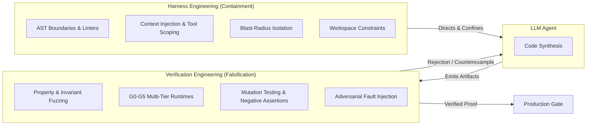

# Harness & Verification Engineering: Architectural Doctrine and Adversarial Codebase Audit

> *"Programming is not the production of a collection of programs and supporting texts. It is the building of a theory in the minds of the developers."*  
> — Peter Naur, *Programming as Theory Building* (1985)

---

## Executive Summary

As AI coding agents become ubiquitous, the software engineering industry has encountered an unyielding structural wall: **the cost of generating syntax has collapsed to near-zero, while the cost of verifying correctness, preserving architectural boundaries, and maintaining operational trust has skyrocketed.**

This document codifies the twin disciplines required to scale systems past the initial prototype:
1. **Harness Engineering:** The constructive architectural containment vessel that restricts what agents can see, touch, and modify through AST boundaries, sandboxes, and structural constraints.
2. **Verification Engineering:** The adversarial falsification engine that subjects all agent-emitted artifacts to deterministic execution, tiered test evidence governance (G0–R1), property testing, and anti-slop filters.

This document also records the findings of an unsparing, adversarial "Worst Reviewer Ever" audit across the Polymath Platform workspace (`c:\x`), establishing the remediation baseline for our tooling, core state integrity, and test evidence gates.

---

## Part 1: The Doctrine of Post-MVP Reliability

### 1. The Verification Tax & The Cognitive Asymmetry
Coined by Google's DORA research team, the **verification tax** is the hidden surcharge incurred when auditing code generated by AI.
* **Creation vs. Verification:** Generating 500 lines of code via an LLM requires $O(1)$ human effort. Thoroughly verifying that code—discovering subtle boundary leaks, swallowed exceptions, unhandled concurrency races, and broken invariants—is an $O(N^2)$ cognitive task.
* **The Plausibility Trap:** AI-generated bugs do not look like human junior mistakes. They look like clean, typed, idiomatic senior-engineer code that silently fails edge cases.
* **The Perception Paradox:** As documented in METR's 2025 randomized controlled trial of experienced open-source maintainers, developers using AI perceived a 20% speedup while objectively taking 19% longer to complete real maintenance tasks in familiar repositories.

### 2. The Theory-Building Deficit (Peter Naur)
In his seminal 1985 paper, Turing Award winner Peter Naur demonstrated that a software system is not the text on disk, but the living **theory** held in the developers' minds.
* Autoregressive models build no theory; they emit tokens based on statistical probabilities.
* When developers outsource the productive struggle of architectural design to agents, no human internalizes the trade-offs or constraints.
* The resulting system accumulates **cognitive debt**. Unlike technical debt, which can be refactored, cognitive debt turns future modifications into speculative reverse engineering on an orphan artifact.

### 3. The Law of Code Entropy (GitClear Telemetry)
Longitudinal analysis across hundreds of millions of commits (GitClear, 2024–2026) reveals that unconstrained AI usage accelerates architectural decay:
* **Code Churn:** Code updated or deleted within 14 days of authorship has doubled relative to historical baselines.
* **Refactoring Collapse:** "Moved code" (the primary signal of refactoring and deduplication) has dropped from ~21% in 2022 to under 4% in 2026.
* **Additive Sprawl:** Agents inherently append, wrap, and duplicate rather than compress. Without automated compression sprints and boundary enforcement, systems rapidly degenerate into a "Big Ball of Mud."

### 4. Harness vs. Verification Engineering: The Interlocking Model

* **Harness without Verification:** A gilded cage. The agent stays within boundaries, but emits plausible, unverified slop.
* **Verification without Harness:** Post-hoc firefighting. Rejecting 95% of agent code because the model had no structural guardrails.
* **Harness + Verification:** The only sustainable regime for long-lived, high-reliability software.

---

## Part 2: The Adversarial Audit Baseline (Polymath Platform)

An adversarial codebase audit conducted on October 5, 2026 revealed that despite advanced governance documentation ([AGENTS.md](file:///c:/x/AGENTS.md)), the active workspace suffered from five categories of structural decay:

### 1. The 52-Violation Evidence Policy Failure
* **Finding:** Running `node scripts/audit-test-evidence-levels.mjs` failed with **52 evidence-policy violations**.
* **Impact:** 16 packages (`accounting`, `admin`, `ai`, `analytics`, `classroom`, `community`, `database`, `library`, `payments`, `people`, `platform-mcp`, `profile`, `scanner-kit`, `self`, `types-shim`, `workforce`, `edlove-web`, `gurudevi-marketingWeb`) ran unlevelled `vitest run` scripts, violating the repo's mandatory Test-Claim Protocol.

### 2. Verification Tooling Failures (Auditing the Auditors)
* **`scripts/report-cognitive-load.mjs`:** `fd` on Windows returned relative paths from root, which `path.join(dir, f)` mutated into invalid duplicate paths (`packages/packages/core/...`). The `catch (_e) { return null; }` block silently swallowed the resulting `ENOENT` error, causing the script to output an empty table and falsely report zero cognitive load.
* **`scripts/check-effect-boundaries.mjs`:** Missing `android`, `ios`, and `.gradle` from `ignoredDirectories`, causing recursive traversal through native build artifacts and hanging in CI / background tasks.
* **`tooling/oxlint-custom-rules/src/rules/max-use-state.ts`:** Used global mutable variables (`useStateCount = 0; inComponent = false;`) across AST visitor callbacks instead of a scope stack, corrupting state across nested functions and multiple components.
* **`tooling/oxlint-custom-rules/src/rules/ban-use-store.ts`:** Checked only `node.source.value === 'zustand'`, allowing imports from `@repo/core/store` to bypass the rule entirely.

### 3. God Components & Code Bloat
* **`packages/ui/src/screens/AuthScreen.tsx` (936 lines):** Merged state machine, living glow, breath animation, deep links, haptics, QR scanner, and direct API client calls into a single monolithic component with import-time side effects (`WebBrowser.maybeCompleteAuthSession()`).
* **`packages/ui/src/screens/OnboardingScreen.tsx` (1,223 lines):** Directly imported `@react-native-async-storage/async-storage` (bypassing MMKV / safe storage wrappers) and contained empty import slop (`import {} from '@repo/ui/screens/devOnboardingFastTrack';`).
* **`apps/gurudevi-web/app/styles.css` (1,240 lines):** Monolithic global stylesheet with hand-rolled BEM utilities committed in a Next.js 16 + Tailwind v4 project.

### 4. Framework Boundary Leaks (Native Bleeding into Shared Packages)
* Running `node scripts/find-native-leaks.mjs` flagged **11 active native package leaks**, including `react-native-worklets` imported in shared UI components (`AchievementUnlockOverlay.tsx`, `LotusPetalFAB.tsx`, `SanctuaryToast.tsx`, `TemporalScrubber.tsx`, `DraggableCanvasSurface.tsx`) and `@react-native-community/netinfo` imported in core network adapters without web shims.

### 5. Data Integrity & Type Safety Hazards
* **`packages/core/src/adapters/powersync/SupabasePowerSyncConnector.ts`:** Used `(client.api as any)` and `(res: any)` in critical data synchronization pathways, shadowed `startTime`, and retained dead variables (`latencyMs`, `uploadCount`).
* **`packages/core/src/native/guestIdentity.ts`:** `migrateGuestDataToAuthenticatedUser` dropped `activeBond` upon sign-in (wiping user classroom selections) and duplicated `availableBonds` on repeat executions.
* **`apps/sanctuary-api/src/entry-node.ts`:** Production server entry polluted with raw `console.log('[debug] ...')` statements.

---

## Part 3: Standing Remediation Mandate

1. **Deterministic Verification First:** All verification scripts must fail loudly and explicitly on missing paths or syntax errors; no silent try/catch blocks masking analysis failures.
2. **Evidence Level Enforcement:** Every package test script in the monorepo must declare an explicit evidence level (`G0` through `R1`) via the shared test runner.
3. **AST Linter Scope Hygiene:** All AST rules in `oxlint-custom-rules` must maintain lexical scope stacks to prevent visitor cross-contamination.
4. **Data Concurrency Invariants:** Storage migrations must guarantee idempotency (deduplicating arrays) and state preservation (carrying forward active selections).
