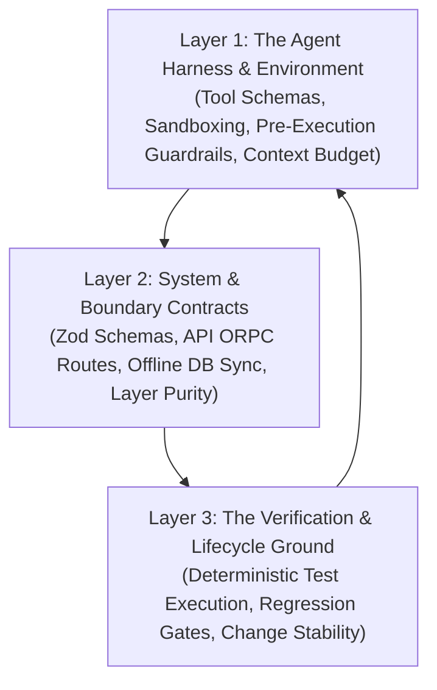

# The 3 Real Operational Dimensions of Modern Software & Agentic Systems

## 1. Why Syntax / Line-of-Code Scans are Surface-Level

In modern engineering (2025–2026), evaluating a codebase by simple string counts (`any`, `lines of code`, `hex matches`) only measures surface syntax. It does not measure whether the software **functions correctly, stays resilient under AI modification, or preserves system contracts**.

Industry engineering models measure three interconnected operational layers:

---

## 2. Dimension 1: The Agent Harness (The Scaffold)

### What it Actually Is:
The Harness is the environmental system that constrains, directs, and guides AI agents (`Agent = Model + Harness`). It governs what tools the agent can execute, how the context window is managed, and what pre-execution gates block hallucinated or destructive actions.

### Visible Marks & Concrete Signals:
1. **Tool Invocation Parity & MCP Health:** Can agents call tools (`browser`, `terminal`, `drizzle`, `orpc`, `git`) with valid JSON schemas without tool call schema failures?
2. **Pre-Execution Contract Gate:** Does the workflow enforce human alignment / architectural verification before touching files?
   - Verified in: [`workflows/code-execution.md`](file:///c:/x/.agents/workflows/code-execution.md) (The Triple-Helix Dimensional Plan Gate).
3. **Context Pollution Ceiling:** Are agent memory files, instruction skills, and workspace rules kept within manageable token limits?

### Operational Test & Current Monorepo Signal:
- **Test:** Verify whether agent skills, workflows, and MCP configurations pass schema validation.
- **Concrete Repo Evidence:** The workspace enforces [code-execution.md](file:///c:/x/.agents/workflows/code-execution.md) and [gurudevi-quality-gate](file:///c:/x/.agents/skills/gurudevi-quality-gate/SKILL.md) to intercept changes before code generation.

---

## 3. Dimension 2: System Contracts & Boundary Invariants (The Architecture)

### What it Actually Is:
The invariants that ensure distributed components—Supabase, PowerSync offline SQLite, tRPC/oRPC endpoints, and React Native UI—maintain type and data contract synchronization without runtime drift.

### Visible Marks & Concrete Signals:
1. **API Contract & Route Parity:** Are client requests strictly validated against server route contracts?
   - **Operational Test:** [`scripts/audit-api-contracts.ts`](file:///c:/x/scripts/audit-api-contracts.ts)
   - **Real Signal:** Audited **224 active API routes across 38 contract sources** $\rightarrow$ **0 errors, 0 warnings** (100% contract compliance).
2. **Offline-First Storage Boundary Invariants:**
   - **Rule:** Presentation components and hooks must NOT execute direct Supabase queries (`supabase.from(...)`), which break offline-first PowerSync synchronizers.
   - **Operational Test:** [`scripts/check-monorepo-boundaries.mjs`](file:///c:/x/scripts/check-monorepo-boundaries.mjs)
   - **Real Visible Breach (2 Active Failures):**
     - [`packages/library/src/hooks/useLibrary.ts`](file:///c:/x/packages/library/src/hooks/useLibrary.ts) — Direct Supabase call bypassing offline repository.
     - [`packages/library/src/screens/CollectionDetailScreen.web.tsx`](file:///c:/x/packages/library/src/screens/CollectionDetailScreen.web.tsx) — Direct Supabase query in UI layer.
3. **Cross-Domain Coupling Locks:** Packages like `classroom` must route through explicit bridges rather than tightly coupling to `admin` or `workforce`.

---

## 4. Dimension 3: The Verification & Software Lifecycle (The Proving Ground)

### What it Actually Is:
The automated verification apparatus that proves runtime behavior deterministically rather than relying on code inspection.

### Visible Marks & Concrete Signals:
1. **Contract Proving Suites (Evidence Levels):**
   - Tests categorized by empirical rigor:
     - **G0:** Pure logic unit tests.
     - **G1:** Boundary tests with deterministic mocks (e.g., [`deepLinkPolicyPipeline.test.ts`](file:///c:/x/packages/core/src/logic/deeplink/__tests__/deepLinkPolicyPipeline.test.ts)).
     - **G2 / G3:** End-to-end integration and device browser passes (Playwright / Maestro).
2. **Zero Suppression Integrity:**
   - The TypeScript compiler runs with real type safety—evidenced by **0 `@ts-ignore` suppressions in application source code**.
3. **Change Failure & Boundary Drift:**
   - Whether automated gates prevent regressions before merging into `main`.

---

## 5. Synthesis: Real Actionable Diagnostics

| Operational Test | Real Command | Current Status | Concrete Visible Finding |
| :--- | :--- | :---: | :--- |
| **API Contract Validation** | `npx tsx scripts/audit-api-contracts.ts` | 🟢 **PASS** | 224/224 active routes mapped with 0 contract drift. |
| **Architectural Boundary Guard** | `node scripts/check-monorepo-boundaries.mjs` | 🔴 **FAIL (2 violations)** | 2 direct Supabase query leaks in `packages/library` violating offline-first contracts. |
| **Agent Pre-Execution Gate** | Review against `code-execution.md` | 🟢 **ACTIVE** | Triple-Helix workflow blocks arbitrary code generation until architecture is approved. |
| **Compiler Truth Gate** | `pnpm tsc --noEmit` | 🟢 **ACTIVE** | Compiler strictly verifies code without `@ts-ignore` evasion. |

This moves the conversation away from superficial syntax counting and places it squarely on **real runtime contracts, architectural boundary enforcement, and agent guardrails**.
