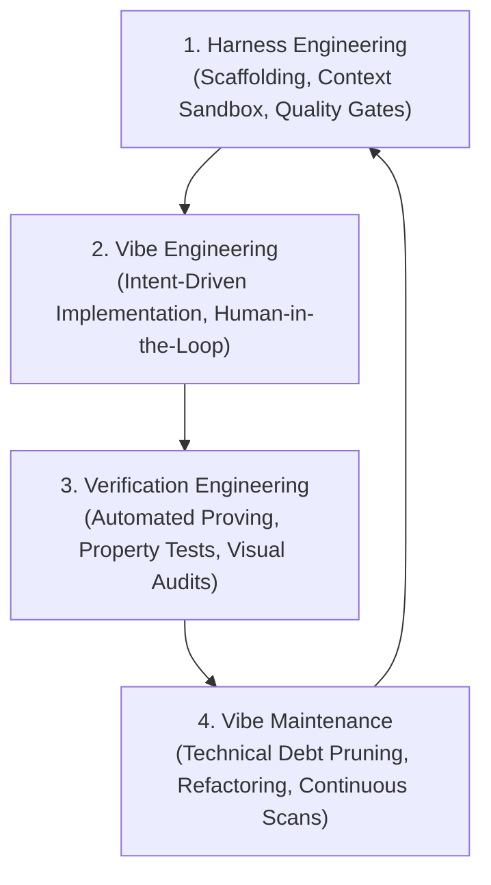

# The 4 Pillars of AI-Native Engineering (Standards & Future Direction)

## 1. The Industry Paradigm Shift (2025 → 2026+)

In early 2025, software development experienced the explosion of **"Vibe Coding"** (Karpathy)—a flow state where developers prompted models in natural language without inspecting syntax. 

By late 2025 and 2026, as codebases surged past **70,000–100,000 Lines of Code (LOC)**, the industry hit the **"Vibe Wall"**:
- Code generation became abundant, instantaneous, and cheap.
- **Verification, architectural integrity, and maintenance became the new bottleneck.**
- Unstructured vibe coding transformed into **Agentic Engineering**, supported by four distinct disciplines:



---

## 2. The 4 Engineering Disciplines Defined

### I. Harness Engineering (The Scaffolding & Constraints)
* **Definition:** The infrastructure, memory boundaries, and execution sandbox that constrains an AI agent before it writes code.
* **Core Mechanisms:**
  1. **Custom Rules & Directives:** Files like `AGENTS.md`, `.agents/skills/`, and `workflows/code-execution.md` that dictate token budgets, styling palettes, and package limits.
  2. **Tool Sandboxing & MCP Servers:** Giving agents real, reproducible tool access (shell, git, typecheckers, database migrators) rather than raw text generation.
  3. **Blast-Radius Classification:** Enforcing pre-execution reviews for modifications touching core shared boundaries (`packages/core`, root layout gates).

### II. Vibe Engineering (The Disciplined Generation Flow)
* **Definition:** The structured evolution of vibe coding. Developers act as **architects and orchestrators** rather than raw line-writers.
* **Core Mechanisms:**
  1. **Behavior-Driven Design (BDD / Gherkin):** Formulating specifications (`Given-When-Then`) first before requesting functions.
  2. **"Thin & Sensing" UI Invariant:** Enforcing components that only render and sense interactions; business logic is quarantined in hooks and stores (`packages/core`).
  3. **Intent over Syntax:** Guiding agents with higher-order product goals while letting the harness catch syntax errors.

### III. Verification Engineering (The Proving Ground)
* **Definition:** The proactive quality-assurance pipeline that verifies AI output before it merges into production.
* **Core Mechanisms:**
  1. **Automated Static & Type Gates:** Strict TypeScript compile checks (`tsc --noEmit`), lint rules, and zero compiler suppressions (`@ts-ignore`).
  2. **Empirical Diagnostic Audits:** Recurring automated scanners measuring type escapes (`: any`), swallowed exceptions (`catch {}`), and runtime logging sprawl.
  3. **Perceptual & Runtime Verification:** Headless browser runs (Playwright), visual screen diffing, and RAM profiling to uphold the **2GB mobile hardware constraint**.

### IV. Vibe Maintenance (Living with Scaled AI Code)
* **Definition:** The sustained lifecycle management of codebases built partially or entirely with AI assistance.
* **Core Mechanisms:**
  1. **Periodic Dead-Code Pruning:** Eliminating abandoned feature flags, zombie screens, and orphaned exports (`ts-prune`).
  2. **Monolith Deconstruction:** Continually splitting oversized components (>300 LOC) to prevent agent context degradation.
  3. **Dependency & Barrel Hygiene:** Enforcing public entry points (`@repo/core`) and rejecting internal deep leaks (`/src/`).

---

## 3. How Devs Implement It (Practical Playbook in This Monorepo)

| Discipline | Implemented via Current Monorepo Assets | Next Evolutionary Step |
| :--- | :--- | :--- |
| **Harness Engineering** | - [code-execution.md](file:///c:/x/.agents/workflows/code-execution.md)<br/>- [gurudevi-quality-gate](file:///c:/x/.agents/skills/gurudevi-quality-gate/SKILL.md)<br/>- Polymath MCP & Tools | Pre-commit git hooks that block edits violating the 300 LOC budget or introducing unapproved packages. |
| **Vibe Engineering** | - BDD / Gherkin feature files<br/>- Design Retina token laws (`#F5EDD6`, `#D4843A`)<br/>- Zustand stores in `packages/core` | Formal Specification Kits (Spec-Driven Generation) before UI drafting. |
| **Verification Engineering** | - Jest / Playwright test suites<br/>- [2026-10-08 Audit Framework](file:///c:/x/docs/architecture/2026-10-08-codebase-scale-and-vibe-coding-audit.md)<br/>- Clean compiler (`@ts-ignore` = 1) | Automated CI action running the Effort-Denominated Health Score on every PR. |
## 5. Operationalized Testing Matrix & Visible Marks

We created an operationalized scanner in [`scripts/audit-4-pillars.mjs`](file:///c:/x/scripts/audit-4-pillars.mjs) that evaluates each pillar individually and cumulatively across the entire monorepo.

### The 4-Pillar Test Scorecard & Visible Marks

```
================================================================
   🏛️  THE 4 PILLARS OF AI-NATIVE CODEBASE HEALTH (OCT 2026)    
================================================================
Total Scope: 3,229 source files (449,609 lines across apps & packages)
```

| Pillar | Test Score | Status Badge | Concrete Visible Signals / Marks Measured | What It Directly Proves |
| :--- | :---: | :---: | :--- | :--- |
| **1. Harness Engineering** | **79 / 100** | 🟡 **Stable** | • **25 Context Sinks** (>1,000 LOC)<br/>• **258 Modularity Breaches** (>300 LOC) | Whether file sizes fit comfortably into AI context windows without memory degradation. |
| **2. Vibe Engineering** | **83 / 100** | 🟡 **Stable** | • **1,105 Hardcoded Hex Colors** (vs. Sacred Brand Tokens in `@repo/ui`) | Whether UI screens respect the Design System rather than inventing ad-hoc colors. |
| **3. Verification Engineering**| **90 / 100** | 🟢 **Excellent** | • **1 `@ts-ignore`** (Compiler rules strictly active)<br/>• **187 `as unknown as`** assertions<br/>• **692 Swallowed catches** | Whether the compiler and testing layers are actively proving correctness or suppressed. |
| **4. Vibe Maintenance** | **69 / 100** | 🟠 **Elevated Drag** | • **3 Deep `/src/` Imports** (Barrel bypasses)<br/>• **2,559 `console.*` statements** (Mobile 2GB RAM budget) | Whether the codebase stays clean from runtime pollution and tight coupling over time. |

---

### Cumulative Monorepo Health Grade: **82 / 100 (Grade: A-)**

$$\text{Cumulative Score} = (0.25 \times \text{Harness}) + (0.20 \times \text{Vibe}) + (0.35 \times \text{Verification}) + (0.20 \times \text{Maintenance}) = \mathbf{82}$$

---

## 6. How to Run the Automated 4-Pillars Test

You can run this anytime from PowerShell or bash:

```bash
node scripts/audit-4-pillars.mjs
```

This single command gives you immediate visible signals across all 4 pillars, letting you track improvements whenever you decompose a file, replace a hex color with a brand token, or clean up logs!


---

## 4. The Way Forward: Why Recurring Audits are Essential

### Why Audits are Non-Negotiable at Scale
1. **Preventing the Silent "Rot" Curve:** Because AI generates code at 100x human velocity, technical debt compounds at 100x velocity if unchecked.
2. **Preserving Agent Context Coherence:** Once files exceed 500–1,000 lines, AI agents lose attention across functions and begin hallucinating variables or introducing regressions. Keeping files modular preserves agent accuracy.
3. **Hardware Budget Guarantees:** On mobile devices with 2GB RAM constraints, unmanaged console logging, oversized bundles, and unmemoized component trees degrade the sacred "Fine UI" experience.

### Audit Cadence Schedule
- **On Every PR (Continuous):** Zero `@ts-ignore` check + barrel violation blocker.
- **Bi-Weekly (Sprint-Level):** Health Score Audit script (`full_repo_audit.js`). Target: Keep Health Score **$\ge 80/100$**.
- **Quarterly (Architectural Review):** Monolith decomposition pass targeting top files $>500$ LOC.
