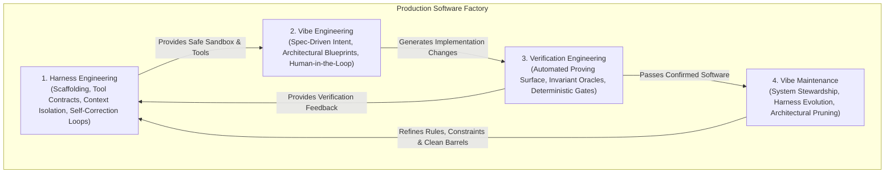

# The Architecture of AI-Native Software Systems: Harness, Vibe, Verification & Maintenance

## 1. The Fundamental Shift: From Prompting to Systems Engineering

In early 2025, **"Vibe Coding"** (Karpathy) captured the industry: prompting LLMs in natural language, focusing on outcomes, and "forgetting the code exists."

By 2026, the industry encountered the **"Context & Maintenance Wall"** at scale (70k–100k+ lines of code). When code is generated faster than human review capacity, unstructured prompting results in:
- **Prompt drift & context window saturation**
- **Invisible behavioral regressions**
- **Accumulation of unverified, un-owned architecture**

To solve this, professional engineering evolved into **Agentic Systems Architecture**, structured around the universal formula:

$$\mathbf{Agent} = \mathbf{Model} + \mathbf{Harness}$$

The model is the **stochastic reasoning brain**; the harness and its surrounding disciplines are the **deterministic system body**.

---

## 2. Deep Dives: What Each Discipline Actually Is & How It Is Done

### I. Harness Engineering (The Infrastructure & Scaffolding)
* **What it is:** The software infrastructure built *around* the AI model that makes it predictable, safe, and autonomous in a real development environment. The harness is the "hard part" of AI coding.
* **The 5 Production Layers of a Harness:**
  1. **Tool Contracts & Orchestration:** Formal schemas (e.g. MCP / Model Context Protocol, typed shell tools, AST manipulators) with strict input/output contracts rather than unbounded bash execution.
  2. **Context & Memory Management:** Semantic context retrieval (KIs, local indexing, barrel summaries) preventing the model from saturating its attention budget.
  3. **Verification Loops & Self-Correction:** When a compiler or test fails, the harness automatically feeds the exact compiler diagnostic back to the agent in a loop until solved, without human intervention.
  4. **Pre-Execution Guardrails:** Architectural gates (e.g., [`workflows/code-execution.md`](file:///c:/x/.agents/workflows/code-execution.md)) forbidding code modification until dimensional plans (Vertical, Horizontal, Diagonal) are approved.
  5. **Execution Sandboxing:** Isolating agent workspace operations, enforcing blast-radius classifications on sensitive packages (`packages/core`).

---

### II. Vibe Engineering (The Disciplined Development Process)
* **What it is:** The organizational, structured evolution of vibe coding. The developer ceases to be a syntax typist and becomes a **Systems Architect and Intent Orchestrator**.
* **How It Is Usually Done:**
  1. **Spec-Driven Development (SDD):** Replacing vague chat prompts with machine-readable specifications (Gherkin BDD `.feature` files, OpenAPI/oRPC schemas, Zod definitions) *before* asking the agent to generate implementation files.
  2. **The "Thin & Sensing" UI Architectural Invariant:** Enforcing that UI presentation components only render state and capture events; all orchestration, data transformation, and storage logic are quarantined in domain stores and hooks (`packages/core`).
  3. **Domain Tokenization:** Bounding visual and styling variance using strict design tokens (e.g. `@repo/ui` Theme tokens) rather than allowing models to hallucinate arbitrary styles.

---

### III. Verification Engineering (The Proving Ground)
* **What it is:** Designing the automated, deterministic validation layer that proves AI-generated software is correct. Because AI code generation is cheap, **verification is the primary bottleneck of modern software engineering**.
* **How It Is Usually Done:**
  1. **The Verification Surface:** Shifting from manual PR reviews to automated invariant checks:
     - **Compiler Proofs:** Zero tolerance for type suppressions (`@ts-ignore`, `@ts-nocheck`). The compiler is treated as a mathematical theorem prover.
     - **Boundary & Architectural Oracles:** Scripts that continuously verify structural laws (e.g., [`check-monorepo-boundaries.mjs`](file:///c:/x/scripts/check-monorepo-boundaries.mjs) verifying that presentation layers never leak direct Supabase queries).
     - **Contract Synchronization:** Validating that client API endpoints match backend schemas without manual human inspection ([`audit-api-contracts.ts`](file:///c:/x/scripts/audit-api-contracts.ts)).
  2. **Tiered Evidence Levels (G0 to G3):**
     - **G0:** Deterministic pure-function unit tests.
     - **G1:** Boundary tests with mocked adapters (e.g., [`deepLinkPolicyPipeline.test.ts`](file:///c:/x/packages/core/src/logic/deeplink/__tests__/deepLinkPolicyPipeline.test.ts)).
     - **G2/G3:** End-to-end integration and headless browser journeys (Playwright).

---

### IV. Vibe Maintenance (System Stewardship & Lifecycle)
* **What it is:** The long-term stewardship of a codebase evolving under continuous AI generation. It counters "context amnesia" and architectural erosion.
* **How It Is Usually Done:**
  1. **Harness Evolution:** As the codebase grows, the rules in `.agents/`, skills, and workflows are updated so agents remain aware of newly established patterns.
  2. **Continuous Dead-Code & Zombie Pruning:** Automatically identifying abandoned feature flags, dead route files, and obsolete helpers that accumulate during fast iteration.
  3. **Monolith Deconstruction:** Continually identifying files that have grown past single-context comprehension (>300–500 LOC) and splitting them into modular sub-units so future agent passes do not suffer attention loss.
  4. **Runtime Budget Defense:** Auditing console logging, heavy animations, and memory leaks to uphold hardware constraints (e.g. the 2GB RAM mobile constraint).

---

## 3. How to Operationalize Each Pillar (Signals & Visible Marks)

| Engineering Pillar | What to Test Separately | Visible Mark / Real Signal | Operational Test in Repo |
| :--- | :--- | :--- | :--- |
| **1. Harness Engineering** | Does the harness successfully guide and constrain the AI agent? | • Valid tool schemas & zero agent hallucination crashes. • Pre-execution plan compliance before file modifications. | Check [`code-execution.md`](file:///c:/x/.agents/workflows/code-execution.md) compliance and MCP tool health. |
| **2. Vibe Engineering** | Does the generated code adhere to architectural contracts and design tokens? | • All data interactions go through `packages/core`. • Zero hardcoded magic tokens in UI. • BDD feature specs exist for user flows. | Review against "Thin & Sensing" component structure in [`apps/gurudevi-mobile`](file:///c:/x/apps/gurudevi-mobile). |
| **3. Verification Engineering**| Can the system mathematically prove correctness without human manual review? | • **224/224 API routes contract-validated** (`audit-api-contracts.ts`). • **0 `@ts-ignore`** suppressions. • Automated boundary enforcement passes. | `npx tsx scripts/audit-api-contracts.ts` `node scripts/check-monorepo-boundaries.mjs` |
| **4. Vibe Maintenance** | Is technical debt actively tracked and pruned over time? | • Zero boundary leaks across package barrels. • Offline-first integrity maintained (No direct DB calls in UI). • Mobile memory budget respected. | `node scripts/check-monorepo-boundaries.mjs` (detects real leaks in `packages/library`). |

---

## 4. The Way Forward

To make these 4 pillars real and permanent across your development cycle:

1. **Keep the Harness Strict:** Never bypass the pre-execution plan gate in [`code-execution.md`](file:///c:/x/.agents/workflows/code-execution.md). It is the primary harness that keeps agents from breaking architectural invariants.
2. **Close the Boundary Leaks in Verification:** Resolve the 2 active violations detected by [`check-monorepo-boundaries.mjs`](file:///c:/x/scripts/check-monorepo-boundaries.mjs) in `packages/library`, establishing a completely green verification baseline.
3. **Automate the Stewardship Cycle (Vibe Maintenance):** Run contract and boundary audits in CI on every push, ensuring that high-velocity AI coding is always matched with deterministic, machine-enforced verification.
