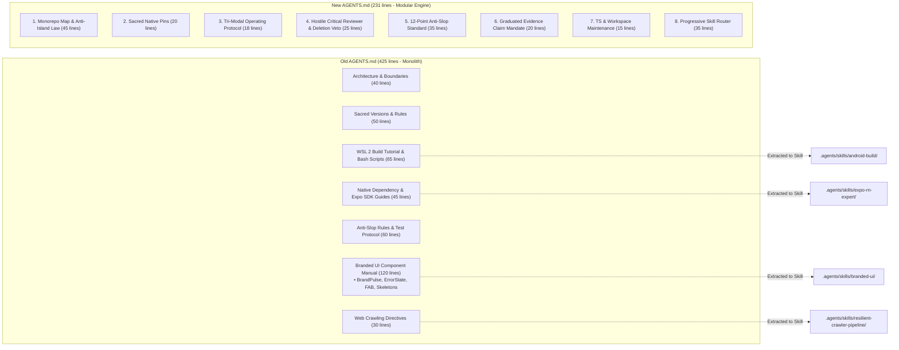
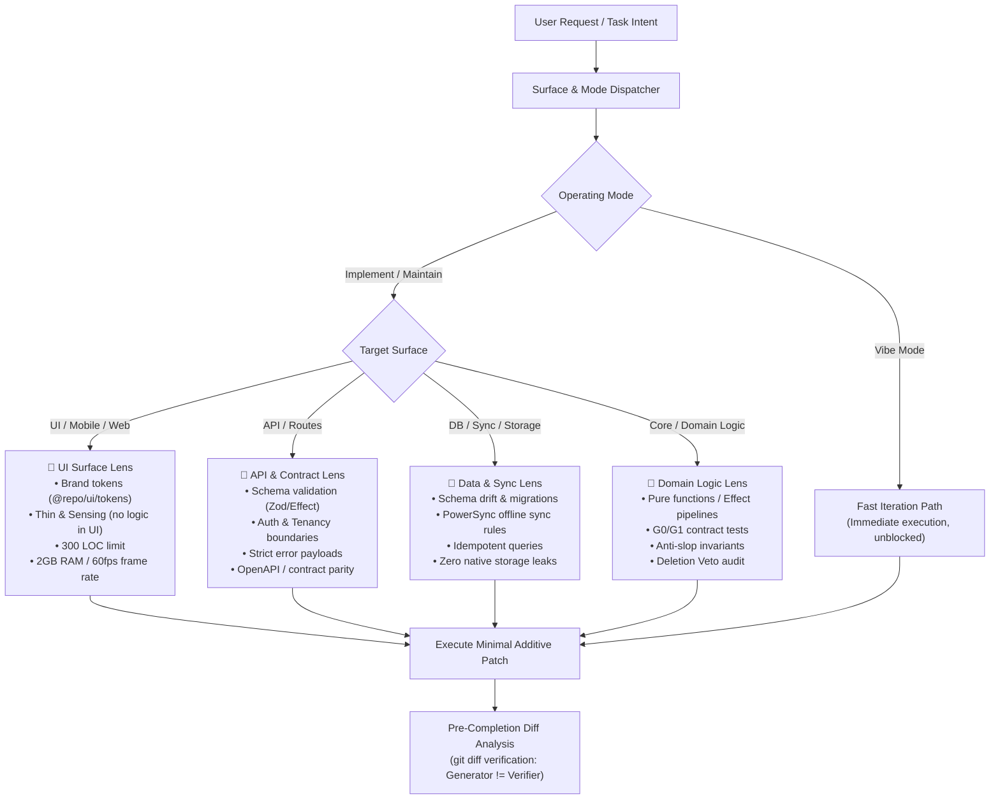

# AGENTS.md Evolution & Modular Dynamic Code Execution Architecture

> **Executive Thesis:**  
> The evolution of `AGENTS.md` from a 425-line procedural encyclopedia into a 231-line lean policy document represents a shift from **monolithic context dumping** to **modular, on-demand routing**.  
> The next natural evolution is to apply this exact same modularity to **code execution workflows**: agents rarely execute full-stack features from UI down to database migrations in a single prompt. Forcing a monolithic full-stack questionnaire on every turn causes cognitive bloat, hallucinations, and conversational deadlocks. Code execution must become **surface-aware, modular, and dynamic**.

---

## 1. Deep Comparative Analysis: Old `AGENTS.md` vs. New `AGENTS.md`

### 1.1 Structural Metrics & Token Footprint

| Metric | Old `AGENTS.md` (Pre-Oct 8) | New `AGENTS.md` (Current Grounded) | Delta & Impact |
| :--- | :---: | :---: | :--- |
| **Total Lines** | 425 lines | **231 lines** | **-45.6% reduction** in context window overhead |
| **Word Count** | ~3,729 words | **~2,150 words** | **~1,600 fewer tokens** injected on every agent boot |
| **Role & Purpose** | Operational encyclopedia + code snippets + tutorial guide | **Pure Layer-1 Policy File**: boundaries, sacred pins, invariants, and router | Clean separation of **Policy** from **Execution Details** |
| **Procedural Content** | Embedded Bash/WSL commands, component usage docs | **0 embedded runbooks** (delegated to on-demand skills) | Prevents context dilution on unrelated tasks |

---

### 1.2 Side-by-Side Section Anatomy



---

### 1.3 Detailed Shape Differences: What Was Pruned vs. What Was Added

#### A. What Was Pruned (And Where It Now Lives)
1. **WSL 2 Native Build Manual (65 lines removed):**
   - *Old:* Contained literal bash scripts, ccache configs, and `./gradlew :app:assembleRelease` flags.
   - *Destination:* Relocated into [`.agents/skills/android-build/SKILL.md`](file:///c:/x/.agents/skills/android-build/SKILL.md). Loaded only when compiling APKs.
2. **Branded UI Component Manual (120 lines removed):**
   - *Old:* Contained full React Native component prop definitions (`BrandPulse`, `ErrorState`, `BrandedEmptyState`, `Skeleton`, `LotusPetalFAB`).
   - *Destination:* Relocated into [`.agents/skills/branded-ui/SKILL.md`](file:///c:/x/.agents/skills/branded-ui/SKILL.md). An agent editing API logic or database schemas never sees this UI bloat.
3. **Web Crawling & Document Ingestion (30 lines removed):**
   - *Old:* Contained SQLite WAL rules and rate-limiting configs for harvesters.
   - *Destination:* Relocated into [`.agents/skills/resilient-crawler-pipeline/SKILL.md`](file:///c:/x/.agents/skills/resilient-crawler-pipeline/SKILL.md).

#### B. What Was Added (The Modern 2026 Engine)
1. **The Sovereign Context & Integration Pattern ("The Anti-Island Law"):**
   - Codifies the 5-phase Cognitive Order of Operations:  
     `Explore Terrain` ➔ `Absorb Context` ➔ `Think in Existing Terms` ➔ `Minimal Additive Seam` ➔ `Code, Verify, Codify`.
   - Strictly prohibits creating ad-hoc wrapper scripts, redundant utilities, or disconnected islands.
2. **The Tri-Modal Operating Protocol:**
   - Formal classification into **`Vibe Mode`** (throwaway spikes), **`Implement Mode`** (spec-first features), and **`Maintain Mode`** (default on code >3,000 LOC with blast radius containment).
3. **The Hostile Critical Reviewer & Deletion Veto:**
   - Enforces pre-completion `git diff` audit (*"Generator $\ne$ Verifier"*).
   - Establishes the non-negotiable **Deletion Veto**: working behavior, fallbacks, or routes can never be silently deleted without explicit human sign-off.
4. **Empirical Grounding (Rule 5 & Rule 12):**
   - *Rule 5 (Prime Directive):* Mandates direct inspection of installed packages in `node_modules/<pkg>/...` over LLM parametric memory.
   - *Rule 12 (Anti-Slop):* Strictly bans memory-hallucinated API replacements during version hops (React 19, RN 0.88, Effect v4).
5. **Graduated Evidence Tiers (G0–G5, R1):**
   - Bans the unqualified statement *"tests passed"*. Requires declaring evidence tier (G0 Static, G1 Mock, G2 Scenario, G3 Component, G4 Platform, G5 Device, R1 Production).
6. **Progressive Skill Router:**
   - A deterministic markdown table routing agents to specialized skills only when their specific domain is triggered.

---

## 2. The Core Bottleneck: Why Current `code-execution.md` is Broken

The file [`.agents/workflows/code-execution.md`](file:///c:/x/.agents/workflows/code-execution.md) was authored in early 2025 during the initial "Resonance Engineering" spike. Today, it acts as an anti-pattern:

### 2.1 The "Full-Stack Waterfall" Fallacy
Currently, `code-execution.md` mandates that before writing a single line of code, the agent must output:
1. *The Horizontal Flow (User Journey)*: Start state, transition, end state.
2. *The Vertical Stack (Architecture)*: File paths, Database/tRPC migrations, Zustand store slices.
3. *Spatial & GPU Analysis*: Z-Axis layers, Blurs, GPU pressure, 2GB mobile budget.
4. *Execution Plan*: Task 1 (Logic), Task 2 (Store), Task 3 (UI).
5. *Wait for human to say "Approved"*.

**Why this fails in practice:**
* **Real Tasks are Single-Slice:** In 90% of turns, an agent is assigned a **single surface**:
  - Fixing a CSS/NativeWind layout bug in a button.
  - Updating an API route handler in `apps/sanctuary-api`.
  - Adding a column in a Drizzle schema or PowerSync sync rule.
  - Refactoring an Effect-TS pipeline in `@repo/core`.
* **Hallucination Trigger:** Forcing an agent fixing a button to describe database migrations and Zustand slices causes it to hallucinate unnecessary full-stack changes.
* **Conversational Deadlock:** The rule `"YOU ARE FORBIDDEN FROM WRITING ANY CODE UNTIL A PLAN IS APPROVED"` stalls simple requests, micro-fixes, and autonomous refactoring sessions.

---

## 3. The New Architecture: Modular & Dynamic Code Execution

Instead of a monolithic questionnaire, code execution should be structured into a **Lightweight Kernel** plus **Dynamic Surface Lenses**.



---

### 3.1 The Common Kernel (Universal Invariants)
A universal, non-blocking foundation (<35 lines) that applies to all code:
1. **Mode Classification:** Determine if the task is `Vibe` (spike), `Implement` (new feature/contract), or `Maintain` (code >3k lines).
2. **Anti-Island Order:** Explore existing patterns first; use existing helpers in `@repo/core` and `@repo/ui`.
3. **The Deletion Veto:** Never silently remove working routes, fallbacks, or handlers without explicit sign-off.
4. **Targeted Diff Verification:** Inspect `git diff` before declaring done (`Generator != Verifier`).

---

### 3.2 The 4 Dynamic Surface Lenses

#### Lens 1: UI & Presentation Lens (`apps/gurudevi-mobile`, `apps/gurudevi-web`, `packages/ui`)
* **When active:** Editing screens, components, styles, or user-facing interactions.
* **Core Invariants:**
  - **Tokens First:** Import color and motion values from `@repo/ui/tokens`. Zero hardcoded `#hex` literals.
  - **Thin & Sensing:** Keep components purely visual. Business logic, network calls, and stores stay in hooks or `@repo/core`.
  - **Context Boundary (300 LOC Budget):** Components must remain modular. If a component exceeds 300 lines, decompose sub-views.
  - **Hardware Budget:** Avoid heavy animations that drop frames; uphold the 2GB mobile RAM budget.

#### Lens 2: API & Contract Lens (`apps/sanctuary-api`, Next.js route handlers)
* **When active:** Editing endpoints, request/response models, or RPC boundaries.
* **Core Invariants:**
  - **Typed Schemas:** Request and response payloads must be validated via Effect Schema or Zod.
  - **Auth & Tenant Isolation:** Every route must check session context and school/tenant permissions.
  - **Error Serialization:** Return typed, machine-readable errors (no unhandled 500 HTML dumps).
  - **Contract Parity:** Ensure client-side API clients in `@repo/core` match the endpoint contract.

#### Lens 3: Data & Sync Lens (`packages/database`, `packages/schema`, `powersync/`, migrations)
* **When active:** Modifying database schemas, Drizzle models, ZenStack ZModels, or PowerSync sync streams.
* **Core Invariants:**
  - **Schema Non-Destruction:** Additive migrations only; never drop active columns without a phased waiver.
  - **Offline-First Synchronization:** Tables exposed to mobile must include PowerSync sync rules and local SQLite shims.
  - **Storage Polyfill Invariant:** Never import native MMKV directly into shared core logic; route through `StorageManager`.

#### Lens 4: Domain Logic & Maintenance Lens (`packages/core`, `@repo/classroom`, refactors)
* **When active:** Editing state stores, business rules, Effect pipelines, or version upgrades.
* **Core Invariants:**
  - **Type Soundness:** Zero `@ts-ignore`, zero unconstrained `any`, zero `as unknown as` bypasses.
  - **Source Grounding:** Inspect `node_modules/<pkg>/...` directly for API signatures during upgrades (Rule 5 & Rule 12).
  - **Blast-Radius Containment:** Modifications must remain strictly within the target package without leaking into caller packages.
  - **Graduated Test Proof:** Declare evidence tier (e.g. `G1 boundary / Vitest mock`).

---

## 4. Reconstructing the Quality Gate: The Dual-Loop Engine

The legacy `sovereign-quality-gate.md` attempted to enforce a heavy, blocking sentinel on every atomic commit, which forced developers and agents to bypass it with `--no-verify`.

The reconstructed quality gate embraces the **Dual-Loop Reality**:

```
┌─────────────────────────────────────────────────────────────────┐
│                    THE DUAL-LOOP QUALITY ENGINE                 │
├────────────────────────────────┬────────────────────────────────┤
│   INNER LOOP: VELOCITY TRACK   │   OUTER LOOP: VERIFICATION     │
│   (During Active Development)  │   (Pre-Push / CI / Milestone)  │
├────────────────────────────────┼────────────────────────────────┤
│ • Fast, atomic commits         │ • node scripts/audit-4-pillars │
│ • --no-verify by design        │ • pnpm run check:anti-slop     │
│ • Zero pre-commit latency      │ • pnpm run check:version-drift │
│ • Agent maintains flow state   │ • Surgical TSC package audits  │
│ • Focus: Intent & Exploration  │ • Full Sentinel verification   │
└────────────────────────────────┴────────────────────────────────┘
```

1. **Velocity Track (The Inner Loop):**
   - Unblocked local commits using `--no-verify` are formally recognized as healthy development practice for capturing work-in-progress.
   - Prevents tooling fatigue and allows fast experimentation without getting bogged down by 5 sequential linters.
2. **Verification Track (The Outer Loop):**
   - Verification runs **asynchronously or on-demand**, using the fast empirical tools already in the repo:
     - `node scripts/audit-4-pillars.mjs` (gives comprehensive 4-pillar health scores in 2 seconds).
     - `pnpm run check:version-drift` and `scripts/surgical-push-check.mjs`.
   - Blocks only occur at the boundary of a remote push or PR creation, keeping the inner development loop completely friction-free.

---

## 5. Summary of Recommended Next Steps

| Component | Current State | Proposed Modular State |
| :--- | :--- | :--- |
| **`AGENTS.md`** | Restored (231 lines) | ✅ Already restored and acting as the lean Layer-1 Policy & Skill Router. |
| **`code-execution.md`** | 59 lines, monolithic waterfall questionnaire, outdated 2025 tokens | 👉 Transform into a **Modular Dynamic Execution Kernel** with 4 specialized surface lenses (UI, API, Data, Logic). |
| **`sovereign-quality-gate.md`** | 39 lines, claims blocking commit checks, dogmatic refusal | 👉 Reconstruct into the **Dual-Loop Quality Protocol** (Velocity Track with `--no-verify` + Asynchronous Verification Outer Loop). |
| **`scripts/` Directory** | 80+ loose scripts, cluttering searches | 👉 Move the ~30 legacy `heal-*` scripts to `scripts/archive/` to keep developer affordances clean. |

*(No changes to workflows or scripts have been made yet, pending your review and direction on this proposal).*
