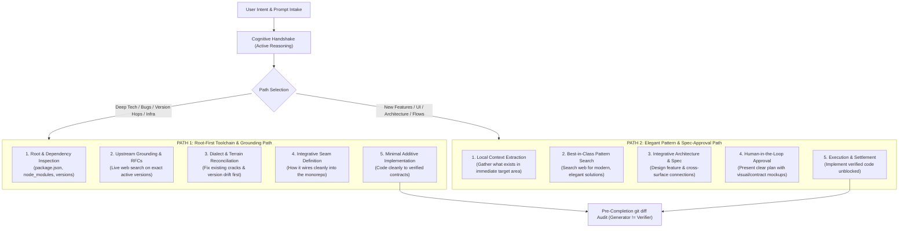

# Recursive Integrative Code Execution Framework

> **The Central Paradox:**  
> If an agent only thinks modularly in an isolated bubble, the codebase becomes fragmented and nothing connects.  
> If an agent is forced to do a monolithic full-stack waterfall on every turn, it overcomplicates simple tasks and hallucinates rewrites.  
> **The Solution:** **Integrative Architecture + Modular Execution**, navigated through two distinct operating gears: the **Toolchain-Grounded Root Path** and the **Elegant Spec-Approval Path**.

---

## 1. Solving the "First 100 Lines" Problem: Active Reasoning over Passive Reading

### 1.1 The Vulnerability
Agents (and tool contexts) frequently truncate or lazily skim large instruction files. When an agent runs `view_file` or receives an injected policy, attention degrades after the first 80–100 lines ("Lost-in-the-Middle" phenomenon). This causes critical rules in lines 101–231 (Anti-Slop, Deletion Veto, Graduated Evidence) to be ignored.

### 1.2 The Remedy: The "Active Reasoning Assertion" (Cognitive Handshake)
Telling an agent *"Read `AGENTS.md`"* fails because reading is passive.  
Instead, the harness enforces a **Cognitive Handshake**:

```text
[Cognitive Handshake Invariant]
Before writing code or proposing a plan, the agent must output a 2-line "Bounding Triad":
1. Surface & Mode: [e.g. UI Surface | Implement Mode]
2. Grounded Constraint: [e.g. Rule 5 source-grounding in node_modules, Rule 3 Deletion Veto]
3. Active Seam: [e.g. Consuming Theme tokens from @repo/ui/tokens, zero raw hex]
```

By requiring the model to generate the bounding constraints from the rules, the model’s attention mechanism is mechanically forced to attend to and reason over the full document.

---

## 2. Reconciling Integrative Thinking with Modular Surface Execution

You identified a critical architectural truth:  
> *"Someone who thinks integratively is also needed right? Unless when we gonna connect all together nothing can be connected etc?"*

The system cannot choose between modularity and integration—it requires **both**, decoupled into two distinct cognitive phases:

```
┌─────────────────────────────────────────────────────────────────────────────┐
│ PHASE 1: INTEGRATIVE SITUATIONAL AWARENESS (The Seam Map)                   │
│ • Where does this intent live in the overall monorepo ecosystem?            │
│ • What connects to what? (UI Screen ➔ Hook ➔ API Route ➔ Core Schema)        │
│ • What is the contract between them? (The Seam)                             │
└──────────────────────────────────────┬──────────────────────────────────────┘
                                       │
                                       ▼
┌─────────────────────────────────────────────────────────────────────────────┐
│ PHASE 2: MODULAR EXECUTION (The Bounded Slice)                              │
│ • The agent executes strictly on ONE targeted surface at a time.           │
│ • The code written must fit the established Seam Contract like a jigsaw.    │
│ • Zero hallucinated full-stack rewrites; zero scope creep.                  │
└─────────────────────────────────────────────────────────────────────────────┘
```

---

## 3. The Dual-Path Execution Engine

Different types of developer prompts require fundamentally different cognitive trajectories. The new `code-execution` framework formalizes two distinct operational paths:



---

### Path 1: The Root-First Toolchain & Grounding Path (Deep Engineering)
* **Best for:** Version upgrades (React 19, RN 0.88, Effect v4), thorny compiler errors, dependency integrations, and foundational fixes.
* **Execution Flow:**
  1. **Intent Extraction:** Understand the underlying technical problem.
  2. **Root & Dependency Audit:** Inspect root `package.json`, target `package.json`, and the installed code in `node_modules/<pkg>/...` to establish ground truth.
  3. **Upstream Grounding:** Search official release tags, changelogs, and RFCs for the active versions. Never guess deprecated APIs.
  4. **Dialect Reconciliation:** Compare existing codebase code against modern upstream conventions. If foundational drift or cracks exist, stabilize them first before building on top.
  5. **Integrative Seam Design:** Map how the fix integrates across callers and packages without breaking dependents.
  6. **Minimal Additive Patch:** Author the fix conforming to the Deletion Veto.

---

### Path 2: The Elegant Pattern & Spec-Approval Path (Product & Architecture)
* **Best for:** New feature development, complex user journeys, UI screens, and domain capabilities.
* **Execution Flow:**
  1. **Intent Extraction:** Deeply parse the user's desired outcome and constraints.
  2. **Local Context Harvest:** Inspect existing adjacent components, stores, and hooks to avoid duplicate utilities (Anti-Island Law).
  3. **Best-in-Class Pattern Search:** Search the web and registries for state-of-the-art, elegant implementations of this specific pattern (modern 2026 UX/architecture).
  4. **Integrative Architecture & Spec:** Author a concise Spec defining:
     - The user journey & component hierarchy.
     - The cross-surface integration points (Hooks, API endpoints, Core stores).
     - Bounding constraints (Design tokens, 300 LOC limit, 2GB mobile RAM budget).
  5. **Review Gate (Human Approval):** Present the plan, integration seams, and visual structure to the user for sign-off.
  6. **Execution & Settlement:** Once approved, write the code in modular slices without friction.

---

## 4. Recursive Demonstration: Applying the Workflow to This Very Prompt

To prove this methodology, we recursively execute the workflow on **your exact request in this turn**:

### Step 1: Intent Extraction
* **User Goal:** Reconcile modular single-surface execution with integrative thinking; solve the "100-line `AGENTS.md` truncation" problem; formalize Path 1 (Root-first grounding) vs. Path 2 (Elegant pattern & approval spec).

### Step 2: Root & Context Audit
* **Grounded Reality:** `c:\x\AGENTS.md` is 231 lines. The top 50 lines contain the Prime Directive, Boundaries, and Anti-Island Law. Lines 100+ contain the Tri-Modal protocol and Anti-Slop.
* **The Root Issue:** Agents reading `AGENTS.md` passively lose focus after line 100. Workflows in `.agents/workflows/` are monolithic and block velocity.

### Step 3: Upstream & Industry Grounding
* **2026 Frontier Research:** Spec-Driven Development (SDD) replaces blind vibe coding; Context Engineering operates by subtraction; Agent Scaffolding manages dual loops (inner velocity vs outer verification).

### Step 4: Integrative Reconciliation
* Path 1 stabilizes the technical substrate (dependencies, versions, dialects).
* Path 2 drives product features and architecture with human-in-the-loop approval.
* The "Bounding Triad" cognitive handshake forces active reasoning over the first 100 lines and beyond.

### Step 5: Deliverable Specification
* Written and preserved in this architectural document for retrieval, comparison, and progressive implementation.
