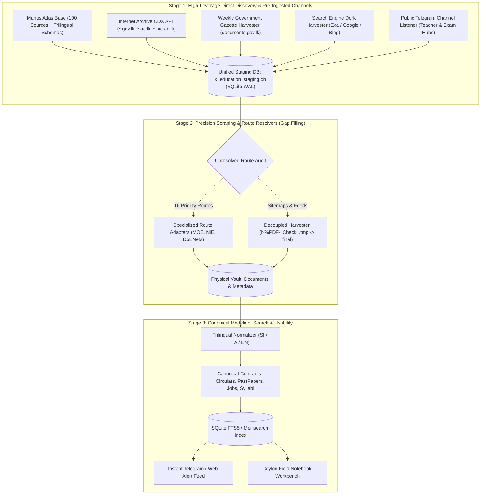

# Sri Lanka Educational Web Indexer & Domain Census
## Inverted High-Leverage Architecture & Implementation Plan

> **Objective:** Rapidly aggregate, catalog, and index the entire Sri Lankan educational ecosystem—ministry circulars, official gazettes, past papers, syllabi, teacher guides, job vacancies, and community learning resources—by inverting the pipeline to harvest high-leverage pre-aggregated channels first, incorporating the Manus Atlas foundation, and deploying targeted scrapers only where gaps remain.

---

## 1. The Inverted Strategy (The Anti-Monolith / High-Leverage Shift)

Traditional web scraping against Sri Lankan government portals (`moe.gov.lk`, `doenets.lk`, `nie.ac.lk`) suffers from high fragility: unstable JavaScript frameworks, frequent 503 gateway timeouts, unannounced URL restructuring, and non-existent pagination APIs.

Instead of starting with fragile low-level scrapers, the pipeline is inverted into three modular stages:



---

## 2. Stage 1: High-Leverage Channels & Baseline Integration

### 2.1 Integrating the Manus Education Atlas Foundation
The project integrates the vetted groundwork from `sri-lanka-education-atlas`:
* **Authoritative Source Bibliography:** 100 vetted educational entities across official national, higher ed, TVET, and community publishers (`data/research/source-bibliography-100.json`).
* **Trilingual Vocabularies:** Controlled labels in Sinhala (`si`), Tamil (`ta`), and English (`en`) for educational stages (Primary, Junior Secondary, O/L, A/L, Tertiary, TVET) and professional roles (Teacher, Principal, In-Service Advisor, Policy Maker).
* **Route Audit & Priority Repair Queue:** 16 identified high-priority unresolved routes requiring targeted handling.
* **Pre-existing Seeds:** Over 5MB of verified educational resource placements and compositions.

### 2.2 Internet Archive CDX "Time Machine" Harvester
The Internet Archive has crawled `.gov.lk` and `.ac.lk` for over two decades. The CDX Server API allows querying without putting any load on local government infrastructure:
* **Query Patterns:**
  * `http://web.archive.org/cdx/search/cdx?url=*.gov.lk/*&output=json&fl=original,mimetype,timestamp&filter=mimetype:application/pdf`
  * Filters for keywords: `circular`, `exam`, `gazette`, `syllabus`, `curriculum`, `tim` (Teacher Instruction Manual).
* **Yield:** Thousands of verified, historical PDF links discovered in seconds.

### 2.3 The Weekly Government Gazette Engine (`documents.gov.lk`)
By law, all formal teacher appointments, promotional examinations, educational administrative services (SLEAS, SLPS, SLTS), and core ministerial circulars are published in the Friday **Sri Lanka Government Gazette**:
* **Target Section:** Part I: Section IIA (Public Service Vacancies & Examinations) and Part I: Section I (General Notices & Circulars).
* **Mechanism:** A weekly polling worker downloads the Friday PDF, extracts the table of contents and recruitment notices, and registers them directly into the staging database.

### 2.4 Telegram Educational Hub Monitor
In Sri Lanka, teachers and exam boards distribute circulars, marking schemes, and term-test papers through public Telegram channels minutes after release:
* **Mechanism:** Monitor key public educational channels (e.g. via public web previews `t.me/s/<channel>` or Telethon API) to ingest clean native PDF uploads, dates, and subject captions without scraping websites.

### 2.5 Search Engine Dork Ingestion
Automated queries against search indices (Google, Bing, Exa) using precision dorks:
* `site:gov.lk filetype:pdf ("චක්‍රලේඛ" OR "circular") 2024`
* `site:nie.ac.lk filetype:pdf ("syllabus" OR "ගුරු මාර්ගෝපදේශය")`
* `site:doenets.lk filetype:pdf ("marking scheme" OR "evaluation report")`

---

## 3. Stage 2: Precision Scraping & Route Resolvers

For gaps not covered by Stage 1, targeted scrapers resolve the 16 priority routes identified in the Manus route audit:
1. **Ministry of Education (`moe.gov.lk`):** Dynamic circular listing tabs and language toggle endpoints.
2. **National Institute of Education (`nie.ac.lk`, `channelnie.nie.ac.lk`):** XML sitemap processing for 407+ curriculum pages and teacher guides.
3. **Department of Examinations (`doenets.lk`):** Past paper prototype releases, statistics, and evaluation reports.
4. **Resilient Pipeline Rules:**
   * Enforce SQLite WAL state tracking (`PRAGMA journal_mode = WAL;`).
   * Download to `.tmp` files with `b"%PDF-"` magic byte checks before atomic rename.
   * Rate limiting: Max 1 request per 1.5 seconds per government domain.

---

## 4. Stage 3: Canonical Modeling, Search & Usability

### 4.1 Canonical Data Contracts

#### A. Educational Circular (`EducationalCircular`)
```typescript
interface EducationalCircular {
  id: string; // Stable UUID
  sourceId: string; // e.g. "LK-SOURCE-MOE"
  circularNumber: string; // e.g. "2024/18"
  titleTrilingual: {
    en?: string;
    si?: string;
    ta?: string;
  };
  publishedDate: string; // ISO 8601
  targetAudience: ("principals" | "teachers" | "students" | "non-academic")[];
  downloadUrl: string;
  extractedText: string;
}
```

#### B. Exam Resource & Past Paper (`ExamResource`)
```typescript
interface ExamResource {
  id: string;
  sourceId: string;
  examLevel: "Grade 5 Scholarship" | "GCE O/L" | "GCE A/L" | "Term Test";
  year: number;
  subject: string; // e.g. "Combined Mathematics", "Science"
  medium: "sinhala" | "tamil" | "english";
  resourceType: "past_paper" | "marking_scheme" | "model_paper" | "prototype";
  grade?: number; // 1 to 13
  schoolOrBoard: string;
  downloadUrl: string;
  checksumSha256: string;
}
```

#### C. Education Job Notice (`EducationJobNotice`)
```typescript
interface EducationJobNotice {
  id: string;
  title: string;
  institution: string;
  gazetteDate?: string;
  applicationDeadline: string;
  qualifications: string;
  applicationFormUrl?: string;
}
```

### 4.2 Search Engine & Usability Layers
* **SQLite FTS5 Full-Text Search:** Sub-50ms indexed search across extracted PDF text, titles, circular numbers, and metadata.
* **Instant Delta Alerts:** Webhook / Telegram notification service when new circulars or gazettes are detected.
* **Workbench UI:** "Ceylon Field Notebook" editorial design system for teachers, principals, and educational researchers.

---

## 5. Implementation Roadmap

| Milestone | Target Deliverable | Verification Gate |
| :--- | :--- | :--- |
| **M1: Baseline Integration** | Import 100 Manus sources, trilingual vocabularies, and schemas into SQLite WAL database (`lk_education_staging.db`). | Schema validation passes; 100 sources cataloged. |
| **M2: CDX & Gazette Ingestion** | Harvester for Wayback Machine CDX API + weekly Gazette parser. | $\ge 1,000$ historical educational PDF records captured without website scraping. |
| **M3: Telegram & Dork Ingestion** | Public Telegram channel monitor + search dork harvester. | Real-time circular stream active; new papers ingested with metadata. |
| **M4: Precision Route Scraping** | Route adapters for MOE circulars, NIE sitemaps, and DoENets evaluation reports. | 16 priority route repair items resolved; PDF magic bytes validated. |
| **M5: FTS5 Search & Alert Service** | Trilingual search index + instant notification feed. | Sub-50ms search by grade, subject, year, and circular number. |
