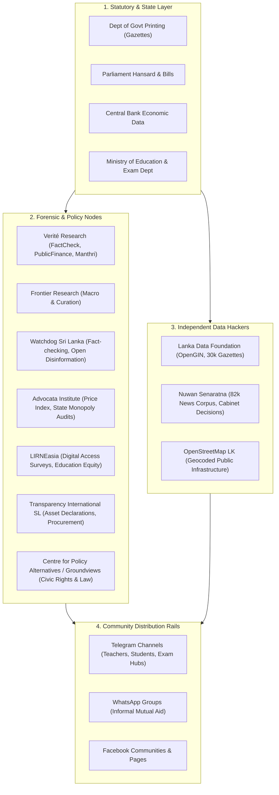

# Sri Lanka Civic-Data Ecosystem
## The Constellation of Doors and the Polycentric Dilemma

> **Executive Summary:** This document catalogs the major investigative, civic-tech, and public-policy "doors" in Sri Lanka (Verité Research, CPA/Groundviews, Watchdog, Advocata, LIRNEasia, TISL), investigates whether a distributed ecosystem of small actors is fundamentally **fragile or polycentric**, and clarifies how a sovereign civic platform connects them into a resilient epistemic mesh.

---

## 1. The Full Constellation of Doors

The Sri Lankan civic data landscape is not a single monolith; it consists of specialized institutional nodes that each hold a specific piece of public truth:



### 1.1 The Verité Research Ecosystem
* **FactCheck.lk:** Cross-references political claims by MPs and ministers in Sinhala, Tamil, and English against primary state data (Central Bank, Hansards, Gazettes).
* **PublicFinance.lk:** Visual analytics breaking down national debt, treasury revenue, sovereign bonds, and tax structures into digestible infographics.
* **Manthri.lk:** The trilingual parliamentary scorecard tracking attendance, debates, and committee contributions of all 225 MPs.
* **The Sri Lanka IMF Tracker ("IMF Meter"):** Tracks the compliance status of 100+ structural benchmarks pledged to the IMF, verifying whether statutory gazettes were actually drafted and passed.
* **RTI Compliance Audits:** Systematically tests government ministries against the Right to Information Act (No. 12 of 2016), exposing proactive disclosure failures.

### 1.2 Investigative Data Journalism & Civic Resistance
* **Watchdog Sri Lanka (`watchdog.team`):** Founded by Yudhanjaya Wijeratne and researchers during the economic crisis; pioneered data scrapers for medicine shortages, gazettes, and disinformation tracking.
* **Groundviews / Maatram / Vikalpa (CPA):** 15+ years of trilingual citizen journalism, constitutional legal critique, and grassroots human rights documentation.
* **Roar Media:** Long-form explainer journalism bridging complex public finance and social history into accessible vernacular formats.

### 1.3 Think Tanks, Independent Research & Economic Curation
* **Frontier Research (Founded by Amal Sanderatne, 1976–2023):** Sri Lanka's pioneer independent macroeconomic and equity research firm. Amal Sanderatne championed accessible economic curation, time-tracking, and demystifying debt/currency dynamics for the broader public before his sudden passing in July 2023 (with wide commemorations marking his 1-year anniversary in July 2024). Frontier Research continues as an essential independent economic beacon alongside Verité.
* **Advocata Institute:** Tracks everyday cost of living through the "Bath Curry Index" (BCI) and focuses on deregulation, state-owned enterprise (SOE) reform, and trade barriers.
* **LIRNEasia:** The regional authority on digital poverty, telecom regulations, and school connectivity—providing ground-truth survey evidence on student dropouts and digital divides.
* **Marga Institute (Founded by Godfrey Gunatilleke, 1926–2023):** The historical foundation of Sri Lankan development research, studying poverty alleviation and human flourishing since the 1970s.
* **Transparency International Sri Lanka (TISL):** Focuses on judicial transparency, public asset declarations of politicians, and anti-corruption litigations.

---

## 2. The Core Debate: "Fragile" vs. "Polycentric"

When looking at this ecosystem, an immediate paradox emerges:
> *Are these initiatives merely small, under-resourced, and fragile silos doomed to die when funding ends, or are they a resilient, polycentric root system?*

### 2.1 Why the Nodes Appear "Fragile" (The Island Syndrome)
1. **The Donor Funding Cliff:** Many projects rely on short-term foreign grants (USAID, NED, EU). When a 2-year grant ends, the dedicated engineering team dissolves, and the web platform goes dark.
2. **Founder Burnout & Single Points of Failure:** Projects like `nuuuwan`'s daily news scrapers or small civic bots rely on single individuals maintaining scripts at night. If the founder moves abroad or burns out, the stream stutters.
3. **Data Silos & Duplicate Effort:** Verité, LDF, and independent developers often scrape the exact same gazettes or election records without sharing a normalized database schema.

### 2.2 Why the Ecosystem is Actually "Polycentric" (Ostrom's Law)
In political science, **Polycentricity** (defined by Nobel laureate Elinor Ostrom) describes systems with *multiple governing authorities and autonomous actors operating under overlapping domains without a single central hierarchy*.

In Sri Lanka, polycentricity is **the only reason civic truth survives**:
* **Censorship Resistance:** If Sri Lanka had a single, centralized "National Open Data Institute" run by the state, an incoming authoritarian regime could silence or purge it with one executive order.
* **Resilience to Crackdowns:** Because the nodes are small, autonomous, and distributed (Verité in Colombo 7, LDF on GitHub, teachers on Telegram, CPA in human rights spaces), **the state cannot kill the system because there is no single throat to choke.**
* When the Department of Printing delays physical gazettes, LDF surfaces the digital PDF. When a minister lies on television, FactCheck.lk debunks it. When a ministry refuses to publish a circular, a teacher leaks the PDF to Telegram within 3 minutes.

---

## 3. The Role of Our Civic Platform: The Federated Substrate

The goal of our platform ("Urumaya" / Sri Lanka Education Atlas) is **not to centralize or replace these polycentric nodes**. That would destroy their autonomy.

Instead, the platform acts as the **Federated Integration Substrate**:

```
[ Polycentric Producers ]            [ Our Hexagonal Mesh ]            [ Omnichannel Delivery ]
- LDF (Institutional Trees)   ──►   ┌───────────────────────────┐   ──► - Google Search (SEO #1)
- nuuuwan (82k News Corpus)   ──►   │ SQLite WAL + FTS5 Substrate│   ──► - WhatsApp / Telegram Bot
- Verité / Watchdog (Audits)  ──►   │ Zero-Cost, Local, Portable│   ──► - School Admin Workbenches
- Gazette Harvester (Legal)   ──►   └───────────────────────────┘
```

1. **Eliminate the Infrastructure Cost Cliff:** By storing everything in zero-cost SQLite WAL, DuckDB Parquet, and static GitHub repositories, the system has **\$0 monthly cloud bills**. It cannot starve to death when donor grants expire.
2. **Unify Schemas, Preserve Autonomy:** We map Verité's policy signals, LDF's institutional trees, Nuwan's news articles, and Telegram's exam papers into a clean trilingual domain model.
3. **Bring Truth to the Citizen's Habitat:** Rather than demanding citizens visit 10 different academic websites, our engine answers citizen questions directly inside Google searches and WhatsApp messages with grounded citations to the original producer.

---

## 4. The Epistemic Invariant: Curation Over Raw Data Dumping

A foundational insight derived from both Amal Sanderatne's Frontier Research curation model and the Urumaya epistemic doctrine is that **raw information volume does not produce civic understanding**:

$$\text{Civic Agency} = \frac{\text{Curated Signal} \times \text{Contextual Clarity}}{\text{Cognitive Load} + \text{Bureaucratic Opacity}}$$

1. **Rejecting the "Data Dump" Anti-Pattern:** A platform that simply dumps 5,000 raw scanned PDFs on an anxious teacher or A/L student only amplifies systemic panic.
2. **Actionable Scenario Framing:** Ingested documents must be distilled into plain-language summaries (Sinhala, Tamil, English), explicit deadlines, and clear next steps before surfacing to citizens.
3. **Respecting Human Cognitive Bandwidth:** The primary measure of platform success is not how many gigabytes it indexes, but how many hours of anxiety and bureaucratic confusion it saves the everyday citizen.
