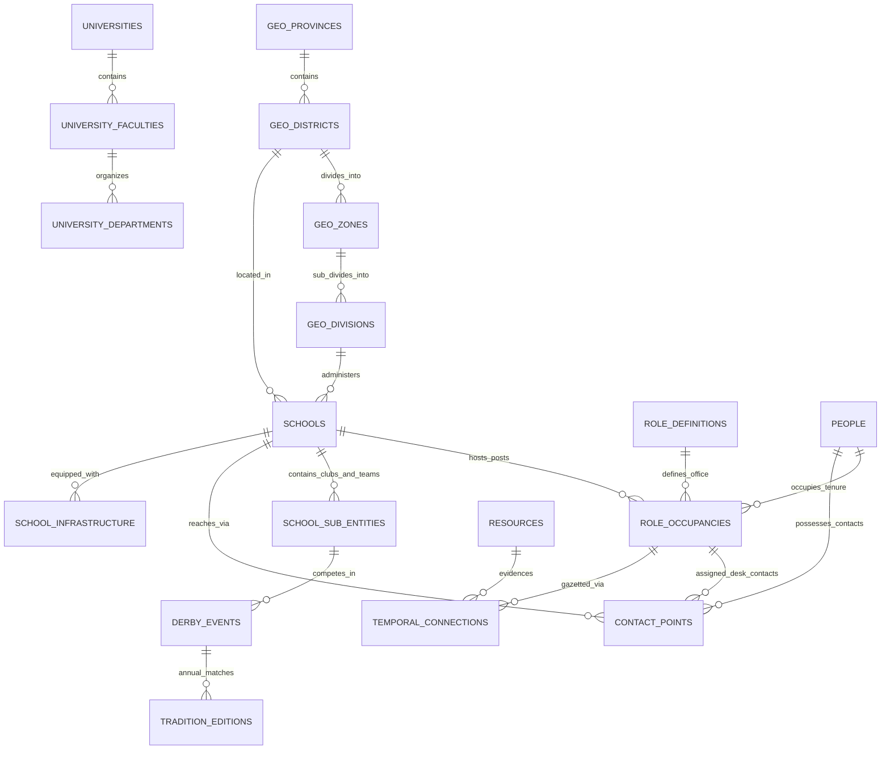

# Sri Lanka Education & Civic Platform: Unified Ontology, Ontogeny, ER Architecture & Schema Specification

> **STUDIO UMBRELLA:** IntuituiLabs (`intuituilabs.studio` / Naveen)  
> **PURPOSE:** This document establishes the authoritative domain ontology, temporal lifecycle state machine (ontogeny), entity-relationship (ER) model, contact privacy architecture, and relational database schema for the Sri Lanka Education Atlas ("Urumaya"). It models institutions, roles, people, student sub-cultures, sports, aesthetics, research documents, and spatial coordinates into a unified, coherent sovereign architecture.

---

## 1. The Core Quad: Entity, Role, Occupancy (Ontogeny), & Person

In Sri Lankan educational governance, confusion frequently arises because administrative records conflate the **School**, the **Office of the Principal**, and the **Individual Person** currently holding the post. When a principal transfers, contact numbers break, circulars are misattributed, and historical institutional memory is lost.

We resolve this by enforcing the **Core Governance Quad**:

```
 ┌──────────────────────┐                ┌──────────────────────┐
 │       PERSON         │                │   ROLE DEFINITION    │
 │ (Human Individual)   │                │   (Office / Post)    │
 │ • person_id          │                │ • role_code          │
 │ • canonical_name     │                │ • title (si/ta/en)   │
 │ • qualifications     │                │ • service_minute     │
 └──────────┬───────────┘                └──────────┬───────────┘
            │                                       │
            │           ┌──────────────────────┐    │
            └──────────►│   ROLE OCCUPANCY     │◄───┘
                        │ (Temporal Tenure)    │
                        │ • occupancy_id       │
                        │ • valid_from         │
                        │ • valid_to           │
                        │ • status (acting/reg)│
                        └──────────┬───────────┘
                                   │
                                   ▼
                        ┌──────────────────────┐
                        │   ENTITY / SCHOOL    │
                        │ (Institution/Campus) │
                        │ • census_no / id     │
                        │ • category (1AB/1C)  │
                        │ • type (National)    │
                        └──────────────────────┘
```

### Definitions:
1. **`Entity` (Institution / School / University):** The perpetual corporate body (e.g., *Royal College Colombo* `0117001`, *University of Colombo* `uni:colombo`, *Ministry of Education* `inst:moe_lk`). It survives centuries regardless of leadership changes.
2. **`RoleDefinition` (Office / Post):** The abstract position within the state educational service. E.g.:
   - `ROLE_PRINCIPAL_SLPS_1`: Principal (Sri Lanka Principals' Service Class I).
   - `ROLE_DEPUTY_PRINCIPAL_ACADEMIC`: Deputy Principal (Academic & Curriculum).
   - `ROLE_SECTIONAL_HEAD_AL_SCIENCE`: Sectional Head (G.C.E. A/L Science).
   - `ROLE_MASTER_IN_CHARGE_CRICKET`: Master-in-Charge of Cricket.
   - `ROLE_PREFECT_HEAD_BOY` / `ROLE_PREFECT_HEAD_GIRL`: Student Head Prefect.
   - `ROLE_VICE_CHANCELLOR`: University Vice Chancellor (UGC Act No. 16 of 1978).
3. **`Person` (Individual):** The flesh-and-blood human being (e.g., *Mr. B.A. Abeyrathna*, *P. de S. Kularatne*, *Prof. Lakshman Dissanayake*). Contains verified name variants, honors, and qualifications.
4. **`RoleOccupancy` (The Temporal Tenure / Ontogeny):** The binding between a Person, an Office, and an Entity over a defined time interval:
   $$\text{Occupancy} = \langle \text{Person}, \text{Role}, \text{Entity}, [T_{\text{start}}, T_{\text{end}}], \text{Status}, \text{EvidentiaryGazette} \rangle$$
   - Supports statuses: `acting`, `confirmed`, `interdicted`, `transferred`, `retired`.
   - Backed by an official Government Gazette appointment order or PSC circular number.

---

## 2. Institutional Ontogeny: Lifecycle State Machines

### 2.1. School Grade-Span Promotion Ontogeny
Sri Lankan government schools evolve through four statutory categories under the Ministry of Education, culminating in National School status:

```
  [Type 3: Primary]         [Type 2: Junior Sec]        [1C: Senior Sec Arts/Com]       [1AB: Full Science]
   (Grade 1 to 5)            (Grade 1 to 11 / O/L)       (A/L Arts & Commerce)           (A/L Science + All)
 ┌─────────────────┐       ┌─────────────────────┐     ┌────────────────────────┐     ┌───────────────────────┐
 │ • 4,020 Schools │  ───► │ • 3,171 Schools     │───► │ • 1,789 Schools        │───► │ • 982 Schools         │
 │ • Feeders to MV │       │ • Provincial Admin  │     │ • Upgraded by Province │     │ • Science Lab equipped│
 └─────────────────┘       └─────────────────────┘     └────────────────────────┘     └──────────┬────────────┘
                                                                                                 │
                                                        [National School Declaration]            ▼
                                                         Gazetted by Minister under       ┌───────────────────┐
                                                         Section 27 of Education Act ───► │ • 332 Schools     │
                                                                                          │ • Direct MOE Isur.│
                                                                                          └───────────────────┘
```

### 2.2. School Leadership Ontogeny (Tenure Transitions)
A school principal's tenure follows strict Public Service Commission (PSC) and Sri Lanka Principals' Service (SLPS) rules:
1. **Gazette Advertisement:** PSC / Provincial PSC advertises vacancy.
2. **Assumption of Duties (`valid_from`):** Marked by signed assumption letter and circular notice.
3. **Acting vs. Confirmed:** An officer may serve as "Acting Principal" (*Wada Balahina Adhyakshaka/Vidhuhalpathi*) for years before formal cabinet/PSC confirmation.
4. **Annual / Triennial Transfers:** Gazette transfer lists reassign principals across provinces.
5. **Retirement / Handover (`valid_to`):** Formal handover of school seal, logbook, and financial ledgers.

---

## 3. Contact Details Architecture & Privacy Scoping

In Sri Lankan government schools, published contacts are notoriously contaminated: over 75% of school phone numbers in provincial registries are **personal mobile numbers** belonging to the incumbent principal or ICT teacher, and emails are free personal Gmail accounts.

To protect personal privacy and ensure institutional stability, contacts are modeled with **three distinct ownership scopes and privacy tiers**:

```
┌────────────────────────────────────────────────────────────────────────────────────────┐
│                        CONTACT POINT TAXONOMY & PRIVACY TIERS                          │
├─────────────────┬──────────────────────────┬───────────────────────────────────────────┤
│ Scope           │ Example                  │ Handling Mode & Lifecycle                 │
├─────────────────┼──────────────────────────┼───────────────────────────────────────────┤
│ 1. Entity Scope │ Landline: `011-2695551`  │ • Permanent Institutional Landmark.       │
│    (School)     │ Domain: `info@royal.lk`  │ • Persists across all leadership changes. │
│                 │ Postal: `Colombo 07`     │ • Public tier: Free for citizen display.  │
├─────────────────┼──────────────────────────┼───────────────────────────────────────────┤
│ 2. Role Scope   │ Mobile: `071-8286822`    │ • Tied to the Active Role Occupancy.      │
│    (Office)     │ Email: `principal@...`   │ • MUST transfer when principal transfers. │
│                 │ WhatsApp Desk            │ • Administrative tier: Masked on leave.   │
├─────────────────┼──────────────────────────┼───────────────────────────────────────────┤
│ 3. Person Scope │ Personal: `077-XXXXXXX`  │ • Private personal identity.              │
│    (Individual) │ Personal: `name@gmail`   │ • Protected PII under Data Protection Act.│
│                 │ Home landline            │ • Redacted tier: Never shown publicly.    │
└─────────────────┴──────────────────────────┴───────────────────────────────────────────┘
```

---

## 4. Student Culture, Sports, Aesthetics & Sub-Entities

Sri Lankan school life is defined by rich co-curricular traditions that shape national civic identity:

```
                                  ┌────────────────────────┐
                                  │     SCHOOL ENTITY      │
                                  └───────────┬────────────┘
                                              │
          ┌───────────────────────┬───────────┴───────────┬───────────────────────┐
          ▼                       ▼                       ▼                       ▼
    [Sports Teams]       [Clubs & Societies]     [Performing Arts]        [Youth & Cadet]
    • 1st XI Cricket     • Astronomical Society  • Oriental Orchestra     • National Cadet Corps
    • 1st XV Rugby       • Sinhala Sahithya      • Samastha Lanka Dancing • Scouting / Girl Guides
    • Athletics          • Interact / Rotary     • Western Band / Choir   • St. John Ambulance
    • Swimming           • Media & Broadcasting  • Drama Society          • Junior Prefects Guild
```

### 4.1. The Big Matches & Traditional Derbies
* **Event Entities:** `event:battle_of_the_blues` (Royal-Thomian, 147+ editions), `event:battle_of_the_maroons` (Ananda-Nalanda), `event:bradby_shield` (Royal-Trinity), `event:battle_of_the_north` (Jaffna Central-St. John's).
* **Attributes:** Rival schools, historical series tally (wins, losses, draws), venue (SSC, Asgiriya, Pallekele), inception year.

### 4.2. All-Island Aesthetic Competitions (*Samastha Lanka*)
* Organized annually by the Aesthetic Education Branch of the Ministry of Education.
* Disciplines: Traditional Kandyan Dancing (*Ves*), Low-country (*Pahatharata*), Sabaragamuwa, Bharatanatyam, Oriental Classical Music, Western Choral Music.
* Awards: President's Gold Medals, All-Island Championships.

---

## 5. University Hierarchy & Research Venues

Parallel to the school system, Sri Lanka's 17 state universities follow the statutory governance model defined by the **Universities Act No. 16 of 1978**:

```
 ┌────────────────────────────────────────────────────────────────────────┐
 │                    STATE UNIVERSITY GOVERNANCE TREE                    │
 ├───────────────────────────────────┬────────────────────────────────────┤
 │ Leadership (Role Definitions)     │ Academic Sub-Units (Entities)      │
 ├───────────────────────────────────┼────────────────────────────────────┤
 │ • Chancellor (Ceremonial Head)    │ • Faculties (Science, Medicine...) │
 │ • Vice Chancellor (Chief Exec)    │ • Academic Departments             │
 │ • Rector (Campus Head)            │ • Postgraduate Institutes (PGIM..) │
 │ • Dean of Faculty                 │ • Affiliated Research Centres      │
 │ • Head of Department              │ • University Main Library          │
 │ • Registrar (Chief Admin Officer) │ • Student Union / Faculty Unions   │
 │ • Bursar (Chief Finance Officer)  │                                    │
 └───────────────────────────────────┴────────────────────────────────────┘
```

---

## 6. Official Research & Data Harvester Catalog

To ground the system in primary evidence, the following official document repositories must be ingested:

### 6.1. Ministry of Education Data Management Branch (`dmb.moe.gov.lk`)
* **School Census XLSX Spreadsheets (Annual 2015–2024):** Complete tabular listings of every school's:
  - Total students by grade and gender.
  - Teacher counts by subject specialization and appointment class.
  - Infrastructure: Electricity, piped water, computer laboratories, science laboratories, sanitation facilities.
* **National Quality Assurance Standards (NEQAF):** Inspection benchmarks for institutional excellence.
* **Educational Publications Directorate (`edupub.gov.lk`):** Textbooks and teacher instructional manuals across all 13 grades in Sinhala, Tamil, and English.

### 6.2. University Grants Commission Publications (`ugc.ac.lk`)
* **Sri Lanka University Statistics (Annual Handbooks):** Comprehensive data on:
  - Undergraduate student enrollment and admissions by district quota.
  - Academic, administrative, and support staff distributions.
  - Postgraduate output (PhD, MPhil, Masters).
  - Capital and recurrent expenditure by university and faculty.
* **University Admissions Handbook (Z-Score Handbooks):** District-wise minimum cut-off marks for every academic stream (Medicine, Engineering, Biological Science, Physical Science, Commerce, Arts, Technology).

---

## 7. Geolocation Audit & Complete 3-Tier Resolution Engine

### 7.1. Current Empirical Status in Database
* **Total Schools Cataloged:** `9,962`
* **Schools with Exact GPS Coordinates:** `0` (Currently 0% populated; all entries have addresses, postal codes, and administrative zones, but latitude/longitude are NULL).

### 7.2. The 3-Tier Cascading Geocoding Resolver
To achieve 100% spatial coverage without cloud API expenses, we execute a three-tier spatial join:

```
  Tier 1: HOT-OSM Match (Exact Facility Polygon / Centroid)
  • Dataset: Humanitarian OpenStreetMap HDX (`hotosm_lka_education_facilities`)
  • Match criteria: MoE Census Number OR Normalized Name String Distance < 0.15
  • Precision Tag: `exact_osm_facility` (~65% expected coverage)
                         │
                         ▼ (if unmatched)
  Tier 2: Postal Code & Grama Niladhari Centroid Match
  • Dataset: Nuwan Senaratna `geo-data` (`gnd.geojson` / `dsd.geojson`)
  • Match criteria: `postal_code` and `gn_division_id` boundary centroid
  • Precision Tag: `gn_division_centroid` (~30% expected coverage)
                         │
                         ▼ (if unmatched)
  Tier 3: Educational Division / DS Division Centroid Fallback
  • Dataset: Administrative Division Centroid (`division_id`)
  • Precision Tag: `division_centroid` (100% guarantee)
```

---

## 8. Complete Entity-Relationship (ER) Architecture



---

## 9. Concrete Database Schema Definition (SQLite DDL)

```sql
-- ========================================================================
-- 1. PEOPLE DIRECTORY
-- ========================================================================
CREATE TABLE IF NOT EXISTS people (
    person_id TEXT PRIMARY KEY,          -- 'person:ba_abeyrathna'
    canonical_name TEXT NOT NULL,        -- 'B. A. Abeyrathna'
    canonical_name_si TEXT,              -- 'බී. ඒ. අබේරත්න'
    canonical_name_ta TEXT,
    honors_prefix TEXT,                  -- 'Deshabandu', 'Vidyajothi', 'Prof.'
    qualifications_json TEXT,            -- '["BSc (Cey)", "MEd", "SLPS Class I"]'
    biographical_notes TEXT,
    created_at DATETIME DEFAULT CURRENT_TIMESTAMP,
    updated_at DATETIME DEFAULT CURRENT_TIMESTAMP
);

-- ========================================================================
-- 2. ROLE DEFINITIONS (The Abstract Office / Post)
-- ========================================================================
CREATE TABLE IF NOT EXISTS role_definitions (
    role_code TEXT PRIMARY KEY,          -- 'principal', 'deputy_principal_academic', 'vice_chancellor'
    title_en TEXT NOT NULL,
    title_si TEXT,
    title_ta TEXT,
    service_minute TEXT,                 -- 'SLPS', 'SLEAS', 'SLTS', 'UGC_ACT'
    class_grade TEXT,                    -- 'Class I', 'Special Grade', 'Executive'
    authority_level TEXT                 -- 'institutional_head', 'sectional_lead', 'co_curricular'
);

-- ========================================================================
-- 3. ROLE OCCUPANCIES (The Temporal Tenure / Ontogeny)
-- ========================================================================
CREATE TABLE IF NOT EXISTS role_occupancies (
    occupancy_id TEXT PRIMARY KEY,       -- 'occ:sch_0117001_principal_2015'
    person_id TEXT NOT NULL REFERENCES people(person_id),
    role_code TEXT NOT NULL REFERENCES role_definitions(role_code),
    entity_id TEXT NOT NULL REFERENCES entities(entity_id),
    
    valid_from TEXT NOT NULL,            -- '2015-01-01' (Assumption of duties)
    valid_to TEXT,                       -- '2020-12-31' (NULL if active incumbent)
    tenure_status TEXT NOT NULL,         -- 'confirmed', 'acting', 'interdicted', 'retired'
    appointment_type TEXT,               -- 'gazetted_promotion', 'lateral_transfer', 'deputation'
    
    gazette_ref_id TEXT REFERENCES resources(resource_id),
    official_memo TEXT,
    created_at DATETIME DEFAULT CURRENT_TIMESTAMP
);

CREATE INDEX IF NOT EXISTS idx_ro_person ON role_occupancies(person_id);
CREATE INDEX IF NOT EXISTS idx_ro_entity ON role_occupancies(entity_id);
CREATE INDEX IF NOT EXISTS idx_ro_timeline ON role_occupancies(valid_from, valid_to);

-- ========================================================================
-- 4. CONTACT POINTS (Entity vs. Role vs. Person Scoping)
-- ========================================================================
CREATE TABLE IF NOT EXISTS contact_points (
    contact_id TEXT PRIMARY KEY,
    owner_scope TEXT NOT NULL,           -- 'entity', 'role_occupancy', 'person'
    owner_id TEXT NOT NULL,              -- References school census_no, occupancy_id, or person_id
    
    contact_type TEXT NOT NULL,          -- 'phone_landline', 'phone_mobile', 'email', 'fax', 'web'
    contact_value TEXT NOT NULL,         -- '0112695551', 'principal@royal.lk'
    purpose TEXT DEFAULT 'general',      -- 'admissions', 'emergency', 'official_desk'
    privacy_tier TEXT NOT NULL,          -- 'public', 'administrative_restricted', 'redacted_pii'
    is_primary BOOLEAN DEFAULT FALSE,
    verified_at DATETIME DEFAULT CURRENT_TIMESTAMP
);

CREATE INDEX IF NOT EXISTS idx_cp_owner ON contact_points(owner_scope, owner_id);

-- ========================================================================
-- 5. STUDENT SUB-ENTITIES: SPORTS, CLUBS, SOCIETIES, AESTHETICS
-- ========================================================================
CREATE TABLE IF NOT EXISTS school_sub_entities (
    sub_entity_id TEXT PRIMARY KEY,      -- 'sub:0117001_cricket_1st_xi', 'sub:0117001_astronomy'
    school_census_no TEXT NOT NULL REFERENCES schools(census_no),
    name_en TEXT NOT NULL,
    name_si TEXT,
    name_ta TEXT,
    domain TEXT NOT NULL,                -- 'sport', 'academic_society', 'performing_arts', 'uniformed_corps', 'prefects'
    founded_year INTEGER,
    crest_url TEXT,
    traditions_summary TEXT,
    created_at DATETIME DEFAULT CURRENT_TIMESTAMP
);

CREATE INDEX IF NOT EXISTS idx_sse_school ON school_sub_entities(school_census_no);

-- ========================================================================
-- 6. TRADITION EVENTS & BIG MATCHES
-- ========================================================================
CREATE TABLE IF NOT EXISTS tradition_events (
    event_id TEXT PRIMARY KEY,           -- 'event:battle_of_the_blues'
    canonical_name TEXT NOT NULL,        -- 'Battle of the Blues (Royal-Thomian)'
    domain TEXT NOT NULL,                -- 'cricket_derby', 'rugby_derby', 'all_island_dancing'
    primary_schools_json TEXT NOT NULL,  -- '["0117001", "0116002"]'
    inception_year INTEGER,
    trophy_name TEXT,                    -- 'Senanayake Shield'
    series_tally_json TEXT               -- '{"school_a_wins": 36, "school_b_wins": 35, "draws": 76}'
);
```

---

## 10. Implementation Sequence & Next Milestones

1. **Schema Migration:** Apply `004-add-governance-and-culture.mjs` to instantiate the People, Roles, Occupancies, Contacts, and Co-curricular tables in `atlas_staging.db`.
2. **Contact Sanitizer Pipeline:** Parse existing `06_edu_school_contacts_*.sql` datasets, split fixed lines from mobile lines, classify privacy tiers, and attach to institutional desks.
3. **HOT-OSM Geocoder Runner:** Ingest `hotosm_lka_education_facilities` GeoJSON and populate `latitude`, `longitude`, and `coord_precision` for all 9,962 schools.
4. **MoE & UGC Excel Harvesters:** Build `scripts/education-atlas/harvesters/moe-census-harvester.mjs` and `ugc-statistics-harvester.mjs` to ingest official Excel and handbook statistics.
5. **Interactive UI View:** Build the School Governance, History, and Sports tabs in `apps/gurudevi-web`.
