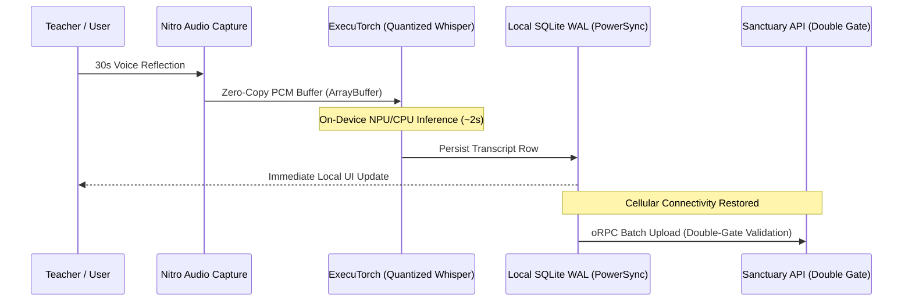

# Holistic Edge, Somatic, and Compute Expansion Architecture Covenant

> **Author**: Naveen  
> **Scribe & Critic**: Antigravity (Senior Principal Solutions Architect & Hostile Critic)  
> **Date**: 2026-10-17  
> **Status**: Active Architectural Specification & Governance Covenant  
> **Target Substrates**: `apps/gurudevi-mobile` (Expo SDK 58 / React Native 0.88 / Hermes), `apps/edlove-web` (Next.js 16 / Research Atlas), `@repo/core`, `@repo/classroom`, `apps/sanctuary-api`

---

## 1. Executive Context & The Edge Autonomy Loop

### The Reality of Rural Pedagogy & Contemplative Sanctuary
The EdLove and Gurudevi platforms operate under stringent physical realities:
1. **Low-Bandwidth & Intermittent Connectivity**: Rural schools across Sri Lanka (Central, Uva, Northern, Eastern provinces) frequently operate with 2G/3G connections or complete offline isolation.
2. **Device Hardware Realities**: Teachers and students rely on modest Android devices (often 2GB–3GB RAM, MediaTek Helio or low-tier Snapdragon chipsets) operating in tropical ambient temperatures (30°C–38°C).
3. **The Convivial Limit (Ivan Illich Doctrine)**: Software must automate administrative drudgery (attendance, grading, record keeping) and provide grounding contemplative sanctuary (somatic release, breathwork, reflection), never enclosing living human attention or imposing complex digital gatekeeping.

To solve this without fragile cloud reliance or monthly API subscription barriers, the platform establishes the **"Edge Autonomy Loop"**:

```
                       ┌──────────────────────────────────────────────┐
                       │           THE EDGE AUTONOMY LOOP             │
                       │   (Zero-Cloud, High-Sensory, Convivial)      │
                       └──────────────────────┬───────────────────────┘
                                              │
              ┌───────────────────────────────┼───────────────────────────────┐
              ▼                               ▼                               ▼
     [SOMATIC SANCTUARY]             [RURAL PEDAGOGY]                [RESEARCH ATLAS]
  • Pulsar Haptics (Worklets)     • Nitro Audio PCM DSP           • TypeGPU Compute Shaders
  • Harmonic Drone / Sound Bowl   • On-Device Whisper (Local AI)  • 50k School Census Heatmaps
  • Parasympathetic Pacing        • Offline SQLite WAL (PowerSync)• 60 FPS WebGPU Clustering
```

---

## 2. Pillar 1: Tier 1 Native Animation & Worklets Upstream Radar (Reanimated 4.7.1 ➔ 4.8.0 Track)

### Current Physical Substrate
- **Current Pinned Baseline**:
  - `react-native-reanimated@4.7.1` (Tier 1 Critical Native Pin)
  - `react-native-worklets@0.13.0` (Tier 1 Critical Native Pin)
  - `react-native-gesture-handler@3.3.0` (Tier 1 Critical Native Pin)
  - `react-native@0.88.0` (Tier 2 Framework Baseline)
  - `expo@~58.0.13` (Tier 2 Framework Baseline)

### Upstream Radar Analysis
- Upstream development branches on Software Mansion's `react-native-reanimated` repository contain active **`4.8.0-nightly`** releases.
- **Key Enhancements in 4.8**:
  - Fine-grained memory management and lifecycle cleanup for worklet-captured JavaScript closures.
  - Hardening of React Native 0.88 New Architecture Fabric layout hooks.
  - Native thread safety optimizations across multi-runtime instances.

### The Cautious Upgrade Protocol Gate
Under our strict **Monorepo Guardrails (`AGENTS.md`)**:
* **Prohibition**: Merging nightly or unreleased minor builds into production is strictly vetoed. Tier 1 pins bind directly into C++ JSI, Hermes bytecode dispatchers, and native thread runtimes; premature updates cause fatal `SIGABRT` crashes.
* **Release Gate**: Upgrade to `4.8.0` will execute only when the version is tagged stable on npm, proceeding through the mandatory 4-step sequence:
  ```
  [1. Upstream Changelog Audit] ➔ [2. Worklets Peer Matrix Check] ➔ [3. rn-terrain audit:seams] ➔ [4. Harmonizer Manifest Sync]
  ```

---

## 3. Pillar 2: Somatic Release via Worklet Haptics (`react-native-pulsar`)

### The Clinical & Human Need
Rural students and teachers experience acute cognitive and environmental stress. Somatic release protocols—including box breathing (4-4-4-4), 4-7-8 parasympathetic activation, and heart-rate variability (HRV) pacing—require **eyes-closed tactile guidance** rather than visual screen fixation.

### Technical Implementation Seam
* **Engine**: Software Mansion's `react-native-pulsar`.
* **Execution Thread**: Operates directly on the UI/Worklet thread via `react-native-worklets@0.13.0`.
* **Sub-Millisecond Zero-Jitter Dispatch**: Haptic envelopes trigger without traversing the Hermes JavaScript bridge, guaranteeing zero GC interruptions and zero frame drops during heavy background SQLite writes.

### Dual-Tier Hardware Fallback Sentinel
Because low-end Android hardware common in rural deployments utilizes coarse Eccentric Rotating Mass (ERM) motors rather than Linear Resonant Actuators (LRAs), naive continuous vibration can cause motor burnout, battery drain, and harsh buzzing.

| Hardware Tier | Actuator Substrate | Operational Mode | Experience |
| :--- | :--- | :--- | :--- |
| **Tier 1 (Advanced)** | Apple Taptic Engine / Android API 31+ `VibrationEffect.Composition` (LRA) | Continuous frequency and amplitude envelopes (`usePatternComposer`) | Seamless parasympathetic swell and fade matching breathwork rhythms. |
| **Tier 2 (Coarse / Budget)** | Legacy Android ERM Motors / Budget Chipsets | Throttled discrete micro-ticks (`click`, `soft-tap`) or optional soft acoustic clicks | Clean rhythmic guidance without mechanical motor rattle or overheating. |

---

## 4. Pillar 3: The Contemplative Resonator (Singing Bowl & Drone)

### The Ruthless Veto on DAW / Music Sequencer Bloat
The proposal to embed a complex music sequencer, digital audio workstation (DAW), or multi-knob synthesizer inside Gurudevi is **flatly rejected**:
1. **Binary Bloat**: Adds 40MB+ in audio engines, soundfonts, and complex audio graph libraries.
2. **Audio Thread Fragility**: Complex real-time synthesis causes buffer underruns and audio crackle on budget MediaTek chipsets (Helio P22/G35).
3. **Violates Convivial Design**: Turns a focused pedagogical and sanctuary tool into an over-engineered novelty toy.

### The Approved Convivial Instrument
A single-touch **Contemplative Resonator (Singing Bowl & Harmonic Drone)**:
1. **Interactive Touch Gesture**: Rotary rim friction tracked via RNGH 3.3 `<GestureDetector>` with `Gesture.Pan()`.
2. **Coupled Audio-Haptic Resonance**: As the user circles the singing bowl rim, `react-native-pulsar`'s `useRealtimeComposer` dynamically scales tactile motor resistance in direct proportion to harmonic audio volume.
3. **Asset & Memory Weight**: Under **500KB total** using micro-procedural oscillators or looping lossless audio slices. Zero cloud dependency.

---

## 5. Pillar 4: Native Jurisdictional Boundary: Nitro vs. Expo Inline Modules 2.0

To prevent architectural overlap and configuration sprawl, native code is divided into two distinct jurisdictions:

```
┌───────────────────────────────────────────────┬───────────────────────────────────────────────┐
│          EXPO INLINE MODULES 2.0              │                 NITRO MODULES                 │
│         (App-Local Micro-Sentinels)           │           (High-Speed C++ Pipelines)          │
├───────────────────────────────────────────────┼───────────────────────────────────────────────┤
│ • Native battery thermal throttler            │ • Zero-copy raw audio PCM buffers             │
│ • Ambient classroom decibel sound gauge       │ • MMKV v4 high-speed state storage (Active)   │
│ • System network interface type interrogator  │ • Cryptographic signing & binary chunker      │
│ • Annotated Swift/Kotlin classes (@ExpoModule)│ • Nitrogen TypeScript AST codegen (.nitro.ts) │
│ • No separate npm package needed              │ • Direct sub-millisecond C++ memory sharing   │
└───────────────────────────────────────────────┴───────────────────────────────────────────────┘
```

* **Expo Inline Modules 2.0 Location**: Placed in `apps/gurudevi-mobile/modules/` and watched via `app.json` `experiments.inlineModules`.
* **Nitro Modules Location**: Defined via `.nitro.ts` specs compiling with `npx nitrogen` into deterministic C++/Swift/Kotlin bindings.

---

## 6. Pillar 5: TypeGPU Research Atlas Acceleration (`apps/edlove-web`)

### Problem
[`apps/edlove-web/app/atlas/page.tsx`](file:///c:/x/docs/edlove/plans/MASTER_SCALING_OPERATIONAL_PLAN.md#L81) (5,604 LOC) visualizes over 50,000 Sri Lankan educational institutions, provincial boundaries, poverty indices, and teacher-student ratios. Computing spatial clusters, Voronoi partitions, and multi-variable heatmaps on the main JavaScript CPU thread causes noticeable UI lag.

### The TypeGPU Solution
* **Technology**: Software Mansion's **TypeGPU**.
* **Method**: Move spatial clustering and multi-variable filtering into client-side WebGPU compute shaders authored in pure TypeScript (`'use gpu'`).
* **Strict Type Safety**: GPU buffer layouts and uniform parameters share contracts with our monorepo schemas (`@repo/schema`).
* **Safety Fallback**: Automatic feature detection via `navigator.gpu`. If opened on an older educational laptop without WebGPU, the view gracefully degrades to standard Leaflet / Canvas2D clustering without throwing uncaught runtime exceptions.

---

## 7. Pillar 6: Local On-Device AI / Whisper Inference

### The Operational Challenge in Rural Classrooms
Teachers spend up to 45 minutes after school typing daily attendance notes, student behavior logs, and lesson progress notes on small mobile screens. In schools lacking internet access, cloud-based speech-to-text APIs are completely unusable.

### The Edge Transcription Pipeline


1. **Zero-Copy Capture**: Native microphone captures raw PCM audio into an in-memory `ArrayBuffer` via a lightweight Nitro module.
2. **On-Device Inference**: Quantized Whisper / Moonshine model executes locally via Meta's `react-native-executorch` using hardware delegates (Apple Neural Engine / Android QNN/XNNPACK).
3. **Local-First Persistence**: Transcribed text writes immediately to the local SQLite database.
4. **Resilient Synchronization**: When cellular 3G/Wi-Fi becomes available, records sync upstream to `sanctuary-api` through declarative oRPC contracts, passing Cedar PDP and ZenStack row-level authorization.

---

## 8. Physical Substrate & Scaling Constraints Ledger

| Constraint | Physical Threshold | Failure Consequence | Mitigation Strategy |
| :--- | :--- | :--- | :--- |
| **Device RAM** | 2GB–3GB (Rural low-end phones) | Out-Of-Memory (OOM) process termination during AI load. | Models are 4-bit quantized, memory-mapped (`mmap`), and loaded strictly on-demand. Unloaded immediately post-transcription. |
| **Thermal Budget** | 35°C ambient tropical heat | Continuous vibration and tensor compute causes thermal throttling. | Expo Inline Module `ThermalSentinel` queries battery temperature; throttles haptic cycles and defers heavy tasks if battery exceeds 40°C. |
| **Hermes GC Latency** | >16ms budget | Audio buffer serialization into JSON causes visible UI stutter. | Zero JSON bridges. Use **Nitro zero-copy `ArrayBuffer`** and `react-native-worklets` for audio and haptic loops. |
| **Binary Download Weight** | Play Store / App Store <50MB | Teachers abandon downloads on metered mobile data connections. | Model weights are downloaded lazily on-demand with progress indicators, cached permanently in local storage. |

---

## 9. The Hostile Critic Audit & Adversarial Review

```
┌────────────────────────────────────────────────────────────────────────────────────────┐
│                          HOSTILE CRITIC ADVERSARIAL QUESTIONS                         │
├────────────────────────────────────────────────────────────────────────────────────────┤
│ 1. "Is this just chasing hype around WebGPU and local AI?"                             │
│    VERDICT: No. Every capability is tied to an empirical rural constraint:            │
│    - Whisper = Saves rural teachers 45 mins of manual typing offline.                  │
│    - Pulsar = Screenless somatic release for traumatized/stressed children.           │
│    - TypeGPU = Prevents 50k school nodes from freezing the educational atlas.          │
│                                                                                        │
│ 2. "Will adding react-native-pulsar break our Tier 1 Reanimated/Worklets pins?"        │
│    VERDICT: No. Pulsar runs natively on react-native-worklets@0.13.0. ABI compatibility│
│    will be verified via `node scripts/audit-seams.mjs` before package installation.   │
│                                                                                        │
│ 3. "What happens when an Android phone lacks rich haptic motors?"                      │
│    VERDICT: Dual-tier fallback guarantees cheap ERM motors receive soft micro-ticks    │
│    or audio clicks, eliminating mechanical rattle and thermal risks.                   │
└────────────────────────────────────────────────────────────────────────────────────────┘
```

---

## 10. Phased Execution Roadmap

```
[Phase 1: Database oRPC Ratchet] ──► [Phase 2: Security Parity Gate]
                │                                    │
                ▼                                    ▼
[Phase 3: Atlas Monolith Split]  ──► [Phase 4: Seed Data Hardening]
                │                                    │
                ▼                                    ▼
[Phase 5: Pulsar Somatic Engine] ──► [Phase 6: TypeGPU Atlas & Whisper Spike]
```

1. **Phase 1 (Active)**: Refactor `packages/core/src/adapters/supabase/communityRepository.ts` to call `orpcClient.community.*`, ratcheting database bypasses downward.
2. **Phase 2**: Implement `packages/policies/src/__tests__/security-parity.test.ts` and run `pnpm run ratchet:update`.
3. **Phase 3**: Decompose `apps/edlove-web/app/atlas/page.tsx` (5,604 LOC) into modular subcomponents under `_components/`.
4. **Phase 4**: Harden `packages/core/src/api/demoProvider.ts` with fully typed schemas.
5. **Phase 5**: Prototype `react-native-pulsar` tactile breathwork and the Contemplative Resonator with the Dual-Tier Hardware Fallback Sentinel in `apps/gurudevi-mobile`.
6. **Phase 6**: Implement TypeGPU compute shaders in the extracted `AtlasMapSurface.tsx` and conduct the on-device Whisper offline transcription spike.
