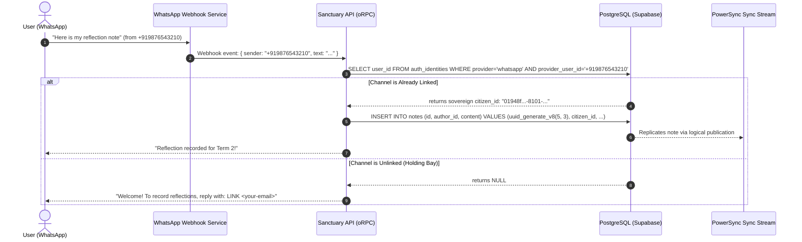

# Sovereign Identity, Omni-Channel Ingress, and RFC 9562 UUIDv8 Architecture

> **Superseded on 2026-10-23.** Preserve this as the historical proposal that
> identified the credential-to-citizen and ingress-quarantine problems. New
> authentication, account-linking, channel, device, and AI work follows
> [`authentication-and-sovereign-identity.md`](authentication-and-sovereign-identity.md).
> New identifier layouts, domain/subtype assignments, and generator work follow
> [`edlove-sovereign-uuidv8-specification.md`](edlove-sovereign-uuidv8-specification.md).
>
> The UUIDv8 layouts and generator samples below are historical and
> non-executable. In particular, their Gurudevi/Polymath-first scope, blanket
> primary-key mandate, and client random fallback are not approved for adoption.
> The retained ingress model does not itself authorize a schema migration.

> **PRIME ARCHITECTURAL AXIOM: CREDENTIAL $\ne$ CITIZEN**  
> An external authentication provider's subject ID (Supabase Auth `sub`, Google OAuth, Apple ID, WhatsApp JID, Telegram Chat ID, or AI Agent API Key) is strictly a **Credential Vector**, NEVER an application domain identifier. Business domains (Classrooms, Attendance, Grades, Bonds, Perspectives, Forms, Messages, Notes) belong exclusively to sovereign citizens (`public.users.id`).

---

## 1. The Omni-Channel Ingress Dilemma & Anti-Duplication Doctrine

In an ecosystem where users enter through multiple surfaces (Web app, Native mobile app, WhatsApp bots, Telegram channels, School SMS, and autonomous AI agents), naive identity management leads to two fatal failure modes:

1. **The Duplicate Explosion Trap (Silent Fragmentation)**:  
   If every new ingress doorway automatically mints a row in `public.users`, Alice ends up with three unconnected accounts:
   - Account 1 (Web): `alice@school.edu` (holds classroom enrollment)
   - Account 2 (WhatsApp): `+919876543210` (holds homework submissions)
   - Account 3 (Telegram): `@alice_learner` (holds quiz scores)  
   The teacher grades Account 2, but report cards generate from Account 1. The data model collapses into chaos.

2. **The Naive Auto-Merge Trap (The Security Breach)**:  
   If the system naively auto-merges records whenever a matching phone number or email is guessed without cryptographic verification:
   - Telecom operators routinely **recycle disconnected phone numbers** after 90 days.
   - If Bob surrenders his number and Alice is assigned it 6 months later, Alice messaging the bot would automatically inherit Bob's historical grades, attendance records, disciplinary observations, and family bonds.

```
                                  [THE UNVERIFIED VECTOR]
                              WhatsApp / Telegram / SMS Ingress
                                             │
                                             ▼
                      Does (provider, provider_user_id) exist
                            in `public.auth_identities`?
                                      ├───► YES: Immediately resolve to `user_id`. Done.
                                      │
                                      └───► NO: [INGRESS QUARANTINE / HOLDING BAY]
                                            • DO NOT insert into `public.users`!
                                            • Do not allocate school records!
                                            • Issue Ingress Challenge:
                                              ├── [Existing User Handshake] ➔ Cryptographic Verification ➔ Link
                                              └── [New User Onboarding] ➔ Sovereign Mint ➔ Bind
```

### The Ingress Quarantine Protocol (The Holding Bay)

An unverified incoming channel message **NEVER** creates a sovereign citizen. It creates a temporary **Ingress Session**:

```
[Incoming Contact: wa:+919876543210]
          │
          ▼
Is phone bound in `auth_identities`?
          ├── Yes ➔ Resolve `public.users.id` ➔ Execute command (attendance, grades, query)
          │
          └── No ➔ Bot Response:
                   "Welcome to Gurudevi Sanctuary.
                    1. If you already have a school account, tap [Connect Account] or reply: LINK <email>
                    2. If you are a new learner/parent, reply: START"
```

### The Two Verifiable Linking Seams

To link a WhatsApp or Telegram number to an existing student/teacher without guessing:

#### Flow 1: In-App Deep Link (Zero-Password Cryptographic Handshake)
1. User logs into the mobile or web app as `alice@school.edu` (authenticated via Supabase Auth or Passkey).
2. Alice navigates to **Settings $\rightarrow$ Connect WhatsApp**.
3. The app generates a short-lived HMAC-SHA256 signed token: `CLAIM_v8_9f2a7c...`.
4. The app opens WhatsApp via deep link: `https://wa.me/our_school_bot?text=CLAIM_v8_9f2a7c...`.
5. Alice sends the message. The bot verifies the cryptographic signature:
   - Validates that `CLAIM_v8_9f2a7c...` was issued to `citizen_alice_123`.
   - Records the binding in `public.auth_identities`:
     ```sql
     INSERT INTO public.auth_identities (user_id, provider, provider_user_id)
     VALUES ('citizen_alice_123', 'whatsapp', '+919876543210')
     ON CONFLICT (provider, provider_user_id) DO NOTHING;
     ```
6. **Result**: Zero passwords, zero manual typing, mathematically impossible to hijack.

#### Flow 2: Bot-Initiated Challenge (6-Digit Email Verification)
1. Alice messages the bot on WhatsApp: `LINK alice@school.edu`.
2. The bot verifies that `alice@school.edu` exists in `public.users`.
3. The bot dispatches a 6-digit OTP to `alice@school.edu` with a 5-minute expiry.
4. Alice enters the code on WhatsApp.
5. Upon code verification, the system executes the atomic channel link.

---

## 2. Polymath Sovereign UUIDv8 Specification (RFC 9562 §5.8)

In May 2024, the IETF published **RFC 9562**, deprecating RFC 4122 and standardizing:
- **UUIDv4**: Purely random. Causes catastrophic B-Tree index page splitting and high disk I/O in high-scale relational databases.
- **UUIDv6**: Reordered UUIDv1. Inherited the complex Gregorian 1582 calendar epoch solely for backward compatibility with 1990s systems.
- **UUIDv7**: Modern universal standard. 48-bit Unix epoch millisecond timestamp + 74 bits randomness.
- **UUIDv8**: **Custom, domain-specific UUID standard**. Permits organizations to encode custom domain metadata into the 128-bit structure while maintaining standard UUID library and database compatibility.

The Polymath Platform adopts **UUIDv8** as its primary identifier for all core entities.

### Bit Layout Diagram (16 Bytes / 128 Bits)

```
 0                   1                   2                   3
 0 1 2 3 4 5 6 7 8 9 0 1 2 3 4 5 6 7 8 9 0 1 2 3 4 5 6 7 8 9 0 1
+-+-+-+-+-+-+-+-+-+-+-+-+-+-+-+-+-+-+-+-+-+-+-+-+-+-+-+-+-+-+-+-+
|                    Unix Millisecond Timestamp (48 bits)       |
+-+-+-+-+-+-+-+-+-+-+-+-+-+-+-+-+-+-+-+-+-+-+-+-+-+-+-+-+-+-+-+-+
|   Timestamp (cont.)           |  ver (8)  | Domain (4b)| Sub(4b)
+-+-+-+-+-+-+-+-+-+-+-+-+-+-+-+-+-+-+-+-+-+-+-+-+-+-+-+-+-+-+-+-+
|var (10)|   Mint Origin (6b)   |    Sequence Counter (8b)      |
+-+-+-+-+-+-+-+-+-+-+-+-+-+-+-+-+-+-+-+-+-+-+-+-+-+-+-+-+-+-+-+-+
|                 Cryptographic Entropy (48 bits)               |
+-+-+-+-+-+-+-+-+-+-+-+-+-+-+-+-+-+-+-+-+-+-+-+-+-+-+-+-+-+-+-+-+
|                 Cryptographic Entropy (cont.)                 |
+-+-+-+-+-+-+-+-+-+-+-+-+-+-+-+-+-+-+-+-+-+-+-+-+-+-+-+-+-+-+-+-+
```

### Exact Segment Allocation

| Byte Offset | Bit Range | Field Name | Encoding & Description |
| :--- | :--- | :--- | :--- |
| **0 – 5** | 0 – 47 | `timestamp_ms` | 48-bit Unix millisecond epoch (big-endian). Preserves append-only B-Tree clustering up to 10,889 AD. |
| **6 (High)** | 48 – 51 | `version` | Constant `0x8` (`1000b`), strictly adhering to RFC 9562 UUIDv8. |
| **6 (Low)** | 52 – 55 | `domain_category` | High-level architectural domain (see Taxonomy table below). |
| **7** | 56 – 63 | `entity_subtype` | Specific entity classification within the domain category. |
| **8 (High)** | 64 – 65 | `variant` | Constant `10b` (RFC 4122 / 9562 standard variant). |
| **8 (Low)** | 66 – 71 | `mint_origin` | 6-bit environment and device origin (Cloud, Local Edge, Offline Mobile). |
| **9** | 72 – 79 | `sequence_counter` | 8-bit monotonic rollover counter (`0–255`) for intra-millisecond ordering. |
| **10 – 15** | 80 – 127 | `entropy` | 48 bits of cryptographically secure random bytes ($2^{48} \approx 2.81 \times 10^{14}$ unique values). |

### Domain & Subtype Taxonomy

```typescript
export const SovereignDomain = {
  IDENTITY: 0x1,
  ACADEMIC: 0x2,
  ASSESSMENT: 0x3,
  CHRONO: 0x4,
  CONTENT: 0x5,
  AUTONOMOUS: 0x6,
} as const;

export const SovereignSubtype = {
  // Domain 0x1: IDENTITY
  CITIZEN_USER: 0x01,
  AUTH_IDENTITY: 0x02,
  REBAC_BOND: 0x03,
  PERSPECTIVE: 0x04,
  DEVICE_ACCOUNT: 0x05,

  // Domain 0x2: ACADEMIC
  SCHOOL: 0x01,
  GRADE_CLASS: 0x02,
  ACADEMIC_CYCLE: 0x03,
  SUBJECT: 0x04,

  // Domain 0x3: ASSESSMENT
  GRADE_MARK: 0x01,
  RUBRIC: 0x02,
  EXAM_SESSION: 0x03,

  // Domain 0x4: CHRONO & OPERATIONS
  ATTENDANCE_RECORD: 0x01,
  MOOD_LOG: 0x02,
  SECURITY_AUDIT_LOG: 0x03,

  // Domain 0x6: AUTONOMOUS & SYSTEM
  AI_AGENT: 0x01,
  OUTBOX_MUTATION: 0x02,
} as const;

export const MintOrigin = {
  CENTRAL_CLOUD_PROD: 0x00,
  CENTRAL_CLOUD_DEV: 0x01,
  LOCAL_SCHOOL_APPLIANCE: 0x02,
  NATIVE_MOBILE_OFFLINE: 0x03,
  WEB_BROWSER_WASM: 0x04,
  AI_AGENT_WORKLET: 0x05,
  EPHEMERAL_TEST: 0x3f,
} as const;
```

### Zero-Query Type Introspection

Because the entity type is packed directly into Bytes 6 and 7, any layer of the stack can introspect an ID without executing a single database query:

```typescript
export function introspectSovereignId(id: string) {
  const clean = id.replace(/-/g, '');
  const timestampMs = parseInt(clean.slice(0, 12), 16);
  const version = parseInt(clean[12], 16);
  const domainCategory = parseInt(clean[13], 16);
  const entitySubtype = parseInt(clean.slice(14, 16), 16);
  const mintOrigin = (parseInt(clean.slice(16, 18), 16) & 0x3f);

  return {
    isSovereignV8: version === 8,
    createdAt: new Date(timestampMs),
    domainCategory,
    entitySubtype,
    mintOrigin,
  };
}
```

---

## 3. Reference Implementation: PostgreSQL & TypeScript

### PostgreSQL Generation Function (`public.uuid_generate_v8`)

```sql
CREATE OR REPLACE FUNCTION public.uuid_generate_v8(
  p_domain smallint,
  p_subtype smallint,
  p_origin smallint DEFAULT 0
) RETURNS uuid
LANGUAGE plpgsql VOLATILE AS $$
DECLARE
  v_time_ms bigint;
  v_bytes bytea;
  v_seq int;
BEGIN
  -- 1. 48-bit Unix epoch millisecond timestamp
  v_time_ms := floor(extract(epoch from clock_timestamp()) * 1000)::bigint;
  v_bytes := substring(int8send(v_time_ms) from 3 for 6);

  -- 2. Byte 6: Version 8 (high 4b) | Domain category (low 4b)
  v_bytes := v_bytes || set_byte(E'\\x00'::bytea, 0, (128 | (p_domain & 15)));

  -- 3. Byte 7: Specific entity subtype (8b)
  v_bytes := v_bytes || set_byte(E'\\x00'::bytea, 0, (p_subtype & 255));

  -- 4. Byte 8: Variant 10b (high 2b) | Mint origin (low 6b)
  v_bytes := v_bytes || set_byte(E'\\x00'::bytea, 0, (128 | (p_origin & 63)));

  -- 5. Byte 9: 8-bit pseudo-sequence counter (randomized lower byte of transaction clock)
  v_seq := (extract(microsecond from clock_timestamp())::int) & 255;
  v_bytes := v_bytes || set_byte(E'\\x00'::bytea, 0, v_seq);

  -- 6. Bytes 10-15: 48 bits of cryptographically secure random bytes
  v_bytes := v_bytes || gen_random_bytes(6);

  RETURN encode(v_bytes, 'hex')::uuid;
END;
$$;

REVOKE ALL ON FUNCTION public.uuid_generate_v8(smallint, smallint, smallint) FROM PUBLIC;
GRANT EXECUTE ON FUNCTION public.uuid_generate_v8(smallint, smallint, smallint) TO authenticated, anon, service_role;
```

### TypeScript Sovereign Generator (`@repo/core/logic/utils/uuid`)

```typescript
let sequenceCounter = 0;
let lastTimestamp = 0;

export function generateSovereignUuidV8(
  domain: number,
  subtype: number,
  origin: number = 0,
): string {
  const now = Date.now();
  if (now === lastTimestamp) {
    sequenceCounter = (sequenceCounter + 1) & 0xff;
  } else {
    sequenceCounter = 0;
    lastTimestamp = now;
  }

  const bytes = new Uint8Array(16);

  // Bytes 0-5: Timestamp
  bytes[0] = (now / 0x10000000000) & 0xff;
  bytes[1] = (now / 0x100000000) & 0xff;
  bytes[2] = (now / 0x1000000) & 0xff;
  bytes[3] = (now / 0x10000) & 0xff;
  bytes[4] = (now / 0x100) & 0xff;
  bytes[5] = now & 0xff;

  // Byte 6: ver (8) | domain (4 bits)
  bytes[6] = 0x80 | (domain & 0x0f);

  // Byte 7: entity subtype (8 bits)
  bytes[7] = subtype & 0xff;

  // Byte 8: variant (10xxxxxx) | origin (6 bits)
  bytes[8] = 0x80 | (origin & 0x3f);

  // Byte 9: monotonic counter
  bytes[9] = sequenceCounter;

  // Bytes 10-15: 48 bits cryptographically secure randomness
  if (typeof crypto !== 'undefined' && crypto.getRandomValues) {
    const randomTail = new Uint8Array(6);
    crypto.getRandomValues(randomTail);
    bytes.set(randomTail, 10);
  } else {
    for (let i = 10; i < 16; i++) {
      bytes[i] = Math.floor(Math.random() * 256);
    }
  }

  // Convert to canonical UUID string format
  const hex = Array.from(bytes, (b) => b.toString(16).padStart(2, '0')).join('');
  return `${hex.slice(0, 8)}-${hex.slice(8, 12)}-${hex.slice(12, 16)}-${hex.slice(16, 20)}-${hex.slice(20, 32)}`;
}
```

---

## 4. End-to-End Ingress & Sync Flow



---

## 5. Summary of Architecture Invariants

1. **Strict Credential Decoupling**: Supabase Auth handles password, token refresh, and OTP. It never dictates the primary key of our business models.
2. **Channel Immutability**: All external doorways map to `public.auth_identities`. The citizen row in `public.users` is sovereign and unique.
3. **No Automatic Duplicate Creation**: Incoming communications from unverified numbers or channels stay in an ingress session until explicitly linked or onboarded.
4. **Self-Describing Storage**: All IDs minted by the system conform to the **Polymath Sovereign UUIDv8** specification, ensuring time-ordered B-Tree clustering, origin tracing, and zero-query type introspection.
