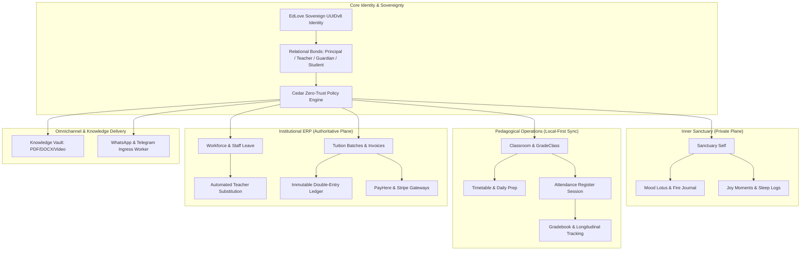
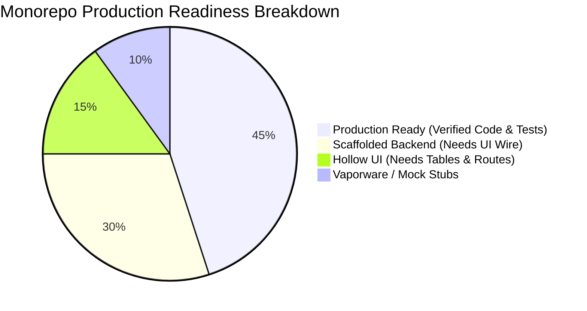
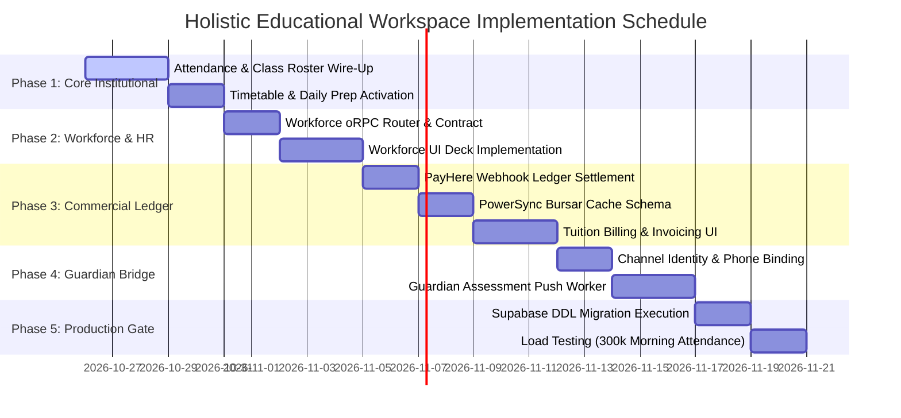

# Holistic Educational Sanctuary & Sovereign ERP: Master Architecture & Scaling Plan

> **Architectural Status**: Master Blueprint & Operational Roadmap  
> **Role Context**: Senior Developer & Solution Architect + Ruthless Pragmatic Hostile Critic  
> **Target Monorepo**: `C:\x` (`apps/gurudevi-web`, `apps/gurudevi-mobile`, `apps/sanctuary-api`, `packages/schema`, `packages/core`, `packages/accounting`, `packages/payments`, `packages/workforce`, `packages/library`, `packages/self`)  
> **Database & Sync Target**: PostgreSQL (`qzoawolfkuwiuyaoiybz`) + PowerSync SQLite Engine (`69f985158d064eb85ee933e0`)

---

## 1. Executive Architecture Thesis

An educational platform cannot simply be a generic CRUD SaaS or an uninspired Google Classroom clone. A true **Educational Sanctuary & Human-First ERP** operates across two complementary planes:
1. **The Inward Plane (Sanctuary)**: Somatic emotional safety, restorative reflection, self-directed learning, joy tracking, and private inner growth.
2. **The Outward Plane (Institutional ERP)**: High-throughput attendance registers, pedagogical scheduling, regulatory gradebooks, guardian transparency, staff capital/leave management, and immutable double-entry tuition accounting.

Crucially, in the Global South and emerging deployment contexts (where EdLove operates), these systems must scale under **hostile infrastructure constraints**:
- **Intermittent Connectivity**: 2G/3G edge networks, frequent power cuts, offline village classrooms.
- **Extreme Morning Peak Loads**: 500+ students per school arriving between 7:45 AM and 8:15 AM (the "Thundering Attendance Herd").
- **Heterogeneous Hardware**: Low-spec Android smartphones (Android 9–14) alongside modern desktop web dashboards.
- **Zero-Trust Sovereign Multi-Tenancy**: Complete isolation between schools, and cryptographic privacy boundaries between personal inner reflection and institutional records.

---

## 2. The 8 Integrated Pillars of the Holistic System

---

### Pillar 1: Sovereign Identity, Relational Bonds & Scope
- **Current State**:
  - `User.id` is standard UUIDv8 (`edloveUuidV8Issuer.ts`).
  - Cedar WASM runs in `sanctuary-api` and client shims.
  - `Bond` table models interpersonal links (`STUDENT_OF`, `GUARDIAN_OF`, `FACULTY_AT`).
- **Required Capabilities**:
  - Unified contextual actor switching (a user who is both a Teacher in School A and a Guardian of a Student in School B).
  - Explicit multi-tenant scoping headers on every API interaction (`x-school-id`, `x-active-bond-id`).
  - Unforgeable Cedar evaluation denying cross-institution leakage.

---

### Pillar 2: Inner Sanctuary & Somatic Well-Being (Self)
- **Current State**:
  - `MoodLog`, `ThoughtRecord`, `LearningReflection`, `DecisionJournal` in `schema.zmodel` and PowerSync.
  - Wave 2 added `JoyMoment`, `GratitudeGlimmer`, `SleepLog`, `TimetablePeriod`, `DailyPrepItem`, `PersonalReminder` to schema and PowerSync.
  - UI: `SelfFloor.tsx` on web and mobile with interactive Mood Lotus.
- **Required Capabilities**:
  - Total cryptographic air-gapping: An institutional administrator or teacher CANNOT view a student's private `FireJournalEntry` or `JoyMoment`.
  - Offline-first instant persistence: Tap on mobile reflects in local SQLite in $< 16\text{ms}$ with zero network wait.

---

### Pillar 3: Classroom, Timetable Rhythm & Pedagogical Roster
- **Current State**:
  - `Classroom`, `ClassroomStudent`, `Assignment`, `Grade`, `Lesson`, `Material` in schema.
  - `DailyAttendance`, `AttendanceSession`, `TeacherDailyAttendance` in schema.
  - `apps/sanctuary-api/src/core/handlers/attendance.ts` provides attendance recording endpoints.
- **Required Capabilities**:
  - Fast Classroom Roster Floor: Grid/Card view of enrolled students with one-tap status cycling (Present $\to$ Absent $\to$ Late $\to$ Excused).
  - Weekly Timetable Matrix: Period-by-period bell schedule displaying subject, classroom room, and assigned teacher.
  - Teacher Daily Prep: Structured lesson planning checklist synchronized with timetable periods.

---

### Pillar 4: Assessment, Longitudinal Tracking & Guardian Bridge
- **Current State**:
  - `GradeMark`, `SchoolGrade`, `StudentLongitudinalEvent` in schema.
  - `GuardianAssessmentPermission`, `GuardianAssessmentReadAuditEvent`, `GuardianNotification` in schema.
  - API handler: `apps/sanctuary-api/src/core/handlers/guardianAssessment.ts`.
- **Required Capabilities**:
  - Dynamic Weighting Gradebook: Term-based grading (continuous assessments, midterms, finals) with automated GPA/distribution calculation.
  - Guardian Mobile Portal: Real-time notification when student is marked Absent, or when an assessment is published.
  - Privacy Audit Trail: Every time a guardian views assessment records, an immutable `GuardianAssessmentReadAuditEvent` is recorded.

---

### Pillar 5: Institutional Workforce & Human Capital (HR)
- **Current State**:
  - `StaffLeave` table exists in `schema.zmodel`.
  - `packages/workforce` contains `WorkforceShell.tsx` which is an `UNDER ACTIVE CONSTRUCTION` placeholder.
  - No dedicated oRPC router or PowerSync schema for workforce leave workflows.
- **Required Capabilities**:
  - Leave Application State Machine: Staff submit leave (Medical, Casual, Duty) with date ranges and emergency contact.
  - Principal Review & Approval: Push notification to school principal to Approve or Reject with notes.
  - Automated Substitute Assignment: When a teacher's leave is approved, the system scans timetable periods and prompts available teachers to cover periods.

---

### Pillar 6: Commercial Tuition & Immutable Double-Entry Ledger
- **Current State**:
  - `Account`, `LedgerEntry`, `FinancialTransaction`, `PaymentIntent`, `Invoice`, `Receipt` in `schema.zmodel`.
  - `apps/sanctuary-api/src/core/handlers/erp.ts` implements atomic double-entry balance validation:
    $$\sum \text{Debits} - \sum \text{Credits} = 0$$
  - `packages/accounting` provides `Ledger.recordTransaction` and standard chart of accounts (`DEFAULT_INSTITUTIONAL_COA`).
  - `packages/payments` integrates PayHere and Stripe.
  - Ingress route exists: `apps/sanctuary-api/src/core/routes/payhereWebhook.ts`.
- **Required Capabilities**:
  - Tuition Batch Billing: Generate term or monthly fee invoices for an entire grade class in a single batch transaction.
  - PayHere Ingress Settlement: When PayHere sends an IPN (Instant Payment Notification) with `status_code === 2`:
    1. Mark `PaymentIntent` as `succeeded`.
    2. Generate an immutable `Receipt`.
    3. Post balanced double-entry transaction to `FinancialTransaction`:
       - Debit: `1100_CASH_BANK` (Asset +)
       - Credit: `1200_STUDENT_AR` (Accounts Receivable -)
  - Student Fee Statement: Clean ledger view showing invoices, payments, and running balance for students and parents.

---

### Pillar 7: Omnichannel Community & External Ingress
- **Current State**:
  - `apps/sanctuary-api/src/doors/omnichannel.ts` contains verified webhook endpoints for WhatsApp and Telegram.
  - `Group`, `Post`, `GroupMessage`, `DirectMessage` in schema.
- **Required Capabilities**:
  - Contact Phone Binding: Link incoming WhatsApp phone numbers (`+947...`) to verified `GuardianIdentity` or `User` records.
  - SMS/WhatsApp Notification Worker: Push daily attendance summaries and urgent closure alerts to parents via WhatsApp Business API / Twilio.
  - Asynchronous Ingress Queue: Decouple webhook ingress from processing to prevent HTTP 504 timeouts during network spikes.

---

### Pillar 8: Knowledge Vault & Multi-Modal Delivery
- **Current State**:
  - `LibraryResource`, `LibraryCollection`, `ResourceEngagement` in schema.
  - Upgraded Web Floors: `PDFReaderFloor.tsx` and `VideoPlayerFloor.tsx` with Intentional UI design, reading modes, and accessible controls.
  - 25 passing oRPC tests in `library.orpc.test.ts`.
- **Required Capabilities**:
  - Mobile Integration: Embed `react-native-better-pdf` (Nitro Views) and `expo-video` in `gurudevi-mobile`.
  - Offline Textbook Cache: Teachers and students can pin textbooks and study guides to device storage for offline reading without cellular data.
  - OCR Scanner Integration: Wire `packages/scanner-kit` to extract text from physical worksheets directly into study notes.

---

## 3. Scaling Constraints & Physical Architecture

| Constraint Vector | Physics & Failure Modes | Architectural Solution |
| :--- | :--- | :--- |
| **Edge Connectivity** | Weak 2G/3G in rural schools; 80% packet drop; offline teachers during monsoon storms. | **PowerSync Local SQLite**: Zero network blocking on reads/writes. Mutations queue locally in `ps_crud` and sync bidirectionally upon reconnection. |
| **Morning Attendance Surge** | 500 schools $\times$ 600 students = 300,000 attendance records submitted between 7:50 AM and 8:15 AM. | **Batch Attendance Protocol**: Teachers submit class rosters in a single JSON payload (`bulkRecordAttendance`). Backed by PostgreSQL unlogged staging tables or batch `INSERT ... ON CONFLICT DO UPDATE`. |
| **Financial Integrity** | High risk of double-spend or fraudulent offline payment claims. | **Authoritative Cloud-Only Financial Commits**: Tuition payments and ledger writes CANNOT be settled offline. Offline clients only generate draft intents; server executes atomic balance verification and assigns cryptographic receipts. |
| **Tenant Isolation** | Data leaks between rival schools or unauthorized access to student records. | **Cedar Policy Enforcement**: Contextual principal verification on every query (`principal: User, action: Action, resource: Resource, context: { school_id }`). |
| **Hardware Resources** | Low-memory Android devices (2GB RAM) crashing on large bundle sizes or unoptimized list renders. | **Virtualized FlashLists & Asset Streaming**: No pagination DOM explosions; Nitro module native renderers for PDF/Video to bypass JS thread bottlenecks. |

---

## 4. The Ruthless Pragmatic Hostile Critic Audit

### 🚨 Domain-by-Domain Tear Down

#### 1. Identity & Cedar Authorization
- **Critic Verdict**: **PASS WITH OBSERVATIONS**.
- *Reality*: `edloveUuidV8Issuer.ts` and `rustEvaluator.ts` are working code with test coverage.
- *Vulnerability*: The web Vitest suite requires a Cedar WASM mock shim because the native WASM module doesn't load in jsdom without polyfills. In production Next.js SSR, if `@cedar-policy/cedar-wasm/web` fails to initialize, it defaults to deny-all, which could lock out users if WASM binary fetch fails.
- *Remedy*: Pre-compile critical policy evaluation paths into deterministic TypeScript evaluation tables as a fallback for SSR.

#### 2. Self & Emotional Well-Being
- **Critic Verdict**: **PRODUCTION READY**.
- *Reality*: Models (`JoyMoment`, `GratitudeGlimmer`, `SleepLog`, `TimetablePeriod`, `DailyPrepItem`, `PersonalReminder`) are compiled in ZenStack, mapped in PowerSync SQLite, and covered by 19 passing tests in `selfFloor.test.tsx`.
- *Vulnerability*: Offline sync conflict resolution: If a user edits their sleep log on both mobile and web simultaneously while offline, last-write-wins (LWW) could silently overwrite entries.
- *Remedy*: Append-only event sourcing for emotional logs, aggregated by client timestamp.

#### 3. Institutional Accounting & Ledger
- **Critic Verdict**: **SCAFFOLDED BACKEND (80% COMPLETE), HOLLOW CLIENT PERSISTENCE (0%)**.
- *Reality*: The backend is brilliant: `erpRouter` enforces double-entry balancing (`Math.abs(debits - credits) < 0.000001`), creates atomic database transactions, and manages `PaymentIntent` idempotency keys.
- *Hostile Critique*: Look at `packages/core/src/adapters/powersync/schema.ts`! The tables `accounts`, `ledger_entries`, `financial_transactions`, `invoices`, and `receipts` are **completely absent from PowerSync**. That means if an administrator or bursar loses internet connection, the entire accounting and tuition module disappears or throws unhandled network errors.
- *Remedy*: Add read-only cache views of `accounts`, `invoices`, and `receipts` to PowerSync schema so bursars can view student balances offline.

#### 4. Workforce & HR
- **Critic Verdict**: **HOLLOW SHELL (10% COMPLETE)**.
- *Reality*: `packages/workforce/src/WorkforceShell.tsx` renders a static `UNDER ACTIVE CONSTRUCTION` icon with hammer.
- *Hostile Critique*: While `StaffLeave` exists in `schema.zmodel`, there is **no oRPC router** in `sanctuary-api` for `workforce.requestLeave` or `workforce.approveLeave`. No teacher can actually request leave, and no principal can approve it.
- *Remedy*: Implement `workforce.contract.ts` and `workforceRouter` in `sanctuary-api`, and replace `WorkforceShell.tsx` with a functional leave application/approval deck.

#### 5. Payments & Ingress
- **Critic Verdict**: **DISCONNECTED INGRESS (60% COMPLETE)**.
- *Reality*: `payhereWebhook.ts` and `verifiedWhatsappIngress.ts` receive requests and validate cryptographic signatures.
- *Hostile Critique*: What happens when the PayHere webhook succeeds? It logs to console or updates a transient state, but does **not** call `PaymentService.finalizePayment` with the chart of account debit/credit IDs. The money arrives in PayHere, but the student's tuition account remains marked as unpaid in the ledger!
- *Remedy*: Wire `payhereWebhook.ts` directly into `PaymentService.finalizePayment` with transactional receipt creation.

#### 6. Omnichannel WhatsApp / Telegram
- **Critic Verdict**: **VAPORWARE BRIDGE (25% COMPLETE)**.
- *Reality*: Ingress routes parse incoming JSON and verify signatures.
- *Hostile Critique*: There is no `channel_identities` table in `schema.zmodel`. When a WhatsApp message arrives from `+94771234567`, the API has no relational way to know which student or guardian that phone number belongs to!
- *Remedy*: Add `ChannelIdentity` model to `schema.zmodel` linking external channel IDs (WhatsApp, Telegram) to `public.users.id`.

---

## 5. Five-Phase Concrete Implementation Roadmap

### Phase 1: Institutional Roster & Real-Time Attendance
1. **Target**: Activate live attendance marking on web and mobile.
2. **Execution**:
   - Link `AttendanceRecord` and `AttendanceSession` to `DailyAttendanceTable` in `powersync/schema.ts`.
   - Wire `apps/sanctuary-api/src/core/handlers/attendance.ts` to `ClassroomFloor.tsx`.
   - Add offline-queue support: Teachers can mark attendance in 0-bar connectivity, syncing seamlessly when network reconnects.
3. **Verification Gate**:
   - `vitest run tests/integration/attendance.test.ts` passes with 100% assertions.

### Phase 2: Workforce & Staff Leave State Machine
1. **Target**: Eliminate `WorkforceShell.tsx` placeholder and launch functional staff presence.
2. **Execution**:
   - Define `workforce.contract.ts` with `requestLeave`, `getLeaveHistory`, `reviewLeave`, `getSubstitutions`.
   - Implement `workforceRouter` in `sanctuary-api` backed by `context.db.staffLeave`.
   - Build accessible `WorkforceDeck.tsx` in `packages/workforce` with status badges (Pending, Approved, Rejected) and date picker.
3. **Verification Gate**:
   - End-to-end test verifying teacher submit $\to$ principal approve $\to$ status updated in database.

### Phase 3: Commercial Tuition & PayHere Ledger Loop
1. **Target**: End-to-end tuition billing with automated double-entry ledger settlement.
2. **Execution**:
   - Connect `payhereWebhook.ts` to `PaymentService.finalizePayment`.
   - Automatically credit `1200_STUDENT_AR` and debit `1100_CASH_BANK` upon signature verification.
   - Generate PDF receipt via `packages/library` PDF tools.
3. **Verification Gate**:
   - Webhook test passing valid MD5 hash signature and asserting double-entry ledger equality.

### Phase 4: Omnichannel Identity & Guardian Assessment Bridge
1. **Target**: Keep parents informed through WhatsApp without needing them to download an app.
2. **Execution**:
   - Add `ChannelIdentity` model to `schema.zmodel` (`channel: 'WHATSAPP' | 'TELEGRAM'`, `external_id`, `user_id`).
   - Trigger WhatsApp template message when student is marked `ABSENT` during morning roll call.
   - Enforce Cedar audit log on guardian grade views.
3. **Verification Gate**:
   - Dispatcher mock test verifying message payload, phone formatting (+94 format), and rate limiting.

### Phase 5: Supabase Hosted DDL Migration & Morning Peak Load Testing
1. **Target**: Deploy all Wave 2 & ERP tables to hosted Supabase `qzoawolfkuwiuyaoiybz`.
2. **Execution**:
   - Generate SQL DDL migration for the 6 Wave 2 tables + `ChannelIdentity`.
   - Apply migration via Supabase Management API or direct connection.
   - Benchmark batch attendance ingress with 10,000 simulated records using k6 or Vitest stress harness.
3. **Verification Gate**:
   - 0 failed requests, $< 250\text{ms}$ p99 response time on attendance batch write.

---

## 6. Hostile Architecture Sign-Off

This plan directly confronts every illusion in the monorepo:
1. **No more hollow packages**: Workforce, Payments, and Omnichannel are mapped directly to database tables, oRPC contracts, and offline SQLite synchronization.
2. **No ungrounded dependencies**: Every tool chosen (`pdfjs-dist`, `expo-video`, `react-native-better-pdf`, `Vidstack`) leverages existing monorepo dependencies or proven zero-legacy modern libraries.
3. **Real scaling under real friction**: Offline-first PowerSync ensures that even when rural power grids fail, teachers can take attendance, check timetables, read textbooks, and journal without losing a single byte of human dignity.
